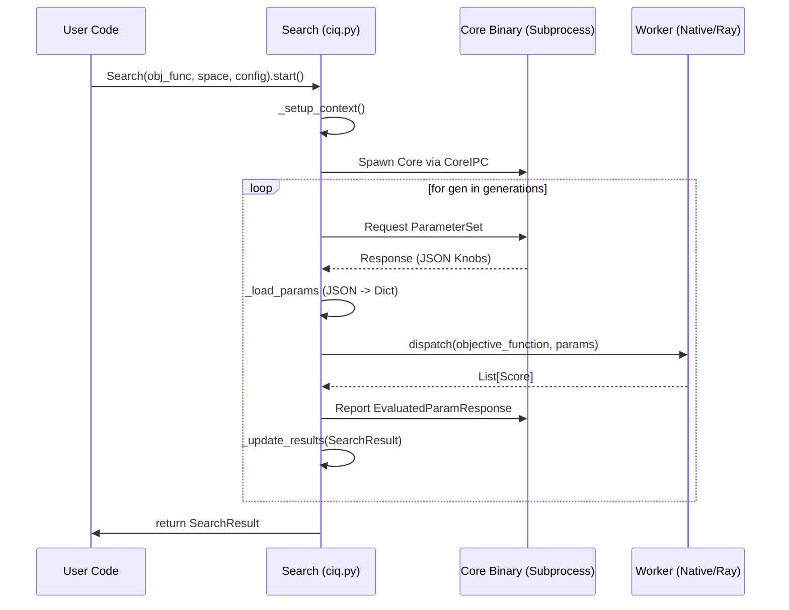
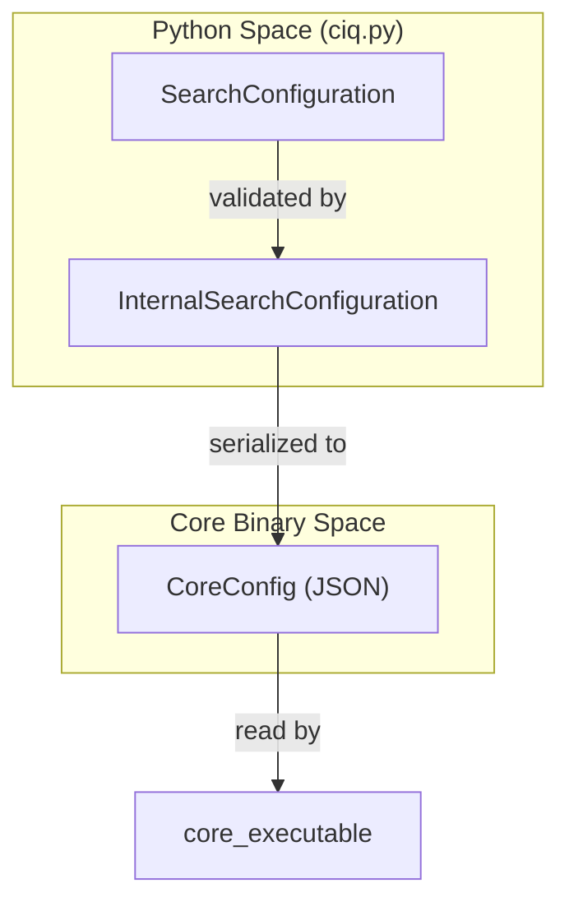
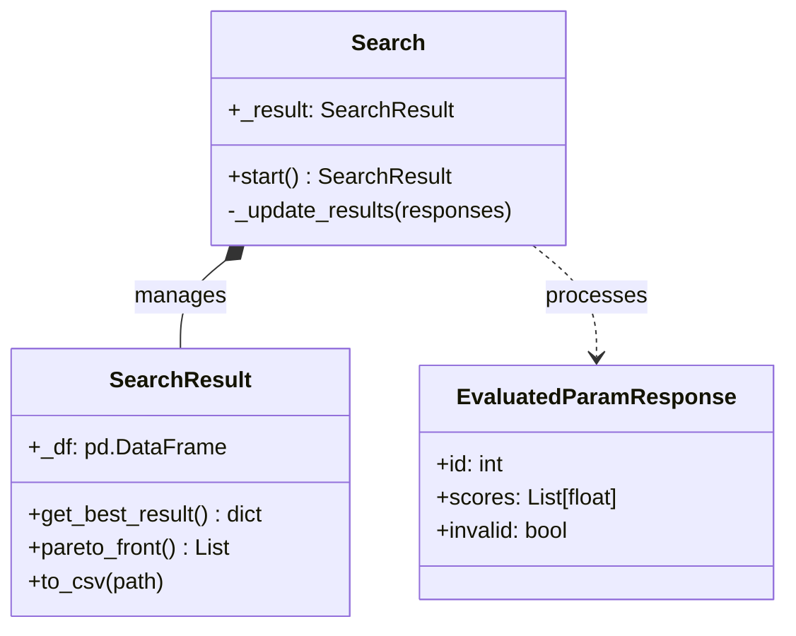

<!-- source: DeepWiki mcp.deepwiki.com · repo NVIDIA/CompileIQ · page 2.1 The Search Class & Orchestration · fetched 2026-10-26 -->

# The Search Class & Orchestration

Relevant source files

The following files were used as context for generating this wiki page:

- [compileiq/ciq.py](compileiq/ciq.py)
- [tests/integration/test_core_integration.py](tests/integration/test_core_integration.py)
- [tests/integration/test_search.py](tests/integration/test_search.py)
- [tests/unit/test_parameter_parsing.py](tests/unit/test_parameter_parsing.py)

The `Search` class in `compileiq/ciq.py` is the central orchestration engine of CompileIQ. It manages the lifecycle of an optimization experiment, coordinating between the user's objective function, the search space definitions, the background Core binary (which implements the genetic algorithms), and the execution workers.

## The Search Lifecycle

The `Search` class follows a strict lifecycle from initialization to result persistence. The orchestration logic is primarily contained within the `start()` method, which executes a generational loop.

### 1. Initialization and Configuration
When a `Search` object is instantiated, it validates and resolves three primary inputs:
- **Objective Function**: A Python callable that evaluates a parameter set [compileiq/ciq.py:94-99]().
- **Search Space**: A dictionary or provider that defines the tunable knobs [compileiq/ciq.py:100-107]().
- **Search Configuration**: A `SearchConfiguration` object defining the GA parameters like `pool_size`, `generations`, and `mutate_rate` [compileiq/ciq.py:108-114]().

During initialization, the class sets up the IPC environment by initializing a socket for communication with the Core binary [compileiq/ciq.py:189-192]().

### 2. The Generational Loop
The `start()` method triggers the core optimization loop. In each generation, the following steps occur:

1.  **Request Parameters**: The `Search` class requests a new batch of candidates (a "pool") from the Core binary via `CoreIPC` [compileiq/ciq.py:533-540]().
2.  **Evaluation**: The candidates are dispatched to the configured `Worker` (e.g., `MultiProcessWorker`). The objective function is executed for each candidate [compileiq/ciq.py:545-560]().
3.  **Reporting**: The resulting scores are sent back to the Core binary to inform the next generation's mutation and selection [compileiq/ciq.py:562-571]().
4.  **Persistence**: If `dump_results` is configured, the current state is saved to a CSV file [compileiq/ciq.py:573-577]().

### Search Class Orchestration Flow
The following diagram illustrates how the `Search` class bridges the high-level Python space with the low-level Core binary and Worker execution.

**Diagram: Search Orchestration & Data Flow**

Sources: [compileiq/ciq.py:465-498](), [compileiq/ciq.py:511-584](), [compileiq/core/core_comms.py:22-45]()

---

## Configuration via SearchConfiguration

The behavior of the `Search` class is dictated by the `SearchConfiguration` Pydantic model. This configuration ensures that the search strategy is valid before the Core binary is even started.

| Parameter | Type | Description |
| :--- | :--- | :--- |
| `pool_size` | `int` | Number of candidates to evaluate per generation. |
| `generations` | `int` | Total number of GA iterations. |
| `mutate_rate` | `float` | Probability of mutation for each knob (0.0 to 1.0). |
| `problem_type` | `str` | Either `"min"` or `"max"`. |
| `num_objectives`| `int` | Number of scores returned by the objective function. |
| `normalize` | `bool` | If True, performs a baseline run to normalize scores. |

**Code Entity Association**
The `Search` class uses an `InternalSearchConfiguration` which extends the public `SearchConfiguration` with system-level metadata like the `run_id` and `invocation_id`.

**Diagram: Configuration to Core IPC Mapping**

Sources: [compileiq/types.py:126-174](), [compileiq/ciq.py:381-405]()

---

## Error Handling and Robustness

The `Search` class implements several mechanisms to handle failures in the objective function or the infrastructure.

### 1. `exit_on_failure`
This safety check is triggered after the first generation. If `exit_on_failure` is `True` (default) and **all** candidates in the first generation returned an `INVALID_SCORE`, the search terminates with a `RuntimeError`. This prevents wasting resources on a misconfigured objective function [compileiq/ciq.py:157-164](), [compileiq/ciq.py:586-605]().

### 2. `task_timeout`
Managed at the `Worker` level but configured via `SearchConfiguration`, this enforces a maximum wall-clock time for a single evaluation of the objective function. If a task exceeds this limit, it is killed and assigned an `INVALID_SCORE` [compileiq/types.py:168-171]().

### 3. Result Persistence
The `SearchResult` object (managed by `Search._result`) tracks every evaluation. If the search is interrupted, the results can be recovered if `dump_results` was provided [compileiq/ciq.py:146-152]().

**Diagram: Result Management Entities**

Sources: [compileiq/results.py:15-40](), [compileiq/ciq.py:607-626](), [compileiq/core/core_types.py:84-95]()

---

## Normalization and Baseline Runs

When `normalize=True` is set in the `SearchConfiguration`, the `Search` class performs an additional "Generation -1" before the actual search begins.

1.  **Baseline Request**: The `Search` class sends an empty dictionary `{}` to the objective function. This represents the "default" or "baseline" compiler settings [compileiq/ciq.py:514-525]().
2.  **Score Capture**: The score from this baseline run is captured as the `norm_score`.
3.  **Adjustment**: All subsequent scores in generations 0 through $N$ are divided by this `norm_score` before being sent to the Core binary, allowing the GA to operate on a relative scale [compileiq/ciq.py:527-531]().

Sources: [compileiq/ciq.py:511-531](), [tests/integration/test_core_integration.py:201-205]()

---

