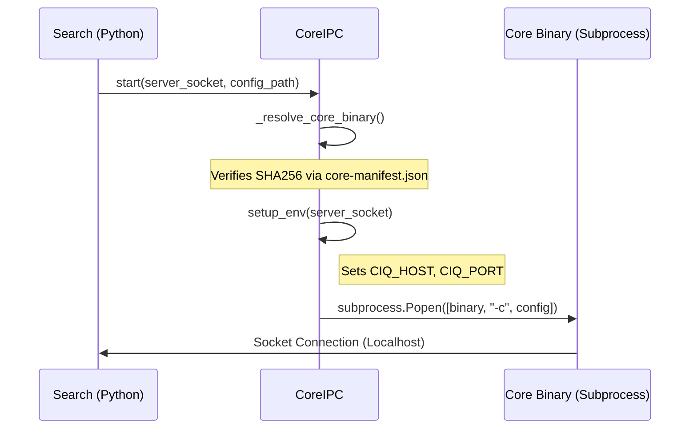
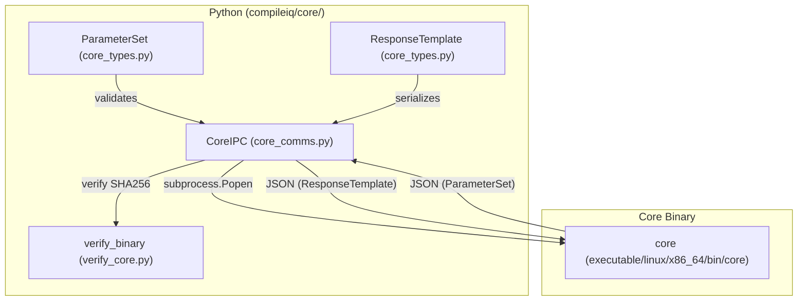

<!-- source: DeepWiki mcp.deepwiki.com · repo NVIDIA/CompileIQ · page 2.2 Core Binary & IPC Communication · fetched 2026-10-26 -->

# Core Binary & IPC Communication

Relevant source files

The following files were used as context for generating this wiki page:

- [compileiq/core/core_comms.py](compileiq/core/core_comms.py)
- [compileiq/core/core_types.py](compileiq/core/core_types.py)
- [compileiq/core/executable/core-manifest.json](compileiq/core/executable/core-manifest.json)
- [compileiq/core/executable/core-version.lock](compileiq/core/executable/core-version.lock)
- [compileiq/core/executable/linux/x86_64/bin/_core](compileiq/core/executable/linux/x86_64/bin/_core)
- [compileiq/core/executable/win32/amd64/core.exe](compileiq/core/executable/win32/amd64/core.exe)
- [compileiq/core/verify_core.py](compileiq/core/verify_core.py)
- [compileiq/search_spaces/models.py](compileiq/search_spaces/models.py)
- [tests/unit/test_core_comms.py](tests/unit/test_core_comms.py)
- [tests/unit/test_core_types.py](tests/unit/test_core_types.py)
- [tests/unit/test_verify_core.py](tests/unit/test_verify_core.py)

The CompileIQ architecture separates the Python-based orchestration and worker management from the high-performance optimization logic, which is implemented in a compiled **Core binary**. This separation allows the Core to leverage optimized search algorithms while Python handles flexible task distribution and user-defined objective functions. Communication between these layers is managed via a socket-based Inter-Process Communication (IPC) protocol.

### Core Binary Distribution & Verification

CompileIQ bundles platform-specific executables for Linux (x86_64, aarch64) and Windows (amd64) [compileiq/core/executable/core-manifest.json:4-11](). These binaries are managed by a manifest system to ensure integrity and version alignment.

#### Binary Verification via `core-manifest.json`
The `verify_core.py` module ensures that the bundled binaries match the expected versions before execution.
*   **Manifest Tracking**: `core-manifest.json` stores the `core_commit` and SHA-256 hashes for every platform-specific file [compileiq/core/executable/core-manifest.json:2-12]().
*   **Platform Support**: Supported platforms include `linux/x86_64`, `linux/aarch64`, and `win32/amd64` [compileiq/core/verify_core.py:15-15]().
*   **Verification Logic**: The `verify()` function calculates the SHA-256 of on-disk files and compares them against the manifest [compileiq/core/verify_core.py:135-172](). It also checks for missing or extra files [compileiq/core/verify_core.py:158-168]().

#### Binary Resolution Workflow
The `CoreIPC` class resolves which binary to run based on the host environment:
1.  **Environment Overrides**: If `CIQ_CORE_BINARY` is set, it uses that path [compileiq/core/core_comms.py:82-84](). If `CIQ_CORE_MANIFEST` is also provided, it performs verification; otherwise, it issues a warning [compileiq/core/core_comms.py:88-102]().
2.  **Bundled Selection**: By default, it constructs a path based on `sys.platform` and `platform.machine()` [compileiq/core/core_comms.py:69-71]().
3.  **Integrity Check**: The selected binary and its platform dependencies (e.g., `libciq.so` or `_core`) are verified using `verify_binary_platform` before the process starts [compileiq/core/core_comms.py:107-111]().

**Sources:** [compileiq/core/core_comms.py:68-112](), [compileiq/core/verify_core.py:135-172](), [compileiq/core/executable/core-manifest.json:1-13]()

---

### CoreIPC Subprocess Management

The `CoreIPC` class manages the lifecycle of the Core subprocess.

#### Subprocess Lifecycle
*   **Startup**: `CoreIPC.start()` launches the binary using `subprocess.Popen`. It passes a configuration file path via the `-c` flag and configures the environment with socket details [compileiq/core/core_comms.py:54-66]().
*   **Environment Setup**: The Core discovers the Python orchestration layer via `CIQ_HOST` and `CIQ_PORT` environment variables, which are extracted from the `server_socket` [compileiq/core/core_comms.py:181-190]().
*   **Termination**: `CoreIPC.stop()` kills the process. On non-Windows systems, it uses `os.killpg` with `SIGKILL` to ensure all children in the process group are terminated [compileiq/core/core_comms.py:114-129]().

**Core Startup Sequence**

**Sources:** [compileiq/core/core_comms.py:44-67](), [compileiq/core/core_comms.py:114-129](), [compileiq/core/core_comms.py:181-190]()

---

### Socket-Based Communication Protocol

The communication between Python and the Core is full-duplex over localhost sockets using JSON-serialized messages.

#### Message Types (`core_types.py`)
| Class | Purpose | Key Fields |
| :--- | :--- | :--- |
| `ParameterSet` | Sent from Core to Python; contains candidates to evaluate. | `params` (List), `generation_num`, `invocation_id` |
| `SingleCandidate` | A single point in the search space. | `id`, `knobs` (serialized string) |
| `ResponseTemplate` | Sent from Python to Core; contains evaluation results. | `evaluated_params` (List of scores) |
| `CompletionMessage` | Signals the end of the search. | `complete` (bool) |

#### Data Flow and Framing
1.  **Receiving (Core -> Python)**: `receive_from_core` reads from the socket in chunks of `MAX_BYTES` [compileiq/core/core_comms.py:142](). It accumulates data into a buffer until it can be successfully parsed as a valid JSON object [compileiq/core/core_comms.py:156-164]().
2.  **Sending (Python -> Core)**: `send_to_core` serializes the `ResponseTemplate` to JSON and appends a newline (`\n`), which the Core uses as a message delimiter [compileiq/core/core_comms.py:192-202]().

**Entity Mapping: Communication Logic**

**Sources:** [compileiq/core/core_types.py:5-27](), [compileiq/core/core_comms.py:130-179](), [compileiq/core/core_comms.py:192-202]()

### Error Handling & Retries
The IPC layer includes robust handling for socket timeouts and process hangs:
*   **Socket Timeouts**: If `socket.recvfrom` times out, `CoreIPC` checks if the core process is still alive [compileiq/core/core_comms.py:143-146]().
*   **Retries**: It will retry the receive operation up to `MAX_RETRIES` if the process is still running [compileiq/core/core_comms.py:146-148]().
*   **Validation**: Received messages are validated using Pydantic `TypeAdapter` to ensure they conform to the expected `ParameterSet` or `CompletionMessage` schemas [compileiq/core/core_comms.py:171-177]().

**Sources:** [compileiq/core/core_comms.py:140-153](), [compileiq/core/core_comms.py:171-177]()

---

