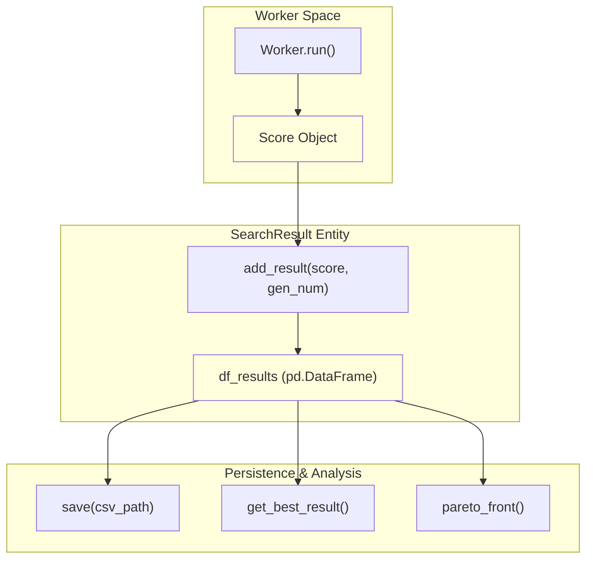
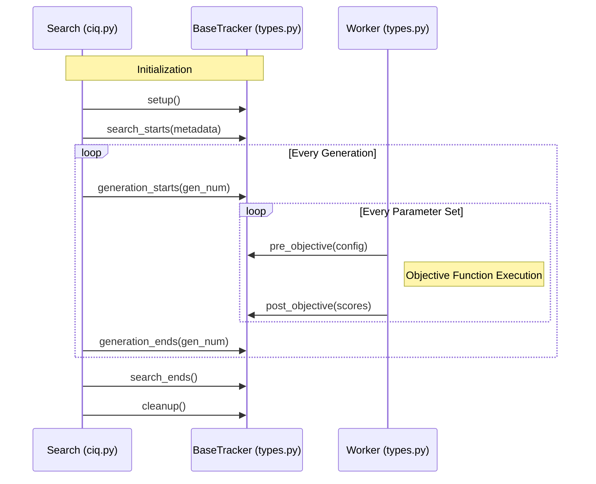

<!-- source: DeepWiki mcp.deepwiki.com · repo NVIDIA/CompileIQ · page 2.3 Data Types & Result Management · fetched 2026-10-26 -->

# Data Types & Result Management

Relevant source files

The following files were used as context for generating this wiki page:

- [.github/copy-pr-bot.yaml](.github/copy-pr-bot.yaml)
- [compileiq/results.py](compileiq/results.py)
- [compileiq/tracker.py](compileiq/tracker.py)
- [compileiq/types.py](compileiq/types.py)
- [docs/xgboost.md](docs/xgboost.md)
- [examples/mlflow_tracker.py](examples/mlflow_tracker.py)
- [examples/multi_objective.py](examples/multi_objective.py)
- [examples/normalizing.py](examples/normalizing.py)
- [tests/integration/test_worker.py](tests/integration/test_worker.py)
- [tests/unit/test_results.py](tests/unit/test_results.py)
- [tests/unit/test_search_configuration.py](tests/unit/test_search_configuration.py)
- [tests/unit/test_tracker_unit.py](tests/unit/test_tracker_unit.py)

This page documents the internal type system and result management infrastructure of CompileIQ. It covers how scores are represented, how search results are persisted and analyzed, and the lifecycle of experiment tracking.

## Core Type System

CompileIQ utilizes a structured type system to ensure consistency between the Python orchestration layer and the evaluation workers.

### Problem Definition
The optimization goal is defined by `ProblemType`, which determines whether the search algorithm seeks to minimize or maximize the objective function [compileiq/types.py:34-39]().

### Score Representation
Scores are encapsulated in the `Score` model, which supports both single and multi-objective outputs:
*   **`SingleScore`**: A single `float`, `int`, or the string `"*"` (represented by `INVALID_SCORE`) [compileiq/utils/validation.py:23-26]().
*   **`MultiScore`**: A sequence of `SingleScore` values [compileiq/utils/validation.py:24]().
*   **`INVALID_SCORE`**: The sentinel value `"*"` used to indicate that an objective function evaluation failed (e.g., a compiler error or timeout) [compileiq/utils/validation.py:26]().

### Multi-Objective Aggregation
When `num_objectives > 1`, the system uses `MultiScoreComparison` to determine how results are compared or aggregated [compileiq/types.py:41-58]().

| Strategy | Enum Value | Description |
| :--- | :--- | :--- |
| `AVERAGE` | `"avg"` | Averages all scores in the MultiScore [compileiq/types.py:55](). |
| `STDDEV` | `"stddev"` | Calculates the standard deviation across scores [compileiq/types.py:56](). |
| `PARETO` | `"pareto_front"` | The preferred method; identifies non-dominated solutions [compileiq/types.py:57](). |

**Sources:** [compileiq/types.py:34-58](), [compileiq/utils/validation.py:22-28]()

---

## Result Management: SearchResult

The `SearchResult` class is the primary container for data generated during a search. It wraps a pandas `DataFrame` and provides methods for analysis, deduplication, and persistence [compileiq/results.py:10-31]().

### Data Flow: From Worker to DataFrame
The following diagram illustrates how raw scores from workers are transformed into managed results.

**Diagram: Result Acquisition Pipeline**

**Sources:** [compileiq/results.py:151-165](), [compileiq/results.py:182-202]()

### Key Functionality
*   **Deduplication**: The `clear_duplicates()` method removes redundant entries based on the `params` column to ensure the Pareto front calculation is efficient [compileiq/results.py:119-122]().
*   **Normalization Support**: If `normalize=True` in `SearchConfiguration`, the `SearchResult` tracks both `score_N` and `norm_score_N` columns [compileiq/results.py:163-165](). It uses the `BASELINE_CONFIG` (an empty dict `{}`) to establish the baseline [compileiq/results.py:178-180]().
*   **CSV Persistence**: Results are saved via `save()` and can be reloaded using `from_csv()`, which automatically handles JSON-deserialization of the `params` column [compileiq/results.py:45-71]().

**Sources:** [compileiq/results.py:45-122](), [compileiq/results.py:151-180]()

---

## Pareto Front Calculation

For multi-objective problems, CompileIQ identifies the set of "non-dominated" solutions. A solution is non-dominated if no other solution is better in at least one objective without being worse in another.

### Implementation Logic
The `pareto_front()` method filters the internal DataFrame to return only these optimal trade-offs [compileiq/results.py:215-220](). This is critical when balancing conflicting metrics, such as "Instruction Count" vs. "Register Pressure" in compiler tuning [examples/multi_objective.py:8-11]().

**Sources:** [compileiq/results.py:182-220](), [examples/multi_objective.py:1-35]()

---

## Experiment Tracking

The `BaseTracker` defines the lifecycle for logging experiment data. This allows users to monitor progress via console (Loguru) or specialized UI (MLflow) [compileiq/types.py:93-103]().

### Tracker Lifecycle and Entities
This diagram maps the natural language "Search Lifecycle" to the specific code entities in the `Tracker` system.

**Diagram: Tracker Lifecycle Mapping**

**Sources:** [compileiq/types.py:93-171](), [compileiq/tracker.py:94-150]()

### Supported Trackers
1.  **`LoguruTracker`**: The default tracker. It provides structured logging to `stdout` or files. It captures `search_space_resolution_metadata` to log exactly which compiler versions or binary search spaces were used [compileiq/tracker.py:121-126]().
2.  **`MLflowTracker`**: Integrates with MLflow. It logs parameters as `mlflow.log_params`, metrics as `mlflow.log_metrics`, and can even track artifacts if the objective function uses `mlflow.log_artifact` [compileiq/tracker.py:151-213](), [examples/mlflow_tracker.py:23-58]().
3.  **`DisabledTracker`**: A no-op implementation used when `tracker_config` is set to `DISABLED` [compileiq/tracker.py:59-92]().

**Sources:** [compileiq/types.py:60-82](), [compileiq/tracker.py:59-213](), [examples/mlflow_tracker.py:1-58]()

---

