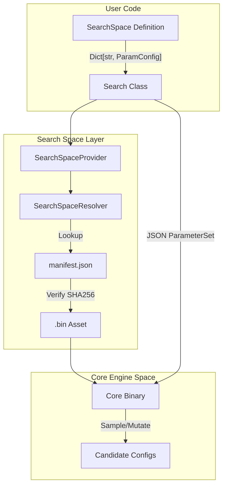
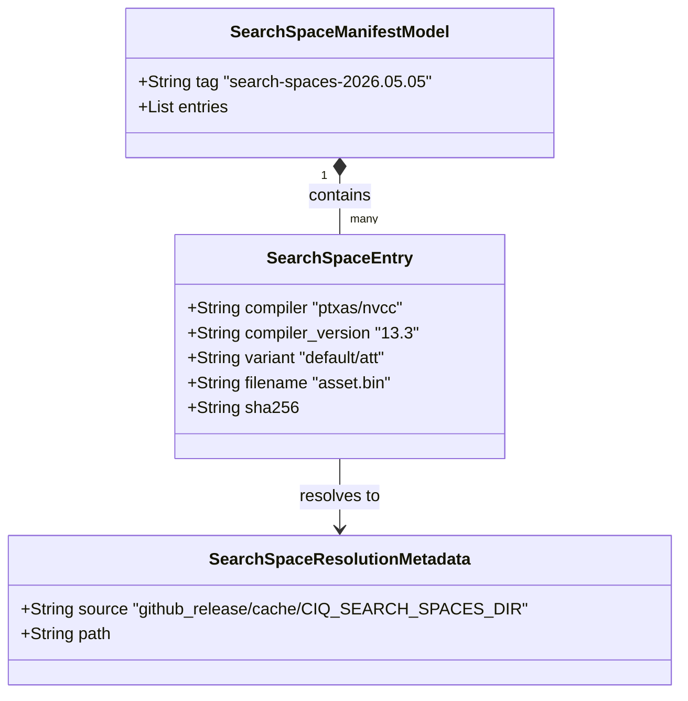

<!-- source: DeepWiki mcp.deepwiki.com · repo NVIDIA/CompileIQ · page 3 Search Spaces · fetched 2026-10-26 -->

# Search Spaces

Relevant source files

The following files were used as context for generating this wiki page:

- [.gitignore](.gitignore)
- [compileiq/search_spaces/base.py](compileiq/search_spaces/base.py)
- [compileiq/search_spaces/compilers.py](compileiq/search_spaces/compilers.py)
- [compileiq/search_spaces/manifest.py](compileiq/search_spaces/manifest.py)
- [compileiq/search_spaces/resolver.py](compileiq/search_spaces/resolver.py)
- [compileiq/utils/validation.py](compileiq/utils/validation.py)
- [compileiq/worker.py](compileiq/worker.py)
- [docs/compilers_overview.md](docs/compilers_overview.md)
- [docs/getting_started.md](docs/getting_started.md)

Search spaces in CompileIQ define the range of parameters and compiler controls that the optimization engine explores. These spaces are defined in Python, resolved to concrete assets if they refer to NVIDIA compiler controls, and then delivered to the Core binary for sampling and mutation.

## Overview

The search space system bridges high-level user definitions with the low-level Core optimization engine. It consists of three primary layers:
1.  **Primitives**: Python functions used to define ranges, choices, and literals.
2.  **Providers**: Specialized classes for fetching and managing NVIDIA compiler search spaces (e.g., `ptxas`, `nvcc`).
3.  **Manifest/Resolver**: A system for mapping logical compiler requests to verified binary assets, supporting both online downloads and air-gapped mirrors.

### Search Space Architecture

The following diagram illustrates how search spaces move from definition to the Core engine.

**Search Space Resolution Flow**

Sources: [compileiq/ciq.py:1-50](), [compileiq/search_spaces/resolver.py:1-14](), [compileiq/search_spaces/compilers.py:1-10]()

---

## Search Space Primitives

Primitives are the building blocks of any search space. They are defined in `compileiq/search_spaces/base.py` and allow users to specify the "shape" of the data they want to optimize.

*   **`range()`**: Defines a continuous or stepped numerical range. Supports `seed_low` and `seed_high` for biased initialization [compileiq/search_spaces/base.py:12-82]().
*   **`choice()`**: Defines a discrete list of values (formerly known as `Enum`) [compileiq/search_spaces/base.py:85-121]().
*   **`log_sampling()`**: Emulates logarithmic distribution by generating a geometric progression of choices [compileiq/search_spaces/base.py:158-185]().
*   **`literal()`**: Provides a constant value, often used with `knockout_prob` to toggle flags [compileiq/search_spaces/base.py:124-155]().

Every primitive supports a `knockout_prob`, which defines the likelihood of a parameter being excluded from a specific sample, effectively allowing the search to explore the absence of a parameter [compileiq/search_spaces/base.py:37-40]().

For details, see [Search Space Primitives](#3.1).

---

## Compiler Search Space Providers

CompileIQ provides curated search spaces for NVIDIA compilers through the `SearchSpaceProvider` interface [compileiq/search_spaces/compilers.py:21-29](). These providers automate the retrieval of complex compiler control definitions.

### Key Provider Classes
| Class | Purpose | Source |
| :--- | :--- | :--- |
| `PtxasSearchSpace` | Fetches controls for the PTX assembler. | [compileiq/search_spaces/compilers.py:66-72]() |
| `NvccSearchSpace` | Fetches controls for the NVCC compiler driver. | [compileiq/search_spaces/compilers.py:75-81]() |
| `LocalSearchSpaceBin` | Uses a local `.bin` file, bypassing manifest lookups. | [compileiq/search_spaces/compilers.py:84-103]() |

These providers use a `version`, `variant`, and `tag` to identify the correct asset [compileiq/search_spaces/compilers.py:44-52](). For example, the `att` variant is often used for tuning attention kernels [docs/compilers_overview.md:22-24]().

For details, see [Compiler Search Space Providers](#3.2).

---

## The Manifest and Resolver System

The `SearchSpaceResolver` ensures that the search space used by the Python layer matches the expectations of the Core binary. It manages a local cache under `~/.cache/compileiq/` and verifies assets using a `manifest.json` file [compileiq/search_spaces/resolver.py:1-14]().

### Data Association: Logical to Physical
The system maps logical identifiers to physical code entities and files.

**Entity Mapping Diagram**

Sources: [compileiq/search_spaces/manifest.py:41-90](), [compileiq/search_spaces/resolver.py:61-79]()

### Offline and Air-Gapped Use
Users can bypass GitHub downloads by setting the `CIQ_SEARCH_SPACES_DIR` environment variable [compileiq/search_spaces/resolver.py:36-37](). When set, the resolver looks for `manifest.json` and `.bin` files in that local directory instead of querying the GitHub API [compileiq/search_spaces/compilers.py:6-9]().

### Safety and Validation
The resolver performs strict validation on every asset:
*   **SHA256 Verification**: Ensures the binary hasn't been corrupted or tampered with [compileiq/search_spaces/resolver.py:153-155]().
*   **Size Checks**: A quick sanity check before the expensive hashing process [compileiq/search_spaces/resolver.py:148-152]().
*   **Path Sanitization**: Prevents parent directory traversal attacks in manifest filenames [compileiq/search_spaces/manifest.py:23-38]().

Sources: [compileiq/search_spaces/resolver.py:135-156](), [compileiq/search_spaces/manifest.py:69-72]()

---

