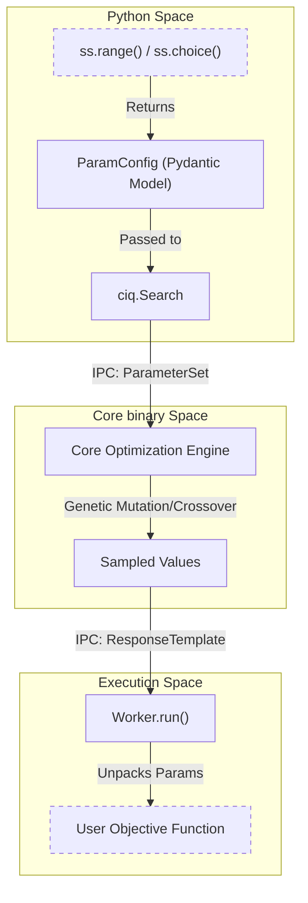
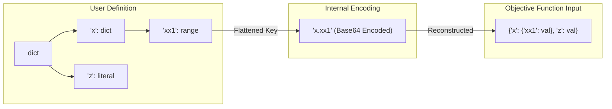

<!-- source: DeepWiki mcp.deepwiki.com · repo NVIDIA/CompileIQ · page 3.1 Search Space Primitives · fetched 2026-10-26 -->

# Search Space Primitives

Relevant source files

The following files were used as context for generating this wiki page:

- [compileiq/search_spaces/base.py](compileiq/search_spaces/base.py)
- [compileiq/utils/validation.py](compileiq/utils/validation.py)
- [compileiq/worker.py](compileiq/worker.py)
- [docs/getting_started.md](docs/getting_started.md)
- [examples/nested_search_space.py](examples/nested_search_space.py)
- [examples/single_objective.py](examples/single_objective.py)

The search space API in CompileIQ provides a set of primitives used to define the parameters that the optimization engine explores. These primitives are defined in `compileiq/search_spaces/base.py` and map Python-level definitions to configuration structures that the Core binary can process.

### Overview of Primitives

Search spaces are typically defined as a dictionary where keys are parameter names and values are primitive configurations [docs/getting_started.md:25-30](). CompileIQ supports four primary primitives: `range`, `choice`, `log_sampling`, and `literal`.

#### Logic Flow: From Definition to Objective Function

The following diagram illustrates how a search space definition in Python is transformed and eventually passed to the user-provided objective function.

**Search Space Data Transformation**

Sources: [compileiq/search_spaces/base.py:12-155](), [compileiq/worker.py:91-126](), [docs/getting_started.md:15-50]()

---

### Core Primitives API

#### 1. Range Sampling
The `range()` function defines a continuous numerical space with a fixed step size.

*   **Function**: `range(start, end, step=1, knockout_prob=None, seed_low=None, seed_high=None)` [compileiq/search_spaces/base.py:12-19]()
*   **Constraints**: The `step` must be positive [compileiq/search_spaces/base.py:59-60](), and `start` must be less than `end` [compileiq/search_spaces/base.py:62-63]().
*   **Seeding**: `seed_low` and `seed_high` allow for a secondary initialization subset. If provided, the engine initializes a percentage of the population (defined by `init_with_true_random_threshold` in `SearchConfiguration`) within this sub-range to accelerate convergence in known "safe" areas [compileiq/search_spaces/base.py:41-56]().

#### 2. Discrete Choice
The `choice()` function defines a discrete set of values to sample from.

*   **Function**: `choice(choice_list, knockout_prob=None)` [compileiq/search_spaces/base.py:85-88]()
*   **Implementation**: It handles Python types and `numpy` scalars, converting booleans to integers (0/1) for compatibility with the Core [compileiq/search_spaces/base.py:105-114]().
*   **Legacy**: Previously referred to as `Enum` in earlier versions [compileiq/search_spaces/base.py:91]().

#### 3. Logarithmic Sampling
Since the Core engine does not natively support logarithmic distributions, `log_sampling` emulates this by generating a `choice` list.

*   **Function**: `log_sampling(start, end, total=10, knockout_prob=None)` [compileiq/search_spaces/base.py:158-163]()
*   **Implementation**: Uses `np.geomspace` to create a list of `total` values distributed logarithmically between `start` and `end`, which is then passed to `choice()` [compileiq/search_spaces/base.py:182-185]().

#### 4. Literals and Constants
The `literal()` primitive represents a fixed value that does not change during the search but can still participate in the knockout logic.

*   **Function**: `literal(const_value, knockout_prob=None)` [compileiq/search_spaces/base.py:124-127]()
*   **Usage**: Useful for "on/off" flags where the "on" value is a specific string or number, and "off" is achieved via knockout [compileiq/search_spaces/base.py:129-132]().

Sources: [compileiq/search_spaces/base.py:12-186]()

---

### Common Features: Knockout and Validation

| Feature | Description | Implementation Detail |
| :--- | :--- | :--- |
| **Knockout Prob** | The probability (`0.0` to `1.0`) that a parameter is omitted from the dictionary passed to the objective function. | Converted to `knockout_threshold` (1.0 - prob) for the Core [compileiq/search_spaces/base.py:65](). |
| **Invalid Scores** | If a specific parameter combination causes a failure (e.g., compiler crash), the objective function should return `INVALID_SCORE` (literal `"*"`). | Defined in `compileiq/utils/validation.py:16` and handled by `Score.failed` [compileiq/utils/validation.py:64-79](). |
| **Type Safety** | Pydantic models `RangeParamConfig`, `ChoiceParamConfig`, and `LiteralParamConfig` enforce schema validation before transmission. | Imported from `compileiq.search_spaces.models` [compileiq/search_spaces/base.py:5-9](). |

Sources: [compileiq/search_spaces/base.py:37-40](), [compileiq/utils/validation.py:15-32]()

---

### Nested Search Spaces

CompileIQ supports nested dictionaries in the search space definition. This allows users to group related parameters logically.

**Nested Structure Mapping**

When a nested dictionary is provided, CompileIQ flattens the keys using a dot-notation (e.g., `parent.child.parameter`). To ensure these keys are safe for IPC and the Core engine's internal parsers, they are typically encoded. When the `Worker` receives sampled values back from the Core, it reconstructs the original nested dictionary structure before calling the `objective_function` [examples/nested_search_space.py:6-12](), [examples/nested_search_space.py:16-29]().

Sources: [examples/nested_search_space.py:16-29](), [compileiq/worker.py:103-115]()

---

