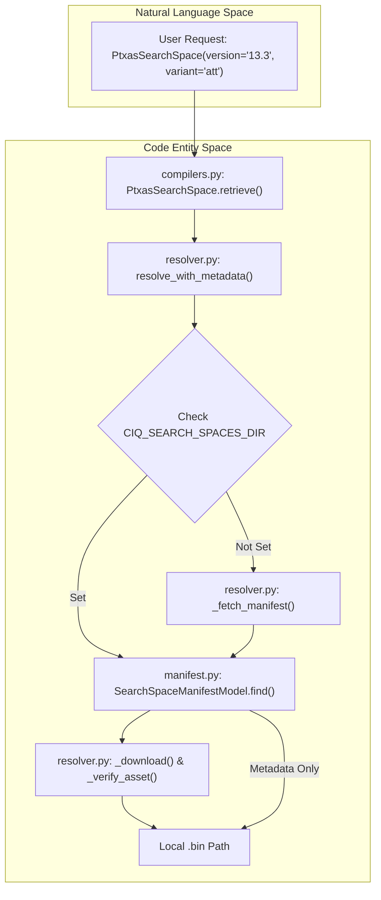
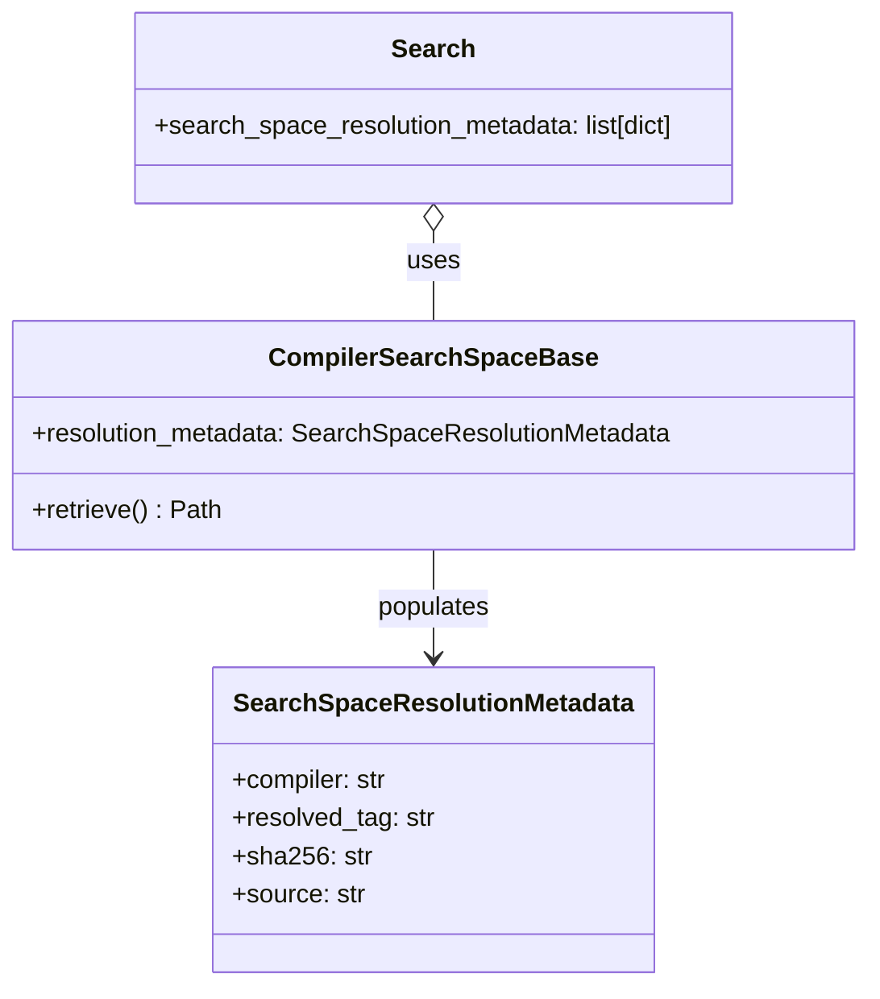

<!-- source: DeepWiki mcp.deepwiki.com · repo NVIDIA/CompileIQ · page 3.2 Compiler Search Space Providers · fetched 2026-10-26 -->

# Compiler Search Space Providers

Relevant source files

The following files were used as context for generating this wiki page:

- [.gitignore](.gitignore)
- [compileiq/search_spaces/compilers.py](compileiq/search_spaces/compilers.py)
- [compileiq/search_spaces/manifest.py](compileiq/search_spaces/manifest.py)
- [compileiq/search_spaces/resolver.py](compileiq/search_spaces/resolver.py)
- [docs/compilers_overview.md](docs/compilers_overview.md)
- [tests/integration/test_search_space_resolution.py](tests/integration/test_search_space_resolution.py)
- [tests/unit/search_spaces/test_compilers.py](tests/unit/search_spaces/test_compilers.py)
- [tests/unit/search_spaces/test_manifest.py](tests/unit/search_spaces/test_manifest.py)
- [tests/unit/search_spaces/test_resolver.py](tests/unit/search_spaces/test_resolver.py)

Compiler Search Space Providers are specialized classes responsible for retrieving and managing the search space definitions used to tune NVIDIA compilers. Starting in CUDA Toolkit (CTK) 13.3, `nvcc` and `ptxas` expose the **Advanced Controls Interface**, allowing CompileIQ to influence compiler heuristics via **Advanced Controls Files** (ACF) [docs/compilers_overview.md:1-5]().

These providers map high-level logical requests (compiler version, variant) to concrete binary assets, handling resolution, network retrieval, integrity verification, and local caching [compileiq/search_spaces/compilers.py:4-10]().

## Provider Classes

The codebase implements three primary providers in `compileiq/search_spaces/compilers.py`.

### PtxasSearchSpace and NvccSearchSpace
These classes are the standard interface for tuning PTXAS and NVCC. They inherit from `CompilerSearchSpaceBase` and use the GitHub-release-backed resolver pipeline [compileiq/search_spaces/compilers.py:66-82]().

*   **`version`**: The compiler version (e.g., `"13.3"`) [compileiq/search_spaces/compilers.py:46-50]().
*   **`variant`**: Specific control sets. Use `"default"` for standard tuning or `"att"` for specialized attention kernel optimizations [docs/compilers_overview.md:22-23]().
*   **`tag`**: Pins the search space to a specific release tag (e.g., `"search-spaces-2026.05.05"`) for reproducibility [docs/compilers_overview.md:28-34]().

### LocalSearchSpaceBin
Used for development or out-of-band assets. It takes a direct filesystem path and bypasses the manifest and network resolution logic entirely [compileiq/search_spaces/compilers.py:84-93]().

## The Resolver Pipeline

When `retrieve()` is called on a provider, it initiates a resolution pipeline that translates logical parameters into a local file path.

### Resolution Data Flow
The following diagram illustrates how a `PtxasSearchSpace` request moves from the Python API to a verified local binary.

**Search Space Resolution Flow**

Sources: [compileiq/search_spaces/compilers.py:55-63](), [compileiq/search_spaces/resolver.py:170-192](), [compileiq/search_spaces/manifest.py:107-130]()

### Offline Mirroring (Air-Gapped Use)
For environments without internet access, the resolver supports offline mirroring via the `CIQ_SEARCH_SPACES_DIR` environment variable [compileiq/search_spaces/compilers.py:6-9]().
1.  Set `CIQ_SEARCH_SPACES_DIR` to a local directory.
2.  The directory must contain a `manifest.json` and the corresponding `.bin` files.
3.  The resolver will prioritize this directory and skip all network calls [compileiq/search_spaces/resolver.py:104-119]().

## Manifest and Metadata

The `manifest.json` acts as a Table of Contents for a release, defined by the `SearchSpaceManifestModel` [compileiq/search_spaces/manifest.py:75-90]().

### SearchSpaceEntry Schema
Each entry in the manifest contains:
| Field | Description |
| :--- | :--- |
| `compiler` | `ptxas` or `nvcc` [compileiq/search_spaces/manifest.py:44]() |
| `compiler_version` | Target CTK version (e.g., "13.3") [compileiq/search_spaces/manifest.py:47]() |
| `variant` | The specific optimization profile [compileiq/search_spaces/manifest.py:50]() |
| `sha256` | Hex string for integrity verification [compileiq/search_spaces/manifest.py:57]() |
| `size_bytes` | File size in bytes for sanity checking [compileiq/search_spaces/manifest.py:60]() |

### Resolution Metadata
When a search is initialized, CompileIQ captures `SearchSpaceResolutionMetadata` to ensure traceability in experiment logs [compileiq/search_spaces/resolver.py:61-78](). This metadata includes the `resolved_tag`, the `source` (e.g., `github_release`, `cache`, or `CIQ_SEARCH_SPACES_DIR`), and the asset's SHA256 hash [compileiq/search_spaces/resolver.py:179-191]().

**Metadata Association**

Sources: [compileiq/search_spaces/compilers.py:53](), [compileiq/search_spaces/resolver.py:62-76](), [tests/unit/search_spaces/test_compilers.py:119-135]()

## Implementation Details

### Integrity Verification
The resolver enforces strict security checks:
*   **Filename Validation**: Prevents path traversal by rejecting filenames containing slashes or backslashes [compileiq/search_spaces/manifest.py:23-38]().
*   **Checksums**: Downloads are written to a `.part` file and only moved to the final cache location after the `sha256` and `size_bytes` match the manifest [compileiq/search_spaces/resolver.py:147-167]().

### Cache Management
Assets are cached in `~/.cache/compileiq/<tag>/` [compileiq/search_spaces/resolver.py:4-6](). The cache filename is prefixed with the first 12 characters of the SHA256 hash to prevent collisions between different versions of the same filename [compileiq/search_spaces/resolver.py:135-136]().

Sources:
*   `compileiq/search_spaces/compilers.py`
*   `compileiq/search_spaces/resolver.py`
*   `compileiq/search_spaces/manifest.py`
*   `docs/compilers_overview.md`
*   `tests/unit/search_spaces/test_compilers.py`

---

