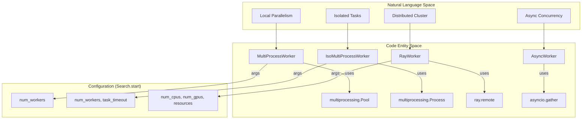
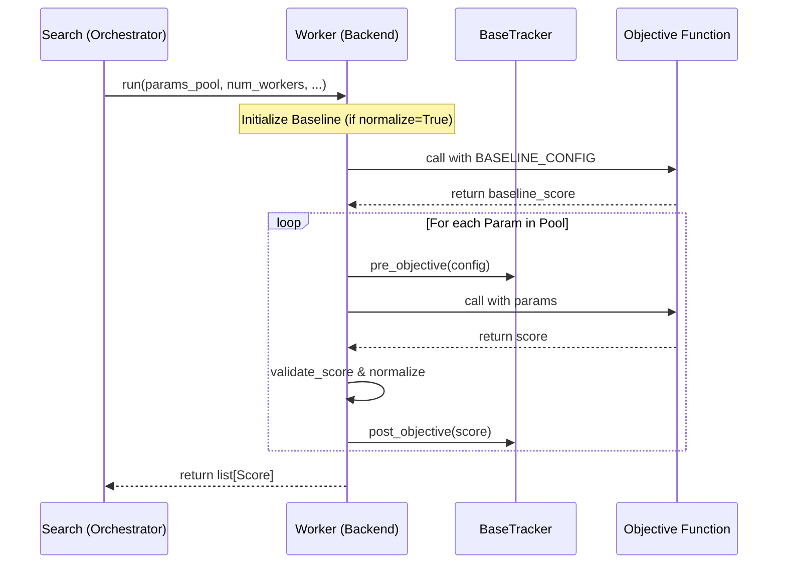

<!-- source: DeepWiki mcp.deepwiki.com · repo NVIDIA/CompileIQ · page 4 Workers & Execution Backends · fetched 2026-10-26 -->

# Workers & Execution Backends

Relevant source files

The following files were used as context for generating this wiki page:

- [compileiq/tracker.py](compileiq/tracker.py)
- [compileiq/types.py](compileiq/types.py)
- [docs/workers.md](docs/workers.md)
- [examples/custom_worker.py](examples/custom_worker.py)
- [examples/distributed.py](examples/distributed.py)
- [tests/integration/test_worker.py](tests/integration/test_worker.py)
- [tests/unit/test_search_configuration.py](tests/unit/test_search_configuration.py)
- [tests/unit/test_tracker_unit.py](tests/unit/test_tracker_unit.py)

CompileIQ decouples the search orchestration logic from the execution of the objective function through a flexible worker abstraction [compileiq/types.py:173-176](). This architecture allows the same search configuration to run locally using multiprocessing, across a distributed cluster using Ray, or asynchronously within a single event loop.

## The Worker Abstraction

All execution backends inherit from the `Worker` base class [compileiq/types.py:173-176](). The worker is responsible for managing the execution of a batch of parameters (a "generation") and returning validated `Score` objects to the search engine [examples/custom_worker.py:13-21]().

### Core Responsibilities
* **Execution:** Running the user-provided `objective_function` against a pool of parameters [examples/custom_worker.py:44-46]().
* **Normalization:** Handling baseline calculations and applying normalization if enabled in `SearchConfiguration` [examples/custom_worker.py:28-40]().
* **Error Handling:** Catching exceptions within the objective function to prevent search interruption, typically returning `INVALID_SCORE` [examples/custom_worker.py:47-57]().
* **Tracking:** Triggering lifecycle callbacks in the configured `BaseTracker` (e.g., `pre_objective`, `post_objective`) [compileiq/types.py:153-170]().

### Worker Mapping to Code Space

The following diagram bridges the conceptual worker types to their specific implementation classes and configuration parameters.

**Worker System Mapping**

Sources: [compileiq/types.py:173-233](), [docs/workers.md:1-16](), [examples/custom_worker.py:8-76]()

---

## Built-in Execution Backends

CompileIQ provides four built-in worker types to cover common optimization workflows.

### 1. Native & Isolated Workers
These workers utilize Python's `multiprocessing` module for local parallel execution.
* **`MultiProcessWorker`**: The default worker. It maintains a persistent pool of processes to minimize overhead between tasks [docs/workers.md:18-26]().
* **`IsoMultiProcessWorker`**: Spawns a fresh process for every single task. This is the preferred choice for unstable objective functions as it allows the parent to enforce a `task_timeout` and kill hanging processes [docs/workers.md:40-42]().

For details on process modes and timeout enforcement, see [Native & Isolated Workers](#4.1).

### 2. Ray & Async Workers
These workers support advanced scaling and non-blocking I/O.
* **`RayWorker`**: Enables distributed execution across a cluster of machines. It is the only worker that supports automatic GPU resource scheduling via `num_gpus` [docs/workers.md:79-83](), [docs/workers.md:123-127]().
* **`AsyncWorker`**: Uses `asyncio` for concurrency. This is ideal for I/O-bound tasks (e.g., querying a remote benchmark server) where the objective function is defined as an `async def` [docs/workers.md:58-60]().

For details on Ray scheduling and async constraints, see [Ray & Async Workers](#4.2).

---

## Worker Execution Lifecycle

The `Search` class interacts with workers primarily through the `run()` method during each generation of the evolutionary loop.

**Worker Runtime Flow**

Sources: [compileiq/types.py:93-172](), [examples/custom_worker.py:13-76](), [docs/workers.md:142-143]()

## Summary Table

| Worker Class | Execution Model | Distributed? | Resource Management | Best For |
| :--- | :--- | :--- | :--- | :--- |
| `MultiProcessWorker` | Process Pool | No | `num_workers` | General local tuning |
| `IsoMultiProcessWorker` | One process per task | No | `task_timeout` | Unstable/leaky tasks |
| `RayWorker` | Task-based (Ray) | **Yes** | `num_cpus`, `num_gpus` | Multi-GPU / Cluster tuning |
| `AsyncWorker` | `asyncio` Event Loop | No | N/A | I/O-bound tasks |

Sources: [docs/workers.md:1-130](), [compileiq/worker.py:2-3]()

---

