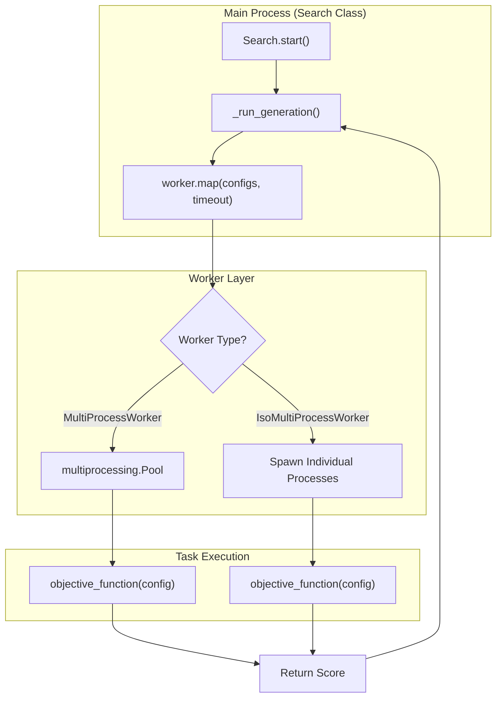
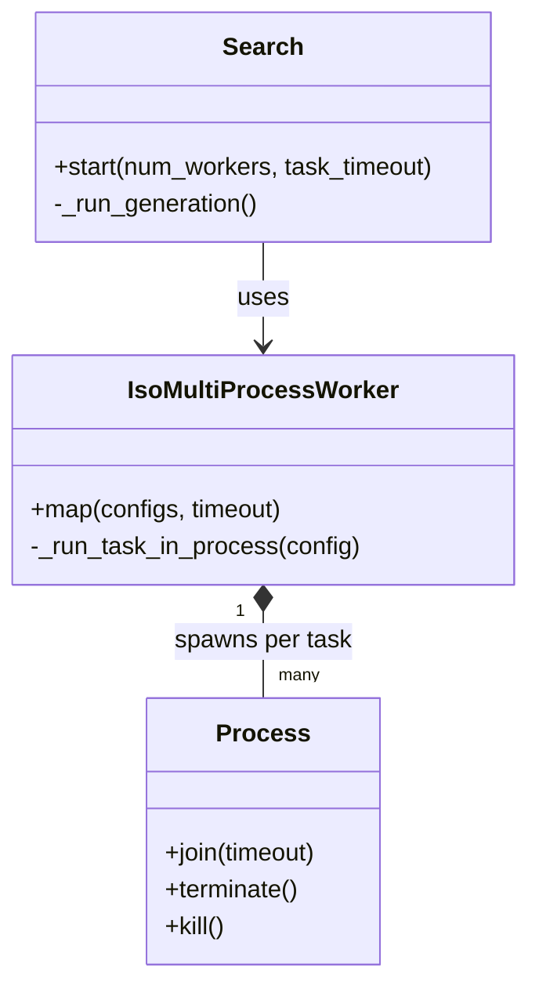

<!-- source: DeepWiki mcp.deepwiki.com · repo NVIDIA/CompileIQ · page 4.1 Native & Isolated Workers · fetched 2026-10-26 -->

# Native & Isolated Workers

<details>
<summary>Relevant source files</summary>

The following files were used as context for generating this wiki page:

- [docs/workers.md](docs/workers.md)
- [examples/single_objective.py](examples/single_objective.py)

</details>


The execution of objective functions in CompileIQ is handled by worker classes that manage concurrency and process lifecycles. For local execution, CompileIQ provides two primary backends based on Python's `multiprocessing` module: `MultiProcessWorker` and `IsoMultiProcessWorker`. These workers facilitate parallel execution of parameter sets generated by the Core binary across multiple CPU cores.

### Worker Architecture Overview

The worker abstraction allows the `Search` class to remain agnostic of the underlying execution environment. When `Search.start()` is called, it initializes the chosen worker type and delegates the execution of a "generation" (a batch of parameter sets) to it.

| Feature | MultiProcessWorker | IsoMultiProcessWorker |
| :--- | :--- | :--- |
| **Concurrency** | Persistent Process Pool | Process-per-task |
| **Default Start Method** | `forkserver` (configurable) | `fork` (configurable) |
| **Timeout Enforcement** | Soft (Task-level check) | Hard (Process termination) |
| **Resource Isolation** | Low (Pool reuse) | High (Fresh process per task) |
| **Overhead** | Low | High (Process creation cost) |

**Process Flow: Search to Worker**


Sources: [compileiq/ciq.py:175-210](), [compileiq/worker.py:15-25](), [docs/workers.md:18-54]()

---

### MultiProcessWorker (Native Worker)

The `MultiProcessWorker` is the default execution backend in CompileIQ [docs/workers.md:18-20](). It utilizes a persistent `multiprocessing.Pool` to minimize the overhead of process creation.

#### Implementation Details
- **Process Management**: It initializes a pool of size `num_workers`. Tasks are distributed to these idle processes as they become available [compileiq/worker.py:133-145]().
- **Start Method**: Defaults to `forkserver` on supported platforms to provide a balance between the speed of `fork` and the safety of `spawn`. This is configurable via the `CIQ_PROCESS_MODE` environment variable [docs/workers.md:26-26]().
- **Windows Compatibility**: On Windows, it automatically falls back to the `spawn` start method, as `fork` and `forkserver` are unavailable [compileiq/worker.py:112-120]().

#### Data Flow
1. `Search` calls `worker.map(configs, timeout)` [compileiq/ciq.py:204-204]().
2. `MultiProcessWorker` wraps the objective function in a helper to capture exceptions [compileiq/worker.py:148-155]().
3. Results are collected and returned as a list of scores to the `Search` loop.

Sources: [compileiq/worker.py:108-160](), [docs/workers.md:18-38]()

---

### IsoMultiProcessWorker (Isolated Worker)

The `IsoMultiProcessWorker` is designed for robustness in unstable environments. It is recommended when the objective function is prone to hanging, leaking memory, or failing to release hardware locks (e.g., GPU handles) [docs/workers.md:40-42]().

#### Hard Timeout Enforcement
Unlike the pool-based worker, `IsoMultiProcessWorker` creates a new process for every single task. This allows the worker to enforce a strict `task_timeout`. If a task exceeds the limit, the worker sends a `SIGKILL` (or equivalent) to the specific process, ensuring it does not block the rest of the search [docs/workers.md:42-42]().

#### Configuration
- **Start Method**: Defaults to `fork` for performance, as process creation happens frequently [docs/workers.md:56-56]().
- **CIQ_PROCESS_MODE**: Users can override the start method (e.g., to `spawn`) if the objective function requires a completely clean state [compileiq/worker.py:165-175]().

**Entity Association: Isolation Logic**


Sources: [compileiq/worker.py:162-200](), [compileiq/ciq.py:175-210]()

---

### Process Mode Management

CompileIQ provides granular control over how Python processes are created through the `CIQ_PROCESS_MODE` environment variable. This is critical for avoiding deadlocks when using libraries like CUDA or OpenMP inside the objective function.

| CIQ_PROCESS_MODE | Implementation | Characteristics |
| :--- | :--- | :--- |
| `fork` | `os.fork()` | Fast; copies memory; unsafe with some C-extensions (CUDA). |
| `spawn` | Fresh interpreter | Slowest; safest; required on Windows. |
| `forkserver` | Template process | Safer than fork; faster than spawn; default for `MultiProcessWorker`. |

#### Code Logic for Start Methods
The `BaseWorker` class (and its derivatives) determines the context using a utility that checks the environment and OS:

- **Windows Check**: If `os.name == "nt"`, the mode is forced to `spawn` regardless of settings [compileiq/worker.py:115-117]().
- **Environment Variable**: It reads `os.getenv("CIQ_PROCESS_MODE")`. If unset, `MultiProcessWorker` defaults to `forkserver` while `IsoMultiProcessWorker` defaults to `fork` [compileiq/worker.py:112-114]().

Sources: [compileiq/worker.py:108-125](), [docs/workers.md:26-26](), [docs/workers.md:56-56]()

---

### Comparison & Selection

Choosing the correct worker depends on the nature of the `objective_function`.

| Use Case | Recommended Worker |
| :--- | :--- |
| Standard numerical optimization (fast, stable) | `MultiProcessWorker` |
| Objective function involves external binaries that may hang | `IsoMultiProcessWorker` |
| Objective function leaks memory or file descriptors | `IsoMultiProcessWorker` |
| Development on Windows | `MultiProcessWorker` (with `spawn`) |
| High-concurrency, low-overhead tasks | `MultiProcessWorker` |

#### Usage Example: Enforcing Timeouts
```python
from compileiq.worker import IsoMultiProcessWorker
from compileiq.ciq import Search

# This search will kill any task taking longer than 30 seconds
tuner = Search(
    objective_function=my_unstable_objective,
    search_space=my_space,
    search_config=my_config,
    worker_type=IsoMultiProcessWorker,
)
tuner.start(num_workers=8, task_timeout=30)
```
Sources: [docs/workers.md:44-54](), [compileiq/ciq.py:65-80]()

---

