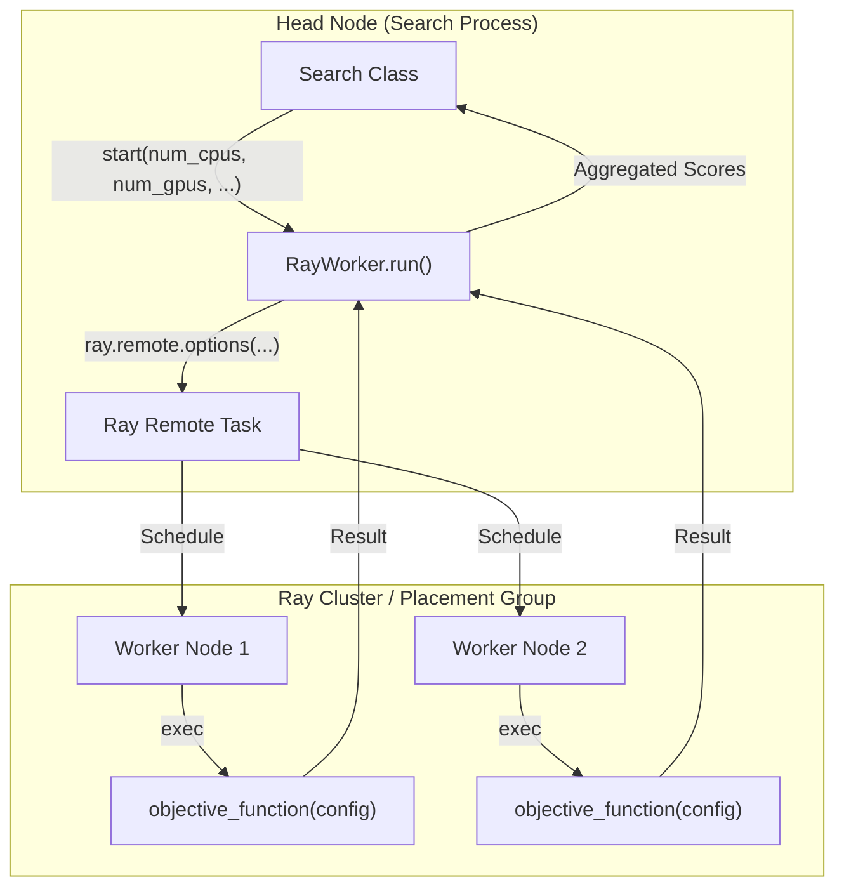
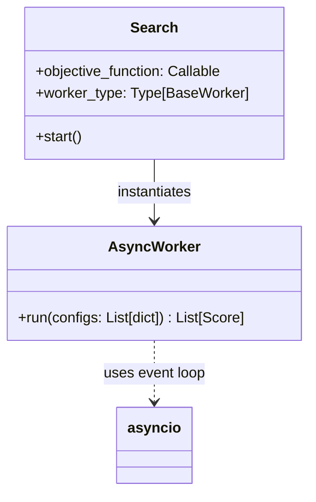

<!-- source: DeepWiki mcp.deepwiki.com · repo NVIDIA/CompileIQ · page 4.2 Ray & Async Workers · fetched 2026-10-26 -->

# Ray & Async Workers

<details>
<summary>Relevant source files</summary>

The following files were used as context for generating this wiki page:

- [docs/workers.md](docs/workers.md)
- [examples/distributed.py](examples/distributed.py)
- [pyproject.toml](pyproject.toml)

</details>


This page details the implementation and configuration of `RayWorker` and `AsyncWorker`, the two backends in CompileIQ designed for distributed execution and asynchronous concurrency. While `RayWorker` enables scaling across multi-node clusters and multi-GPU environments, `AsyncWorker` provides a lightweight mechanism for I/O-bound or natively asynchronous objective functions.

## RayWorker: Distributed Execution

The `RayWorker` leverages the [Ray](https://docs.ray.io/) framework to distribute objective function evaluations across a cluster or locally with advanced resource scheduling [compileiq/worker.py:270-272](). It is the only worker type in CompileIQ that natively supports GPU resource assignment via `CUDA_VISIBLE_DEVICES` [docs/workers.md:123-127]().

### Architecture and Data Flow

When `Search.start()` is called with `RayWorker`, CompileIQ serializes the objective function and search space parameters using `dill` and `msgpack` to ensure compatibility across distributed nodes [pyproject.toml:23-24]().

**Ray Execution Flow**


Sources: [compileiq/ciq.py:108-112](), [docs/workers.md:92-104](), [examples/distributed.py:43-55]()

### Configuration and Scheduling Strategies

The `RayWorker` accepts specific Ray task options during the `tuner.start()` call. These options dictate how the Ray scheduler allocates tasks to nodes based on available resources [docs/workers.md:108-110]().

| Parameter | Description | Implementation Note |
| :--- | :--- | :--- |
| `num_cpus` | Fractional or integer CPUs required per task. | Used for scheduling; does not pin processes to specific cores [docs/workers.md:118-119](). |
| `num_gpus` | Number of GPUs required per task. | Ray sets `CUDA_VISIBLE_DEVICES` for the task process [docs/workers.md:127-129](). |
| `scheduling_strategy` | Strategy for node selection (e.g., `DEFAULT`, `SPREAD`). | Passed to `ray.remote(...).options()` [examples/distributed.py:55-55](). |
| `resources` | Custom resource requirements. | Allows targeting nodes with specific hardware tags [docs/workers.md:108-110](). |

### Node Affinity and Multi-GPU Handling

In multi-GPU environments, Ray manages the mapping of tasks to physical hardware. Users can retrieve assigned IDs using `ray.get_gpu_ids()` within the objective function [docs/workers.md:127-127](). For sensitive measurements, the head node can be prevented from executing tasks by starting it with `--num-cpus=0` [docs/workers.md:118-118]().

Sources: [docs/workers.md:108-132](), [examples/distributed.py:50-55]()

---

## AsyncWorker: Asynchronous Concurrency

The `AsyncWorker` is designed for objective functions defined with `async def`. It utilizes Python's `asyncio` event loop to manage concurrent execution without the overhead of multiple OS processes [docs/workers.md:58-60]().

### Implementation Details

The `AsyncWorker` expects the `objective_function` to be a coroutine. If the function is not natively asynchronous (i.e., it doesn't contain `await` statements for I/O or timers), the execution will effectively remain sequential [docs/workers.md:60-61]().

**AsyncWorker Class Structure**


Sources: [docs/workers.md:63-75](), [compileiq/ciq.py:108-112]()

### Usage Example
The objective function must be decorated or defined as `async def` to be compatible with this worker [docs/workers.md:77-78]().

```python
from compileiq.worker import AsyncWorker

async def objective(config):
    # Perform async I/O or subprocess calls
    await asyncio.sleep(0.1) 
    return config["x"] ** 2

tuner = Search(
    objective_function=objective,
    worker_type=AsyncWorker,
    ...
)
tuner.start()
```
Sources: [docs/workers.md:63-75]()

---

## Limitations and Constraints

### Ray Version and Python Compatibility
* **Ray Constraints:** CompileIQ requires Ray `^2.53.0` [pyproject.toml:21-21]().
* **Windows Exclusion:** While CompileIQ supports Windows for native workers, Ray support on Windows is subject to Ray's own upstream limitations.
* **Python 3.13:** The project supports Python 3.11 through 3.13 [pyproject.toml:16-16](), but specific dependencies like Ray may have delayed support for the newest Python releases.

### Performance Considerations
* **Serialization Overhead:** `RayWorker` incurs overhead when transferring large data structures to remote nodes due to `dill` serialization.
* **Async Blocking:** If the `AsyncWorker` is used with a CPU-bound function that does not yield control to the event loop, it will block the entire search process, negating any concurrency benefits [docs/workers.md:60-61]().

### Comparison Summary

| Feature | RayWorker | AsyncWorker |
| :--- | :--- | :--- |
| **Concurrency Type** | Distributed Processes | Event-loop Coroutines |
| **Multi-Node** | Yes [docs/workers.md:80-81]() | No [docs/workers.md:58-60]() |
| **GPU Scheduling** | Native (via Ray) [docs/workers.md:123-125]() | Manual |
| **Primary Use Case** | Heavy compiler runs, Multi-GPU | I/O-bound tasks, API calls |

Sources: [pyproject.toml:16-21](), [docs/workers.md:58-81](), [docs/workers.md:123-125]()

---

