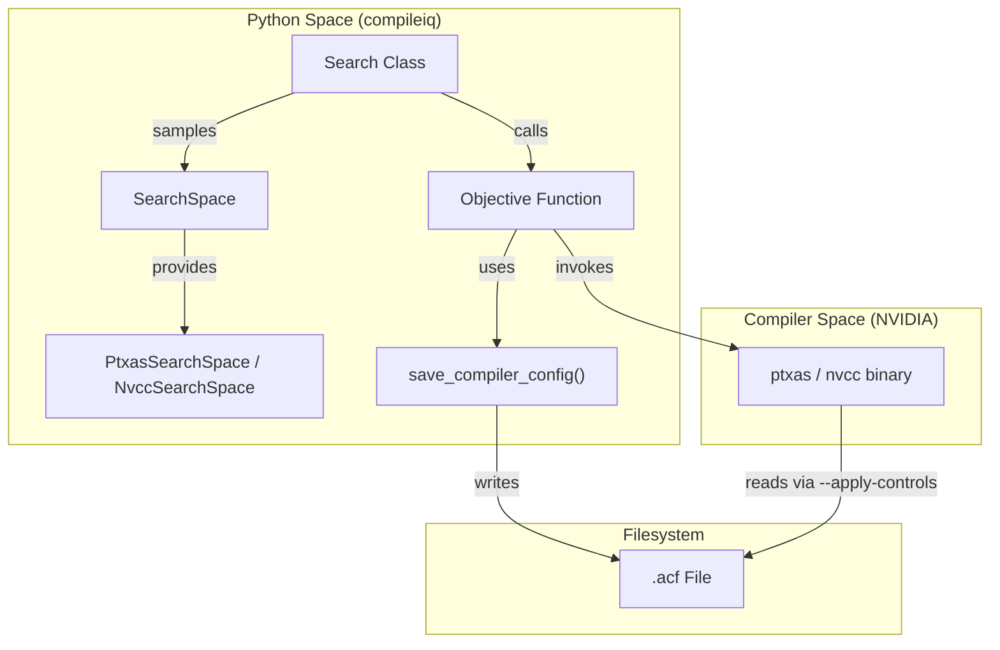
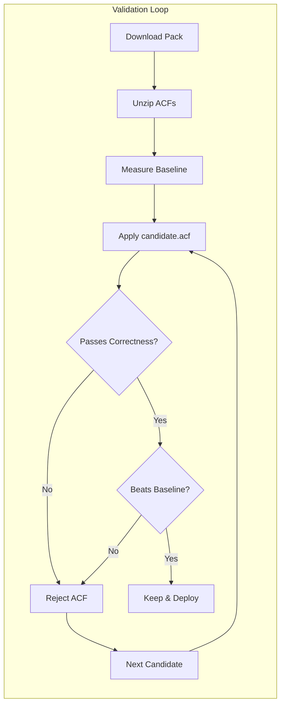

<!-- source: DeepWiki mcp.deepwiki.com · repo NVIDIA/CompileIQ · page 5 Compiler Tuning & Booster Packs · fetched 2026-10-26 -->

# Compiler Tuning & Booster Packs

Relevant source files

The following files were used as context for generating this wiki page:

- [docs/_static/decode_acf_s_curve_full.svg](docs/_static/decode_acf_s_curve_full.svg)
- [docs/_static/decode_acf_s_curve_summary.svg](docs/_static/decode_acf_s_curve_summary.svg)
- [docs/booster_packs.md](docs/booster_packs.md)
- [docs/compilers_overview.md](docs/compilers_overview.md)
- [docs/flashinfer_booster.md](docs/flashinfer_booster.md)
- [examples/compilers/ptxas_example/README.md](examples/compilers/ptxas_example/README.md)
- [examples/compilers/ptxas_example/ptx_spill.py](examples/compilers/ptxas_example/ptx_spill.py)

CompileIQ provides a specialized interface for optimizing NVIDIA compiler heuristics. Starting with **CUDA Toolkit (CTK) 13.3**, `nvcc` and `ptxas` expose the **Advanced Controls Interface** via the `--apply-controls` flag [docs/compilers_overview.md:1-5](). This interface allows users to modify compiler optimization choices—such as register allocation, instruction scheduling, and memory behavior—without altering the kernel source code [docs/compilers_overview.md:7-12]().

There are two primary workflows for compiler optimization:
1.  **Running a Full Search**: Using CompileIQ to sample a curated search space and find the optimal configuration for a specific kernel and environment.
2.  **Applying Booster Packs**: Testing pre-built, high-performance configurations (ACFs) that have already shown benefits on similar workloads.

### The Advanced Controls Interface (ACF)

An **Advanced Controls File (ACF)** is the artifact produced by CompileIQ to communicate with the compiler. Each ACF represents a specific point in the compiler's heuristic search space [docs/compilers_overview.md:40-43]().

#### System-to-Code Mapping: Compiler Controls
The following diagram illustrates how the Python-based `Search` orchestration interacts with the underlying compiler binaries through ACF files.

Sources: [docs/compilers_overview.md:13-24](), [examples/compilers/ptxas_example/ptx_spill.py:15-18](), [examples/compilers/ptxas_example/ptx_spill.py:24-33]()

### Paths to Optimization

| Feature | [Running a Compiler Search](#5.1) | [Booster Packs](#5.2) |
| :--- | :--- | :--- |
| **Effort** | Higher (requires search setup) | Lower (test pre-built files) |
| **Customization** | Specific to your exact kernel/input | General to workload families |
| **Artifacts** | Generates new `.acf` files | Uses curated `.zip` bundles |
| **Use Case** | Production-critical kernels | Quick-start / "Low hanging fruit" |

---

### [Running a Compiler Search](#5.1)
Users can perform automated tuning by selecting a `PtxasSearchSpace` or `NvccSearchSpace` [docs/compilers_overview.md:19-24](). The objective function typically involves:
1.  Receiving a configuration string from the `Search` loop.
2.  Writing it to a temporary file using `save_compiler_config` [examples/compilers/ptxas_example/ptx_spill.py:27-27]().
3.  Executing the compiler with `--apply-controls` [examples/compilers/ptxas_example/ptx_spill.py:31-31]().
4.  Parsing output (e.g., spill bytes) or running a benchmark to return a `Score`.

For details, see [Running a Compiler Search](#5.1).

---

### [Booster Packs](#5.2)
Booster Packs are ZIP archives containing curated ACFs that have demonstrated performance gains on specific families of kernels, such as those in the Helion or FlashInfer libraries [docs/booster_packs.md:1-5](). These are distributed via GitHub Releases and include a `booster-pack-manifest.json` describing the intended targets [docs/booster_packs.md:38-52]().

#### Validation Workflow
Applying an ACF can trigger compilation failures or numeric instability. Users must validate every candidate using a "fail-closed" approach [docs/compilers_overview.md:61-75]().

Sources: [docs/booster_packs.md:58-67](), [docs/flashinfer_booster.md:101-124]()

For details, see [Booster Packs](#5.2).

---

### [Triton & XGBoost Integration](#5.3)
While optimized for NVIDIA compilers, CompileIQ’s `Search` API is generic. It can be used to tune:
*   **Triton Kernels**: Passing ACFs through the Triton backend to `ptxas` [docs/booster_packs.md:80-80]().
*   **Non-Compiler Workloads**: Hyperparameter optimization for libraries like XGBoost or custom application-level knobs.

For details, see [Triton & XGBoost Integration](#5.3).

---

### Safety and Generalization Warning
ACFs are highly sensitive to the environment. An ACF that improves performance on an **H100** with **CTK 12.4** may cause a regression or failure on a **B200** with **CTK 13.3** [docs/compilers_overview.md:50-60](). Always treat ACFs as per-kernel and per-environment.

Sources: [docs/compilers_overview.md:44-50](), [docs/booster_packs.md:7-8]()

---

