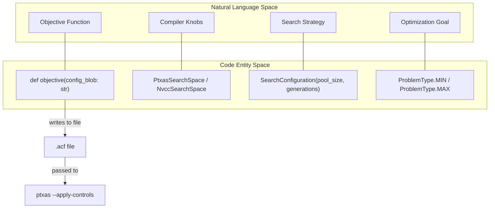
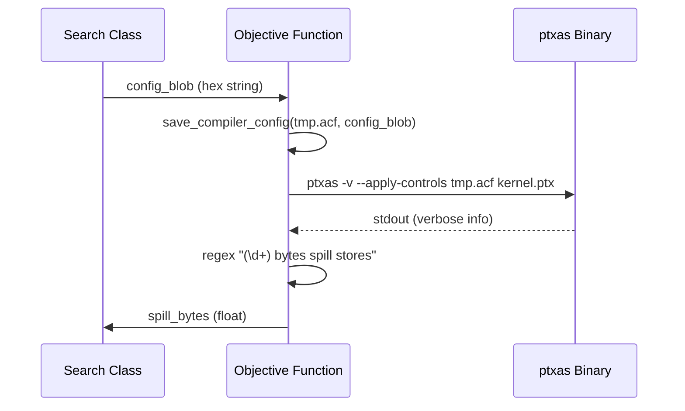

<!-- source: DeepWiki mcp.deepwiki.com · repo NVIDIA/CompileIQ · page 5.1 Running a Compiler Search · fetched 2026-10-26 -->

# Running a Compiler Search

<details>
<summary>Relevant source files</summary>

The following files were used as context for generating this wiki page:

- [compileiq/utils/helpers.py](compileiq/utils/helpers.py)
- [docs/_static/decode_acf_s_curve_full.svg](docs/_static/decode_acf_s_curve_full.svg)
- [docs/_static/decode_acf_s_curve_summary.svg](docs/_static/decode_acf_s_curve_summary.svg)
- [docs/flashinfer_booster.md](docs/flashinfer_booster.md)
- [docs/nvcc_example.md](docs/nvcc_example.md)
- [docs/ptx_spill_example.md](docs/ptx_spill_example.md)
- [examples/compilers/nvbench_example/README.md](examples/compilers/nvbench_example/README.md)
- [examples/compilers/nvbench_example/nvbench_utils.py](examples/compilers/nvbench_example/nvbench_utils.py)
- [examples/compilers/nvbench_example/optimize_reduction.py](examples/compilers/nvbench_example/optimize_reduction.py)
- [examples/compilers/nvbench_example/reduction_bench.cu](examples/compilers/nvbench_example/reduction_bench.cu)
- [examples/compilers/nvcc_example/optimize_reduction.py](examples/compilers/nvcc_example/optimize_reduction.py)
- [examples/compilers/nvcc_example/reduction.cu](examples/compilers/nvcc_example/reduction.cu)
- [examples/compilers/ptxas_example/README.md](examples/compilers/ptxas_example/README.md)
- [examples/compilers/ptxas_example/ptx_spill.py](examples/compilers/ptxas_example/ptx_spill.py)

</details>


This page provides a technical walkthrough for using CompileIQ to tune NVIDIA compiler controls for `ptxas` and `nvcc`. It covers the implementation of objective functions, the generation of Advanced Controls Files (ACF), and the interpretation of search results.

## Overview of the Tuning Workflow

Tuning a compiler with CompileIQ involves a feedback loop where the `Search` class proposes configurations, and a user-defined **objective function** evaluates them by invoking the compiler.

### Core Components and Data Flow

The search process transitions from abstract parameter sets to concrete binary files (ACFs) used by the NVIDIA Advanced Controls Interface.

1.  **Parameter Generation**: The `Search` class [compileiq/ciq.py:15-16]() samples a configuration from the `SearchSpace` (e.g., `PtxasSearchSpace` [compileiq/search_spaces/compilers.py:31]()).
2.  **ACF Serialization**: The objective function receives a hex-encoded string (the `config_blob`) and uses `save_compiler_config` [compileiq/utils/helpers.py:18]() to write it to disk as an ACF.
3.  **Compiler Invocation**: The objective function executes `ptxas` or `nvcc` using the `--apply-controls` flag, pointing to the generated ACF [docs/ptx_spill_example.md:58-65]().
4.  **Metric Extraction**: The objective function parses the compiler output (e.g., register spills) or runs the resulting binary to measure performance [docs/nvcc_example.md:24-33]().
5.  **Feedback**: The extracted metric is returned to CompileIQ. If compilation or execution fails, the function returns `INVALID_SCORE` [compileiq/types.py:22]().

### System Entity Mapping

The following diagram maps natural language concepts to the specific code entities involved in a compiler search.

**Figure 1: Compiler Search Entity Map**

Sources: [docs/nvcc_example.md:24-65](), [compileiq/ciq.py:15-16](), [compileiq/types.py:32]()

---

## Implementation Details

### The Objective Function

The objective function is the bridge between CompileIQ and the compiler toolchain. It must be robust against compilation failures and timeouts.

#### Handling INVALID_SCORE
When a specific combination of compiler controls results in a compilation error, a timeout, or a functional mismatch (wrong answers), the objective function should return `INVALID_SCORE` [compileiq/types.py:22](). This signals the `Search` class to treat the candidate as non-viable without crashing the entire search process [docs/ptx_spill_example.md:140-142]().

#### File Management
Since searches often run with multiple parallel workers [compileiq/ciq.py:167](), objective functions should use unique temporary filenames (e.g., using `uuid4`) to avoid race conditions when writing ACF files [docs/ptx_spill_example.md:93-94]().

### Tuning ptxas: Register Spill Example
In this scenario, the goal is to minimize register spills in a `.ptx` file. This does not require a GPU and can be run on CPU-only build machines [docs/ptx_spill_example.md:18-19]().

**Figure 2: ptxas Tuning Logic**

Sources: [docs/ptx_spill_example.md:86-134](), [examples/compilers/ptxas_example/ptx_spill.py:24-45]()

### Tuning nvcc: Runtime Performance Example
When tuning for execution time, the objective function must compile the code, run the resulting executable, and verify correctness.

```python
def objective(config_blob: str) -> float:
    # 1. Write the configuration
    with tempfile.NamedTemporaryFile(suffix=".acf", delete=False) as f:
        save_compiler_config(f.name, config_blob)
        config_path = Path(f.name)
    
    try:
        # 2. Compile with nvcc forwarding to ptxas
        # -Xptxas forwards the controls to the ptxas component of nvcc
        cmd = ["nvcc", "-Xptxas", f"--apply-controls={config_path}", "kernel.cu", "-o", "bin"]
        subprocess.run(cmd, check=True, timeout=60)
        
        # 3. Run and measure
        res = subprocess.run(["./bin"], capture_output=True, text=True)
        if "Test passed" not in res.stdout:
            return INVALID_SCORE
            
        return extract_timing(res.stdout)
    except Exception:
        return INVALID_SCORE
    finally:
        config_path.unlink(missing_ok=True)
```
Sources: [docs/nvcc_example.md:24-43](), [examples/compilers/nvbench_example/optimize_reduction.py:210-230]()

---

## Advanced Benchmarking with NVBench

For statistically rigorous results, CompileIQ can be integrated with **NVBench**. NVBench is preferred over manual `cudaEvent` timing because it handles:
*   **Cold measurements**: Flushes L2 cache between samples [examples/compilers/nvbench_example/README.md:12-13]().
*   **Throttling detection**: Discards measurements if the GPU thermally throttles [examples/compilers/nvbench_example/README.md:16-17]().
*   **P75 Metrics**: Allows using the 75th percentile, which is more robust to outliers than the mean [examples/compilers/nvbench_example/nvbench_utils.py:16-30]().

### Integration Pattern
The objective function invokes the NVBench-instrumented binary with `--jsonbin` to output results to a temporary file, which is then parsed by `parse_nvbench_result` [examples/compilers/nvbench_example/optimize_reduction.py:135-164]().

---

## Interpreting Results

After `tuner.start()` completes, it returns a `SearchResult` object [compileiq/results.py:15]().

| Method / Attribute | Purpose |
| :--- | :--- |
| `get_best_result()` | Returns the parameters and score of the top-performing configuration [compileiq/results.py:169](). |
| `to_csv(path)` | Persists the entire search history for post-mortem analysis [compileiq/results.py:185](). |
| `pareto_front()` | (Multi-objective only) Returns the set of non-dominated solutions [compileiq/results.py:163](). |

### Saving the Best ACF
To use the discovered configuration in a production build, save the `params` from the best result using `save_compiler_config` [docs/ptx_spill_example.md:171](). This file can then be passed to the compiler in your standard build system:

```bash
nvcc -Xptxas="--apply-controls=best_config.acf" kernel.cu
```
Sources: [docs/nvcc_example.md:91-93](), [docs/flashinfer_booster.md:107]()

---
Sources:
- `compileiq/ciq.py`
- `compileiq/types.py`
- `compileiq/results.py`
- `compileiq/utils/helpers.py`
- `docs/nvcc_example.md`
- `docs/ptx_spill_example.md`
- `examples/compilers/ptxas_example/ptx_spill.py`
- `examples/compilers/nvbench_example/optimize_reduction.py`
- `examples/compilers/nvbench_example/nvbench_utils.py`

---

