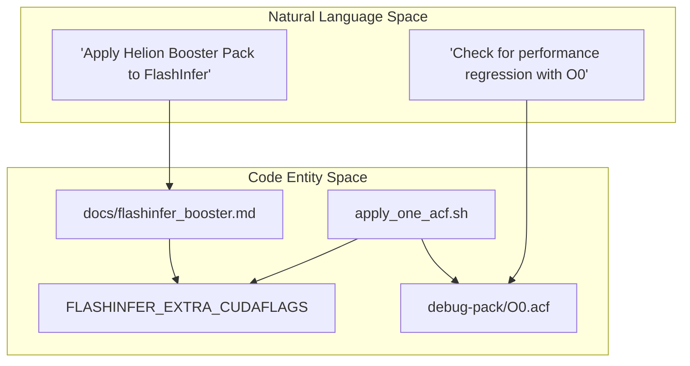
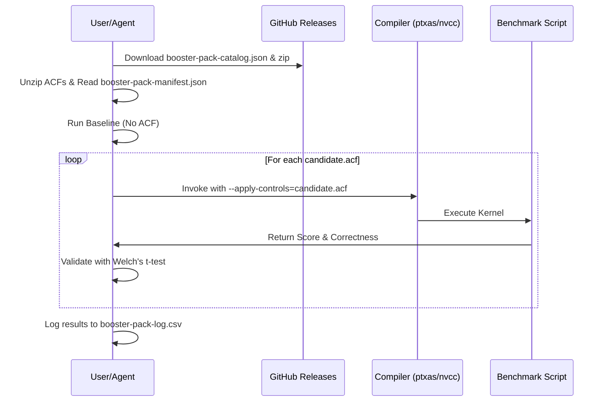

<!-- source: DeepWiki mcp.deepwiki.com · repo NVIDIA/CompileIQ · page 5.2 Booster Packs · fetched 2026-10-26 -->

# Booster Packs

Relevant source files

The following files were used as context for generating this wiki page:

- [agent-skills/MANIFEST.md](agent-skills/MANIFEST.md)
- [agent-skills/README.md](agent-skills/README.md)
- [agent-skills/compileiq-author-objective/SKILL.md](agent-skills/compileiq-author-objective/SKILL.md)
- [agent-skills/compileiq-author-objective/references/templates.md](agent-skills/compileiq-author-objective/references/templates.md)
- [agent-skills/compileiq-booster-pack/SKILL.md](agent-skills/compileiq-booster-pack/SKILL.md)
- [agent-skills/compileiq-booster-pack/scripts/apply_one_acf.sh](agent-skills/compileiq-booster-pack/scripts/apply_one_acf.sh)
- [agent-skills/compileiq-bootstrap/SKILL.md](agent-skills/compileiq-bootstrap/SKILL.md)
- [agent-skills/compileiq-bootstrap/scripts/check_env.sh](agent-skills/compileiq-bootstrap/scripts/check_env.sh)
- [agent-skills/compileiq-debug/SKILL.md](agent-skills/compileiq-debug/SKILL.md)
- [agent-skills/compileiq-debug/scripts/diagnose_csv.py](agent-skills/compileiq-debug/scripts/diagnose_csv.py)
- [agent-skills/compileiq-search-space/SKILL.md](agent-skills/compileiq-search-space/SKILL.md)
- [docs/_static/decode_acf_s_curve_full.svg](docs/_static/decode_acf_s_curve_full.svg)
- [docs/_static/decode_acf_s_curve_summary.svg](docs/_static/decode_acf_s_curve_summary.svg)
- [docs/booster_packs.md](docs/booster_packs.md)
- [docs/flashinfer_booster.md](docs/flashinfer_booster.md)
- [examples/compilers/ptxas_example/README.md](examples/compilers/ptxas_example/README.md)
- [examples/compilers/ptxas_example/ptx_spill.py](examples/compilers/ptxas_example/ptx_spill.py)

Booster Packs are curated collections of Advanced Controls Files (ACFs) distributed as GitHub Release assets. They provide a practical starting point for optimization by offering candidates known to improve specific workload families (e.g., Attention kernels, FP8 quantization) without requiring a full search [docs/booster_packs.md:3-5]().

### Purpose and Selection Logic

The Booster Pack workflow is intended as a "fast path" before committing to a full CompileIQ search. Users should evaluate their workload context against the available packs to decide the best path [docs/booster_packs.md:9-15]().

| Scenario | Recommended Path |
| :--- | :--- |
| Workload is close to a pack's intended compiler, GPU, and kernel type. | Try Booster Pack first. |
| Pack candidates do not help or workload differs materially. | Run full CompileIQ search. |
| No stable baseline or correctness check is in place. | Wait. Establish baseline first. |

**Sources:** [docs/booster_packs.md:9-15](), [agent-skills/compileiq-booster-pack/SKILL.md:41-47]()

---

### Available Booster Packs

Packs are versioned and tagged with the `booster-packs-` prefix on GitHub [docs/booster_packs.md:38-42]().

*   **Helion Booster Pack (`booster-pack-helion.zip`):** Curated for FP8 Quantization, Causal Depthwise Convolution, and Gated DeltaNet Forward. It has also shown benefits for FlashInfer `BatchDecodeWithPagedKVCacheWrapper` [docs/booster_packs.md:29-34]().
*   **Debug Pack (`booster-pack-debug.zip`):** Diagnostic ACFs (e.g., `O0.acf`, `O3.acf`) used to verify that the ACF injection pipeline is actually reaching the compiler [agent-skills/compileiq-booster-pack/SKILL.md:53-54]().

**Sources:** [docs/booster_packs.md:25-34](), [agent-skills/compileiq-booster-pack/SKILL.md:48-54]()

---

### The `apply_one_acf.sh` Workflow

The standard workflow for applying a Booster Pack involves iterative validation of individual candidates.

#### 1. Mandatory ACF-Injection Canary
Before testing performance, users must verify that the framework's cache-busting is working using the Debug Pack. Applying `O0.acf` must result in a measurable performance regression compared to the baseline [agent-skills/compileiq-booster-pack/SKILL.md:60-92]().

#### 2. Application by Target
ACFs are applied by passing the `--apply-controls` flag to the compiler or through framework-specific environment variables [docs/booster_packs.md:68-82]().

| Target | Mechanism |
| :--- | :--- |
| **Raw PTXAS** | `ptxas --apply-controls candidate.acf ...` |
| **NVCC** | `nvcc -Xptxas --apply-controls=candidate.acf ...` |
| **Triton** | `PTXAS_OPTIONS="--apply-controls=candidate.acf" TRITON_ALWAYS_COMPILE=1` |
| **FlashInfer** | `FLASHINFER_EXTRA_CUDAFLAGS="--ptxas-options=--apply-controls=$ACF_FILE"` |

#### 3. Validation and Comparison
Each candidate must be validated for:
1.  **Correctness:** Must match a known-good reference [docs/booster_packs.md:64]().
2.  **Performance:** Must beat the no-ACF baseline [docs/booster_packs.md:65]().
3.  **Stability:** Use Welch's t-test to ensure improvements are statistically significant, especially in noisy GPU environments [agent-skills/compileiq-booster-pack/SKILL.md:139-140]().

**Sources:** [docs/booster_packs.md:58-82](), [agent-skills/compileiq-booster-pack/SKILL.md:60-130](), [docs/flashinfer_booster.md:101-124]()

---

### Case Study: FlashInfer Booster Pack
The Helion Booster Pack was applied to FlashInfer's `BatchDecodeWithPagedKVCacheWrapper` on B200 GPUs. Despite being generated for Helion kernels, several ACFs provided significant speedups for specific FlashInfer shapes [docs/flashinfer_booster.md:3-6]().

#### S-Curve Analysis
CompileIQ uses S-curve visualizations to analyze the distribution of gains across a candidate pool. This helps identify "winning" ACFs that provide consistent benefits across multiple input shapes [docs/booster_packs.md:97-102]().

**FlashInfer Batch Decode B200 ACF Gains**

**Sources:** [docs/flashinfer_booster.md:1-7](), [docs/booster_packs.md:97-104](), [docs/_static/decode_acf_s_curve_summary.svg:1-21]()

---

### Implementation Details: Data Flow

The application of a Booster Pack involves downloading a release, unzipping the manifest, and iterating through the binary blobs contained in the `.acf` files.

**Booster Pack Application Flow**

#### Reproducibility Checklist
For every candidate evaluated, the system recommends logging the following metadata to ensure reproducibility [docs/flashinfer_booster.md:135-148]():
*   ACF filename and SHA256 hash.
*   Compiler paths and versions (`nvcc`, `ptxas`).
*   GPU model and driver version.
*   Input shape and benchmark command.
*   Baseline vs. Candidate results (Mean ± StdDev).

**Sources:** [docs/booster_packs.md:46-54](), [docs/flashinfer_booster.md:135-149](), [agent-skills/compileiq-booster-pack/SKILL.md:142-160]()

---

