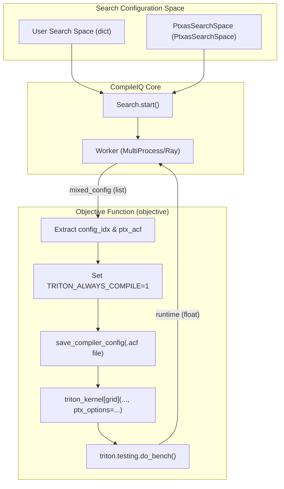
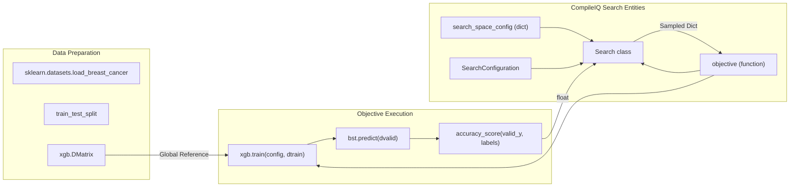

<!-- source: DeepWiki mcp.deepwiki.com · repo NVIDIA/CompileIQ · page 5.3 Triton & XGBoost Integration · fetched 2026-10-26 -->

# Triton & XGBoost Integration

<details>
<summary>Relevant source files</summary>

The following files were used as context for generating this wiki page:

- [docs/triton_example.md](docs/triton_example.md)
- [docs/xgboost.md](docs/xgboost.md)
- [examples/ciq_xgboost.py](examples/ciq_xgboost.py)
- [examples/compilers/triton_example/README.md](examples/compilers/triton_example/README.md)
- [examples/compilers/triton_example/mixed_triton.py](examples/compilers/triton_example/mixed_triton.py)
- [examples/mlflow_tracker.py](examples/mlflow_tracker.py)
- [examples/normalizing.py](examples/normalizing.py)

</details>


The CompileIQ `Search` API is designed to be agnostic of the specific workload being tuned. While it provides specialized providers for compiler flags (e.g., `PtxasSearchSpace`), it can optimize any Python callable that accepts a configuration dictionary and returns a score. This page details the integration with Triton for JIT-compiled kernel tuning and XGBoost for traditional machine learning hyperparameter optimization.

## Triton Kernel Tuning

Tuning Triton kernels involves a "Mixed Search Space" approach where the user optimizes both Triton-specific parameters (block sizes, warps, stages) and low-level compiler controls (PTXAS Advanced Controls Files).

### Key Integration Mechanisms

To successfully tune Triton kernels, several environment and kernel-launch configurations must be managed within the `objective_function`:

1.  **Bypassing Cache**: Triton's JIT cache must be bypassed to ensure every set of compiler controls is actually applied. This is achieved by setting `TRITON_ALWAYS_COMPILE="1"` [docs/triton_example.md:15-23]().
2.  **PTXAS Path Overrides**: Triton often ships with its own PTXAS. To use Advanced Controls (ACF), PTXAS 13.3+ is required. The `TRITON_PTXAS_PATH` (or `TRITON_PTXAS_BLACKWELL_PATH`) environment variable forces Triton to use a specific binary [docs/triton_example.md:17-27]().
3.  **ACF Application**: The sampled compiler controls are passed to Triton via the `ptx_options` argument in the kernel launch, using the `--apply-controls` flag [docs/triton_example.md:29-48]().

### Data Flow for Mixed Triton Search

The following diagram illustrates how CompileIQ coordinates a mixed search space between user-defined Triton configurations and PTXAS controls.

**Triton Mixed Search Orchestration**

Sources: [examples/compilers/triton_example/mixed_triton.py:129-142](), [docs/triton_example.md:175-180]()

### Implementation Example: `mixed_triton.py`

In a mixed search, the `objective` function receives a `list` containing the sampled configurations for each space defined in the `search_space` list [examples/compilers/triton_example/mixed_triton.py:97-100]().

*   **Search Space Definition**: Combines a `ss.range` for indexing into a list of `TRITON_CONFIGS` with a `PtxasSearchSpace` object [examples/compilers/triton_example/mixed_triton.py:130-133]().
*   **Validation**: The objective must validate the output of the tuned kernel against a reference (e.g., `torch.matmul`) to ensure compiler controls haven't introduced functional regressions. If validation fails, it returns `INVALID_SCORE` [examples/compilers/triton_example/mixed_triton.py:113-114]().

Sources: [examples/compilers/triton_example/mixed_triton.py:31-37](), [examples/compilers/triton_example/mixed_triton.py:105-118]()

---

## XGBoost Hyperparameter Optimization

CompileIQ can be used as a general-purpose black-box optimizer for machine learning models. In the XGBoost integration, CompileIQ treats the model training and validation process as the objective function.

### Workflow Entity Mapping

The following diagram maps the logical machine learning steps to the specific code entities in the `ciq_xgboost.py` example.

**XGBoost Search Entity Map**

Sources: [examples/ciq_xgboost.py:12-28](), [docs/xgboost.md:17-25]()

### Defining the ML Search Space

The search space for XGBoost utilizes primitives from `compileiq.search_spaces.base` (aliased as `ss`) to define ranges, choices, and log-sampling for hyperparameters:

| Parameter | Primitive | Range/Values |
| :--- | :--- | :--- |
| `booster` | `ss.choice` | `["gbtree", "gblinear", "dart"]` |
| `lambda` | `ss.log_sampling` | `1e-8` to `1.0` |
| `max_depth` | `ss.range` | `3` to `9`, step `2` |
| `grow_policy`| `ss.choice` | `["depthwise", "lossguide"]` |

Sources: [examples/ciq_xgboost.py:32-48](), [docs/xgboost.md:31-49]()

### Global Variables and Multiprocessing

When using `MultiProcessWorker` (the default for local execution), each worker process receives a copy of the global variables [docs/xgboost.md:27-28](). In the XGBoost example, the `DMatrix` objects (`dtrain`, `dvalid`) are created globally so they are available to the `objective` function without being re-loaded in every iteration [examples/ciq_xgboost.py:12-17]().

---

## Common Patterns Across Workloads

Regardless of whether tuning a Triton kernel or an XGBoost model, the following CompileIQ features are consistently applied:

### Result Management
The `tuner.start()` method returns a `SearchResult` object [compileiq/ciq.py:141]().
*   `results.get_best_result()`: Retrieves the configuration that yielded the optimal score (e.g., lowest runtime for Triton, highest accuracy for XGBoost) [docs/xgboost.md:100]().
*   `results.get_results()`: Returns a Pandas DataFrame containing the history of all tested parameters and scores [docs/xgboost.md:100]().

### Normalization
For noisy benchmarks (common in GPU-bound Triton kernels), the `normalize=True` setting in `SearchConfiguration` can be used. This triggers a baseline measurement using an empty configuration (`BASELINE_CONFIG`) and reports all subsequent scores as a ratio relative to this baseline [examples/normalizing.py:30-41]().

### Reliability and Reproducibility
For GPU workloads like Triton, it is recommended to use the `gpu_benchmark_mode` context manager to lock GPU clocks. This minimizes variance in timing measurements [docs/triton_example.md:113-124]().

```python
from compileiq.utils.gpu import gpu_benchmark_mode

with gpu_benchmark_mode(clock_mhz=1965, raise_on_failure=False):
    results = tuner.start()
```

Sources: [docs/triton_example.md:118-122](), [examples/normalizing.py:30-39]()

---

