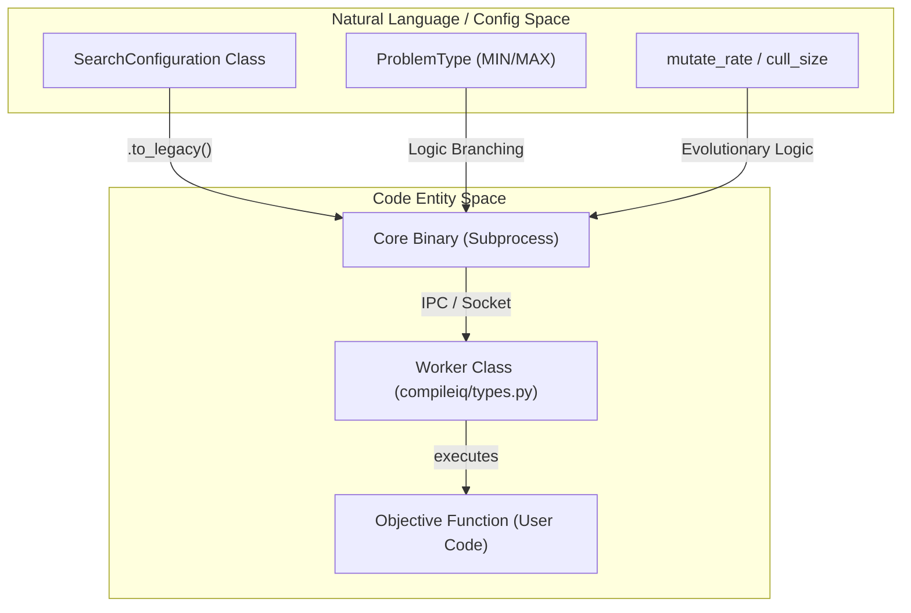
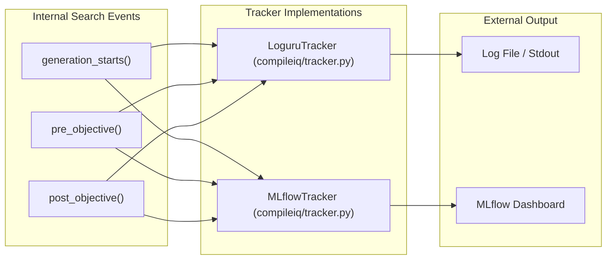

<!-- source: DeepWiki mcp.deepwiki.com · repo NVIDIA/CompileIQ · page 6 Search Configuration & Advanced Features · fetched 2026-10-26 -->

# Search Configuration & Advanced Features

Relevant source files

The following files were used as context for generating this wiki page:

- [compileiq/tracker.py](compileiq/tracker.py)
- [compileiq/types.py](compileiq/types.py)
- [docs/search_strategy.md](docs/search_strategy.md)
- [tests/integration/test_worker.py](tests/integration/test_worker.py)
- [tests/unit/test_search_configuration.py](tests/unit/test_search_configuration.py)
- [tests/unit/test_tracker_unit.py](tests/unit/test_tracker_unit.py)

This page provides a high-level overview of the `SearchConfiguration` system, which governs the behavior of the CompileIQ search engine. It covers the core search strategy, score normalization for noisy environments, multi-objective optimization (Pareto fronts), and the experiment tracking system.

## Search Strategy & Configuration

The search behavior is defined by the `SearchConfiguration` class [compileiq/types.py:1016-1050](). This configuration controls the balance between **exploration** (discovering new areas of the search space) and **refinement** (optimizing around known good candidates).

Key parameters include:
*   `pool_size`: The number of candidates evaluated per generation.
*   `generations`: The total number of iterations to run.
*   `mutate_rate`: The probability of perturbing a candidate to explore new values.
*   `cull_size`: How many low-performing candidates are discarded each generation.
*   `init_with_true_random_threshold`: Controls the randomness of the initial population.

The engine uses a generational loop where candidates are sampled, evaluated by workers, and used to inform the next generation's population [docs/search_strategy.md:20-26]().

For details on tuning these parameters, see [Search Strategy & Configuration](#6.1).

### Search Configuration Flow
The following diagram illustrates how `SearchConfiguration` parameters influence the transition from abstract search parameters to concrete code execution.

**Diagram: Search Configuration to Execution**

Sources: [compileiq/types.py:1016-1050](), [compileiq/types.py:34-39](), [docs/search_strategy.md:20-26]()

---

## Normalization

Normalization is a critical feature for tuning workloads with high variance, such as GPU benchmarks. When `normalize=True` is set in the `SearchConfiguration` [compileiq/types.py:1033](), CompileIQ performs an initial "baseline" run using an empty parameter set (`BASELINE_CONFIG`) [compileiq/utils/validation.py:27]().

The resulting `baseline_score` is used to compute a `norm_score` for all subsequent candidates. This allows the optimizer to focus on relative improvements rather than absolute values, which may shift due to thermal throttling or background system load.

For details on the normalization math and best practices, see [Normalization](#6.2).

Sources: [compileiq/types.py:1033](), [compileiq/types.py:191-218](), [compileiq/utils/validation.py:27]()

---

## Multi-Objective Optimization

CompileIQ supports optimizing for multiple conflicting goals (e.g., minimizing execution time while also minimizing memory usage) by setting `num_objectives > 1` [compileiq/types.py:1030]().

When multiple objectives are present, the search engine utilizes a direction-vector algorithm. This introduces a structural constraint: the number of survivors (`pool_size - cull_size`) must be at least `1 + 2 * num_objectives` [tests/unit/test_search_configuration.py:98-102](). Users can compare results using different strategies defined in `MultiScoreComparison` [compileiq/types.py:41-58]():
*   **PARETO**: Identifies the set of non-dominated solutions.
*   **AVERAGE**: Simplifies the problem by averaging objective scores.
*   **STDDEV**: Focuses on stability across objectives.

For details on Pareto fronts and multi-objective constraints, see [Multi-Objective Optimization](#6.3).

Sources: [compileiq/types.py:41-58](), [compileiq/types.py:1030](), [tests/unit/test_search_configuration.py:98-102]()

---

## Experiment Tracking

CompileIQ includes an event-driven tracking system to monitor search progress in real-time. The `BaseTracker` class [compileiq/types.py:93-103]() defines a lifecycle of callbacks that are triggered by the `Search` orchestrator.

### Tracker Lifecycle
1.  `setup()`: Initializes resources (e.g., MLflow connections).
2.  `search_starts()`: Logs search metadata and resolved search spaces.
3.  `generation_starts()` / `generation_ends()`: Marks the boundaries of each iteration.
4.  `pre_objective()` / `post_objective()`: Tracks individual candidate evaluations.
5.  `search_ends()`: Finalizes logs and summarizes results.

Supported `TrackerTypes` include `LOGURU` (file/stdout logging), `MLFLOW` (full experiment management), and `DISABLED` [compileiq/types.py:60-82]().

For details on configuring MLflow or implementing custom trackers, see [Experiment Tracking](#6.4).

### Tracking Integration
This diagram shows how the `BaseTracker` bridges the gap between internal search events and external tracking platforms.

**Diagram: Tracker Event Mapping**

Sources: [compileiq/types.py:93-171](), [compileiq/tracker.py:94-150](), [compileiq/tracker.py:151-215]()

---

