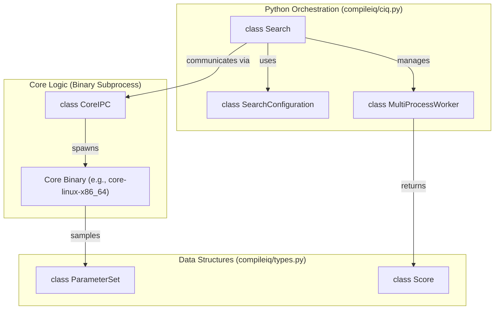
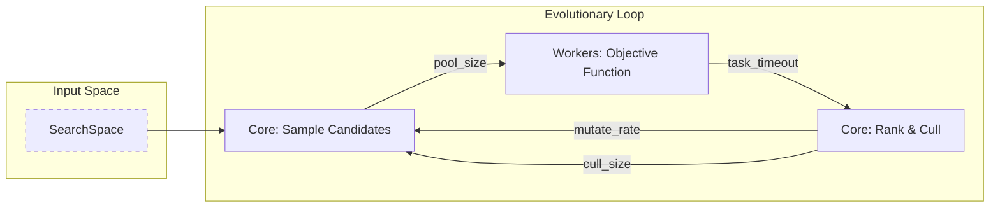

<!-- source: DeepWiki mcp.deepwiki.com · repo NVIDIA/CompileIQ · page 6.1 Search Strategy & Configuration · fetched 2026-10-26 -->

# Search Strategy & Configuration

Relevant source files

The following files were used as context for generating this wiki page:

- [docs/search_strategy.md](docs/search_strategy.md)
- [tests/fuzz/test_search_fuzz.py](tests/fuzz/test_search_fuzz.py)

The `SearchConfiguration` class defines the operational parameters for CompileIQ's evolutionary search algorithm. It balances the exploration of high-dimensional search spaces with the refinement of promising candidate regions to find optimal compiler settings or application parameters.

## The SearchConfiguration Class

The `SearchConfiguration` dataclass in `compileiq/types.py` is the primary interface for tuning the search behavior. It governs how the Core binary samples candidates, how many iterations are performed, and how objective scores are interpreted.

### Field Definitions

| Field | Type | Default | Description |
| :--- | :--- | :--- | :--- |
| `pool_size` | `int` | `16` | The number of candidates evaluated in each generation. Larger pools provide more evidence for the Core to refine the search [docs/search_strategy.md:52-53](). |
| `generations` | `int` | `10` | Total number of search iterations. Each generation allows the search to react to prior measurements [docs/search_strategy.md:59-60](). |
| `mutate_rate` | `float` | `0.1` | Probability (0.0 to 1.0) that a candidate is perturbed away from promising regions to maintain diversity [docs/search_strategy.md:71-72](). |
| `cull_size` | `int` | `8` | Number of top-performing candidates kept as signal to inform the next generation's sampling [docs/search_strategy.md:65-66](). |
| `init_with_true_random_threshold` | `int` | `100` | Threshold for using true random sampling during initialization. |
| `num_objectives` | `int` | `1` | Number of scores returned by the objective function. If > 1, the system performs multi-objective optimization [compileiq/types.py:108-111](). |
| `problem_type` | `str` | `"min"` | Optimization goal: `"min"` for minimizing scores (e.g., latency) or `"max"` for maximizing scores (e.g., throughput) [tests/fuzz/test_search_fuzz.py:46-46](). |
| `normalize` | `bool` | `False` | Whether to normalize scores against a baseline run. Useful for noisy environments [tests/fuzz/test_search_fuzz.py:42-42](). |
| `exit_on_failure` | `bool` | `False` | If `True`, the search terminates immediately if any objective function call raises an unhandled exception. |
| `dump_results` | `bool` | `True` | Whether to persist results to a CSV file during the search. |
| `task_timeout` | `float` | `None` | Maximum time (seconds) allowed for a single objective function evaluation. |

**Sources:** [compileiq/types.py:97-124](), [docs/search_strategy.md:40-44](), [tests/fuzz/test_search_fuzz.py:78-85]()

---

## Generational Loop & Implementation

The search follows a generational lifecycle orchestrated by the `Search` class in `compileiq/ciq.py`. It coordinates between the Python-based `Worker` pool and the `Core` binary which handles the evolutionary logic.

### Search Execution Flow
1.  **Initialization**: The `Search` class establishes a `CoreIPC` connection to the platform-specific Core binary.
2.  **Initial Sampling**: The Core generates the first `pool_size` candidates.
3.  **Evaluation**: Workers execute the user-provided `objective_function` for each candidate in the current generation [docs/search_strategy.md:23-23]().
4.  **Feedback**: Scores are sent back to the Core via local socket IPC [docs/search_strategy.md:24-24]().
5.  **Refinement**: The Core selects the best candidates (up to `cull_size`) and applies mutation based on `mutate_rate` to generate the next pool [docs/search_strategy.md:25-26]().
6.  **Termination**: The loop repeats for the specified number of `generations`.

### System Component Mapping

The following diagram maps the logical search concepts to their specific implementation entities in the codebase.

**Search Logic to Code Entity Mapping**

**Sources:** [compileiq/ciq.py:123-145](), [compileiq/types.py:97-124](), [docs/search_strategy.md:20-26]()

---

## Exploration vs. Refinement

CompileIQ manages the trade-off between exploring the search space and refining known good solutions through three primary knobs.

### The Balancing Act

| Strategy | Primary Control | Effect of Increasing Value |
| :--- | :--- | :--- |
| **Exploration** | `mutate_rate` | Increases the likelihood that new candidates will deviate significantly from the current best performers [docs/search_strategy.md:71-72](). |
| **Diversity** | `pool_size` | Provides more "evidence" per generation, reducing the risk of the search getting stuck in local optima [docs/search_strategy.md:52-57](). |
| **Refinement** | `cull_size` | Focuses the search more tightly around the top performers. Smaller values focus more aggressively [docs/search_strategy.md:65-69](). |

### Data Flow Diagram
The following diagram illustrates how configuration fields influence the flow of data between the objective function and the evolutionary core.

**Configuration Data Flow**

**Sources:** [docs/search_strategy.md:33-44](), [docs/search_strategy.md:65-81]()

---

## Practical Configuration Guidance

### Scaling for Workloads
- **Expensive Workloads**: For compiler searches where a single evaluation takes minutes, start with `pool_size=8` and `generations=2` to validate the `objective_function` and `task_timeout` settings [docs/search_strategy.md:30-31]().
- **Noisy Objectives**: If benchmarks (e.g., GPU kernels) have high variance, increase `pool_size` and set `normalize=True` to help the Core distinguish signal from noise [docs/search_strategy.md:67-69]().
- **Large Search Spaces**: If the space has thousands of parameters, increase `mutate_rate` (e.g., to `0.2` or `0.3`) and `generations` to ensure the algorithm doesn't converge prematurely [docs/search_strategy.md:76-80]().

### Handling Failures
The `exit_on_failure` flag is critical for debugging. When `False` (default), the search continues even if some candidates fail (e.g., due to a compiler crash or timeout). The objective function should return `INVALID_SCORE` in these cases to signal the Core to ignore those candidates [docs/search_strategy.md:42-43]().

**Sources:** [docs/search_strategy.md:45-51](), [docs/search_strategy.md:82-85](), [tests/fuzz/test_search_fuzz.py:41-51]()

---

