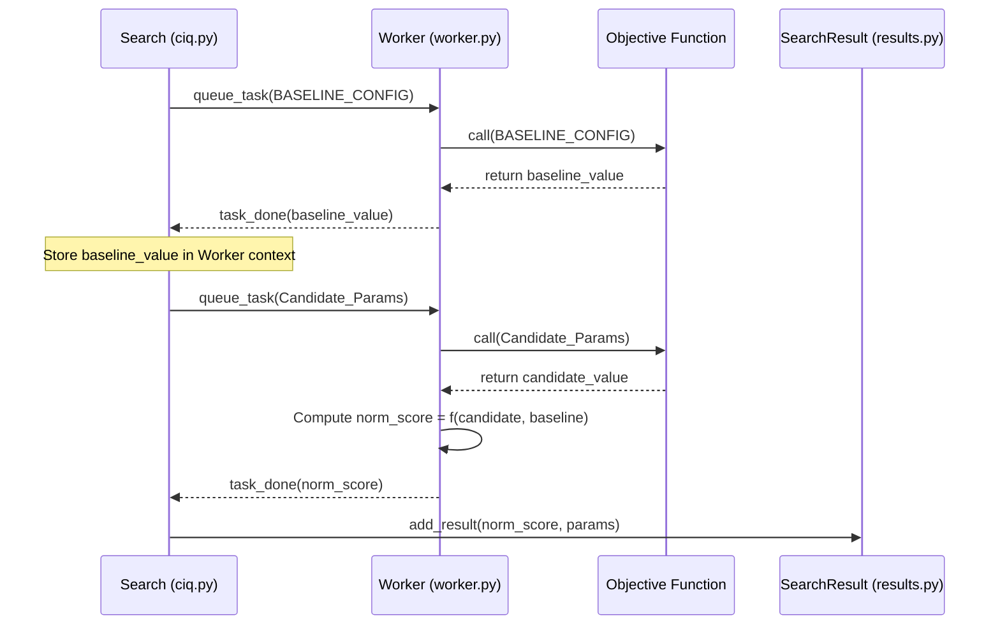
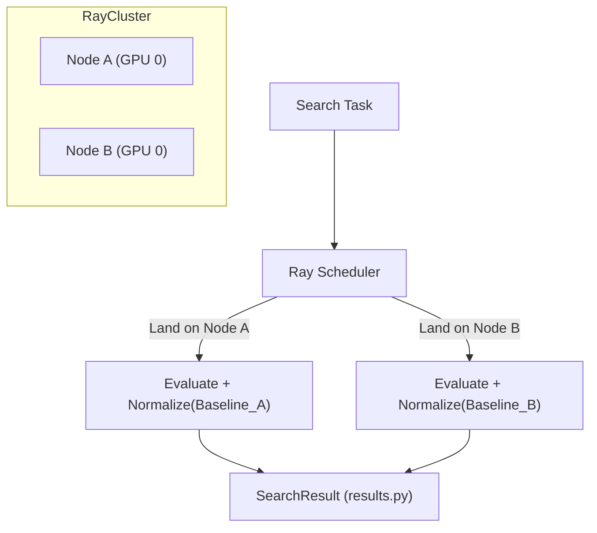

<!-- source: DeepWiki mcp.deepwiki.com · repo NVIDIA/CompileIQ · page 6.2 Normalization · fetched 2026-10-26 -->

# Normalization

<details>
<summary>Relevant source files</summary>

The following files were used as context for generating this wiki page:

- [docs/normalization.md](docs/normalization.md)
- [docs/xgboost.md](docs/xgboost.md)
- [examples/mlflow_tracker.py](examples/mlflow_tracker.py)
- [examples/normalizing.py](examples/normalizing.py)
- [tests/integration/test_core_integration.py](tests/integration/test_core_integration.py)

</details>


Normalization is a built-in feature of CompileIQ designed to mitigate measurement noise in real-world benchmarks. It is particularly critical for GPU-intensive workloads where performance improvements may be marginal (1–9%) and potentially obscured by run-to-run variance caused by thermal throttling, memory pressure, or scheduling jitter [docs/normalization.md:3-6]().

## Purpose and Scope

The normalization subsystem allows CompileIQ to compare candidate configurations relative to a consistent reference point. Instead of optimizing for raw absolute values, the search algorithm optimizes for a `norm_score`, which represents the candidate's performance as a ratio of a baseline measurement [docs/normalization.md:12-18]().

### When to Enable Normalization
*   **Noisy Environments:** When benchmark variance is comparable to the expected optimization gain [docs/normalization.md:13-14]().
*   **Heterogeneous Clusters:** When running across multiple machines or GPUs with different performance profiles, allowing for per-node baselines [docs/normalization.md:17-18]().
*   **Drifting Baselines:** When absolute performance numbers drift over time due to system state changes [docs/normalization.md:20-21]().

---

## Implementation Detail

### The Baseline Sentinel
When `normalize=True` is set in the `SearchConfiguration`, CompileIQ triggers a "baseline run" by passing a specific sentinel value to the objective function [docs/normalization.md:30-34]().

*   **Sentinel:** `BASELINE_CONFIG` (defined as an empty dictionary `{}`) [compileiq/types.py:11-11](), [examples/normalizing.py:6-6]().
*   **Requirement:** The objective function must detect this sentinel and return the performance of the "un-tuned" or reference configuration [docs/normalization.md:43-45]().

### norm_score Computation
The normalized score is computed based on the `problem_type` specified in the configuration:
*   **Minimization:** `norm_score = candidate_score / baseline_score`.
*   **Maximization:** `norm_score = baseline_score / candidate_score`.

In both cases, a `norm_score < 1.0` indicates an improvement over the baseline.

### Data Flow: Objective to SearchResult
The following diagram illustrates how the `BASELINE_CONFIG` flows through the system to establish the normalization factors.

**Normalization Measurement Flow**

Sources: [compileiq/ciq.py:19-20](), [compileiq/worker.py:7-7](), [docs/normalization.md:64-71]()

---

## Worker-Specific Behavior

Normalization logic varies depending on the execution backend to ensure measurements are relevant to the hardware executing the task.

### Async & Multiprocess Workers
For `MultiProcessWorker` and `AsyncWorker`, the baseline is measured exactly once at the start of the search [docs/normalization.md:66-69](). This measurement is the first item in the task queue, and all subsequent evaluations on that machine are normalized against this single value [examples/normalizing.py:41-43]().

### RayWorker (Distributed)
The `RayWorker` implements a more complex, node-aware normalization strategy [docs/normalization.md:72-72]():
*   **Per-Node/GPU Baselines:** Baselines are stored in a matrix keyed by `(node_id, gpu_id)`. Tasks are normalized against the specific hardware they land on [docs/normalization.md:73-75]().
*   **Dynamic Discovery:** If a new node joins the cluster mid-search, it performs a local baseline measurement for its first task and then synchronizes a global baseline for that node at the start of the next generation [docs/normalization.md:79-82]().
*   **Constraint:** When using GPU-based normalization, CompileIQ currently only supports `num_gpus=1` to ensure a 1:1 mapping between the baseline and the execution unit [docs/normalization.md:77-77]().

**Ray Normalization Logic**

Sources: [compileiq/worker.py:3-3](), [docs/normalization.md:73-75]()

---

## Best Practices for Stable Measurements

Normalization is most effective when combined with hardware-level stability measures.

### Hardware Clock Locking
To minimize variance, users should lock GPU memory and SM clocks. CompileIQ provides a utility for this:
[compileiq/utils/gpu.py:90-96]()
```python
from compileiq.utils.gpu import gpu_benchmark_mode

# Lock clocks during the benchmark
with gpu_benchmark_mode(clock_mhz=1965, raise_on_failure=False):
    # Run benchmark here
    ...
```
In a distributed `RayWorker` setup, this context manager should be used **inside** the objective function to ensure every worker node applies the lock before measurement [docs/normalization.md:98-99]().

### Objective Function Implementation
A robust objective function should handle the `BASELINE_CONFIG` sentinel explicitly and return the same number of values as `num_objectives` [docs/normalization.md:62-62]().

[examples/normalizing.py:11-20]()
```python
def objective(config):
    if config == BASELINE_CONFIG:
        # Reference measurement (e.g., default compiler flags)
        return 0.001 
    
    # Candidate measurement
    score = config["x"] ** 2 + config["y"]
    return score
```

### Alternative Strategies
If built-in normalization is insufficient, users can implement custom strategies within the objective function:
1.  **Pre-baked Factors:** Hardcode a baseline if the target hardware is known and stable [docs/normalization.md:106-110]().
2.  **Continuous Normalization:** Run a baseline measurement immediately before every candidate measurement (increases search time but maximizes stability) [docs/normalization.md:120-125]().
3.  **Aggregated Trials:** Run multiple iterations of the benchmark and return the median or trimmed mean to filter outliers [docs/normalization.md:133-138]().

Sources: [docs/normalization.md:10-11](), [docs/normalization.md:85-99](), [docs/normalization.md:100-139]()

---

