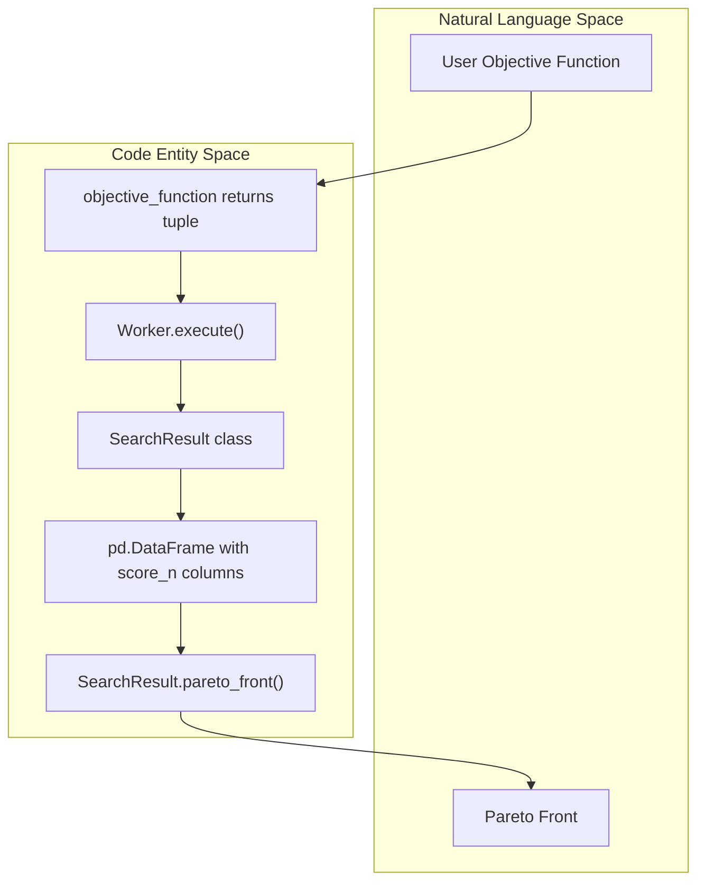
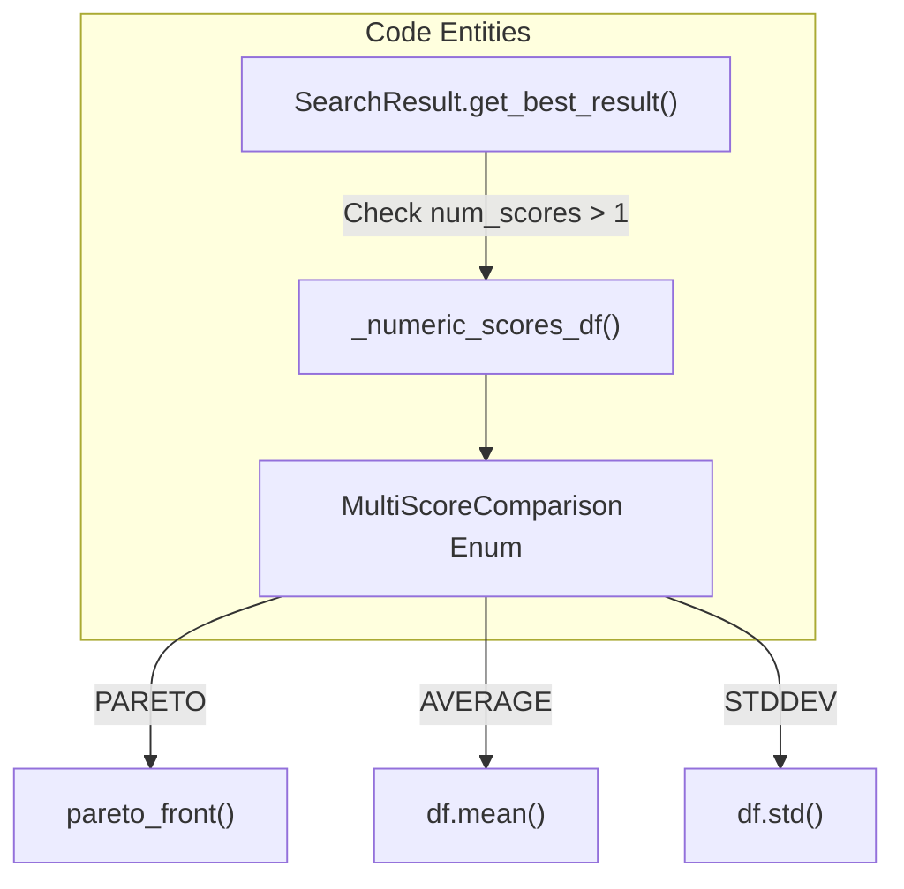

<!-- source: DeepWiki mcp.deepwiki.com · repo NVIDIA/CompileIQ · page 6.3 Multi-Objective Optimization · fetched 2026-10-26 -->

# Multi-Objective Optimization

<details>
<summary>Relevant source files</summary>

The following files were used as context for generating this wiki page:

- [.github/copy-pr-bot.yaml](.github/copy-pr-bot.yaml)
- [compileiq/results.py](compileiq/results.py)
- [examples/multi_objective.py](examples/multi_objective.py)
- [tests/integration/test_core_integration.py](tests/integration/test_core_integration.py)
- [tests/unit/test_results.py](tests/unit/test_results.py)

</details>


Multi-objective optimization in CompileIQ allows users to optimize for multiple, often competing, metrics simultaneously (e.g., minimizing kernel latency while also minimizing register pressure). When `num_objectives > 1`, the search transitions from finding a single "best" point to identifying a **Pareto front**—a set of optimal solutions where no objective can be improved without degrading at least one other objective.

### Configuration and Constraints

To enable multi-objective search, the `num_objectives` field in `SearchConfiguration` must be set to a value greater than 1 [compileiq/types.py:161-163]().

The underlying Core binary utilizes a direction-vector algorithm for multi-objective evolution. This algorithm imposes a specific constraint on the population size: the `pool_size` must be at least $2 \times \text{num\_objectives} + 1$ [tests/integration/test_core_integration.py:170-171](). If this constraint is not met, the Core may fail to initialize the search population correctly.

| Parameter | Type | Requirement |
| :--- | :--- | :--- |
| `num_objectives` | `int` | Must be $> 1$ for multi-objective mode [compileiq/types.py:161-163](). |
| `pool_size` | `int` | Must be $\ge (2 \times \text{num\_objectives} + 1)$ [tests/integration/test_core_integration.py:170-171](). |
| `problem_type` | `ProblemType` | `min` or `max`; applies to all objectives globally [compileiq/results.py:139-140](). |

**Sources:** [compileiq/types.py:161-163](), [tests/integration/test_core_integration.py:170-171](), [compileiq/results.py:139-140]()

---

### Data Flow: Objective Function to Results

In a multi-objective scenario, the user-defined `objective_function` must return a `tuple` or `list` of numeric values, one for each objective [examples/multi_objective.py:8-11](). These scores are processed by the `Worker` and stored in the `SearchResult` object.

#### Scoring Representation in Code
The system maps multi-objective scores into specific dataframe columns named `score_1`, `score_2`, ..., `score_N` [compileiq/results.py:35-38]().

**Multi-Objective Evaluation Flow**
Title: Multi-Objective Score Processing Flow

**Sources:** [examples/multi_objective.py:8-11](), [compileiq/results.py:35-38](), [compileiq/results.py:151-166]()

---

### Pareto Front Calculation

The `SearchResult` class provides the `pareto_front()` method to extract non-dominated solutions from the accumulated search data [compileiq/results.py:255-257]().

A solution $A$ dominates solution $B$ if:
1. $A$ is no worse than $B$ in all objectives.
2. $A$ is strictly better than $B$ in at least one objective.

The implementation in `SearchResult._is_pareto_efficient` uses vectorized NumPy operations to identify these points [compileiq/results.py:276-302]().

#### Key Functions
*   **`SearchResult.pareto_front()`**: Returns a list of dictionaries containing parameters and scores for all non-dominated points [compileiq/results.py:255-274]().
*   **`SearchResult._is_pareto_efficient()`**: The core logic that masks out dominated rows using the `problem_type` to determine the direction of "better" [compileiq/results.py:276-302]().

**Sources:** [compileiq/results.py:255-302]()

---

### MultiScoreComparison Strategies

While `PARETO` is the default strategy for multi-objective results, `SearchResult.get_best_result()` supports alternative aggregation strategies via the `MultiScoreComparison` enum [compileiq/types.py:41-44]().

| Strategy | Description | Implementation Detail |
| :--- | :--- | :--- |
| `PARETO` | Returns the entire Pareto front. | Default for `num_objectives > 1` [compileiq/results.py:186-187](). |
| `AVERAGE` | Ranks points by the mean of their scores. | Uses `scores_df.mean(axis=1)` [compileiq/results.py:230-234](). |
| `STDDEV` | Ranks points by the standard deviation of their scores. | Useful for finding solutions with balanced performance across objectives [compileiq/results.py:235-239](). |

**Comparison Strategy Selection Logic**
Title: MultiScoreComparison Logic in SearchResult

**Sources:** [compileiq/types.py:41-44](), [compileiq/results.py:182-243]()

---

### Implementation Example

The following snippet demonstrates a standard multi-objective search setup using two conflicting objectives [examples/multi_objective.py:8-35]().

```python
def multiobjective(config):
    # Conflict: minimizing x^2 competes with minimizing y^2
    score_1 = config["x"] ** 2 + config["y"]
    score_2 = config["y"] ** 2 + config["x"]
    return score_1, score_2

# Configuration requiring pool_size >= 2*2 + 1
config = SearchConfiguration(
    pool_size=12,
    generations=3,
    problem_type="min",
    num_objectives=2,
)

search = Search(objective_function=multiobjective, ..., search_config=config)
results = search.start()

# Retrieve the non-dominated solutions
front = results.pareto_front() 
```

**Sources:** [examples/multi_objective.py:8-35](), [tests/integration/test_core_integration.py:161-198]()

---

