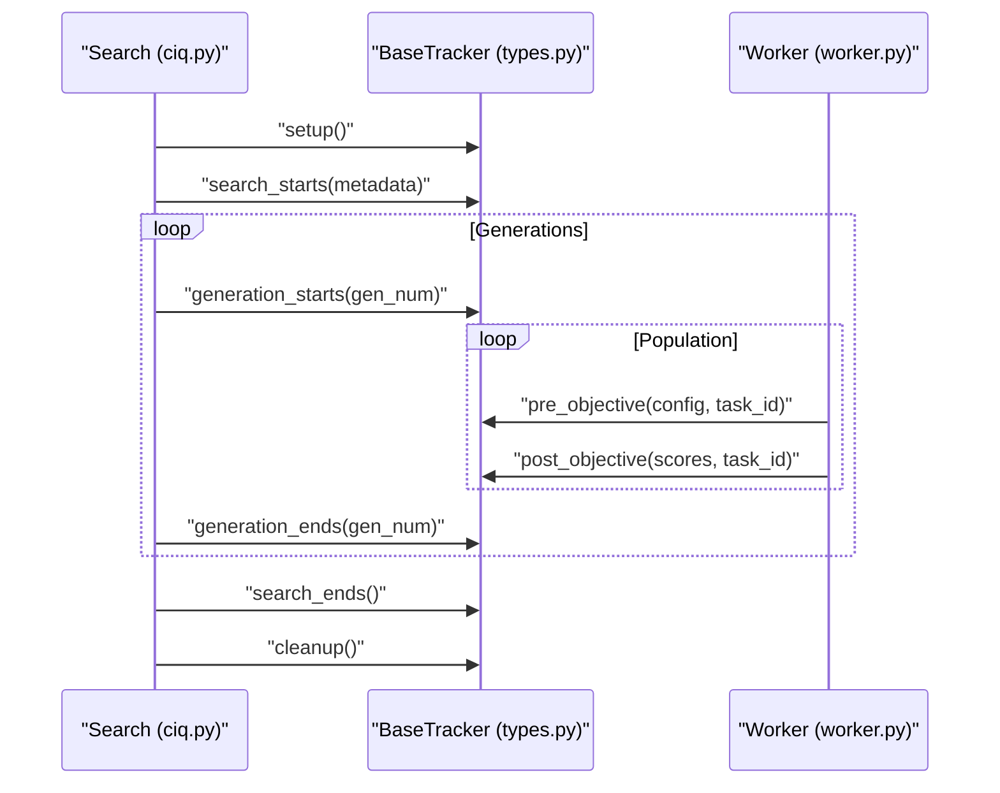

<!-- source: DeepWiki mcp.deepwiki.com · repo NVIDIA/CompileIQ · page 6.4 Experiment Tracking · fetched 2026-10-26 -->

# Experiment Tracking

<details>
<summary>Relevant source files</summary>

The following files were used as context for generating this wiki page:

- [compileiq/tracker.py](compileiq/tracker.py)
- [compileiq/types.py](compileiq/types.py)
- [docs/experiment_tracking.md](docs/experiment_tracking.md)
- [examples/loguru_tracker.py](examples/loguru_tracker.py)
- [tests/integration/test_worker.py](tests/integration/test_worker.py)
- [tests/unit/test_search_configuration.py](tests/unit/test_search_configuration.py)
- [tests/unit/test_tracker_unit.py](tests/unit/test_tracker_unit.py)

</details>


CompileIQ implements an event-driven experiment tracking system designed to capture the full lifecycle of a search process. This system allows for real-time monitoring, debugging, and performance analysis across distributed execution backends (MultiProcess, Ray, etc.) by providing a unified interface for logging parameters, metrics, and metadata.

Sources: [docs/experiment_tracking.md:3-12](), [compileiq/types.py:93-103]()

## Architecture and Lifecycle

The tracking system is built around the `BaseTracker` abstract base class. Trackers are initialized via a `TrackerConfig` and are integrated into the `Worker` and `Search` orchestration layers.

### Tracker Lifecycle Callbacks
The search process triggers specific callbacks in a defined order:
1.  **`setup`**: Initializes resources like logging sinks or network connections. [compileiq/types.py:120-126]()
2.  **`search_starts`**: Triggered once when `Search.start()` is invoked. [compileiq/types.py:133-135]()
3.  **`generation_starts`**: Triggered at the beginning of each evolutionary generation. [compileiq/types.py:143-145]()
4.  **`pre_objective`**: Triggered immediately before the `objective_function` is executed for a specific configuration. [compileiq/types.py:153-160]()
5.  **`post_objective`**: Triggered after the objective function returns, capturing the resulting `Score`. [compileiq/types.py:163-170]()
6.  **`generation_ends`**: Triggered after all configurations in a generation have been evaluated. [compileiq/types.py:148-150]()
7.  **`search_ends`**: Triggered after the final generation or upon early termination. [compileiq/types.py:138-140]()
8.  **`cleanup`**: Releases resources. [compileiq/types.py:128-130]()

### Logic Flow Diagram
The following diagram illustrates how the `Search` class interacts with `BaseTracker` during a typical run.

**Search Lifecycle to Tracker Mapping**

Sources: [compileiq/types.py:100-103](), [compileiq/tracker.py:75-91](), [compileiq/types.py:195-197]()

## Tracker Implementation Types

The system supports three primary tracker types defined in the `TrackerTypes` enum:

| Tracker Type | Class | Description |
| :--- | :--- | :--- |
| `LOGURU` | `LoguruTracker` | Structured logging to files or stdout using the Loguru library. |
| `MLFLOW` | `MLflowTracker` | Comprehensive experiment tracking (metrics, params, artifacts) via MLflow. |
| `DISABLED` | `DisabledTracker` | A no-op implementation used when tracking is not required. |

Sources: [compileiq/types.py:60-82](), [compileiq/tracker.py:17-19]()

### Loguru Integration
The `LoguruTracker` uses `LoguruTrackerConfig` to define logging sinks (files or `sys.stdout`) and levels. It binds `task_id` to log records, allowing developers to trace specific evaluations in a multi-process environment.

**Implementation Details:**
- **Sinks**: Can be a single string path or a list of sinks. [compileiq/tracker.py:102-108]()
- **Metadata**: Logs resolved search space metadata (e.g., compiler versions, SHA256 hashes) during `search_starts`. [compileiq/tracker.py:123-126]()

Sources: [compileiq/tracker.py:94-150](), [examples/loguru_tracker.py:19-22]()

### MLflow Integration
The `MLflowTracker` provides deep integration with the MLflow ecosystem. It maps CompileIQ concepts to MLflow entities:
- **Search Run**: Mapped to an MLflow parent run. [compileiq/tracker.py:201-207]()
- **Configurations**: Logged as parameters using `log_params`. [compileiq/tracker.py:228-232]()
- **Scores**: Logged as metrics. [compileiq/tracker.py:238-242]()
- **Search Space**: Metadata is logged as tags (e.g., `search_space.0.compiler`). [compileiq/tracker.py:30-37]()

**Configuration Example:**
```python
tracker_config = MLflowTrackerConfig(
    experiment_name="cuda_optimization",
    tracking_uri="http://mlflow-server:5000",
    log_config=True
)
```
Sources: [compileiq/tracker.py:151-172](), [docs/experiment_tracking.md:89-93]()

## Configuration and Data Flow

The `TrackerConfig` uses Pydantic with `extra="allow"` to permit passing arbitrary arguments to the underlying tracking backend.

**Entity Association Diagram**
```mermaid
classDiagram
    class "TrackerConfig (types.py)" {
        +TrackerTypes type
        +bool enqueue
    }
    class "LoguruTrackerConfig (types.py)" {
        +str|list sink
        +str level
    }
    class "MLflowTrackerConfig (types.py)" {
        +str experiment_name
        +str tracking_uri
        +bool log_config
    }
    class "BaseTracker (types.py)" {
        <<abstract>>
        +setup()
        +search_starts()
        +pre_objective()
        +post_objective()
    }

    "TrackerConfig (types.py)" <|-- "LoguruTrackerConfig (types.py)"
    "TrackerConfig (types.py)" <|-- "MLflowTrackerConfig (types.py)"
    "BaseTracker (types.py)" <|-- "LoguruTracker (tracker.py)"
    "BaseTracker (types.py)" <|-- "MLflowTracker (tracker.py)"
    "BaseTracker (types.py)" <|-- "DisabledTracker (tracker.py)"
```
Sources: [compileiq/types.py:88-91](), [compileiq/tracker.py:59-64](), [compileiq/tracker.py:94-98](), [compileiq/tracker.py:151-153]()

### Exception Handling
To ensure that logging failures do not crash the search process, CompileIQ uses the `@logging_exception` decorator. This decorator catches exceptions within tracker methods and issues a warning instead of terminating the execution.

Sources: [compileiq/tracker.py:40-56](), [compileiq/tracker.py:135-136]()

### Distributed Tracking with Ray
When using `RayWorker`, the tracker's `setup()` method is called within the remote worker process. This allows the tracker to re-establish connections (e.g., to an MLflow server) on different physical nodes in the cluster.

Sources: [compileiq/types.py:123-125](), [docs/experiment_tracking.md:169-174]()

---

