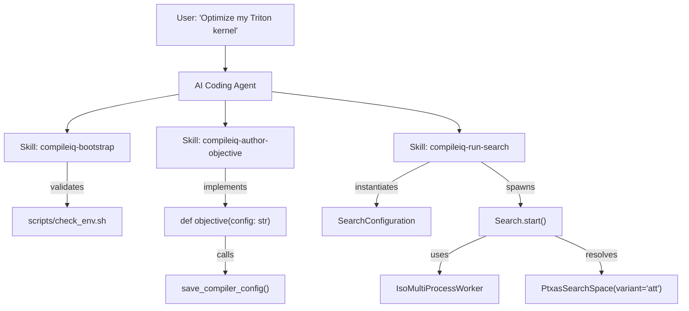
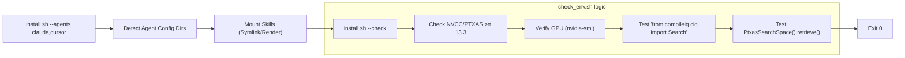

<!-- source: DeepWiki mcp.deepwiki.com · repo NVIDIA/CompileIQ · page 7.1 Skill Catalog & Installation · fetched 2026-10-26 -->

# Skill Catalog & Installation

Relevant source files

The following files were used as context for generating this wiki page:

- [agent-skills/MANIFEST.md](agent-skills/MANIFEST.md)
- [agent-skills/README.md](agent-skills/README.md)
- [agent-skills/compileiq-author-objective/SKILL.md](agent-skills/compileiq-author-objective/SKILL.md)
- [agent-skills/compileiq-author-objective/references/templates.md](agent-skills/compileiq-author-objective/references/templates.md)
- [agent-skills/compileiq-booster-pack/SKILL.md](agent-skills/compileiq-booster-pack/SKILL.md)
- [agent-skills/compileiq-booster-pack/scripts/apply_one_acf.sh](agent-skills/compileiq-booster-pack/scripts/apply_one_acf.sh)
- [agent-skills/compileiq-bootstrap/SKILL.md](agent-skills/compileiq-bootstrap/SKILL.md)
- [agent-skills/compileiq-bootstrap/scripts/check_env.sh](agent-skills/compileiq-bootstrap/scripts/check_env.sh)
- [agent-skills/compileiq-debug/SKILL.md](agent-skills/compileiq-debug/SKILL.md)
- [agent-skills/compileiq-debug/scripts/diagnose_csv.py](agent-skills/compileiq-debug/scripts/diagnose_csv.py)
- [agent-skills/compileiq-run-search/SKILL.md](agent-skills/compileiq-run-search/SKILL.md)
- [agent-skills/compileiq-search-space/SKILL.md](agent-skills/compileiq-search-space/SKILL.md)
- [agent-skills/compileiq-validate-result/SKILL.md](agent-skills/compileiq-validate-result/SKILL.md)
- [agent-skills/install.sh](agent-skills/install.sh)
- [agent-skills/uninstall.sh](agent-skills/uninstall.sh)

The CompileIQ Agent Skill system provides a standardized, agent-agnostic interface for driving compiler optimization campaigns. It bridges the gap between natural language intent and the specific code entities required to execute a search. This system includes seven specialized skills, a cross-agent installation utility, and a set of diagnostic scripts.

## Purpose and Scope

The Agent Skills are designed to guide AI coding agents (such as Claude Code, Cursor, or GitHub Copilot) through the end-to-end CompileIQ workflow. They enforce best practices—such as mandatory "canary" tests for ACF injection and statistical validation—while abstracting away the complexities of IPC timeouts and search space resolution.

### Core Components
*   **SKILL.md Convention**: Each skill is defined by a markdown file containing YAML frontmatter that specifies its name, triggers, and allowed tools [agent-skills/README.md:94-118]().
*   **Cross-Agent Mounter**: The `install.sh` script detects the user's installed coding agents and mounts the skills into their respective configuration directories (e.g., `.cursor/rules/` or `.claude/skills/`) [agent-skills/README.md:31-59]().
*   **Script Helpers**: Bundled Python and Bash scripts provide automated environment checks, CSV diagnostics, and Welch's t-test validation [agent-skills/MANIFEST.md:16-25]().

Sources: [agent-skills/README.md:1-146](), [agent-skills/MANIFEST.md:1-39]()

---

## Skill Catalog

The catalog is organized into seven functional areas, designed to be followed in a specific sequence for new projects.

### The Seven Skills

| Skill | Purpose | Key Code Entities / Commands |
| :--- | :--- | :--- |
| **bootstrap** | Environment & Dependency validation | `check_env.sh`, `PtxasSearchSpace().retrieve()` |
| **booster-pack** | Pre-search optimization using curated ACFs | `apply_one_acf.sh`, `O0`/`O3` canary |
| **search-space** | Selecting and pinning compiler search spaces | `PtxasSearchSpace`, `NvccSearchSpace`, `att` variant |
| **author-objective** | Writing the user's `objective_function` | `save_compiler_config`, `INVALID_SCORE`, `BASELINE_CONFIG` |
| **run-search** | Configuring and executing the GA loop | `Search`, `SearchConfiguration`, `IsoMultiProcessWorker` |
| **validate-result** | Statistical verification of winners | `welch_validate.py`, `Welch's t-test` |
| **debug** | Symptom-indexed troubleshooting | `diagnose_csv.py`, `CIQ_SOCKET_TIMEOUT` |

Sources: [agent-skills/README.md:12-21](), [agent-skills/MANIFEST.md:6-15]()

### Data Flow: Natural Language to Code Entity

The following diagram illustrates how an agent uses the Skill Catalog to translate a user's natural language request into specific CompileIQ code operations.

**Diagram: Skill-to-Code Mapping**

Sources: [agent-skills/compileiq-bootstrap/SKILL.md:25-30](), [agent-skills/compileiq-author-objective/SKILL.md:58-72](), [agent-skills/compileiq-run-search/SKILL.md:105-117]()

---

## Installation & Cross-Agent Mounting

The `agent-skills/install.sh` script is the primary entry point for setting up the environment. It is idempotent and supports multiple installation methods based on the target agent's requirements.

### Installation Logic
1.  **Detection**: Scans the filesystem for known agent configuration directories (e.g., `~/.claude/`, `.cursor/rules/`) [agent-skills/README.md:47-57]().
2.  **Mounting**:
    *   **Symlinks**: Used for Claude Code and Windsurf to keep skills in sync with the repository [agent-skills/README.md:51-56]().
    *   **Frontmatter Rendering**: For Cursor and Copilot, the script transforms `SKILL.md` YAML frontmatter into the specific markdown formats (e.g., `.mdc` for Cursor) required by those tools [agent-skills/README.md:53-54]().
    *   **Config Injection**: For Aider, it modifies the `.aider.conf.yml` to include the skill paths in the `read:` list [agent-skills/README.md:55]().
3.  **Verification**: The `--check` flag runs `scripts/check_env.sh` to ensure the local CUDA toolkit and Python environment are compatible [agent-skills/compileiq-bootstrap/scripts/check_env.sh:1-121]().

**Diagram: Installation and Environment Verification Flow**

Sources: [agent-skills/README.md:31-45](), [agent-skills/compileiq-bootstrap/scripts/check_env.sh:34-113]()

---

## Implementation Details

### The SKILL.md Frontmatter
Every skill must follow a strict metadata convention to ensure portability across agents. Fields like `when_to_use` are specifically parsed by agents like Claude Code to determine tool relevance [agent-skills/README.md:99-114]().

### Mandatory Objective Patterns
The `compileiq-author-objective` skill enforces two critical patterns to prevent common failures:
1.  **ACF Injection Canary**: Before starting a search, the objective must be tested with `O0` (unoptimized) and `O3` (default) ACFs from the `debug-pack`. If `O0` does not regress performance, the ACF is not reaching the compiler (usually due to framework caching) [agent-skills/compileiq-author-objective/SKILL.md:142-166]().
2.  **Cache Busting**: Objectives must explicitly disable framework caches (e.g., `TRITON_ALWAYS_COMPILE=1`, `HELION_SKIP_CACHE=1`) and use unique temporary directories for each evaluation to ensure the compiler actually processes the new ACF [agent-skills/compileiq-author-objective/SKILL.md:80-92]().

### Search Space Resolution
Search spaces are resolved via provider classes in `compileiq.search_spaces.compilers`.
*   **PtxasSearchSpace**: Fetches binary blobs from GitHub Releases [agent-skills/compileiq-search-space/SKILL.md:43-54]().
*   **The `att` Variant**: A curated space specifically for **attention** kernels (FlashAttention, GQA, etc.) [agent-skills/compileiq-search-space/SKILL.md:59-60]().
*   **Air-gapped Support**: Controlled via the `CIQ_SEARCH_SPACES_DIR` environment variable [agent-skills/compileiq-search-space/SKILL.md:89-104]().

Sources: [agent-skills/compileiq-author-objective/SKILL.md:1-170](), [agent-skills/compileiq-search-space/SKILL.md:1-104](), [agent-skills/compileiq-run-search/SKILL.md:1-150]()

---

