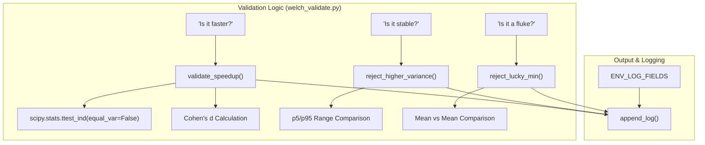
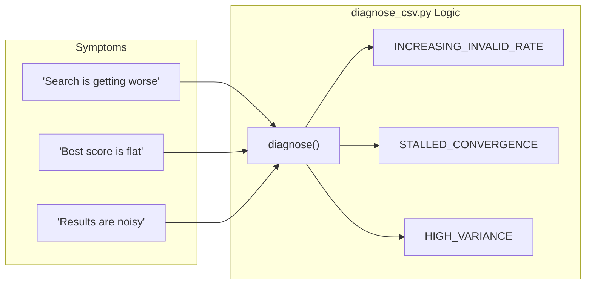

<!-- source: DeepWiki mcp.deepwiki.com · repo NVIDIA/CompileIQ · page 7.2 Validation & Debugging Scripts · fetched 2026-10-26 -->

# Validation & Debugging Scripts

Relevant source files

The following files were used as context for generating this wiki page:

- [agent-skills/MANIFEST.md](agent-skills/MANIFEST.md)
- [agent-skills/README.md](agent-skills/README.md)
- [agent-skills/compileiq-author-objective/references/templates.md](agent-skills/compileiq-author-objective/references/templates.md)
- [agent-skills/compileiq-booster-pack/scripts/apply_one_acf.sh](agent-skills/compileiq-booster-pack/scripts/apply_one_acf.sh)
- [agent-skills/compileiq-debug/SKILL.md](agent-skills/compileiq-debug/SKILL.md)
- [agent-skills/compileiq-debug/scripts/diagnose_csv.py](agent-skills/compileiq-debug/scripts/diagnose_csv.py)
- [agent-skills/compileiq-run-search/scripts/smoke_search.py](agent-skills/compileiq-run-search/scripts/smoke_search.py)
- [agent-skills/compileiq-validate-result/scripts/welch_validate.py](agent-skills/compileiq-validate-result/scripts/welch_validate.py)

This page documents the helper scripts and diagnostic utilities bundled with the CompileIQ agent skills. These tools bridge the gap between automated search results and production-ready optimizations by providing statistical validation, environment health checks, and heuristic diagnostics for search failures.

### Overview of Utilities

| Script | Purpose | Implementation |
|---|---|---|
| `welch_validate.py` | Statistical validation of ACF candidates. | Welch's t-test + Cohen's d [agent-skills/compileiq-validate-result/scripts/welch_validate.py:1-22]() |
| `smoke_search.py` | Verification of the Python orchestration layer. | 2-generation trivial search [agent-skills/compileiq-run-search/scripts/smoke_search.py:1-12]() |
| `diagnose_csv.py` | Analysis of `results.csv` for pathologies. | Heuristic data frame analysis [agent-skills/compileiq-debug/scripts/diagnose_csv.py:1-15]() |
| `apply_one_acf.sh` | Rapid benchmarking of a single ACF. | Bash wrapper for `PTXAS_OPTIONS` [agent-skills/booster-pack/scripts/apply_one_acf.sh:1-19]() |
| `check_env.sh` | Environment and dependency validation. | Shell-based sanity checks [agent-skills/MANIFEST.md:20-20]() |

---

### Statistical Validation: welch_validate.py

The `welch_validate.py` script is the authoritative tool for confirming that a winning ACF candidate provides a statistically significant speedup. It addresses the "noisy GPU benchmark" problem by using Welch's t-test, which does not assume equal variance between the baseline and optimized populations [agent-skills/compileiq-validate-result/scripts/welch_validate.py:97-104]().

#### Implementation Details
The script executes a baseline command and an optimized command for a specified number of trials (default 100) after a warmup phase (default 50) [agent-skills/compileiq-validate-result/scripts/welch_validate.py:203-204](). It uses a regex to extract scores from `stdout` [agent-skills/compileiq-validate-result/scripts/welch_validate.py:162-176]().

**Key Rejection Heuristics:**
1.  **Lucky Min:** Rejects if the optimized mean is not lower than the baseline mean, even if a single "lucky" trial was faster [agent-skills/compileiq-validate-result/scripts/welch_validate.py:155-159]().
2.  **Higher Variance:** Rejects if the optimized distribution's p5-p95 range is >25% wider than the baseline, indicating instability [agent-skills/compileiq-validate-result/scripts/welch_validate.py:141-152]().
3.  **Effect Size:** Uses Cohen's d to ensure the "practical significance" of the speedup is > 0.2 [agent-skills/compileiq-validate-result/scripts/welch_validate.py:120-127]().

**Validation Data Flow**
"Natural Language Space" (Validation Requirements) to "Code Entity Space" (Implementation):

Sources: [agent-skills/compileiq-validate-result/scripts/welch_validate.py:97-138](), [agent-skills/compileiq-validate-result/scripts/welch_validate.py:141-152](), [agent-skills/compileiq-validate-result/scripts/welch_validate.py:155-159](), [agent-skills/compileiq-validate-result/scripts/welch_validate.py:38-48]().

---

### CSV Diagnostics: diagnose_csv.py

This script analyzes the `dump_results` CSV produced by a `Search` run to identify common search pathologies [agent-skills/compileiq-debug/scripts/diagnose_csv.py:1-15]().

#### Flagged Pathologies
*   **`INCREASING_INVALID_RATE`**: Triggered if the percentage of `INVALID_SCORE` returns rises by >10% between early and late generations, suggesting mutation is spreading structurally unsound configs [agent-skills/compileiq-debug/scripts/diagnose_csv.py:61-69]().
*   **`STALLED_CONVERGENCE`**: Triggered if the best score improves by <1% over the final quarter of the search [agent-skills/compileiq-debug/scripts/diagnose_csv.py:71-82]().
*   **`HIGH_VARIANCE`**: Triggered if the median per-generation Coefficient of Variation (CV%) exceeds 15% [agent-skills/compileiq-debug/scripts/diagnose_csv.py:84-89]().

**Diagnostic Heuristics**
"Natural Language Space" (Search Symptoms) to "Code Entity Space" (Diagnosis):

Sources: [agent-skills/compileiq-debug/scripts/diagnose_csv.py:35-95](), [agent-skills/compileiq-debug/SKILL.md:34-46]().

---

### Benchmarking & Smoke Testing

#### apply_one_acf.sh
A lightweight Bash utility used primarily in the `booster-pack` workflow. It applies a single ACF file to a candidate command and compares it to a baseline [agent-skills/compileiq-booster-pack/scripts/apply_one_acf.sh:1-19](). It requires a 1% improvement margin to return a "KEPT" status [agent-skills/compileiq-booster-pack/scripts/apply_one_acf.sh:110-120](). Results are appended to `booster-pack-log.csv` [agent-skills/compileiq-booster-pack/scripts/apply_one_acf.sh:123-128]().

#### smoke_search.py
Verifies the end-to-end installation by running a trivial 2-generation search using `MultiProcessWorker` [agent-skills/compileiq-run-search/scripts/smoke_search.py:28-46](). The objective function `x**2 + y` ensures that the orchestration layer, search space resolution, and result collection are functioning correctly without requiring a GPU or compiler [agent-skills/compileiq-run-search/scripts/smoke_search.py:23-25]().

Sources: [agent-skills/compileiq-booster-pack/scripts/apply_one_acf.sh:1-135](), [agent-skills/compileiq-run-search/scripts/smoke_search.py:1-60]().

---

### Troubleshooting Common Failures

The `compileiq-debug` skill provides a symptom-indexed table for resolving common execution issues [agent-skills/compileiq-debug/SKILL.md:34-46]().

| Symptom | Probable Cause | Recommended Action |
|---|---|---|
| Socket Timeout / Hang | Large search space or slow fetch | Raise `CIQ_SOCKET_TIMEOUT` to 120+; use `CIQ_SEARCH_SPACES_DIR` mirror [agent-skills/compileiq-debug/SKILL.md:57-70](). |
| All `INVALID_SCORE` | Return type mismatch or tight `task_timeout` | Check `num_objectives` vs return shape; call objective manually with `Search.sample(1)` [agent-skills/compileiq-debug/SKILL.md:72-90](). |
| Same score every eval | Framework caching (e.g., Triton/Helion) | Enable `TRITON_ALWAYS_COMPILE=1` or `HELION_SKIP_CACHE=1` [agent-skills/compileiq-debug/SKILL.md:91-102](). |
| `TypeError: fromhex()` | Legacy config handling | Use `save_compiler_config(acf_path, config)` [agent-skills/compileiq-debug/SKILL.md:104-127](). |

Sources: [agent-skills/compileiq-debug/SKILL.md:34-127](), [agent-skills/compileiq-author-objective/references/templates.md:57-64]().

---

