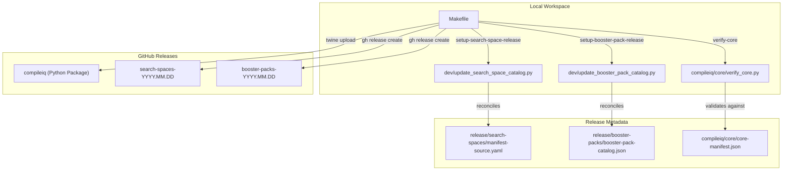
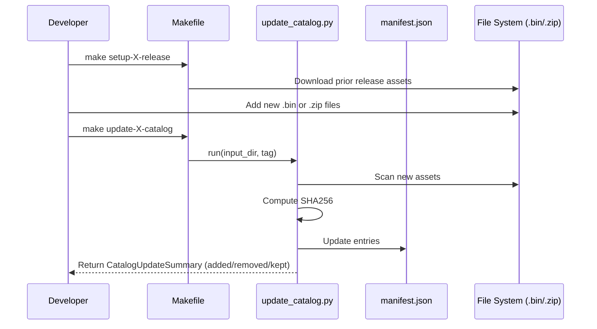

<!-- source: DeepWiki mcp.deepwiki.com · repo NVIDIA/CompileIQ · page 8 Release Engineering · fetched 2026-10-26 -->

# Release Engineering

Relevant source files

The following files were used as context for generating this wiki page:

- [Makefile](Makefile)
- [dev/update_booster_pack_catalog.py](dev/update_booster_pack_catalog.py)
- [dev/update_search_space_catalog.py](dev/update_search_space_catalog.py)
- [dev/verify_booster_pack_release.py](dev/verify_booster_pack_release.py)
- [dev/verify_search_space_release.py](dev/verify_search_space_release.py)
- [tests/unit/test_release_workflow.py](tests/unit/test_release_workflow.py)

CompileIQ utilizes three parallel release pipelines to deliver the core library, search space definitions, and optimized Booster Packs. These pipelines ensure that the Python orchestration layer, the binary compiler descriptions, and the verified optimization sets can evolve at different cadences while maintaining strict compatibility and integrity.

## Release Pipelines Overview

The release process is managed via the `Makefile` and supported by specialized Python tooling in the `dev/` directory.

| Pipeline | Artifacts | Cadence | Purpose |
| :--- | :--- | :--- | :--- |
| **Package Release** | `compileiq` wheel, core binaries | Feature-driven | Updates the orchestration logic and bundled C++ Core. |
| **Search Space** | `manifest.json`, `.bin` files | Data-driven | Adds support for new compiler versions (e.g., `ptxas 12.8`). |
| **Booster Pack** | `catalog.json`, `.zip` assets | Content-driven | Delivers pre-verified optimization sets for specific models/GPUs. |

### System Relationship Diagram

The following diagram illustrates how the release engineering tools interact with the repository structure and external release targets.

**Release Tooling & Entity Mapping**

Sources: [Makefile:112-117](), [Makefile:138-142](), [Makefile:153-157](), [dev/update_search_space_catalog.py:18-25](), [dev/update_booster_pack_catalog.py:17-21]()

---

## Search Space Release Pipeline

The Search Space pipeline manages the lifecycle of binary search space definitions used by `PtxasSearchSpace` and `NvccSearchSpace`. It uses a "seeding" mechanism where new releases are built incrementally from the previous latest release to ensure stability.

*   **Source Truth:** Managed in `release/search-spaces/manifest-source.yaml`.
*   **Validation:** Every release must pass `dev/verify_search_space_release.py` which checks SHA256 integrity and `SearchSpaceManifestModel` schema compliance.
*   **Versioning:** Uses date-based tagging (e.g., `search-spaces-2025.02.20`).

For details, see [Search Space Release Pipeline](#8.1).

Sources: [Makefile:138-150](), [dev/verify_search_space_release.py:150-160](), [dev/update_search_space_catalog.py:218-225]()

---

## Booster Pack Release Pipeline

Booster Packs are bundled optimizations delivered as `.zip` files containing `.acf` (Advanced Control Facility) files and performance evidence. The pipeline reconciles staged zip files with the `booster-pack-catalog.json`.

*   **Automation:** `dev/update_booster_pack_catalog.py` extracts metadata directly from the `booster-pack-manifest.json` inside each zip.
*   **Integrity:** `dev/verify_booster_pack_release.py` ensures that all listed artifacts match their recorded SHA256 and size in the catalog.
*   **Workflow:** Involves seeding from a `PRIOR_RELEASE_CATALOG_NAME` to maintain historical pack entries.

For details, see [Booster Pack Release Pipeline](#8.2).

Sources: [dev/update_booster_pack_catalog.py:17-37](), [dev/verify_booster_pack_release.py:177-185](), [Makefile:14-17]()

---

## Package Release & Core Binary Updates

The core `compileiq` Python package release handles the distribution of the orchestration logic and the platform-specific Core binaries.

*   **Environment Setup:** The `setup-compileiq-package-release` target generates a sourceable `.env` file containing `RELEASE_VERSION`, `RELEASE_TAG`, and `RELEASE_BRANCH`.
*   **Binary Management:** Core binaries are refreshed via `dev/update-core-binaries.sh`, which pulls from a secure internal URL and updates the `core-manifest.json`.
*   **Verification:** The `verify-core` target in the `Makefile` ensures the bundled binaries for Linux (x86_64, aarch64) and Windows match the expected checksums before packaging.

For details, see [Package Release & Core Binary Updates](#8.3).

Sources: [Makefile:117-131](), [Makefile:101-110](), [tests/unit/test_release_workflow.py:40-50]()

---

## Release Tooling & Support

The `dev/` directory contains several critical utilities that support these pipelines:

| Script | Purpose |
| :--- | :--- |
| `update_search_space_catalog.py` | Reconciles `manifest-source.yaml` with staged `.bin` files. |
| `update_booster_pack_catalog.py` | Updates `booster-pack-catalog.json` with new zip artifact metadata. |
| `verify_search_space_release.py` | Validates a search space release directory against its manifest. |
| `verify_booster_pack_release.py` | Validates a booster pack release directory against its catalog. |

**Catalog Reconciliation Flow**

Sources: [dev/update_search_space_catalog.py:37-46](), [dev/update_booster_pack_catalog.py:40-51](), [Makefile:138-160]()

---

