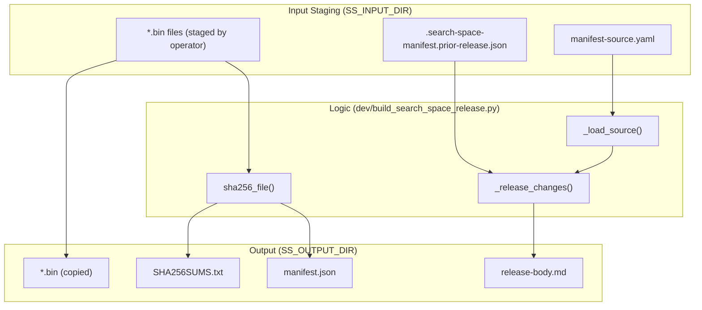
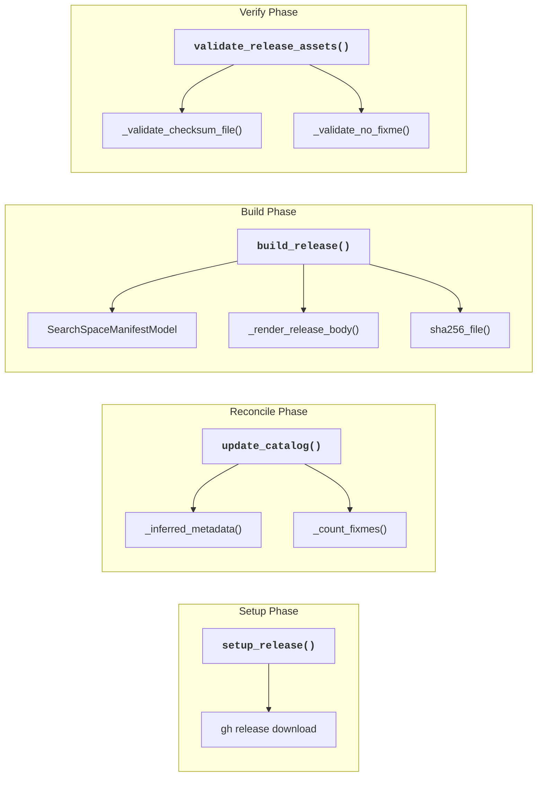

<!-- source: DeepWiki mcp.deepwiki.com · repo NVIDIA/CompileIQ · page 8.1 Search Space Release Pipeline · fetched 2026-10-26 -->

# Search Space Release Pipeline

Relevant source files

The following files were used as context for generating this wiki page:

- [dev/build_booster_pack_release.py](dev/build_booster_pack_release.py)
- [dev/build_manifest.py](dev/build_manifest.py)
- [dev/build_search_space_release.py](dev/build_search_space_release.py)
- [dev/build_search_space_release_notes.py](dev/build_search_space_release_notes.py)
- [dev/setup_search_space_release.py](dev/setup_search_space_release.py)
- [dev/update_booster_pack_catalog.py](dev/update_booster_pack_catalog.py)
- [dev/update_search_space_catalog.py](dev/update_search_space_catalog.py)
- [dev/verify_booster_pack_release.py](dev/verify_booster_pack_release.py)
- [dev/verify_search_space_release.py](dev/verify_search_space_release.py)
- [docs/search_space_release_testing.md](docs/search_space_release_testing.md)
- [release/search-spaces/manifest-source.yaml](release/search-spaces/manifest-source.yaml)
- [schemas/search-space-manifest-v1.schema.json](schemas/search-space-manifest-v1.schema.json)
- [tests/unit/search_spaces/test_build_manifest.py](tests/unit/search_spaces/test_build_manifest.py)
- [tests/unit/search_spaces/test_release_notes.py](tests/unit/search_spaces/test_release_notes.py)
- [tests/unit/test_search_space_catalog_updater.py](tests/unit/test_search_space_catalog_updater.py)
- [tests/unit/test_search_space_release_builder.py](tests/unit/test_search_space_release_builder.py)
- [tests/unit/test_search_space_release_verifier.py](tests/unit/test_search_space_release_verifier.py)

The Search Space Release Pipeline is a structured lifecycle for managing, validating, and publishing the binary search space definitions used by CompileIQ's compiler providers. Unlike the Python package, search spaces are released as independent catalog assets, allowing the core library to retrieve updated compiler tuning knobs without requiring a new library version.

## Pipeline Overview

The release lifecycle consists of four primary stages designed to ensure that the published `manifest.json` exactly matches the cryptographic hashes and metadata of the distributed `.bin` files.

### 1. Seeding (Setup)
The process begins by seeding a local staging directory (`SS_INPUT_DIR`). This is handled by `dev/setup_search_space_release.py`.
- **Scenario A (Prior Release):** If a prior release exists, the script uses the GitHub CLI (`gh release download`) to fetch the previous `manifest.json` and `.bin` files [dev/setup_search_space_release.py:64-80](). It renames the old manifest to `.search-space-manifest.prior-release.json` for comparison logic [dev/setup_search_space_release.py:84]().
- **Scenario B (Bootstrap):** If no prior release is found, it seeds from `release/search-spaces/manifest-source.yaml` [dev/setup_search_space_release.py:89-91]().

### 2. Reconciliation
Operators stage new or updated `.bin` files in the input directory. The script `dev/update_search_space_catalog.py` then reconciles these physical files with the YAML metadata.
- It scans the directory for `.bin` files and infers compiler versions/variants from filenames using `STANDARD_FILENAME_RE` [dev/update_search_space_catalog.py:22-25, 140-148]().
- It identifies added, removed, or replaced files by comparing them against the prior release manifest [dev/update_search_space_catalog.py:218-245]().
- It generates `FIXME` placeholders in `manifest-source.yaml` for any required metadata (like descriptions) that cannot be inferred [dev/update_search_space_catalog.py:125-126]().

### 3. Building the Manifest
Once the YAML source is finalized, `dev/build_search_space_release.py` generates the final distribution assets.
- **Manifest Generation:** It creates a `SearchSpaceManifestModel` containing the `generated_at` timestamp, release tag, and an entry for every validated binary [dev/build_search_space_release.py:213-228]().
- **Integrity Checks:** It calculates the SHA256 hash and size in bytes for every binary [dev/build_search_space_release.py:27-32, 233-241]().
- **Asset Assembly:** It writes `manifest.json`, `SHA256SUMS.txt`, and a Markdown `release-body.md` summarizing changes (Added/Updated/Removed) [dev/build_search_space_release.py:255-265]().

### 4. Verification and Publishing
Before publication, `dev/verify_search_space_release.py` performs a strict audit of the output directory.
- It ensures every file in the directory is listed in `SHA256SUMS.txt` and that hashes match [dev/verify_search_space_release.py:82-119]().
- It validates the `manifest.json` against the Pydantic `SearchSpaceManifestModel` [dev/verify_search_space_release.py:177-181]().
- It checks for unresolved `FIXME` strings in the manifest and release body [dev/verify_search_space_release.py:68-79, 143-144]().

**Sources:** [dev/setup_search_space_release.py:1-151](), [dev/update_search_space_catalog.py:1-245](), [dev/build_search_space_release.py:1-265](), [dev/verify_search_space_release.py:1-210]().

---

## Data Flow: Release Staging

The following diagram illustrates the transformation of data from raw binary files and YAML metadata into a verifiable release bundle.

**Search Space Asset Transformation**

**Sources:** [dev/build_search_space_release.py:69-137](), [dev/build_search_space_release.py:213-265]().

---

## Data Models and Schemas

The pipeline relies on Pydantic models to enforce the structure of the catalog.

### SearchSpaceEntry
This model defines the metadata for a single compiler binary.
| Field | Type | Description |
| :--- | :--- | :--- |
| `compiler` | `str` | Name of the compiler (e.g., `ptxas`, `nvcc`) |
| `compiler_version` | `str` | The specific version string |
| `variant` | `str` | Usually `default` or `att` (attention-optimized) |
| `filename` | `str` | The name of the binary file |
| `sha256` | `str` | Hex digest for integrity verification |
| `size_bytes` | `int` | Size of the file in bytes |
| `description` | `Optional[str]` | Human-readable details for release notes |

### SearchSpaceManifestModel
The top-level container for a release.
- `tag`: The release tag (e.g., `search-spaces-2025.01.01`).
- `manifest_format`: Semantic version of the manifest schema (currently `1.0.0`).
- `generated_at`: ISO 8601 timestamp.
- `entries`: A list of `SearchSpaceEntry` objects.

**Sources:** [compileiq/search_spaces/manifest.py]() (referenced in [dev/build_search_space_release.py:17]()), [tests/unit/search_spaces/test_build_manifest.py:43-53]().

---

## Code Entity Association

This diagram bridges the natural language release stages to the specific Python functions and classes responsible for the execution.

**Pipeline Implementation Map**

**Sources:** [dev/setup_search_space_release.py:47-54](), [dev/update_search_space_catalog.py:218](), [dev/build_search_space_release.py:213](), [dev/verify_search_space_release.py:150]().

---

## Validation Procedures

The pipeline includes a verification script used both locally and in CI to ensure release integrity.

### Asset Validation Checklist
1. **Manifest Schema:** `manifest.json` must be parsable by `SearchSpaceManifestModel.model_validate()` [dev/verify_search_space_release.py:178]().
2. **Checksum Consistency:** Every file must match the hash in `SHA256SUMS.txt` [dev/verify_search_space_release.py:111-117]().
3. **Manifest/Binary Sync:** Every binary listed in the manifest must exist on disk, and every binary on disk must be in the manifest [dev/verify_search_space_release.py:186-198]().
4. **Release Notes Audit:** `release-body.md` must mention every asset and include a link to the documentation [dev/verify_search_space_release.py:141-147]().
5. **Placeholder Check:** No field in any JSON or Markdown file may contain the string `FIXME` [dev/verify_search_space_release.py:68-72]().

**Sources:** [dev/verify_search_space_release.py:1-210](), [docs/search_space_release_testing.md:40-51]().

---

