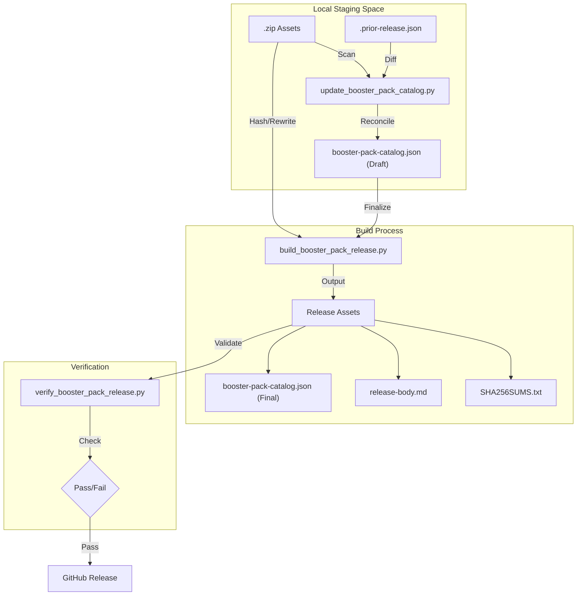
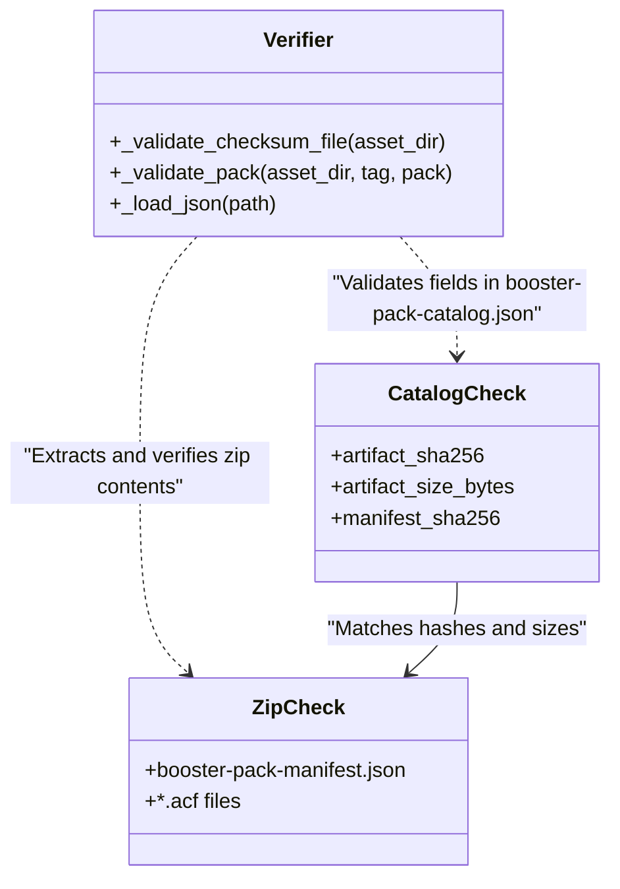

<!-- source: DeepWiki mcp.deepwiki.com · repo NVIDIA/CompileIQ · page 8.2 Booster Pack Release Pipeline · fetched 2026-10-26 -->

# Booster Pack Release Pipeline

Relevant source files

The following files were used as context for generating this wiki page:

- [Makefile](Makefile)
- [dev/build_booster_pack_release.py](dev/build_booster_pack_release.py)
- [dev/build_search_space_release.py](dev/build_search_space_release.py)
- [dev/update_booster_pack_catalog.py](dev/update_booster_pack_catalog.py)
- [dev/update_search_space_catalog.py](dev/update_search_space_catalog.py)
- [dev/verify_booster_pack_release.py](dev/verify_booster_pack_release.py)
- [dev/verify_search_space_release.py](dev/verify_search_space_release.py)
- [tests/unit/test_booster_catalog_updater.py](tests/unit/test_booster_catalog_updater.py)
- [tests/unit/test_booster_release_builder.py](tests/unit/test_booster_release_builder.py)
- [tests/unit/test_booster_release_verifier.py](tests/unit/test_booster_release_verifier.py)

The Booster Pack release pipeline manages the lifecycle of compiler optimization assets (ACF files) from their initial generation through validation and final publication to the GitHub release infrastructure. This pipeline ensures that every Booster Pack is auditable, cryptographically verified, and correctly indexed in the `booster-pack-catalog.json`.

## Pipeline Overview

The release process is divided into four distinct stages, orchestrated via the `Makefile` and supported by specialized Python scripts in the `dev/` directory.

### 1. Seeding and Staging
The pipeline begins by fetching the prior release catalog to use as a baseline for incremental updates.
*   **Target**: `make setup-booster-pack-release` [Makefile:14-16]()
*   **Mechanism**: Downloads the latest `booster-packs-*` release from GitHub and stores the catalog as `.booster-pack-catalog.prior-release.json` in the staging directory [dev/update_booster_pack_catalog.py:18-19]().

### 2. Catalog Reconciliation
The staged catalog is updated to reflect new or modified zip assets.
*   **Target**: `make update-booster-pack-catalog` [Makefile:14]()
*   **Logic**: `update_booster_pack_catalog.py` scans the staging directory for `.zip` files, extracts their internal `booster-pack-manifest.json`, and reconciles them with the prior catalog [dev/update_booster_pack_catalog.py:205-224]().
*   **Validation Check**: The script inserts `FIXME` placeholders for missing validation evidence, which must be resolved before the final build [dev/update_booster_pack_catalog.py:124-136]().

### 3. Asset Building
The raw staging area is transformed into a production-ready release bundle.
*   **Target**: `make build-booster-pack-release` [Makefile:15]()
*   **Logic**: `build_booster_pack_release.py` performs the following:
    *   Rewrites the internal zip manifests to include the official `release_tag` and `catalog_version` [dev/build_booster_pack_release.py:117-122]().
    *   Generates a final `booster-pack-catalog.json` with computed SHA256 hashes and byte sizes for all artifacts [dev/build_booster_pack_release.py:217-224]().
    *   Produces `SHA256SUMS.txt` for the entire asset set [dev/build_booster_pack_release.py:107-113]().
    *   Generates `release-body.md` containing a Markdown-formatted changelog [dev/build_booster_pack_release.py:177-181]().

### 4. Verification and Publishing
The final bundle is verified for schema compliance and internal consistency.
*   **Target**: `make inspect-booster-pack-release` [Makefile:16]()
*   **Logic**: `verify_booster_pack_release.py` performs a "deep" verification, ensuring that the catalog entries match the physical zip files, and that the zip files contain the ACF files described in their internal manifests [dev/verify_booster_pack_release.py:177-211]().

**Sources:** [Makefile:14-18](), [dev/update_booster_pack_catalog.py:1-204](), [dev/build_booster_pack_release.py:1-131](), [dev/verify_booster_pack_release.py:1-211]()

---

## Release Data Flow

The following diagram illustrates how data flows from raw compiler output into the structured catalog and finally to the release assets.

**Booster Pack Data Flow**

**Sources:** [dev/update_booster_pack_catalog.py:218-227](), [dev/build_booster_pack_release.py:97-131](), [dev/verify_booster_pack_release.py:150-181]()

---

## Catalog Structure

The `booster-pack-catalog.json` is the source of truth for the CompileIQ client when discovering available optimizations. It follows a versioned schema.

| Field | Description | Source Entity |
| :--- | :--- | :--- |
| `schema_version` | Catalog schema version (e.g., 1) | `CatalogUpdateSummary` |
| `catalog_version` | Date-based version (YYYY.MM.DD) | `_date_parts_from_tag` |
| `release_tag` | GitHub release tag name | `TAG_RE` |
| `packs` | Array of Booster Pack objects | `_catalog_entry` |

### Booster Pack Entry Details
Each entry in the `packs` array contains:
*   **Metadata**: `pack_id`, `display_name`, `pack_type`, `cuda_version`, `supported_gpus` [dev/update_booster_pack_catalog.py:29-37]().
*   **Artifact Info**: `artifact_name`, `artifact_sha256`, `artifact_size_bytes` [dev/update_booster_pack_catalog.py:22-24]().
*   **Internal Manifest**: `manifest_path`, `manifest_sha256` [dev/update_booster_pack_catalog.py:25-28]().
*   **Validation**: `validation_summary` containing evidence of performance gains [dev/update_booster_pack_catalog.py:157-171]().

**Sources:** [dev/update_booster_pack_catalog.py:17-50](), [dev/update_booster_pack_catalog.py:138-155]()

---

## Verification Logic

The `verify_booster_pack_release.py` script ensures that the release is not just syntactically correct, but also logically consistent.

**Code Entity Association: Verification Logic**

### Key Verification Functions
1.  **`_validate_checksum_file`**: Ensures every file in the directory is listed in `SHA256SUMS.txt` and that the hashes match the physical files [dev/verify_booster_pack_release.py:137-175]().
2.  **`_validate_pack`**: 
    *   Verifies the zip artifact exists and matches the `artifact_sha256` in the catalog [dev/verify_booster_pack_release.py:201-208]().
    *   Opens the zip to find `booster-pack-manifest.json` [dev/verify_booster_pack_release.py:213-217]().
    *   Ensures the manifest inside the zip matches the `manifest_sha256` recorded in the catalog [dev/verify_booster_pack_release.py:221-226]().
3.  **`_validate_no_fixme`**: Recursively scans the catalog and manifests for the string `FIXME`, preventing accidental release of incomplete metadata [dev/verify_booster_pack_release.py:79-93]().

**Sources:** [dev/verify_booster_pack_release.py:79-93](), [dev/verify_booster_pack_release.py:137-175](), [dev/verify_booster_pack_release.py:177-230]()

---

