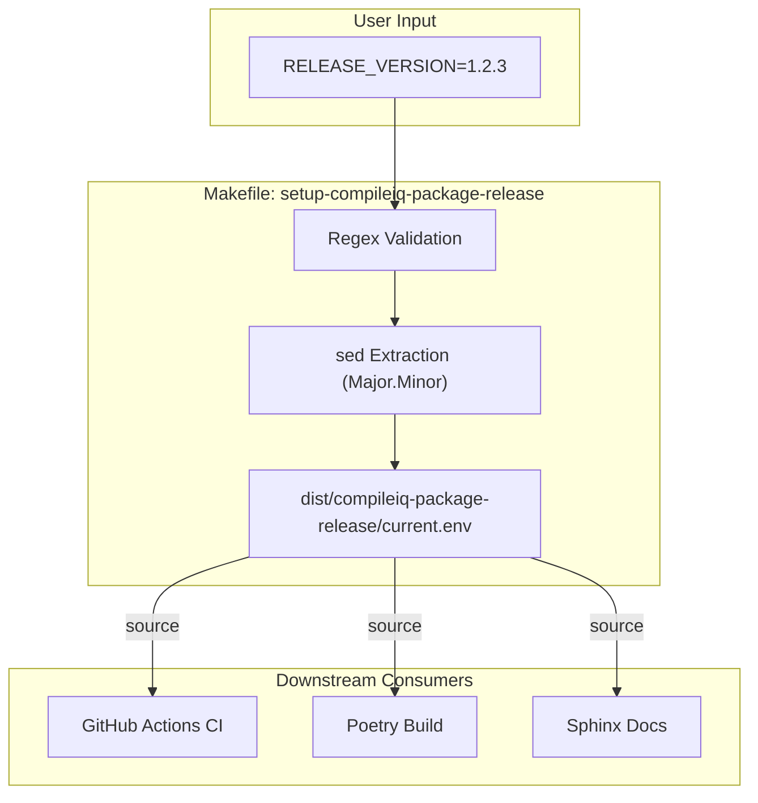
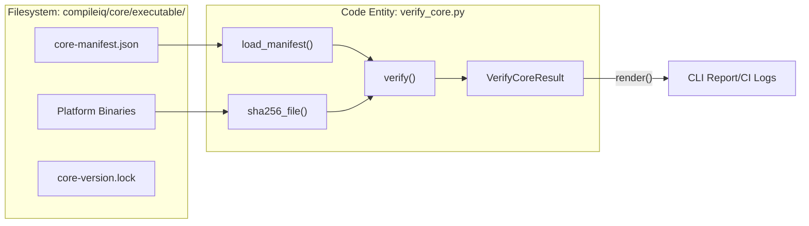

<!-- source: DeepWiki mcp.deepwiki.com · repo NVIDIA/CompileIQ · page 8.3 Package Release & Core Binary Updates · fetched 2026-10-26 -->

# Package Release & Core Binary Updates

Relevant source files

The following files were used as context for generating this wiki page:

- [Makefile](Makefile)
- [compileiq/core/verify_core.py](compileiq/core/verify_core.py)
- [dev/update-core-binaries.sh](dev/update-core-binaries.sh)
- [tests/unit/test_release_workflow.py](tests/unit/test_release_workflow.py)

This page details the release engineering workflows for the `compileiq` Python package and its bundled platform-specific Core binaries. It covers the automation used to enforce semantic versioning, manage release environment variables, and ensure the integrity of the binary executables across supported platforms.

## Package Release Workflow

The `compileiq` package release process is managed via the `Makefile` and coordinated with GitHub Actions. The workflow ensures that version tags follow strict semantic patterns and that release-specific metadata is consistently propagated to build artifacts.

### Release Setup and Versioning

The `setup-compileiq-package-release` target is the entry point for preparing a new package version. It enforces a semantic versioning regex and generates a sourceable environment file to synchronize the release process.

| Environment Variable | Description | Example |
| :--- | :--- | :--- |
| `RELEASE_VERSION` | The raw semantic version string. | `1.2.0rc1` |
| `RELEASE_TAG` | The Git tag used for the release (prefixed with `v`). | `v1.2.0rc1` |
| `RELEASE_MAJOR_MINOR` | The `X.Y` component for branch and doc mapping. | `1.2` |
| `RELEASE_BRANCH` | The dedicated release branch name. | `release-1.2` |

The version string must match the pattern `^[0-9]+\.[0-9]+\.[0-9]+((a|b|rc|dev)[0-9]+)?$`.

**Sources:**
- [Makefile:117-137]()
- [tests/unit/test_release_workflow.py:40-52]()

### Environment State Flow

The following diagram illustrates how the `Makefile` transforms a raw version input into the system-wide release context.

**Figure 1: Release Environment Initialization**

**Sources:**
- [Makefile:115-131]()
- [tests/unit/test_release_workflow.py:40-52]()

---

## Core Binary Updates

CompileIQ bundles pre-compiled binaries for the Core search engine. These are located in `compileiq/core/executable/` and must be kept in sync across three primary platforms: `linux/x86_64`, `linux/aarch64`, and `win32/amd64`.

### update-core-binaries.sh Workflow

The `dev/update-core-binaries.sh` script automates the process of refreshing these binaries from a remote source (typically a build artifact from the Core C++ repository).

1.  **Download**: Fetches a `core-manifest.json` and a `core-binaries.tar.gz`.
2.  **Verification**: Validates the manifest SHA-256 (if provided) and verifies that every file in the tarball matches the manifest's expected hashes.
3.  **Atomicity**: Moves the existing `executable/` directory to a backup before swapping in the new verified tree.
4.  **Locking**: Generates a `core-version.lock` file containing the source commit and manifest hash.

**Sources:**
- [dev/update-core-binaries.sh:1-163]()
- [Makefile:104-110]()

### Core Verification Logic

The `compileiq.core.verify_core` module provides the verification engine used both during updates and as a CI gate. It ensures that the binaries shipped in the wheel have not been tampered with or corrupted.

**Figure 2: Core Binary Verification Data Flow**

**Key Verification Entities:**
- `VerifyCoreResult`: A dataclass that tracks `matches`, `mismatches`, `missing` files, and `missing_platforms`. [compileiq/core/verify_core.py:19-45]()
- `verify()`: The primary function that performs the recursive comparison between the manifest and the disk. [compileiq/core/verify_core.py:135-172]()
- `REQUIRED_PLATFORMS`: A constant enforcing that all three target architectures are present in the manifest. [compileiq/core/verify_core.py:15]()

**Sources:**
- [compileiq/core/verify_core.py:12-172]()
- [Makefile:101-102]()

---

## Release Engineering Summary

The release infrastructure is designed to be local-first for preparation and CI-enforced for publishing.

### Makefile Release Targets

| Target | Purpose |
| :--- | :--- |
| `setup-compileiq-package-release` | Prepares the `current.env` file for the Python package. |
| `update-core` | Refreshes bundled binaries using `dev/update-core-binaries.sh`. |
| `verify-core` | Runs `compileiq.core.verify_core` to check local binary integrity. |
| `build` | Invokes `poetry build` to generate `.whl` and `.tar.gz` artifacts. |

### Release Invariants

The test suite in `tests/unit/test_release_workflow.py` enforces several critical safety checks:
- **Tag Patterns**: Ensures that the CI workflow only triggers package releases for tags matching `v*.*.*`. [tests/unit/test_release_workflow.py:23-37]()
- **Env Integrity**: Verifies that the `Makefile` correctly writes all required variables (`RELEASE_TAG`, `RELEASE_BRANCH`, etc.) to the environment file. [tests/unit/test_release_workflow.py:40-52]()
- **Platform Coverage**: Ensures the core manifest includes all required platforms (Linux x86/ARM and Windows). [compileiq/core/verify_core.py:15-145]()

**Sources:**
- [Makefile:1-137]()
- [tests/unit/test_release_workflow.py:1-79]()
- [compileiq/core/verify_core.py:1-183]()

---

