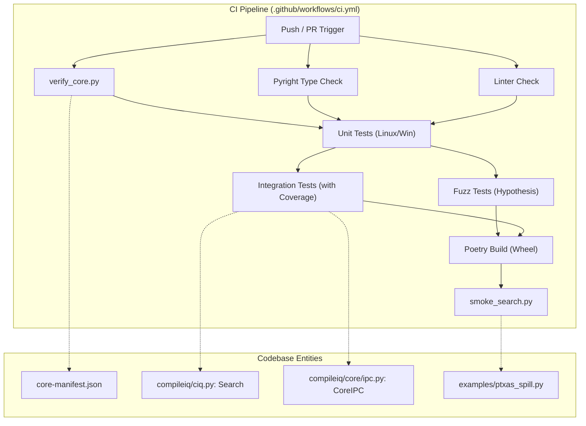

<!-- source: DeepWiki mcp.deepwiki.com · repo NVIDIA/CompileIQ · page 9 CI/CD & Development Tooling · fetched 2026-10-26 -->

# CI/CD & Development Tooling

<details>
<summary>Relevant source files</summary>

The following files were used as context for generating this wiki page:

- [.github/workflows/ci.yml](.github/workflows/ci.yml)
- [.github/workflows/docs.yml](.github/workflows/docs.yml)
- [Makefile](Makefile)

</details>


This section provides a high-level overview of the automation, quality assurance, and documentation infrastructure that supports the CompileIQ codebase. The system is designed to ensure cross-platform compatibility (Linux and Windows) and maintain high reliability for the Core binary orchestration.

### Overview of Tooling Infrastructure

The development environment is managed via `Poetry` and a `Makefile` wrapper that standardizes common tasks across local development and CI environments.

| Tool | Role | Configuration / Entry Point |
| :--- | :--- | :--- |
| **GitHub Actions** | CI/CD Pipeline | `.github/workflows/ci.yml` [1-1](), `.github/workflows/docs.yml` [1-1]() |
| **Poetry** | Dependency & Environment Management | `pyproject.toml` |
| **Makefile** | Task Runner & Release Orchestration | `Makefile` [1-18]() |
| **Pytest** | Testing Framework | `tests/` directory, `pytest.ini` |
| **Sphinx** | Documentation Engine | `docs/conf.py` |
| **Ruff** | Linting & Formatting | `Makefile:35-48`() |
| **Pyright** | Static Type Checking | `Makefile:38-39`() |

---

### CI Pipeline

The CI pipeline, defined in `.github/workflows/ci.yml` [1-1](), executes a multi-stage validation process on every push and pull request. It utilizes a matrix strategy to ensure the `compileiq` package remains compatible with Python 3.11 through 3.13 across `ubuntu-latest` and `windows-latest` runners [77-84]().

**Key Stages:**
*   **Static Analysis:** Runs `ruff` for linting and `pyright` for type consistency [25-58]().
*   **Core Verification:** Validates that the bundled platform-specific Core binaries match the expected cryptographic hashes in `core-manifest.json` [59-71]().
*   **Testing:** Executes unit, integration, and fuzz tests. Integration tests include coverage reporting [111-168]().
*   **Artifact Validation:** Builds the Python wheel and performs a "smoke search" to verify the package is installable and functional [208-261]().

For details on the matrix configuration and failure handling, see [CI Pipeline](#9.1).

**Sources:** [.github/workflows/ci.yml:1-261](), [Makefile:99-102]()

---

### Documentation System

CompileIQ uses a versioned documentation system based on Sphinx. The documentation is automatically deployed to GitHub Pages via the `docs.yml` workflow [1-80]().

**System Components:**
*   **Sphinx & Themes:** Uses the `nvidia-sphinx-theme` for a consistent look and feel.
*   **Deployment Logic:** The `dev/deploy_docs.py` script manages the `gh-pages` branch, handling "latest" aliases and versioned subdirectories (e.g., `v1.0`) [45-79]().
*   **Local Preview:** Developers can use `make docs-preview` or `bash dev/view_docs.sh` to render and serve the documentation locally [80-87]().

For details on the documentation infrastructure and versioning strategy, see [Documentation System](#9.2).

**Sources:** [.github/workflows/docs.yml:1-80](), [Makefile:71-87]()

---

### Testing Infrastructure

The test suite is partitioned into three distinct layers to balance execution speed and thoroughness.

**Test Categories:**
1.  **Unit Tests:** Fast, isolated tests for pure Python logic located in `tests/unit` [56-57]().
2.  **Integration Tests:** End-to-end tests in `tests/integration` that exercise the `Search` lifecycle, IPC communication, and result persistence [59-60]().
3.  **Fuzz Tests:** Use the `Hypothesis` library to find algorithmic edge cases in search space resolution and result comparison [62-63]().

The `Makefile` provides the `test` target which utilizes `pytest-testmon` to run only the tests affected by recent code changes, significantly speeding up the local development loop [50-52]().

For details on fixtures, markers, and coverage configuration, see [Testing Infrastructure](#9.3).

**Sources:** [Makefile:50-70](), [.github/workflows/ci.yml:165-167]()

---

### Developer Workflow Mapping

The following diagram maps the developer commands in the `Natural Language Space` to the specific `Makefile` targets and underlying scripts in the `Code Entity Space`.

**Command to Code Mapping**
```mermaid
graph TD
    subgraph "Natural Language Space"
        "Check Code Quality"
        "Run Tests"
        "Build Docs"
        "Update Core"
    end

    subgraph "Code Entity Space"
        "Check Code Quality" --> M_LINT["Makefile: lint"]
        "Check Code Quality" --> M_TYPE["Makefile: typecheck"]
        M_LINT --> RUFF["ruff check"]
        M_TYPE --> PYRIGHT["pyright"]

        "Run Tests" --> M_TEST["Makefile: test-all"]
        M_TEST --> PYTEST["pytest tests/"]

        "Build Docs" --> M_DOCS["Makefile: docs-preview"]
        M_DOCS --> SPHINX["sphinx-build"]

        "Update Core" --> M_CORE["Makefile: update-core"]
        M_CORE --> S_UPDATE["dev/update-core-binaries.sh"]
    end
```
**Sources:** [Makefile:35-111](), [dev/view_docs.sh:1-10]()

---

### CI Pipeline Architecture

This diagram illustrates how the `ci.yml` workflow orchestrates different components of the codebase during a validation run.

**CI Pipeline Logic**

**Sources:** [.github/workflows/ci.yml:25-261](), [Makefile:99-102]()

---

