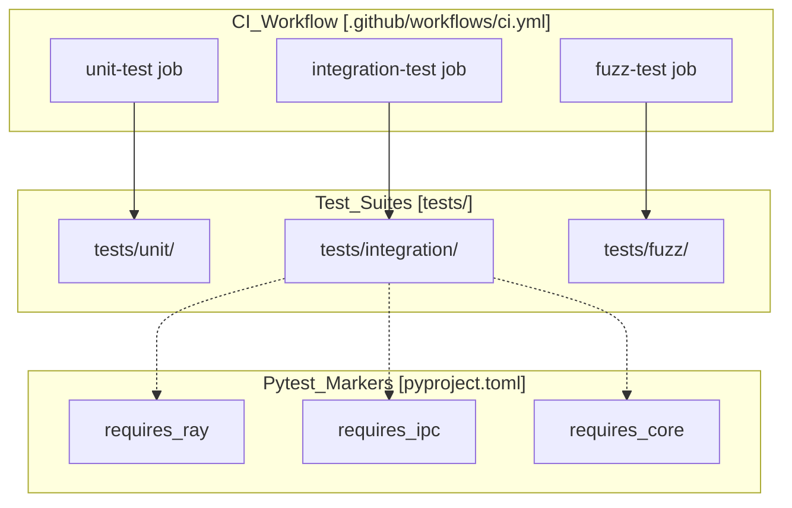
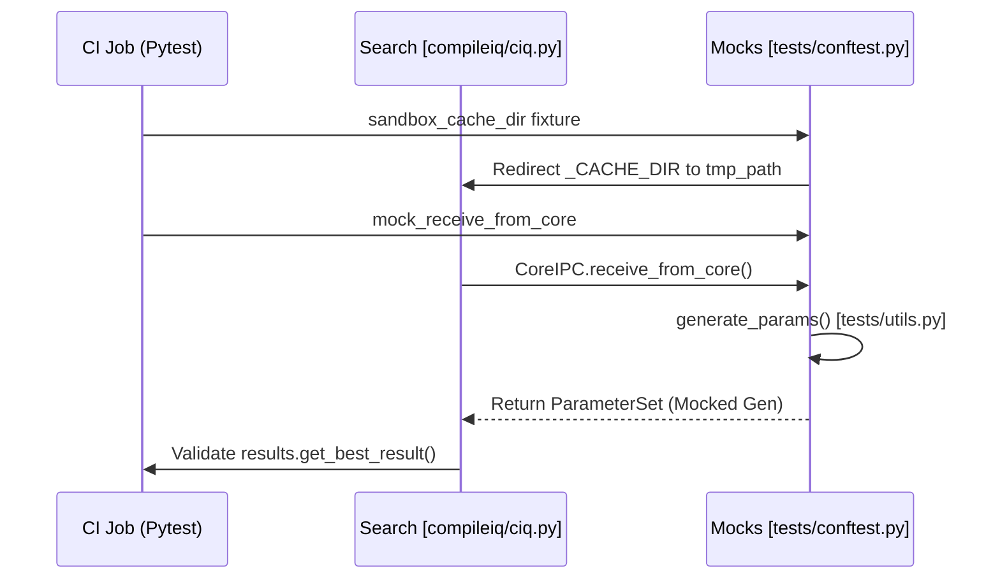

<!-- source: DeepWiki mcp.deepwiki.com · repo NVIDIA/CompileIQ · page 9.1 CI Pipeline · fetched 2026-10-26 -->

# CI Pipeline

Relevant source files

The following files were used as context for generating this wiki page:

- [.github/scripts/smoke_test_compileiq_wheel.py](.github/scripts/smoke_test_compileiq_wheel.py)
- [.github/workflows/ci.yml](.github/workflows/ci.yml)
- [pyproject.toml](pyproject.toml)
- [tests/compiler_ss/validate_binary.py](tests/compiler_ss/validate_binary.py)
- [tests/conftest.py](tests/conftest.py)
- [tests/utils.py](tests/utils.py)

The CompileIQ Continuous Integration (CI) pipeline is a multi-stage automated workflow implemented via GitHub Actions. It ensures code quality, cross-platform compatibility, and the integrity of bundled binaries across a matrix of Python versions and operating systems. The pipeline is designed to catch regressions in both the Python orchestration layer and the platform-specific Core binary communication logic.

### Trigger Conditions and Concurrency

The CI workflow is defined in [.github/workflows/ci.yml:1-21](). It triggers on:
*   **Push/Pull Requests**: Targets `main` and branches matching `pull-request/[0-9]+` [.github/workflows/ci.yml:4-7]().
*   **Tags**: Semantic version tags (e.g., `v1.0.0`) for release candidates [.github/workflows/ci.yml:8-11]().
*   **Manual**: Via `workflow_dispatch` [.github/workflows/ci.yml:17]().

To optimize resource usage, the pipeline uses a concurrency group based on the workflow name and Git reference, with `cancel-in-progress: true` to terminate redundant runs on the same branch [.github/workflows/ci.yml:19-21]().

**Sources:**
* [.github/workflows/ci.yml:1-21]()

---

### Pipeline Architecture

The pipeline is organized into three distinct phases: Static Analysis, Dynamic Testing (Unit & Integration), and Artifact Verification.

#### Phase 1: Static Analysis & Core Verification
This phase runs in parallel to provide immediate feedback on code style and type safety.
*   **Linter Check**: Uses `ruff` to enforce PEP8 and NVIDIA-specific style guidelines [.github/workflows/ci.yml:25-40]().
*   **Type Check**: Uses `pyright` to verify type hints across the `compileiq` package, including optional dependencies like `tracking` (MLflow) and `unittest` [.github/workflows/ci.yml:42-57]().
*   **Core Verification**: Executes `compileiq.core.verify_core` to ensure the bundled platform-specific binaries in `compileiq/core/executable/` match their expected manifests [.github/workflows/ci.yml:59-70]().

#### Phase 2: Multi-Platform Test Matrix
The core of the pipeline is a matrix-based test execution strategy covering the supported ecosystem defined in `pyproject.toml` [pyproject.toml:16-16]().

| Dimension | Values |
| :--- | :--- |
| **Operating Systems** | `ubuntu-latest`, `windows-latest` [.github/workflows/ci.yml:83-83]() |
| **Python Versions** | `3.11`, `3.12`, `3.13` [.github/workflows/ci.yml:84-84]() |

**Architecture to Code Mapping (Test Stages)**

The following diagram bridges the CI stages to the specific test suites and markers used in the codebase.

Title: CI Test Stage Mapping

**Sources:**
* [.github/workflows/ci.yml:72-203]()
* [pyproject.toml:103-111]()

---

### Specialized Testing Strategies

#### Integration & Coverage
Integration tests verify the interaction between the `Search` orchestration [compileiq/ciq.py:9-9]() and the various execution backends.
*   **Coverage**: The pipeline aggregates coverage from both unit and integration tests using `pytest-cov` [.github/workflows/ci.yml:165-167]().
*   **Environment Divergence**: To handle platform-specific limitations, certain cells are excluded. For example, Windows + Python 3.13 is excluded because the `ray` dependency does not yet provide stable wheels for that combination [.github/workflows/ci.yml:139-146]().

#### Fuzz Testing with Hypothesis
Fuzz tests use the `Hypothesis` library to find algorithmic edge cases in the search strategy and parameter sampling [.github/workflows/ci.yml:169-203]().
*   **PR vs. Nightly**: On PRs, fuzzing is limited to Linux with `max_examples=20` to maintain speed [.github/workflows/ci.yml:170-177]().
*   **Nightly**: A separate nightly workflow runs deeper exploration with `CIQ_FUZZ_EXAMPLES=100` [.github/workflows/ci.yml:174-177]().

#### Wheel Smoke Testing
After the matrix tests pass, the pipeline builds a wheel and performs a "smoke test" to ensure the package is installable and functional in a clean environment.
*   **Import Verification**: The script `smoke_test_compileiq_wheel.py` verifies that `compileiq` is imported from the installed site-packages, not the local checkout directory [.github/scripts/smoke_test_compileiq_wheel.py:14-23]().
*   **Functional Baseline**: It runs a minimal 1-generation search to confirm the IPC and result persistence logic are intact [.github/scripts/smoke_test_compileiq_wheel.py:29-43]().

**Sources:**
* [.github/workflows/ci.yml:111-203]()
* [.github/scripts/smoke_test_compileiq_wheel.py:1-57]()

---

### Data Flow and Mocking

The CI pipeline relies on `tests/conftest.py` to provide fixtures that simulate the Core binary's behavior without requiring a full GPU environment.

Title: CI Mocking Data Flow

**Key Mocking Entities:**
*   `sandbox_cache_dir`: Redirects all file persistence to temporary directories to prevent test cross-contamination [tests/conftest.py:45-50]().
*   `mock_receive_from_core`: Simulates the socket-based IPC by returning `ParameterSet` objects containing randomized knobs [tests/conftest.py:83-116]().
*   `generate_params`: A utility that creates valid search space configurations for testing the `Search` lifecycle [tests/utils.py:24-39]().

**Sources:**
* [tests/conftest.py:45-116]()
* [tests/utils.py:24-39]()

---

### Failure Handling and Known Issues

The pipeline is configured with `fail-fast: false` to ensure that a failure in one Python version does not stop the reporting for others [.github/workflows/ci.yml:81-81]().

**Known Broken Gating**:
Due to intermittent RNG collisions in Python 3.13 (Issue #17), the pipeline includes a `known_broken` flag that allows the integration test job to continue on error for that specific cell while still reporting the failure [.github/workflows/ci.yml:130-138, 163-163]().

**Sources:**
* [.github/workflows/ci.yml:81-81]()
* [.github/workflows/ci.yml:130-163]()

---

