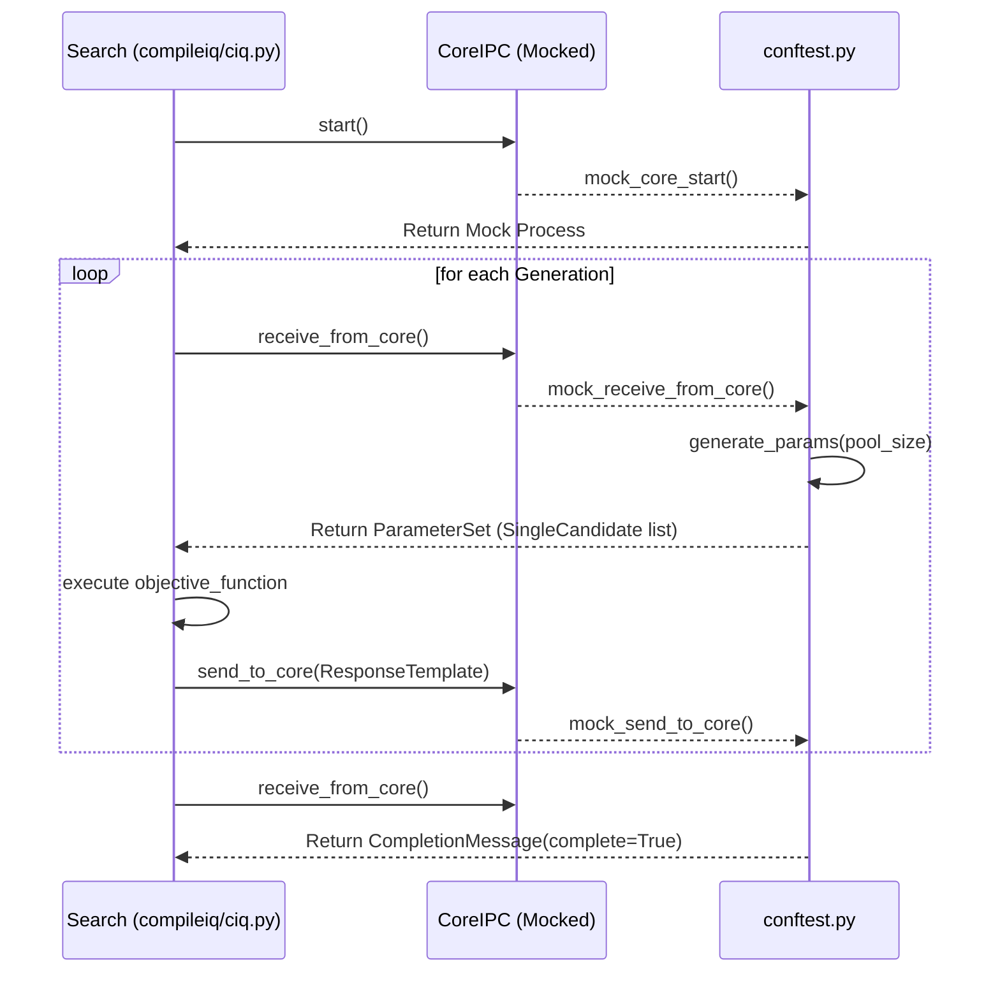
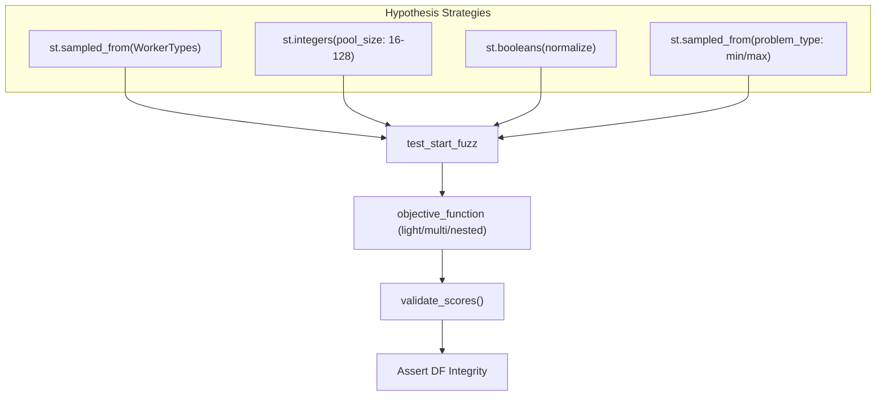

<!-- source: DeepWiki mcp.deepwiki.com · repo NVIDIA/CompileIQ · page 9.3 Testing Infrastructure · fetched 2026-10-26 -->

# Testing Infrastructure

Relevant source files

The following files were used as context for generating this wiki page:

- [pyproject.toml](pyproject.toml)
- [tests/conftest.py](tests/conftest.py)
- [tests/fuzz/test_search_fuzz.py](tests/fuzz/test_search_fuzz.py)
- [tests/unit/test_setup_files.py](tests/unit/test_setup_files.py)
- [tests/unit/test_utils.py](tests/unit/test_utils.py)
- [tests/unit/test_validation.py](tests/unit/test_validation.py)
- [tests/utils.py](tests/utils.py)

The CompileIQ testing infrastructure is designed to validate the optimization engine across multiple levels of abstraction, from low-level dictionary manipulation to distributed generational search loops. The suite leverages `pytest` as the primary runner, incorporating `Hypothesis` for property-based fuzzing and a robust mocking layer to simulate the platform-specific Core binary.

### Test Suite Structure

The codebase categorizes tests into distinct directories based on their scope and resource requirements.

| Category | Location | Purpose |
| :--- | :--- | :--- |
| **Unit Tests** | `tests/unit/` | Validates pure logic: nested dictionary flattening, score validation, and file path generation. |
| **Integration Tests** | `tests/` | Validates the `Search` lifecycle using mocked IPC and Core interactions. |
| **Fuzz Tests** | `tests/fuzz/` | Property-based testing using `Hypothesis` to explore edge cases in search configurations. |
| **Utilities** | `tests/utils.py` | Shared objective functions and score validation logic used across the suite. |

Sources: [pyproject.toml:104-111](), [tests/fuzz/test_search_fuzz.py:1-12]()

---

### Pytest Configuration and Markers

The `pyproject.toml` file defines specific markers to manage tests that require specialized environments or external dependencies.

*   `requires_ray`: Applied to tests that need a running Ray cluster for distributed execution [pyproject.toml:108]().
*   `requires_ipc`: Applied to tests requiring real socket communication or subprocess management where mocking is incomplete [pyproject.toml:109]().
*   `requires_core`: Applied to tests that execute the actual platform-specific Core binary (e.g., `compiler_ss`) rather than using the mocked sandbox [pyproject.toml:110]().

The suite also utilizes `pytest-testmon` for incremental testing, allowing developers to run only tests affected by recent code changes [pyproject.toml:81]().

Sources: [pyproject.toml:104-111](), [pyproject.toml:81]()

---

### Core Mocking Infrastructure

To enable CI/CD on platforms where the Core binary may not be available or to avoid the overhead of a full search, `tests/conftest.py` provides extensive fixtures to simulate the `CoreIPC` lifecycle.

#### Mocking the Search Loop
The integration tests simulate the generational search by mocking the `receive_from_core` and `send_to_core` methods of `compileiq.ciq.CoreIPC`.

1.  **`mock_receive_from_core`**: This fixture manages the state of the search. It uses global `pytest` variables (`current_gen`, `max_gen`, `pool_size`) to decide whether to return a new `ParameterSet` of candidates or a `CompletionMessage` [tests/conftest.py:83-116]().
2.  **`mock_core_start`**: Prevents the orchestration layer from attempting to launch the actual subprocess, returning a `MagicMock` of `subprocess.Popen` instead [tests/conftest.py:52-60]().
3.  **`mock_socket_listen`**: Mocks the internal socket used for IPC, ensuring no actual network ports are bound during unit testing [tests/conftest.py:62-72]().

#### Data Flow in Mocked Search
The following diagram illustrates how the `conftest.py` fixtures intercept calls from the `Search` class to simulate a full generational loop.

**Mocked Search Lifecycle**

Sources: [tests/conftest.py:52-116](), [tests/utils.py:24-39]()

---

### Score and Type Validation

A critical part of the testing infrastructure is validating that the objective functions return data compatible with the search engine. The `tests/unit/test_validation.py` suite tests the `validate_scores` pipeline.

*   **JSON Safety**: Tests ensure that `inf` and `nan` values are converted to the `INVALID_SCORE` string (`"*"`) before reaching the IPC layer, as standard JSON does not support these floats [tests/unit/test_validation.py:23-41]().
*   **Objective Arity**: Validates that multi-objective searches (where `num_objectives > 1`) correctly receive tuples of the expected length and that a single `"*"` return is expanded to match all objectives [tests/unit/test_validation.py:77-110]().
*   **Score Model Integrity**: Validates the `Score` Pydantic model's `failed` property, ensuring that if any single objective in a multi-objective set fails, the entire candidate is marked as failed [tests/unit/test_validation.py:116-165]().

Sources: [tests/unit/test_validation.py:23-165](), [compileiq/utils/validation.py:6-11]()

---

### Fuzz Testing (Hypothesis)

The `tests/fuzz/test_search_fuzz.py` suite uses property-based testing to verify the robustness of the `Search.start()` and `Search.sample()` methods.

The `test_start_fuzz` function explores a massive configuration space:
*   **Worker Types**: `NATIVE`, `ISOLATED`, `RAY`, `ASYNC`.
*   **Search Config**: Variations in `mutate_rate`, `pool_size`, `problem_type` (min/max), and `normalize` (True/False).
*   **Search Spaces**: Both flat and nested structures.

Fuzz tests are excluded from standard runs via `addopts = "--ignore=tests/fuzz"` in `pyproject.toml` due to their resource intensity [pyproject.toml:106](). They can be triggered manually or in nightly CI by setting `CIQ_FUZZ_EXAMPLES` [tests/fuzz/test_search_fuzz.py:9-12]().

**Search Fuzz Configuration Space**

Sources: [tests/fuzz/test_search_fuzz.py:39-68](), [tests/utils.py:134-160]()

---

### Coverage and Incremental Testing

The testing infrastructure is configured to provide detailed feedback on code health:

*   **Coverage**: Configured in `pyproject.toml` to omit the platform-specific `executable` directory and include branch coverage [pyproject.toml:114-127]().
*   **Incremental Runs**: `pytest-testmon` allows for rapid iteration by mapping which tests cover which lines of code, enabling `pytest --testmon` to only run tests relevant to the current diff [pyproject.toml:81]().

Sources: [pyproject.toml:81](), [pyproject.toml:114-127]()

---

