# Page: CompileIQ Overview

# CompileIQ Overview

<details>
<summary>Relevant source files</summary>

The following files were used as context for generating this wiki page:

- [AGENTS.md](AGENTS.md)
- [README.md](README.md)
- [docs/index.rst](docs/index.rst)
- [pyproject.toml](pyproject.toml)

</details>


CompileIQ is a hyperparameter optimization (HPO) engine specifically engineered for tuning NVIDIA compiler controls and application-level parameters [README.md:1-4](). It bridges the gap between low-level compiler tuning (via the NVIDIA Advanced Controls Interface) and high-level Python orchestration, enabling developers to find optimal configurations for performance-critical kernels [docs/index.rst:54-60]().

The system is designed to handle both standard hyperparameter tuning (e.g., block sizes, batch sizes) and specialized compiler-driven optimization using curated search spaces for tools like `ptxas` and `nvcc` [README.md:25-33]().

### System Context Diagram
The following diagram illustrates how the Python orchestration layer interacts with the precompiled Core binary and the target compiler environment.

**CompileIQ High-Level Architecture**
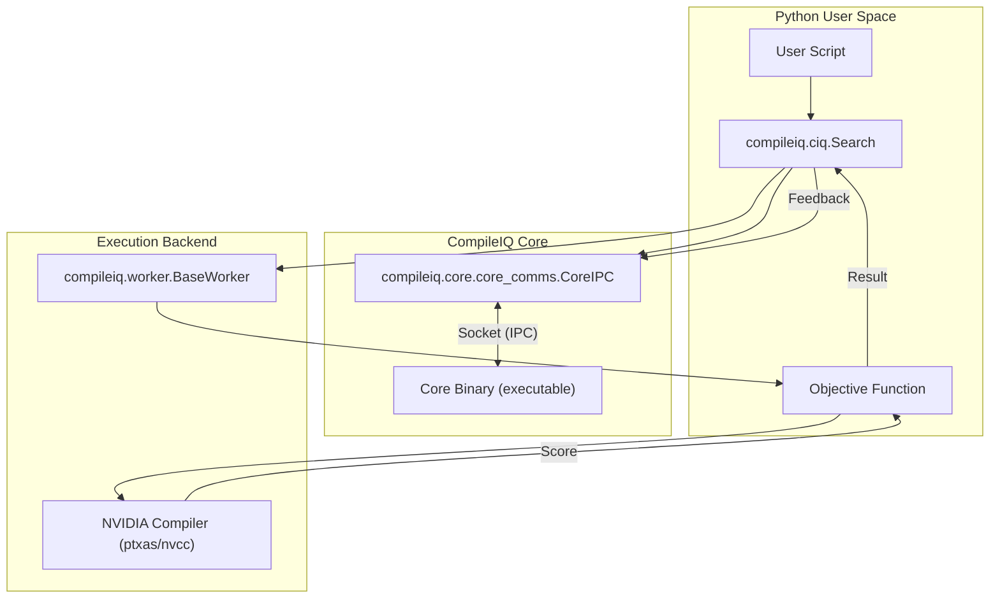
Sources: [AGENTS.md:72-89](), [compileiq/ciq.py](), [compileiq/core/core_comms.py]()

---

## Why CompileIQ?

Optimizing GPU workloads often requires balancing complex compiler flags that are not exposed through standard optimization levels (like `-O3`). CompileIQ provides:
*   **Automated Tuning:** Replaces manual trial-and-error with a generational search strategy [AGENTS.md:73-75]().
*   **Curated Search Spaces:** Access to version-specific compiler parameters for `ptxas` and `nvcc` [README.md:27-33]().
*   **Multi-Objective Support:** Simultaneously optimize for metrics like latency, throughput, and register pressure [docs/index.rst:59-61]().
*   **Scalable Execution:** Support for local multiprocessing, isolated execution, and distributed clusters via Ray [AGENTS.md:79-79]().

For more details on typical performance gains and use cases, see [Key Concepts & Terminology](#1.2).

---

## Core Subsystems

CompileIQ is composed of three primary layers that work in tandem:

### 1. Orchestration & API
The `Search` class in `compileiq/ciq.py` serves as the primary entry point [AGENTS.md:78-78](). It manages the lifecycle of the optimization process, including:
*   Initializing the search configuration (`SearchConfiguration`).
*   Spawning and managing the Core binary subprocess.
*   Distributing evaluation tasks to workers.
*   Collecting and persisting results into `SearchResult` objects containing pandas DataFrames [AGENTS.md:84-84]().

### 2. The Optimization Core
The "Core" is a platform-specific precompiled binary located in `compileiq/core/executable/` [AGENTS.md:7-8](). It contains the proprietary optimization algorithms. The Python layer communicates with this binary via a socket-based Inter-Process Communication (IPC) protocol managed by the `CoreIPC` class [AGENTS.md:82-82]().

### 3. Execution Backends (Workers)
CompileIQ supports multiple worker types defined in `compileiq/worker.py` to execute the user's `objective_function` [AGENTS.md:79-79]():
*   `MultiProcessWorker`: Standard local parallelization.
*   `IsoMultiProcessWorker`: High isolation (one process per task) for crash-prone workloads.
*   `RayWorker`: Distributed execution across a Ray cluster.
*   `AsyncWorker`: Concurrency for I/O bound tasks using `asyncio`.

---

## Key Code Entities

The following diagram maps high-level system concepts to their specific implementations in the codebase.

**System Concepts to Code Entity Mapping**
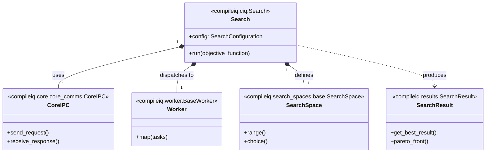
Sources: [AGENTS.md:76-89](), [compileiq/ciq.py](), [compileiq/results.py](), [compileiq/worker.py]()

---

## Getting Started & Next Steps

To begin using CompileIQ, follow the documentation in the child pages:

*   **[Getting Started & Installation](#1.1)**: Instructions for `pip` installation, setting up the development environment with Poetry, and running your first search [README.md:11-23]().
*   **[Key Concepts & Terminology](#1.2)**: A deep dive into the vocabulary of the system, such as "Booster Packs," "ACF files," and "Generational Search" [docs/index.rst:69-70]().

For advanced users, the **[Agent Skills](#7)** section describes how to use the bundled AI agent tools to automate optimization campaigns [AGENTS.md:106-123]().

### Environment Configuration
CompileIQ behavior can be tuned using several environment variables:

| Variable | Default | Purpose |
| :--- | :--- | :--- |
| `CIQ_SOCKET_TIMEOUT` | 20 | Seconds to wait for Core IPC [README.md:49-49]() |
| `CIQ_PROCESS_MODE` | "forkserver" | Start method for workers [README.md:51-51]() |
| `CIQ_SEARCH_SPACES_DIR` | unset | Local path for offline search space assets [README.md:52-52]() |

Sources: [README.md:45-54](), [AGENTS.md:97-101]()

---

# Page: Getting Started & Installation

# Getting Started & Installation

<details>
<summary>Relevant source files</summary>

The following files were used as context for generating this wiki page:

- [CONTRIBUTING.md](CONTRIBUTING.md)
- [SECURITY.md](SECURITY.md)
- [compileiq/search_spaces/base.py](compileiq/search_spaces/base.py)
- [compileiq/utils/_setup_files.py](compileiq/utils/_setup_files.py)
- [compileiq/utils/validation.py](compileiq/utils/validation.py)
- [compileiq/worker.py](compileiq/worker.py)
- [docs/getting_started.md](docs/getting_started.md)
- [docs/install.md](docs/install.md)
- [pyproject.toml](pyproject.toml)
- [tests/unit/search_spaces/test_base.py](tests/unit/search_spaces/test_base.py)

</details>


This page provides a comprehensive guide to installing CompileIQ, setting up a development environment, and running an initial optimization search. CompileIQ is an NVIDIA hyperparameter optimization engine designed to tune compiler controls through a combination of a Python orchestration layer and a high-performance C++ Core binary.

## Installation Methods

CompileIQ can be installed either as a standard package for end-users or via a Poetry-managed environment for developers.

### 1. User Installation (via PyPI)
For users who wish to use CompileIQ as a library to tune their workloads, install directly from PyPI:
```bash
pip install compileiq
```
Sources: [docs/install.md:3-7]()

### 2. Developer Installation (via Poetry)
For contributors or users requiring the latest development features, install from the source repository using [Poetry](https://python-poetry.org/). CompileIQ supports Python versions 3.11 through 3.13.

```bash
git clone https://github.com/NVIDIA/CompileIQ.git
cd CompileIQ
make install           # Installs core dev dependencies (linter, typecheck, unittest)
make install-examples  # Installs optional dependencies for examples (Triton, XGBoost)
make install-docs      # Installs Sphinx and Mermaid documentation tools
```
Sources: [pyproject.toml:16-16](), [CONTRIBUTING.md:85-105]()

## Environment Configuration

CompileIQ uses environment variables to control IPC behavior, process management, and search space resolution.

| Environment Variable | Default | Description |
| :--- | :--- | :--- |
| `CIQ_SOCKET_TIMEOUT` | `20` | Seconds to wait for the Core binary to respond via IPC. |
| `CIQ_PROCESS_MODE` | `forkserver` | Multiprocessing start method (`fork`, `spawn`, `forkserver`). Windows defaults to `spawn`. |
| `CIQ_CORE_BINARY` | unset | Path to a custom Core executable (overrides the bundled binary). |
| `CIQ_SEARCH_SPACES_DIR` | unset | Local directory for offline search space manifests and `.bin` files. |
| `CIQ_KEEP_CACHE` | `False` | If `True`, prevents deletion of `.cache/compileiq` after a search. |

Sources: [docs/install.md:49-57](), [compileiq/worker.py:32-46]()

## Verifying the Core Binary

CompileIQ bundles platform-specific binaries for Linux (x86_64, aarch64) and Windows. These binaries are essential for the genetic algorithm execution. To ensure the binaries are present and match the expected checksums:

```bash
make verify-core
```
This command checks the bundled executables against `core-manifest.json`.
Sources: [CONTRIBUTING.md:107-112](), [pyproject.toml:11-13]()

## Running Your First Search

The following example demonstrates a single-objective optimization using the `Search` class.

### Implementation Data Flow
The `Search` class orchestrates the lifecycle by preparing configuration files, launching the Core binary, and managing worker processes to execute the objective function.

**Search Orchestration Flow**
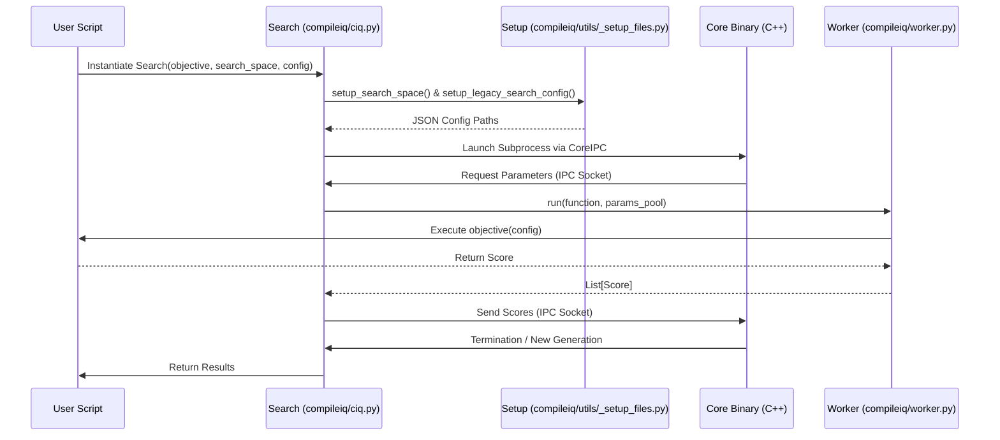
Sources: [compileiq/ciq.py:125-150](), [compileiq/utils/_setup_files.py:57-67](), [compileiq/worker.py:101-126]()

### Code Example: Single Objective
```python
from compileiq.ciq import Search
from compileiq.types import SearchConfiguration
import compileiq.search_spaces.base as ss

# 1. Define Objective Function
def objective(config):
    # Returns a float to minimize
    return config["x"] ** 2 + config["y"]

# 2. Define Search Space
# Uses primitives from compileiq/search_spaces/base.py
search_space_config = {
    "x": ss.range(start=1.0, end=20.0, step=0.5),
    "y": ss.choice([1, 2, 3]),
    "z": ss.literal(const_value="enabled", knockout_prob=0.2)
}

# 3. Configure Search
main_config = SearchConfiguration(
    pool_size=12,
    generations=3,
    problem_type="min"
)

# 4. Execute
tuner = Search(
    objective_function=objective,
    search_space=search_space_config,
    search_config=main_config,
)
results = tuner.start()
print(f"Best Result: {results.get_best_result()}")
```
Sources: [docs/getting_started.md:15-50](), [compileiq/search_spaces/base.py:12-19](), [compileiq/search_spaces/base.py:85-88]()

## Agent Skill Installation

CompileIQ includes a set of "skills" designed for AI coding agents (Claude Code, Cursor, Windsurf, etc.) to automate the optimization workflow. These skills follow the `SKILL.md` convention.

### Skill Components
The skills are located in `agent-skills/` and include:
* `compileiq-bootstrap`: Initial environment and socket setup.
* `compileiq-booster-pack`: Applying pre-built NVIDIA compiler optimizations.
* `compileiq-run-search`: Automating the `Search.start()` lifecycle.

### Installation Command
To mount these skills into your preferred agent:
```bash
# Auto-detect and install for available agents
bash agent-skills/install.sh

# Verify installation
bash agent-skills/install.sh --check
```
Sources: [docs/install.md:15-40]()

## Key Classes and Implementation Details

### Search Space Primitives
The search space is defined using Pydantic models that are serialized to JSON for the Core binary.
* **`range()`**: Generates a `RangeParamConfig`. Validates that `start < end` and `step > 0`. [compileiq/search_spaces/base.py:12-82]()
* **`choice()`**: Generates a `ChoiceParamConfig`. Converts Python booleans to `0/1` for Core compatibility. [compileiq/search_spaces/base.py:85-121]()
* **`literal()`**: Generates a `LiteralParamConfig`. Used for constant flags that can be "knocked out" (dropped from the config) based on `knockout_prob`. [compileiq/search_spaces/base.py:124-155]()

### Worker Execution
The `MultiProcessWorker` handles the parallel execution of the `objective_function`.
* It uses `multiprocessing.Manager` to coordinate `job_queue` and `scores_queue`. [compileiq/worker.py:127-130]()
* It enforces `task_timeout`. If a function exceeds this limit, it returns `INVALID_SCORE` (represented as `"*"`). [compileiq/worker.py:120-123](), [compileiq/utils/validation.py:16-16]()

**Entity Mapping: Search Space to Code**
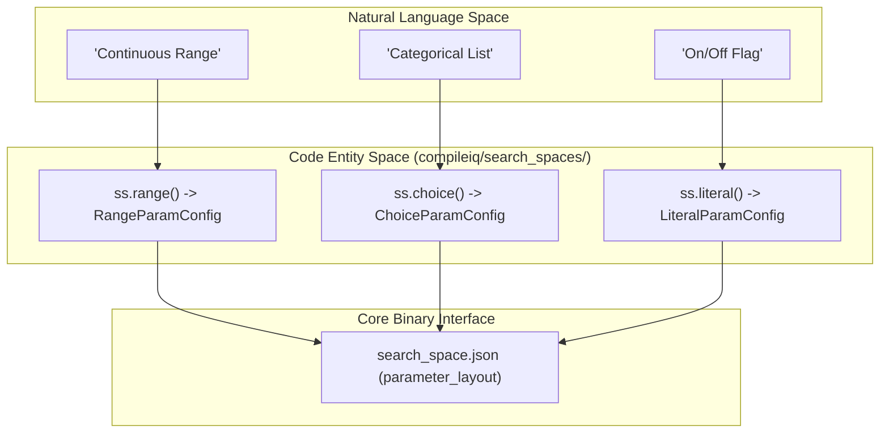
Sources: [compileiq/search_spaces/base.py:12-155](), [compileiq/utils/_setup_files.py:108-117]()

`Sources: compileiq/ciq.py, compileiq/worker.py, compileiq/search_spaces/base.py, compileiq/utils/_setup_files.py, compileiq/utils/validation.py, pyproject.toml, CONTRIBUTING.md, docs/install.md, docs/getting_started.md`

---

# Page: Key Concepts & Terminology

# Key Concepts & Terminology

<details>
<summary>Relevant source files</summary>

The following files were used as context for generating this wiki page:

- [README.md](README.md)
- [compileiq/tracker.py](compileiq/tracker.py)
- [compileiq/types.py](compileiq/types.py)
- [docs/compilers_overview.md](docs/compilers_overview.md)
- [docs/search_strategy.md](docs/search_strategy.md)
- [tests/integration/test_worker.py](tests/integration/test_worker.py)
- [tests/unit/test_search_configuration.py](tests/unit/test_search_configuration.py)
- [tests/unit/test_tracker_unit.py](tests/unit/test_tracker_unit.py)

</details>


This page defines the domain vocabulary and technical concepts used throughout the CompileIQ codebase. It serves as a reference for understanding the relationship between the Python orchestration layer, the optimization core, and the compiler-specific tuning interfaces.

## Core Optimization Concepts

CompileIQ operates as a generational hyperparameter optimizer. It balances exploration (finding new promising regions) and refinement (optimizing within those regions).

### Search Space & Knobs
A **Search Space** defines the universe of possible configurations that the optimizer can explore [docs/search_strategy.md:10-10](). It consists of individual **Knobs** (parameters) which can be discrete choices, continuous ranges, or categorical literals [compileiq/search_spaces/base.py:1-20]().
*   **Implementation**: Defined via `compileiq.search_spaces`.
*   **Resolution**: Compiler-specific spaces (like `PtxasSearchSpace`) are resolved from remote or local `.bin` manifest files [README.md:27-33]().

### Generations & Pools
The search progresses through a series of **Generations** [docs/search_strategy.md:13-13](). In each generation, a **Pool** (a batch of candidates) is evaluated [docs/search_strategy.md:12-12]().
*   **Pool Size**: The number of candidates evaluated per generation [compileiq/types.py:320-325]().
*   **Cull Size**: The number of candidates discarded or used to signal the direction of the next generation [docs/search_strategy.md:65-69]().

### Candidates & Parameters
A **Candidate** is a single set of sampled parameters from the search space [docs/search_strategy.md:11-11](). In the code, this is often referred to as a `ParamArg`, which can be a dictionary of key-value pairs or a path to a configuration file [compileiq/types.py:31-31]().

### Scores & Objectives
The **Objective Function** is a user-provided Python function that takes a candidate's parameters and returns a **Score** [docs/search_strategy.md:23-23]().
*   **SingleScore**: A single numerical value (float or int) [compileiq/types.py:23-23]().
*   **MultiScore**: A list of scores for multi-objective optimization [compileiq/types.py:24-24]().
*   **INVALID_SCORE**: A sentinel value used to indicate that a candidate failed evaluation (e.g., a compilation error or runtime crash) without stopping the entire search [compileiq/types.py:26-26](), [docs/compilers_overview.md:61-64]().

### Data Flow: Natural Language to Code Entities

The following diagram maps high-level search concepts to their specific class and variable representations in the codebase.

**Search Concept Mapping**
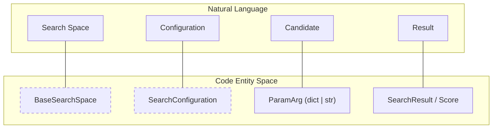
Sources: [compileiq/types.py:31-41](), [compileiq/types.py:23-28](), [docs/search_strategy.md:8-15]()

---

## Compiler Tuning Vocabulary

CompileIQ has specialized terminology for its primary use case: tuning NVIDIA compilers like `ptxas` and `nvcc`.

### Advanced Controls Interface (ACI)
A feature in NVIDIA compilers (starting in CUDA Toolkit 13.3) that allows external tools to influence internal optimization heuristics via the `--apply-controls` flag [docs/compilers_overview.md:3-4]().

### Advanced Controls File (ACF)
A file generated by CompileIQ that contains specific compiler optimization decisions. This file is passed to the compiler to change its behavior for a specific kernel without modifying the source code [docs/compilers_overview.md:3-5]().

### Booster Pack
A curated collection of pre-generated ACFs and metadata targeting specific workloads or kernels [docs/compilers_overview.md:5-5](). These are distributed as zip assets and can be applied directly to achieve performance gains without running a full search [docs/compilers_overview.md:38-41]().

---

## System Architecture Terminology

### Core Binary
The **Core** is a platform-specific executable (written in a lower-level language) that implements the underlying optimization algorithms (e.g., genetic algorithms, Pareto front calculations) [README.md:49-51]().

### CoreIPC
The communication layer that manages the lifecycle of the Core binary. It uses local socket-based **Inter-Process Communication (IPC)** to send parameter sets to the Python layer and receive scores back [docs/search_strategy.md:24-24]().

### Workers
Workers are the execution backends responsible for running the objective function.
*   **MultiProcessWorker**: Uses Python's `multiprocessing` to run evaluations in parallel on a single node [compileiq/types.py:173-178]().
*   **RayWorker**: Uses the Ray framework for distributed execution across a cluster [compileiq/types.py:123-126]().
*   **AsyncWorker**: Uses `asyncio` for concurrent execution of I/O-bound objective functions [tests/integration/test_worker.py:2-2]().

### Trackers
Entities that observe the search lifecycle and log data to external backends.
*   **LoguruTracker**: Provides structured console and file logging [compileiq/tracker.py:94-94]().
*   **MLflowTracker**: Logs parameters, metrics, and artifacts to an MLflow server [compileiq/tracker.py:151-151]().

### Component Interaction Model

The following diagram illustrates how the system components interact using the specific internal naming conventions found in the code.

**System Component Interaction**
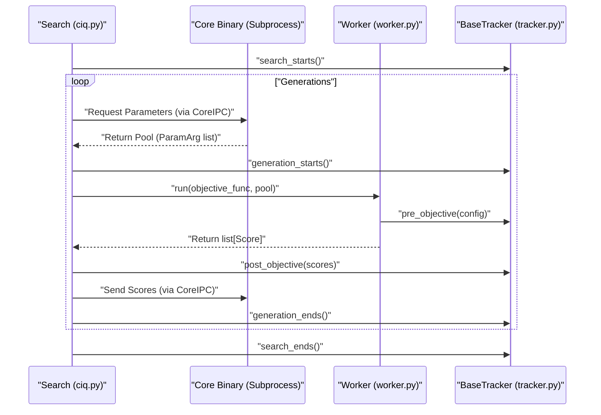
Sources: [compileiq/types.py:100-103](), [compileiq/tracker.py:121-150](), [docs/search_strategy.md:22-26](), [compileiq/types.py:173-198]()

---

## Summary Table

| Term | Definition | Code Reference |
| :--- | :--- | :--- |
| **Knob** | A single tunable parameter in a search space. | [compileiq/search_spaces/base.py]() |
| **Baseline** | A run with an empty parameter set used for normalization. | [compileiq/types.py:192-192]() |
| **Pareto Front** | The set of optimal solutions in a multi-objective search. | [compileiq/types.py:50-53]() |
| **Problem Type** | Whether the goal is to `MIN` (minimize) or `MAX` (maximize) the score. | [compileiq/types.py:34-38]() |
| **Mutate Rate** | Probability of perturbing a parameter during candidate generation. | [compileiq/types.py:326-328]() |
| **Normalization** | Adjusting scores relative to a baseline to handle noisy benchmarks. | [compileiq/types.py:181-181]() |
| **Task Timeout** | A hard limit on the execution time of a single objective evaluation. | [compileiq/types.py:348-350]() |

Sources: [compileiq/types.py:1-100](), [docs/search_strategy.md:1-85]()

---

# Page: Core Architecture

# Core Architecture

<details>
<summary>Relevant source files</summary>

The following files were used as context for generating this wiki page:

- [compileiq/ciq.py](compileiq/ciq.py)
- [compileiq/core/core_comms.py](compileiq/core/core_comms.py)
- [compileiq/core/core_types.py](compileiq/core/core_types.py)
- [tests/integration/test_core_integration.py](tests/integration/test_core_integration.py)

</details>


CompileIQ is structured as a hybrid system where a high-level Python orchestration layer manages experiment lifecycles, and a high-performance C++ Core binary handles the search algorithms and parameter generation. These two components communicate over a local IPC channel using a structured JSON-over-TCP protocol.

### System Overview

The architecture is designed to decouple the search logic (Core) from the objective function execution (Python). This allows users to write arbitrary Python code for their benchmarks while leveraging optimized search strategies.

The following diagram illustrates the relationship between the primary code entities:

**CompileIQ Component Interaction**
```mermaid
graph LR
    subgraph "Python Orchestration Space"
        ["Search Class"] -- "manages" --> ["Worker (NATIVE/RAY/ASYNC)"]
        ["Search Class"] -- "serializes" --> ["SearchConfiguration"]
        ["Search Class"] -- "starts" --> ["CoreIPC"]
    end

    subgraph "IPC Channel (Socket)"
        ["CoreIPC"] <--> ["ParameterSet / ResponseTemplate"]
    end

    subgraph "Binary Execution Space"
        ["ParameterSet / ResponseTemplate"] <--> ["Core Binary (executable)"]
    end

    ["Worker (NATIVE/RAY/ASYNC)"] -- "evaluates" --> ["Objective Function"]
    ["Objective Function"] -- "returns" --> ["Score"]
```
Sources: [compileiq/ciq.py:86-192](), [compileiq/core/core_comms.py:44-66](), [compileiq/core/core_types.py:10-27]()

---

### 1. The Search Class & Orchestration
The `Search` class in `compileiq/ciq.py` serves as the primary entry point for users. It coordinates the initialization of the environment, the starting of the Core binary, and the generational evaluation loop.

*   **Configuration**: Validates user inputs via `SearchConfiguration` and `SearchSpaceInput` [compileiq/ciq.py:93-114]().
*   **Lifecycle**: The `start()` method triggers the search loop, which continues until the Core binary sends a `CompletionMessage` [compileiq/ciq.py:16-22](), [compileiq/core/core_types.py:16-18]().
*   **Resilience**: Manages timeouts via `task_timeout` and handles early termination via `exit_on_failure` [compileiq/ciq.py:157-164]().

For details, see [The Search Class & Orchestration](#2.1).

Sources: [compileiq/ciq.py:86-164](), [compileiq/types.py:39-40]()

---

### 2. Core Binary & IPC Communication
The search algorithms are contained within platform-specific binaries located in the `compileiq/core/executable` directory [compileiq/core/core_comms.py:33-34]().

*   **Subprocess Management**: The `CoreIPC` class resolves the correct binary for the host OS (Linux x86_64, aarch64, or Windows) and spawns it as a subprocess [compileiq/core/core_comms.py:54-80]().
*   **Socket Protocol**: Communication occurs over a local TCP socket. The Python layer acts as a server, and the Core binary connects to the `CIQ_HOST` and `CIQ_PORT` provided in its environment [compileiq/core/core_comms.py:181-190]().
*   **Message Types**:
    *   `ParameterSet`: Sent from Core to Python; contains a list of `SingleCandidate` (knobs to evaluate) [compileiq/core/core_types.py:10-14]().
    *   `ResponseTemplate`: Sent from Python to Core; contains `EvaluatedParamResponse` (scores for the candidates) [compileiq/core/core_types.py:20-27]().

For details, see [Core Binary & IPC Communication](#2.2).

Sources: [compileiq/core/core_comms.py:36-112](), [compileiq/core/core_types.py:5-27]()

---

### 3. Data Types & Result Management
CompileIQ uses a strict type system to ensure consistency between the Python evaluation and the binary search core.

| Entity | Description | Code Reference |
| :--- | :--- | :--- |
| `Score` | A union type of `int`, `float`, or the `INVALID_SCORE` string (`*`). | [compileiq/types.py:28-28]() |
| `SearchResult` | Container for all evaluated parameters, scores, and metadata. | [compileiq/results.py:45-45]() |
| `ProblemType` | Defines if the search is a `min` or `max` optimization. | [compileiq/types.py:84-84]() |
| `Pareto Front` | A set of non-dominated solutions in multi-objective searches. | [tests/integration/test_core_integration.py:192-194]() |

The `SearchResult` class provides methods like `get_best_result()` and `pareto_front()` to extract insights from the search history [tests/integration/test_core_integration.py:92-192]().

For details, see [Data Types & Result Management](#2.3).

Sources: [compileiq/types.py:20-43](), [compileiq/results.py:45-45](), [tests/integration/test_core_integration.py:73-119]()

---

### System Sequence Diagram
The following diagram traces a single generation of the search process:

**Generational Search Sequence**
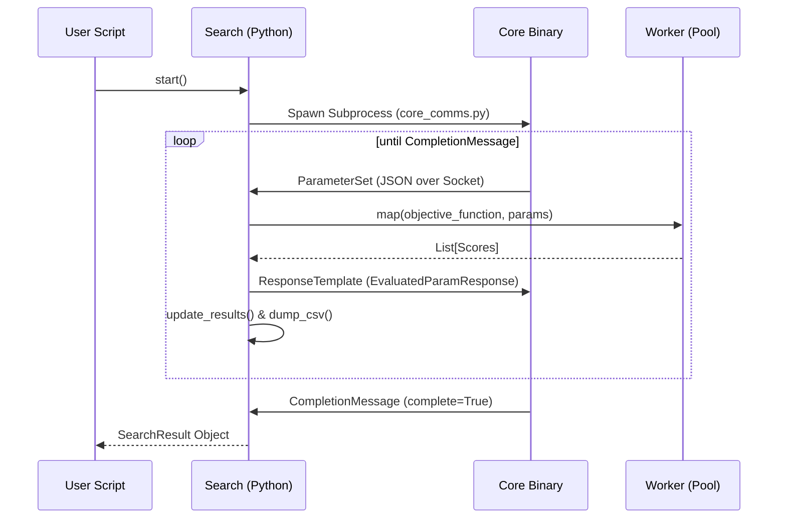
Sources: [compileiq/ciq.py:188-210](), [compileiq/core/core_comms.py:130-179](), [compileiq/core/core_comms.py:192-203](), [compileiq/core/core_types.py:10-27]()

---

# Page: The Search Class & Orchestration

# The Search Class & Orchestration

<details>
<summary>Relevant source files</summary>

The following files were used as context for generating this wiki page:

- [compileiq/ciq.py](compileiq/ciq.py)
- [tests/integration/test_core_integration.py](tests/integration/test_core_integration.py)
- [tests/integration/test_search.py](tests/integration/test_search.py)
- [tests/unit/test_parameter_parsing.py](tests/unit/test_parameter_parsing.py)

</details>


The `Search` class in `compileiq/ciq.py` is the central orchestration engine of CompileIQ. It manages the lifecycle of an optimization experiment, coordinating between the user's objective function, the search space definitions, the background Core binary (which implements the genetic algorithms), and the execution workers.

## The Search Lifecycle

The `Search` class follows a strict lifecycle from initialization to result persistence. The orchestration logic is primarily contained within the `start()` method, which executes a generational loop.

### 1. Initialization and Configuration
When a `Search` object is instantiated, it validates and resolves three primary inputs:
- **Objective Function**: A Python callable that evaluates a parameter set [compileiq/ciq.py:94-99]().
- **Search Space**: A dictionary or provider that defines the tunable knobs [compileiq/ciq.py:100-107]().
- **Search Configuration**: A `SearchConfiguration` object defining the GA parameters like `pool_size`, `generations`, and `mutate_rate` [compileiq/ciq.py:108-114]().

During initialization, the class sets up the IPC environment by initializing a socket for communication with the Core binary [compileiq/ciq.py:189-192]().

### 2. The Generational Loop
The `start()` method triggers the core optimization loop. In each generation, the following steps occur:

1.  **Request Parameters**: The `Search` class requests a new batch of candidates (a "pool") from the Core binary via `CoreIPC` [compileiq/ciq.py:533-540]().
2.  **Evaluation**: The candidates are dispatched to the configured `Worker` (e.g., `MultiProcessWorker`). The objective function is executed for each candidate [compileiq/ciq.py:545-560]().
3.  **Reporting**: The resulting scores are sent back to the Core binary to inform the next generation's mutation and selection [compileiq/ciq.py:562-571]().
4.  **Persistence**: If `dump_results` is configured, the current state is saved to a CSV file [compileiq/ciq.py:573-577]().

### Search Class Orchestration Flow
The following diagram illustrates how the `Search` class bridges the high-level Python space with the low-level Core binary and Worker execution.

**Diagram: Search Orchestration & Data Flow**
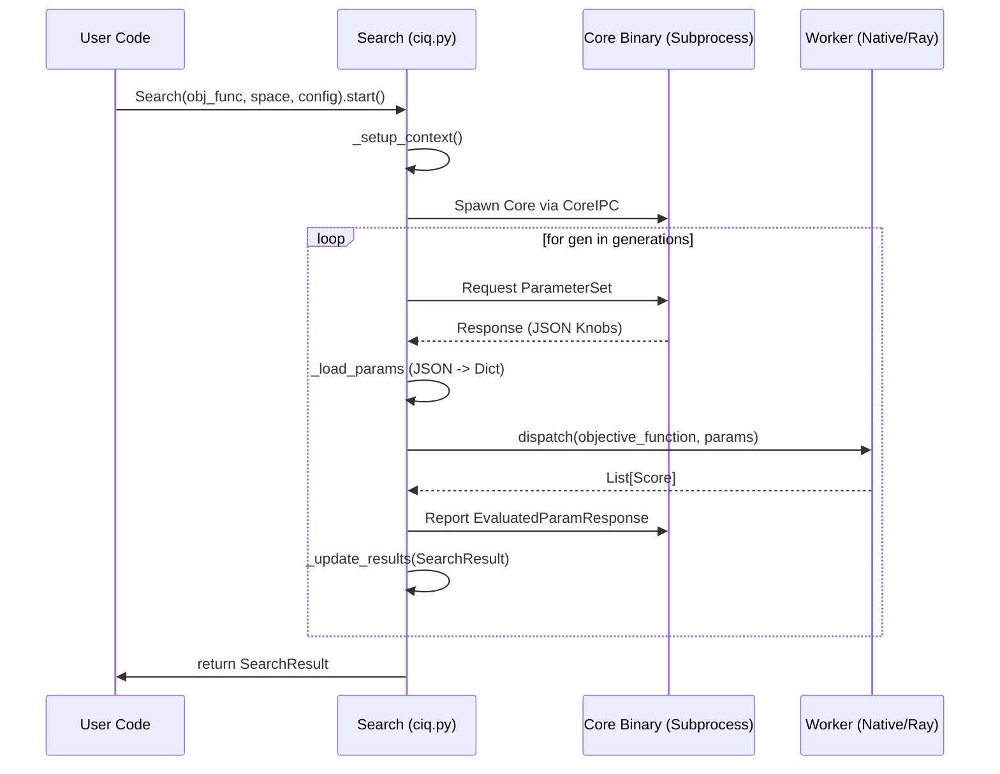
Sources: [compileiq/ciq.py:465-498](), [compileiq/ciq.py:511-584](), [compileiq/core/core_comms.py:22-45]()

---

## Configuration via SearchConfiguration

The behavior of the `Search` class is dictated by the `SearchConfiguration` Pydantic model. This configuration ensures that the search strategy is valid before the Core binary is even started.

| Parameter | Type | Description |
| :--- | :--- | :--- |
| `pool_size` | `int` | Number of candidates to evaluate per generation. |
| `generations` | `int` | Total number of GA iterations. |
| `mutate_rate` | `float` | Probability of mutation for each knob (0.0 to 1.0). |
| `problem_type` | `str` | Either `"min"` or `"max"`. |
| `num_objectives`| `int` | Number of scores returned by the objective function. |
| `normalize` | `bool` | If True, performs a baseline run to normalize scores. |

**Code Entity Association**
The `Search` class uses an `InternalSearchConfiguration` which extends the public `SearchConfiguration` with system-level metadata like the `run_id` and `invocation_id`.

**Diagram: Configuration to Core IPC Mapping**
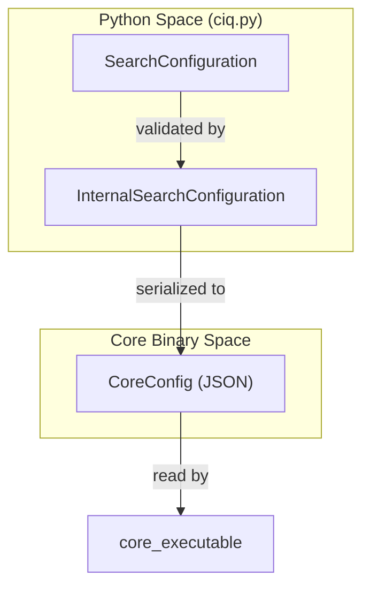
Sources: [compileiq/types.py:126-174](), [compileiq/ciq.py:381-405]()

---

## Error Handling and Robustness

The `Search` class implements several mechanisms to handle failures in the objective function or the infrastructure.

### 1. `exit_on_failure`
This safety check is triggered after the first generation. If `exit_on_failure` is `True` (default) and **all** candidates in the first generation returned an `INVALID_SCORE`, the search terminates with a `RuntimeError`. This prevents wasting resources on a misconfigured objective function [compileiq/ciq.py:157-164](), [compileiq/ciq.py:586-605]().

### 2. `task_timeout`
Managed at the `Worker` level but configured via `SearchConfiguration`, this enforces a maximum wall-clock time for a single evaluation of the objective function. If a task exceeds this limit, it is killed and assigned an `INVALID_SCORE` [compileiq/types.py:168-171]().

### 3. Result Persistence
The `SearchResult` object (managed by `Search._result`) tracks every evaluation. If the search is interrupted, the results can be recovered if `dump_results` was provided [compileiq/ciq.py:146-152]().

**Diagram: Result Management Entities**
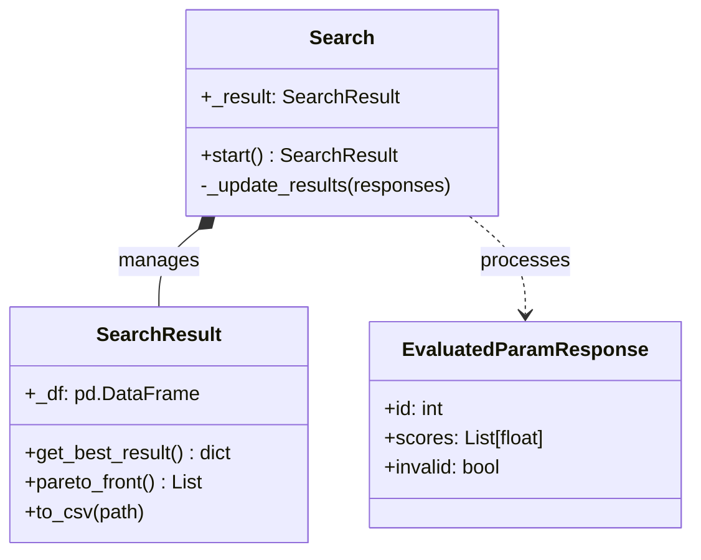
Sources: [compileiq/results.py:15-40](), [compileiq/ciq.py:607-626](), [compileiq/core/core_types.py:84-95]()

---

## Normalization and Baseline Runs

When `normalize=True` is set in the `SearchConfiguration`, the `Search` class performs an additional "Generation -1" before the actual search begins.

1.  **Baseline Request**: The `Search` class sends an empty dictionary `{}` to the objective function. This represents the "default" or "baseline" compiler settings [compileiq/ciq.py:514-525]().
2.  **Score Capture**: The score from this baseline run is captured as the `norm_score`.
3.  **Adjustment**: All subsequent scores in generations 0 through $N$ are divided by this `norm_score` before being sent to the Core binary, allowing the GA to operate on a relative scale [compileiq/ciq.py:527-531]().

Sources: [compileiq/ciq.py:511-531](), [tests/integration/test_core_integration.py:201-205]()

---

# Page: Core Binary & IPC Communication

# Core Binary & IPC Communication

<details>
<summary>Relevant source files</summary>

The following files were used as context for generating this wiki page:

- [compileiq/core/core_comms.py](compileiq/core/core_comms.py)
- [compileiq/core/core_types.py](compileiq/core/core_types.py)
- [compileiq/core/executable/core-manifest.json](compileiq/core/executable/core-manifest.json)
- [compileiq/core/executable/core-version.lock](compileiq/core/executable/core-version.lock)
- [compileiq/core/executable/linux/x86_64/bin/_core](compileiq/core/executable/linux/x86_64/bin/_core)
- [compileiq/core/executable/win32/amd64/core.exe](compileiq/core/executable/win32/amd64/core.exe)
- [compileiq/core/verify_core.py](compileiq/core/verify_core.py)
- [compileiq/search_spaces/models.py](compileiq/search_spaces/models.py)
- [tests/unit/test_core_comms.py](tests/unit/test_core_comms.py)
- [tests/unit/test_core_types.py](tests/unit/test_core_types.py)
- [tests/unit/test_verify_core.py](tests/unit/test_verify_core.py)

</details>


The CompileIQ architecture separates the Python-based orchestration and worker management from the high-performance optimization logic, which is implemented in a compiled **Core binary**. This separation allows the Core to leverage optimized search algorithms while Python handles flexible task distribution and user-defined objective functions. Communication between these layers is managed via a socket-based Inter-Process Communication (IPC) protocol.

### Core Binary Distribution & Verification

CompileIQ bundles platform-specific executables for Linux (x86_64, aarch64) and Windows (amd64) [compileiq/core/executable/core-manifest.json:4-11](). These binaries are managed by a manifest system to ensure integrity and version alignment.

#### Binary Verification via `core-manifest.json`
The `verify_core.py` module ensures that the bundled binaries match the expected versions before execution.
*   **Manifest Tracking**: `core-manifest.json` stores the `core_commit` and SHA-256 hashes for every platform-specific file [compileiq/core/executable/core-manifest.json:2-12]().
*   **Platform Support**: Supported platforms include `linux/x86_64`, `linux/aarch64`, and `win32/amd64` [compileiq/core/verify_core.py:15-15]().
*   **Verification Logic**: The `verify()` function calculates the SHA-256 of on-disk files and compares them against the manifest [compileiq/core/verify_core.py:135-172](). It also checks for missing or extra files [compileiq/core/verify_core.py:158-168]().

#### Binary Resolution Workflow
The `CoreIPC` class resolves which binary to run based on the host environment:
1.  **Environment Overrides**: If `CIQ_CORE_BINARY` is set, it uses that path [compileiq/core/core_comms.py:82-84](). If `CIQ_CORE_MANIFEST` is also provided, it performs verification; otherwise, it issues a warning [compileiq/core/core_comms.py:88-102]().
2.  **Bundled Selection**: By default, it constructs a path based on `sys.platform` and `platform.machine()` [compileiq/core/core_comms.py:69-71]().
3.  **Integrity Check**: The selected binary and its platform dependencies (e.g., `libciq.so` or `_core`) are verified using `verify_binary_platform` before the process starts [compileiq/core/core_comms.py:107-111]().

**Sources:** [compileiq/core/core_comms.py:68-112](), [compileiq/core/verify_core.py:135-172](), [compileiq/core/executable/core-manifest.json:1-13]()

---

### CoreIPC Subprocess Management

The `CoreIPC` class manages the lifecycle of the Core subprocess.

#### Subprocess Lifecycle
*   **Startup**: `CoreIPC.start()` launches the binary using `subprocess.Popen`. It passes a configuration file path via the `-c` flag and configures the environment with socket details [compileiq/core/core_comms.py:54-66]().
*   **Environment Setup**: The Core discovers the Python orchestration layer via `CIQ_HOST` and `CIQ_PORT` environment variables, which are extracted from the `server_socket` [compileiq/core/core_comms.py:181-190]().
*   **Termination**: `CoreIPC.stop()` kills the process. On non-Windows systems, it uses `os.killpg` with `SIGKILL` to ensure all children in the process group are terminated [compileiq/core/core_comms.py:114-129]().

**Core Startup Sequence**
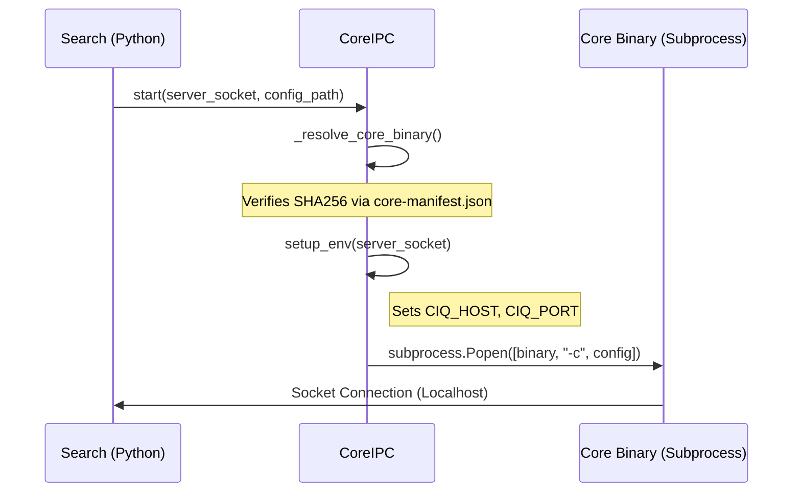
**Sources:** [compileiq/core/core_comms.py:44-67](), [compileiq/core/core_comms.py:114-129](), [compileiq/core/core_comms.py:181-190]()

---

### Socket-Based Communication Protocol

The communication between Python and the Core is full-duplex over localhost sockets using JSON-serialized messages.

#### Message Types (`core_types.py`)
| Class | Purpose | Key Fields |
| :--- | :--- | :--- |
| `ParameterSet` | Sent from Core to Python; contains candidates to evaluate. | `params` (List), `generation_num`, `invocation_id` |
| `SingleCandidate` | A single point in the search space. | `id`, `knobs` (serialized string) |
| `ResponseTemplate` | Sent from Python to Core; contains evaluation results. | `evaluated_params` (List of scores) |
| `CompletionMessage` | Signals the end of the search. | `complete` (bool) |

#### Data Flow and Framing
1.  **Receiving (Core -> Python)**: `receive_from_core` reads from the socket in chunks of `MAX_BYTES` [compileiq/core/core_comms.py:142](). It accumulates data into a buffer until it can be successfully parsed as a valid JSON object [compileiq/core/core_comms.py:156-164]().
2.  **Sending (Python -> Core)**: `send_to_core` serializes the `ResponseTemplate` to JSON and appends a newline (`\n`), which the Core uses as a message delimiter [compileiq/core/core_comms.py:192-202]().

**Entity Mapping: Communication Logic**
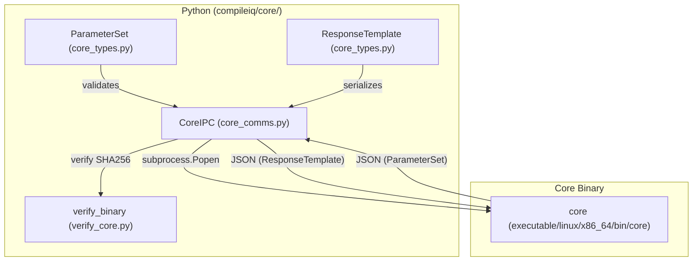

**Sources:** [compileiq/core/core_types.py:5-27](), [compileiq/core/core_comms.py:130-179](), [compileiq/core/core_comms.py:192-202]()

### Error Handling & Retries
The IPC layer includes robust handling for socket timeouts and process hangs:
*   **Socket Timeouts**: If `socket.recvfrom` times out, `CoreIPC` checks if the core process is still alive [compileiq/core/core_comms.py:143-146]().
*   **Retries**: It will retry the receive operation up to `MAX_RETRIES` if the process is still running [compileiq/core/core_comms.py:146-148]().
*   **Validation**: Received messages are validated using Pydantic `TypeAdapter` to ensure they conform to the expected `ParameterSet` or `CompletionMessage` schemas [compileiq/core/core_comms.py:171-177]().

**Sources:** [compileiq/core/core_comms.py:140-153](), [compileiq/core/core_comms.py:171-177]()

---

# Page: Data Types & Result Management

# Data Types & Result Management

<details>
<summary>Relevant source files</summary>

The following files were used as context for generating this wiki page:

- [.github/copy-pr-bot.yaml](.github/copy-pr-bot.yaml)
- [compileiq/results.py](compileiq/results.py)
- [compileiq/tracker.py](compileiq/tracker.py)
- [compileiq/types.py](compileiq/types.py)
- [docs/xgboost.md](docs/xgboost.md)
- [examples/mlflow_tracker.py](examples/mlflow_tracker.py)
- [examples/multi_objective.py](examples/multi_objective.py)
- [examples/normalizing.py](examples/normalizing.py)
- [tests/integration/test_worker.py](tests/integration/test_worker.py)
- [tests/unit/test_results.py](tests/unit/test_results.py)
- [tests/unit/test_search_configuration.py](tests/unit/test_search_configuration.py)
- [tests/unit/test_tracker_unit.py](tests/unit/test_tracker_unit.py)

</details>


This page documents the internal type system and result management infrastructure of CompileIQ. It covers how scores are represented, how search results are persisted and analyzed, and the lifecycle of experiment tracking.

## Core Type System

CompileIQ utilizes a structured type system to ensure consistency between the Python orchestration layer and the evaluation workers.

### Problem Definition
The optimization goal is defined by `ProblemType`, which determines whether the search algorithm seeks to minimize or maximize the objective function [compileiq/types.py:34-39]().

### Score Representation
Scores are encapsulated in the `Score` model, which supports both single and multi-objective outputs:
*   **`SingleScore`**: A single `float`, `int`, or the string `"*"` (represented by `INVALID_SCORE`) [compileiq/utils/validation.py:23-26]().
*   **`MultiScore`**: A sequence of `SingleScore` values [compileiq/utils/validation.py:24]().
*   **`INVALID_SCORE`**: The sentinel value `"*"` used to indicate that an objective function evaluation failed (e.g., a compiler error or timeout) [compileiq/utils/validation.py:26]().

### Multi-Objective Aggregation
When `num_objectives > 1`, the system uses `MultiScoreComparison` to determine how results are compared or aggregated [compileiq/types.py:41-58]().

| Strategy | Enum Value | Description |
| :--- | :--- | :--- |
| `AVERAGE` | `"avg"` | Averages all scores in the MultiScore [compileiq/types.py:55](). |
| `STDDEV` | `"stddev"` | Calculates the standard deviation across scores [compileiq/types.py:56](). |
| `PARETO` | `"pareto_front"` | The preferred method; identifies non-dominated solutions [compileiq/types.py:57](). |

**Sources:** [compileiq/types.py:34-58](), [compileiq/utils/validation.py:22-28]()

---

## Result Management: SearchResult

The `SearchResult` class is the primary container for data generated during a search. It wraps a pandas `DataFrame` and provides methods for analysis, deduplication, and persistence [compileiq/results.py:10-31]().

### Data Flow: From Worker to DataFrame
The following diagram illustrates how raw scores from workers are transformed into managed results.

**Diagram: Result Acquisition Pipeline**
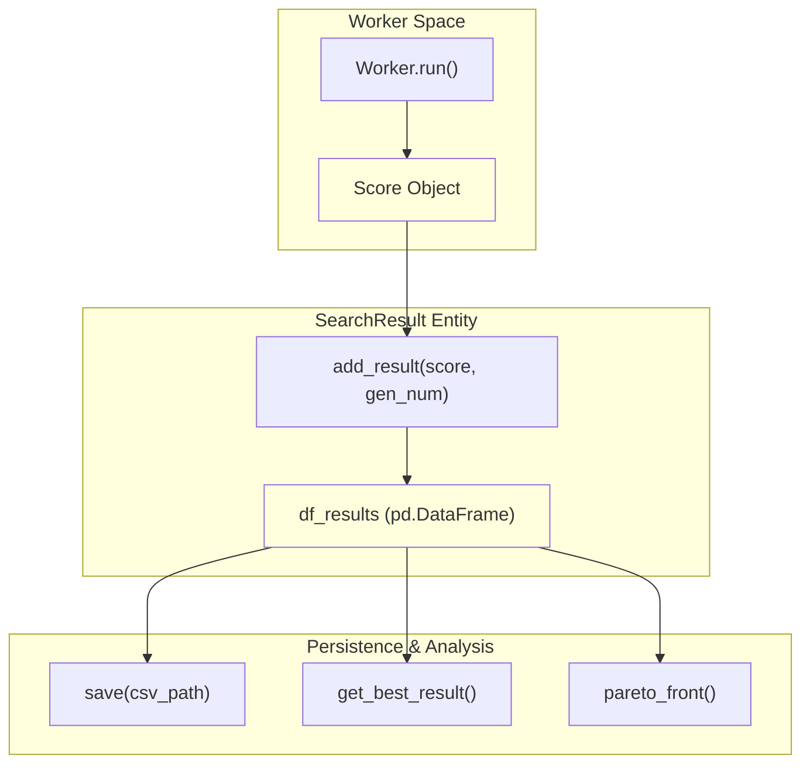
**Sources:** [compileiq/results.py:151-165](), [compileiq/results.py:182-202]()

### Key Functionality
*   **Deduplication**: The `clear_duplicates()` method removes redundant entries based on the `params` column to ensure the Pareto front calculation is efficient [compileiq/results.py:119-122]().
*   **Normalization Support**: If `normalize=True` in `SearchConfiguration`, the `SearchResult` tracks both `score_N` and `norm_score_N` columns [compileiq/results.py:163-165](). It uses the `BASELINE_CONFIG` (an empty dict `{}`) to establish the baseline [compileiq/results.py:178-180]().
*   **CSV Persistence**: Results are saved via `save()` and can be reloaded using `from_csv()`, which automatically handles JSON-deserialization of the `params` column [compileiq/results.py:45-71]().

**Sources:** [compileiq/results.py:45-122](), [compileiq/results.py:151-180]()

---

## Pareto Front Calculation

For multi-objective problems, CompileIQ identifies the set of "non-dominated" solutions. A solution is non-dominated if no other solution is better in at least one objective without being worse in another.

### Implementation Logic
The `pareto_front()` method filters the internal DataFrame to return only these optimal trade-offs [compileiq/results.py:215-220](). This is critical when balancing conflicting metrics, such as "Instruction Count" vs. "Register Pressure" in compiler tuning [examples/multi_objective.py:8-11]().

**Sources:** [compileiq/results.py:182-220](), [examples/multi_objective.py:1-35]()

---

## Experiment Tracking

The `BaseTracker` defines the lifecycle for logging experiment data. This allows users to monitor progress via console (Loguru) or specialized UI (MLflow) [compileiq/types.py:93-103]().

### Tracker Lifecycle and Entities
This diagram maps the natural language "Search Lifecycle" to the specific code entities in the `Tracker` system.

**Diagram: Tracker Lifecycle Mapping**
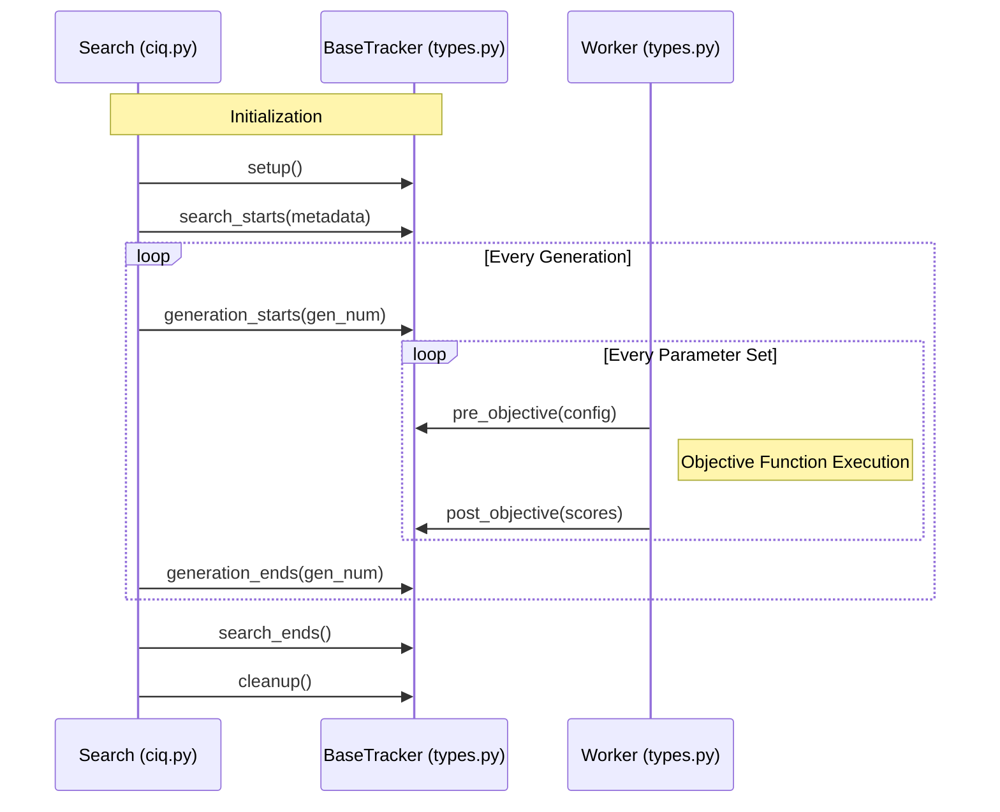
**Sources:** [compileiq/types.py:93-171](), [compileiq/tracker.py:94-150]()

### Supported Trackers
1.  **`LoguruTracker`**: The default tracker. It provides structured logging to `stdout` or files. It captures `search_space_resolution_metadata` to log exactly which compiler versions or binary search spaces were used [compileiq/tracker.py:121-126]().
2.  **`MLflowTracker`**: Integrates with MLflow. It logs parameters as `mlflow.log_params`, metrics as `mlflow.log_metrics`, and can even track artifacts if the objective function uses `mlflow.log_artifact` [compileiq/tracker.py:151-213](), [examples/mlflow_tracker.py:23-58]().
3.  **`DisabledTracker`**: A no-op implementation used when `tracker_config` is set to `DISABLED` [compileiq/tracker.py:59-92]().

**Sources:** [compileiq/types.py:60-82](), [compileiq/tracker.py:59-213](), [examples/mlflow_tracker.py:1-58]()

---

# Page: Search Spaces

# Search Spaces

<details>
<summary>Relevant source files</summary>

The following files were used as context for generating this wiki page:

- [.gitignore](.gitignore)
- [compileiq/search_spaces/base.py](compileiq/search_spaces/base.py)
- [compileiq/search_spaces/compilers.py](compileiq/search_spaces/compilers.py)
- [compileiq/search_spaces/manifest.py](compileiq/search_spaces/manifest.py)
- [compileiq/search_spaces/resolver.py](compileiq/search_spaces/resolver.py)
- [compileiq/utils/validation.py](compileiq/utils/validation.py)
- [compileiq/worker.py](compileiq/worker.py)
- [docs/compilers_overview.md](docs/compilers_overview.md)
- [docs/getting_started.md](docs/getting_started.md)

</details>


Search spaces in CompileIQ define the range of parameters and compiler controls that the optimization engine explores. These spaces are defined in Python, resolved to concrete assets if they refer to NVIDIA compiler controls, and then delivered to the Core binary for sampling and mutation.

## Overview

The search space system bridges high-level user definitions with the low-level Core optimization engine. It consists of three primary layers:
1.  **Primitives**: Python functions used to define ranges, choices, and literals.
2.  **Providers**: Specialized classes for fetching and managing NVIDIA compiler search spaces (e.g., `ptxas`, `nvcc`).
3.  **Manifest/Resolver**: A system for mapping logical compiler requests to verified binary assets, supporting both online downloads and air-gapped mirrors.

### Search Space Architecture

The following diagram illustrates how search spaces move from definition to the Core engine.

**Search Space Resolution Flow**
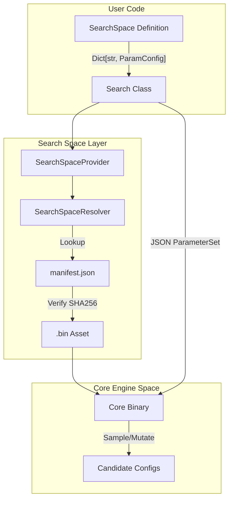
Sources: [compileiq/ciq.py:1-50](), [compileiq/search_spaces/resolver.py:1-14](), [compileiq/search_spaces/compilers.py:1-10]()

---

## Search Space Primitives

Primitives are the building blocks of any search space. They are defined in `compileiq/search_spaces/base.py` and allow users to specify the "shape" of the data they want to optimize.

*   **`range()`**: Defines a continuous or stepped numerical range. Supports `seed_low` and `seed_high` for biased initialization [compileiq/search_spaces/base.py:12-82]().
*   **`choice()`**: Defines a discrete list of values (formerly known as `Enum`) [compileiq/search_spaces/base.py:85-121]().
*   **`log_sampling()`**: Emulates logarithmic distribution by generating a geometric progression of choices [compileiq/search_spaces/base.py:158-185]().
*   **`literal()`**: Provides a constant value, often used with `knockout_prob` to toggle flags [compileiq/search_spaces/base.py:124-155]().

Every primitive supports a `knockout_prob`, which defines the likelihood of a parameter being excluded from a specific sample, effectively allowing the search to explore the absence of a parameter [compileiq/search_spaces/base.py:37-40]().

For details, see [Search Space Primitives](#3.1).

---

## Compiler Search Space Providers

CompileIQ provides curated search spaces for NVIDIA compilers through the `SearchSpaceProvider` interface [compileiq/search_spaces/compilers.py:21-29](). These providers automate the retrieval of complex compiler control definitions.

### Key Provider Classes
| Class | Purpose | Source |
| :--- | :--- | :--- |
| `PtxasSearchSpace` | Fetches controls for the PTX assembler. | [compileiq/search_spaces/compilers.py:66-72]() |
| `NvccSearchSpace` | Fetches controls for the NVCC compiler driver. | [compileiq/search_spaces/compilers.py:75-81]() |
| `LocalSearchSpaceBin` | Uses a local `.bin` file, bypassing manifest lookups. | [compileiq/search_spaces/compilers.py:84-103]() |

These providers use a `version`, `variant`, and `tag` to identify the correct asset [compileiq/search_spaces/compilers.py:44-52](). For example, the `att` variant is often used for tuning attention kernels [docs/compilers_overview.md:22-24]().

For details, see [Compiler Search Space Providers](#3.2).

---

## The Manifest and Resolver System

The `SearchSpaceResolver` ensures that the search space used by the Python layer matches the expectations of the Core binary. It manages a local cache under `~/.cache/compileiq/` and verifies assets using a `manifest.json` file [compileiq/search_spaces/resolver.py:1-14]().

### Data Association: Logical to Physical
The system maps logical identifiers to physical code entities and files.

**Entity Mapping Diagram**
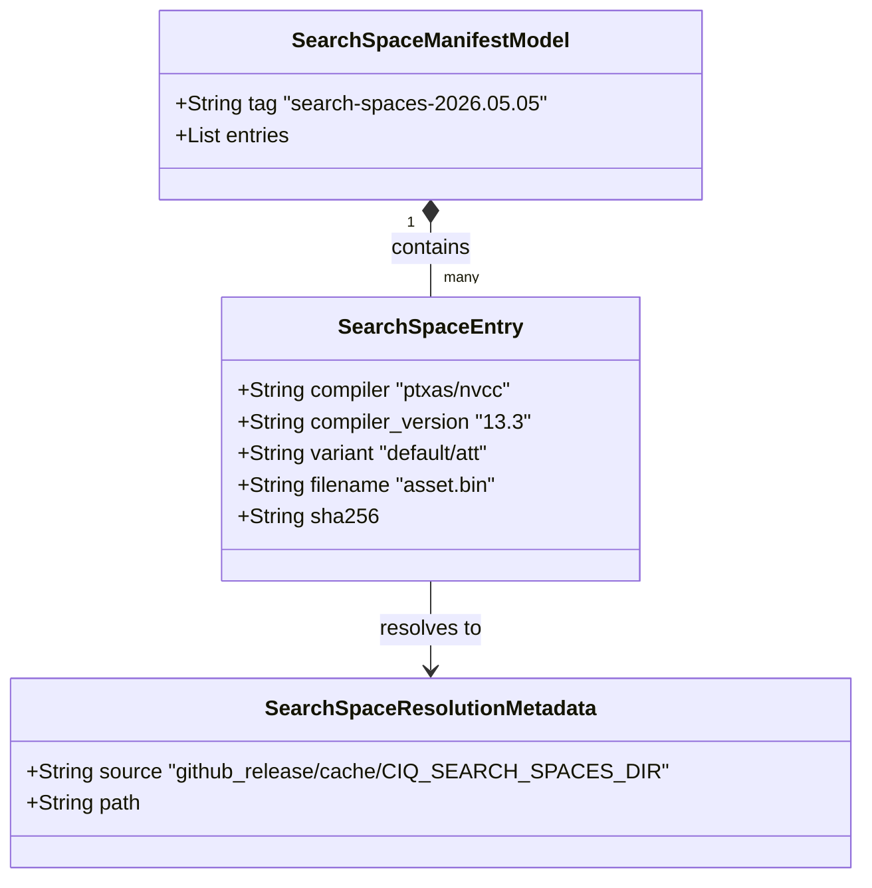
Sources: [compileiq/search_spaces/manifest.py:41-90](), [compileiq/search_spaces/resolver.py:61-79]()

### Offline and Air-Gapped Use
Users can bypass GitHub downloads by setting the `CIQ_SEARCH_SPACES_DIR` environment variable [compileiq/search_spaces/resolver.py:36-37](). When set, the resolver looks for `manifest.json` and `.bin` files in that local directory instead of querying the GitHub API [compileiq/search_spaces/compilers.py:6-9]().

### Safety and Validation
The resolver performs strict validation on every asset:
*   **SHA256 Verification**: Ensures the binary hasn't been corrupted or tampered with [compileiq/search_spaces/resolver.py:153-155]().
*   **Size Checks**: A quick sanity check before the expensive hashing process [compileiq/search_spaces/resolver.py:148-152]().
*   **Path Sanitization**: Prevents parent directory traversal attacks in manifest filenames [compileiq/search_spaces/manifest.py:23-38]().

Sources: [compileiq/search_spaces/resolver.py:135-156](), [compileiq/search_spaces/manifest.py:69-72]()

---

# Page: Search Space Primitives

# Search Space Primitives

<details>
<summary>Relevant source files</summary>

The following files were used as context for generating this wiki page:

- [compileiq/search_spaces/base.py](compileiq/search_spaces/base.py)
- [compileiq/utils/validation.py](compileiq/utils/validation.py)
- [compileiq/worker.py](compileiq/worker.py)
- [docs/getting_started.md](docs/getting_started.md)
- [examples/nested_search_space.py](examples/nested_search_space.py)
- [examples/single_objective.py](examples/single_objective.py)

</details>


The search space API in CompileIQ provides a set of primitives used to define the parameters that the optimization engine explores. These primitives are defined in `compileiq/search_spaces/base.py` and map Python-level definitions to configuration structures that the Core binary can process.

### Overview of Primitives

Search spaces are typically defined as a dictionary where keys are parameter names and values are primitive configurations [docs/getting_started.md:25-30](). CompileIQ supports four primary primitives: `range`, `choice`, `log_sampling`, and `literal`.

#### Logic Flow: From Definition to Objective Function

The following diagram illustrates how a search space definition in Python is transformed and eventually passed to the user-provided objective function.

**Search Space Data Transformation**
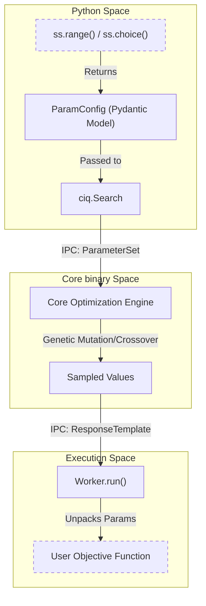
Sources: [compileiq/search_spaces/base.py:12-155](), [compileiq/worker.py:91-126](), [docs/getting_started.md:15-50]()

---

### Core Primitives API

#### 1. Range Sampling
The `range()` function defines a continuous numerical space with a fixed step size.

*   **Function**: `range(start, end, step=1, knockout_prob=None, seed_low=None, seed_high=None)` [compileiq/search_spaces/base.py:12-19]()
*   **Constraints**: The `step` must be positive [compileiq/search_spaces/base.py:59-60](), and `start` must be less than `end` [compileiq/search_spaces/base.py:62-63]().
*   **Seeding**: `seed_low` and `seed_high` allow for a secondary initialization subset. If provided, the engine initializes a percentage of the population (defined by `init_with_true_random_threshold` in `SearchConfiguration`) within this sub-range to accelerate convergence in known "safe" areas [compileiq/search_spaces/base.py:41-56]().

#### 2. Discrete Choice
The `choice()` function defines a discrete set of values to sample from.

*   **Function**: `choice(choice_list, knockout_prob=None)` [compileiq/search_spaces/base.py:85-88]()
*   **Implementation**: It handles Python types and `numpy` scalars, converting booleans to integers (0/1) for compatibility with the Core [compileiq/search_spaces/base.py:105-114]().
*   **Legacy**: Previously referred to as `Enum` in earlier versions [compileiq/search_spaces/base.py:91]().

#### 3. Logarithmic Sampling
Since the Core engine does not natively support logarithmic distributions, `log_sampling` emulates this by generating a `choice` list.

*   **Function**: `log_sampling(start, end, total=10, knockout_prob=None)` [compileiq/search_spaces/base.py:158-163]()
*   **Implementation**: Uses `np.geomspace` to create a list of `total` values distributed logarithmically between `start` and `end`, which is then passed to `choice()` [compileiq/search_spaces/base.py:182-185]().

#### 4. Literals and Constants
The `literal()` primitive represents a fixed value that does not change during the search but can still participate in the knockout logic.

*   **Function**: `literal(const_value, knockout_prob=None)` [compileiq/search_spaces/base.py:124-127]()
*   **Usage**: Useful for "on/off" flags where the "on" value is a specific string or number, and "off" is achieved via knockout [compileiq/search_spaces/base.py:129-132]().

Sources: [compileiq/search_spaces/base.py:12-186]()

---

### Common Features: Knockout and Validation

| Feature | Description | Implementation Detail |
| :--- | :--- | :--- |
| **Knockout Prob** | The probability (`0.0` to `1.0`) that a parameter is omitted from the dictionary passed to the objective function. | Converted to `knockout_threshold` (1.0 - prob) for the Core [compileiq/search_spaces/base.py:65](). |
| **Invalid Scores** | If a specific parameter combination causes a failure (e.g., compiler crash), the objective function should return `INVALID_SCORE` (literal `"*"`). | Defined in `compileiq/utils/validation.py:16` and handled by `Score.failed` [compileiq/utils/validation.py:64-79](). |
| **Type Safety** | Pydantic models `RangeParamConfig`, `ChoiceParamConfig`, and `LiteralParamConfig` enforce schema validation before transmission. | Imported from `compileiq.search_spaces.models` [compileiq/search_spaces/base.py:5-9](). |

Sources: [compileiq/search_spaces/base.py:37-40](), [compileiq/utils/validation.py:15-32]()

---

### Nested Search Spaces

CompileIQ supports nested dictionaries in the search space definition. This allows users to group related parameters logically.

**Nested Structure Mapping**
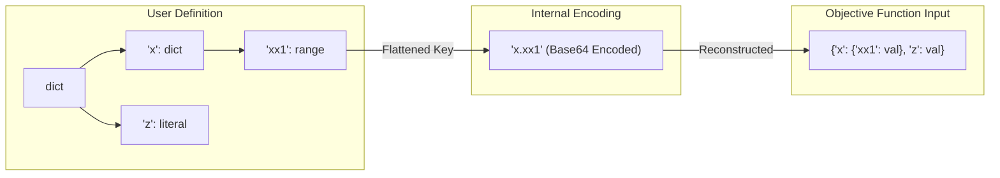

When a nested dictionary is provided, CompileIQ flattens the keys using a dot-notation (e.g., `parent.child.parameter`). To ensure these keys are safe for IPC and the Core engine's internal parsers, they are typically encoded. When the `Worker` receives sampled values back from the Core, it reconstructs the original nested dictionary structure before calling the `objective_function` [examples/nested_search_space.py:6-12](), [examples/nested_search_space.py:16-29]().

Sources: [examples/nested_search_space.py:16-29](), [compileiq/worker.py:103-115]()

---

# Page: Compiler Search Space Providers

# Compiler Search Space Providers

<details>
<summary>Relevant source files</summary>

The following files were used as context for generating this wiki page:

- [.gitignore](.gitignore)
- [compileiq/search_spaces/compilers.py](compileiq/search_spaces/compilers.py)
- [compileiq/search_spaces/manifest.py](compileiq/search_spaces/manifest.py)
- [compileiq/search_spaces/resolver.py](compileiq/search_spaces/resolver.py)
- [docs/compilers_overview.md](docs/compilers_overview.md)
- [tests/integration/test_search_space_resolution.py](tests/integration/test_search_space_resolution.py)
- [tests/unit/search_spaces/test_compilers.py](tests/unit/search_spaces/test_compilers.py)
- [tests/unit/search_spaces/test_manifest.py](tests/unit/search_spaces/test_manifest.py)
- [tests/unit/search_spaces/test_resolver.py](tests/unit/search_spaces/test_resolver.py)

</details>


Compiler Search Space Providers are specialized classes responsible for retrieving and managing the search space definitions used to tune NVIDIA compilers. Starting in CUDA Toolkit (CTK) 13.3, `nvcc` and `ptxas` expose the **Advanced Controls Interface**, allowing CompileIQ to influence compiler heuristics via **Advanced Controls Files** (ACF) [docs/compilers_overview.md:1-5]().

These providers map high-level logical requests (compiler version, variant) to concrete binary assets, handling resolution, network retrieval, integrity verification, and local caching [compileiq/search_spaces/compilers.py:4-10]().

## Provider Classes

The codebase implements three primary providers in `compileiq/search_spaces/compilers.py`.

### PtxasSearchSpace and NvccSearchSpace
These classes are the standard interface for tuning PTXAS and NVCC. They inherit from `CompilerSearchSpaceBase` and use the GitHub-release-backed resolver pipeline [compileiq/search_spaces/compilers.py:66-82]().

*   **`version`**: The compiler version (e.g., `"13.3"`) [compileiq/search_spaces/compilers.py:46-50]().
*   **`variant`**: Specific control sets. Use `"default"` for standard tuning or `"att"` for specialized attention kernel optimizations [docs/compilers_overview.md:22-23]().
*   **`tag`**: Pins the search space to a specific release tag (e.g., `"search-spaces-2026.05.05"`) for reproducibility [docs/compilers_overview.md:28-34]().

### LocalSearchSpaceBin
Used for development or out-of-band assets. It takes a direct filesystem path and bypasses the manifest and network resolution logic entirely [compileiq/search_spaces/compilers.py:84-93]().

## The Resolver Pipeline

When `retrieve()` is called on a provider, it initiates a resolution pipeline that translates logical parameters into a local file path.

### Resolution Data Flow
The following diagram illustrates how a `PtxasSearchSpace` request moves from the Python API to a verified local binary.

**Search Space Resolution Flow**
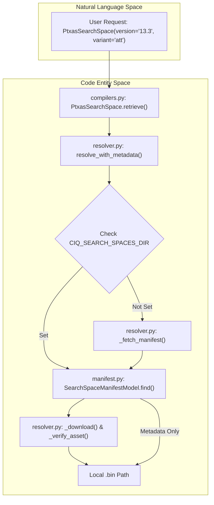
Sources: [compileiq/search_spaces/compilers.py:55-63](), [compileiq/search_spaces/resolver.py:170-192](), [compileiq/search_spaces/manifest.py:107-130]()

### Offline Mirroring (Air-Gapped Use)
For environments without internet access, the resolver supports offline mirroring via the `CIQ_SEARCH_SPACES_DIR` environment variable [compileiq/search_spaces/compilers.py:6-9]().
1.  Set `CIQ_SEARCH_SPACES_DIR` to a local directory.
2.  The directory must contain a `manifest.json` and the corresponding `.bin` files.
3.  The resolver will prioritize this directory and skip all network calls [compileiq/search_spaces/resolver.py:104-119]().

## Manifest and Metadata

The `manifest.json` acts as a Table of Contents for a release, defined by the `SearchSpaceManifestModel` [compileiq/search_spaces/manifest.py:75-90]().

### SearchSpaceEntry Schema
Each entry in the manifest contains:
| Field | Description |
| :--- | :--- |
| `compiler` | `ptxas` or `nvcc` [compileiq/search_spaces/manifest.py:44]() |
| `compiler_version` | Target CTK version (e.g., "13.3") [compileiq/search_spaces/manifest.py:47]() |
| `variant` | The specific optimization profile [compileiq/search_spaces/manifest.py:50]() |
| `sha256` | Hex string for integrity verification [compileiq/search_spaces/manifest.py:57]() |
| `size_bytes` | File size in bytes for sanity checking [compileiq/search_spaces/manifest.py:60]() |

### Resolution Metadata
When a search is initialized, CompileIQ captures `SearchSpaceResolutionMetadata` to ensure traceability in experiment logs [compileiq/search_spaces/resolver.py:61-78](). This metadata includes the `resolved_tag`, the `source` (e.g., `github_release`, `cache`, or `CIQ_SEARCH_SPACES_DIR`), and the asset's SHA256 hash [compileiq/search_spaces/resolver.py:179-191]().

**Metadata Association**
```mermaid
classDiagram
    class Search {
        +search_space_resolution_metadata: list[dict]
    }
    class CompilerSearchSpaceBase {
        +resolution_metadata: SearchSpaceResolutionMetadata
        +retrieve() Path
    }
    class SearchSpaceResolutionMetadata {
        +compiler: str
        +resolved_tag: str
        +sha256: str
        +source: str
    }
    Search o-- CompilerSearchSpaceBase : uses
    CompilerSearchSpaceBase --> SearchSpaceResolutionMetadata : populates
```
Sources: [compileiq/search_spaces/compilers.py:53](), [compileiq/search_spaces/resolver.py:62-76](), [tests/unit/search_spaces/test_compilers.py:119-135]()

## Implementation Details

### Integrity Verification
The resolver enforces strict security checks:
*   **Filename Validation**: Prevents path traversal by rejecting filenames containing slashes or backslashes [compileiq/search_spaces/manifest.py:23-38]().
*   **Checksums**: Downloads are written to a `.part` file and only moved to the final cache location after the `sha256` and `size_bytes` match the manifest [compileiq/search_spaces/resolver.py:147-167]().

### Cache Management
Assets are cached in `~/.cache/compileiq/<tag>/` [compileiq/search_spaces/resolver.py:4-6](). The cache filename is prefixed with the first 12 characters of the SHA256 hash to prevent collisions between different versions of the same filename [compileiq/search_spaces/resolver.py:135-136]().

Sources:
*   `compileiq/search_spaces/compilers.py`
*   `compileiq/search_spaces/resolver.py`
*   `compileiq/search_spaces/manifest.py`
*   `docs/compilers_overview.md`
*   `tests/unit/search_spaces/test_compilers.py`

---

# Page: Workers & Execution Backends

# Workers & Execution Backends

<details>
<summary>Relevant source files</summary>

The following files were used as context for generating this wiki page:

- [compileiq/tracker.py](compileiq/tracker.py)
- [compileiq/types.py](compileiq/types.py)
- [docs/workers.md](docs/workers.md)
- [examples/custom_worker.py](examples/custom_worker.py)
- [examples/distributed.py](examples/distributed.py)
- [tests/integration/test_worker.py](tests/integration/test_worker.py)
- [tests/unit/test_search_configuration.py](tests/unit/test_search_configuration.py)
- [tests/unit/test_tracker_unit.py](tests/unit/test_tracker_unit.py)

</details>


CompileIQ decouples the search orchestration logic from the execution of the objective function through a flexible worker abstraction [compileiq/types.py:173-176](). This architecture allows the same search configuration to run locally using multiprocessing, across a distributed cluster using Ray, or asynchronously within a single event loop.

## The Worker Abstraction

All execution backends inherit from the `Worker` base class [compileiq/types.py:173-176](). The worker is responsible for managing the execution of a batch of parameters (a "generation") and returning validated `Score` objects to the search engine [examples/custom_worker.py:13-21]().

### Core Responsibilities
* **Execution:** Running the user-provided `objective_function` against a pool of parameters [examples/custom_worker.py:44-46]().
* **Normalization:** Handling baseline calculations and applying normalization if enabled in `SearchConfiguration` [examples/custom_worker.py:28-40]().
* **Error Handling:** Catching exceptions within the objective function to prevent search interruption, typically returning `INVALID_SCORE` [examples/custom_worker.py:47-57]().
* **Tracking:** Triggering lifecycle callbacks in the configured `BaseTracker` (e.g., `pre_objective`, `post_objective`) [compileiq/types.py:153-170]().

### Worker Mapping to Code Space

The following diagram bridges the conceptual worker types to their specific implementation classes and configuration parameters.

**Worker System Mapping**
```mermaid
graph TD
    subgraph "Natural Language Space"
        A["Local Parallelism"]
        B["Isolated Tasks"]
        C["Distributed Cluster"]
        D["Async Concurrency"]
    end

    subgraph "Code Entity Space"
        A --> W1["MultiProcessWorker"]
        B --> W2["IsoMultiProcessWorker"]
        C --> W3["RayWorker"]
        D --> W4["AsyncWorker"]
        
        W1 -- "uses" --> P1["multiprocessing.Pool"]
        W2 -- "uses" --> P2["multiprocessing.Process"]
        W3 -- "uses" --> R1["ray.remote"]
        W4 -- "uses" --> AS1["asyncio.gather"]
    end

    subgraph "Configuration (Search.start)"
        W1 -- "args" --> N1["num_workers"]
        W2 -- "args" --> N2["num_workers, task_timeout"]
        W3 -- "args" --> N3["num_cpus, num_gpus, resources"]
    end
```
Sources: [compileiq/types.py:173-233](), [docs/workers.md:1-16](), [examples/custom_worker.py:8-76]()

---

## Built-in Execution Backends

CompileIQ provides four built-in worker types to cover common optimization workflows.

### 1. Native & Isolated Workers
These workers utilize Python's `multiprocessing` module for local parallel execution.
* **`MultiProcessWorker`**: The default worker. It maintains a persistent pool of processes to minimize overhead between tasks [docs/workers.md:18-26]().
* **`IsoMultiProcessWorker`**: Spawns a fresh process for every single task. This is the preferred choice for unstable objective functions as it allows the parent to enforce a `task_timeout` and kill hanging processes [docs/workers.md:40-42]().

For details on process modes and timeout enforcement, see [Native & Isolated Workers](#4.1).

### 2. Ray & Async Workers
These workers support advanced scaling and non-blocking I/O.
* **`RayWorker`**: Enables distributed execution across a cluster of machines. It is the only worker that supports automatic GPU resource scheduling via `num_gpus` [docs/workers.md:79-83](), [docs/workers.md:123-127]().
* **`AsyncWorker`**: Uses `asyncio` for concurrency. This is ideal for I/O-bound tasks (e.g., querying a remote benchmark server) where the objective function is defined as an `async def` [docs/workers.md:58-60]().

For details on Ray scheduling and async constraints, see [Ray & Async Workers](#4.2).

---

## Worker Execution Lifecycle

The `Search` class interacts with workers primarily through the `run()` method during each generation of the evolutionary loop.

**Worker Runtime Flow**
```mermaid
sequenceDiagram
    participant S as Search (Orchestrator)
    participant W as Worker (Backend)
    participant T as BaseTracker
    participant O as Objective Function

    S->>W: run(params_pool, num_workers, ...)
    Note over W: Initialize Baseline (if normalize=True)
    W->>O: call with BASELINE_CONFIG
    O-->>W: return baseline_score
    
    loop For each Param in Pool
        W->>T: pre_objective(config)
        W->>O: call with params
        O-->>W: return score
        W->>W: validate_score & normalize
        W->>T: post_objective(score)
    end
    
    W-->>S: return list[Score]
```
Sources: [compileiq/types.py:93-172](), [examples/custom_worker.py:13-76](), [docs/workers.md:142-143]()

## Summary Table

| Worker Class | Execution Model | Distributed? | Resource Management | Best For |
| :--- | :--- | :--- | :--- | :--- |
| `MultiProcessWorker` | Process Pool | No | `num_workers` | General local tuning |
| `IsoMultiProcessWorker` | One process per task | No | `task_timeout` | Unstable/leaky tasks |
| `RayWorker` | Task-based (Ray) | **Yes** | `num_cpus`, `num_gpus` | Multi-GPU / Cluster tuning |
| `AsyncWorker` | `asyncio` Event Loop | No | N/A | I/O-bound tasks |

Sources: [docs/workers.md:1-130](), [compileiq/worker.py:2-3]()

---

# Page: Native & Isolated Workers

# Native & Isolated Workers

<details>
<summary>Relevant source files</summary>

The following files were used as context for generating this wiki page:

- [docs/workers.md](docs/workers.md)
- [examples/single_objective.py](examples/single_objective.py)

</details>


The execution of objective functions in CompileIQ is handled by worker classes that manage concurrency and process lifecycles. For local execution, CompileIQ provides two primary backends based on Python's `multiprocessing` module: `MultiProcessWorker` and `IsoMultiProcessWorker`. These workers facilitate parallel execution of parameter sets generated by the Core binary across multiple CPU cores.

### Worker Architecture Overview

The worker abstraction allows the `Search` class to remain agnostic of the underlying execution environment. When `Search.start()` is called, it initializes the chosen worker type and delegates the execution of a "generation" (a batch of parameter sets) to it.

| Feature | MultiProcessWorker | IsoMultiProcessWorker |
| :--- | :--- | :--- |
| **Concurrency** | Persistent Process Pool | Process-per-task |
| **Default Start Method** | `forkserver` (configurable) | `fork` (configurable) |
| **Timeout Enforcement** | Soft (Task-level check) | Hard (Process termination) |
| **Resource Isolation** | Low (Pool reuse) | High (Fresh process per task) |
| **Overhead** | Low | High (Process creation cost) |

**Process Flow: Search to Worker**

```mermaid
graph TD
    subgraph "Main Process (Search Class)"
        A["Search.start()"] --> B["_run_generation()"]
        B --> C["worker.map(configs, timeout)"]
    end

    subgraph "Worker Layer"
        C --> D{"Worker Type?"}
        D -- "MultiProcessWorker" --> E["multiprocessing.Pool"]
        D -- "IsoMultiProcessWorker" --> F["Spawn Individual Processes"]
    end

    subgraph "Task Execution"
        E --> G["objective_function(config)"]
        F --> H["objective_function(config)"]
    end
    
    G --> I["Return Score"]
    H --> I
    I --> B
```
Sources: [compileiq/ciq.py:175-210](), [compileiq/worker.py:15-25](), [docs/workers.md:18-54]()

---

### MultiProcessWorker (Native Worker)

The `MultiProcessWorker` is the default execution backend in CompileIQ [docs/workers.md:18-20](). It utilizes a persistent `multiprocessing.Pool` to minimize the overhead of process creation.

#### Implementation Details
- **Process Management**: It initializes a pool of size `num_workers`. Tasks are distributed to these idle processes as they become available [compileiq/worker.py:133-145]().
- **Start Method**: Defaults to `forkserver` on supported platforms to provide a balance between the speed of `fork` and the safety of `spawn`. This is configurable via the `CIQ_PROCESS_MODE` environment variable [docs/workers.md:26-26]().
- **Windows Compatibility**: On Windows, it automatically falls back to the `spawn` start method, as `fork` and `forkserver` are unavailable [compileiq/worker.py:112-120]().

#### Data Flow
1. `Search` calls `worker.map(configs, timeout)` [compileiq/ciq.py:204-204]().
2. `MultiProcessWorker` wraps the objective function in a helper to capture exceptions [compileiq/worker.py:148-155]().
3. Results are collected and returned as a list of scores to the `Search` loop.

Sources: [compileiq/worker.py:108-160](), [docs/workers.md:18-38]()

---

### IsoMultiProcessWorker (Isolated Worker)

The `IsoMultiProcessWorker` is designed for robustness in unstable environments. It is recommended when the objective function is prone to hanging, leaking memory, or failing to release hardware locks (e.g., GPU handles) [docs/workers.md:40-42]().

#### Hard Timeout Enforcement
Unlike the pool-based worker, `IsoMultiProcessWorker` creates a new process for every single task. This allows the worker to enforce a strict `task_timeout`. If a task exceeds the limit, the worker sends a `SIGKILL` (or equivalent) to the specific process, ensuring it does not block the rest of the search [docs/workers.md:42-42]().

#### Configuration
- **Start Method**: Defaults to `fork` for performance, as process creation happens frequently [docs/workers.md:56-56]().
- **CIQ_PROCESS_MODE**: Users can override the start method (e.g., to `spawn`) if the objective function requires a completely clean state [compileiq/worker.py:165-175]().

**Entity Association: Isolation Logic**

```mermaid
classDiagram
    class Search {
        +start(num_workers, task_timeout)
        -_run_generation()
    }
    class IsoMultiProcessWorker {
        +map(configs, timeout)
        -_run_task_in_process(config)
    }
    class Process {
        +join(timeout)
        +terminate()
        +kill()
    }

    Search --> IsoMultiProcessWorker : uses
    IsoMultiProcessWorker "1" *-- "many" Process : spawns per task
```
Sources: [compileiq/worker.py:162-200](), [compileiq/ciq.py:175-210]()

---

### Process Mode Management

CompileIQ provides granular control over how Python processes are created through the `CIQ_PROCESS_MODE` environment variable. This is critical for avoiding deadlocks when using libraries like CUDA or OpenMP inside the objective function.

| CIQ_PROCESS_MODE | Implementation | Characteristics |
| :--- | :--- | :--- |
| `fork` | `os.fork()` | Fast; copies memory; unsafe with some C-extensions (CUDA). |
| `spawn` | Fresh interpreter | Slowest; safest; required on Windows. |
| `forkserver` | Template process | Safer than fork; faster than spawn; default for `MultiProcessWorker`. |

#### Code Logic for Start Methods
The `BaseWorker` class (and its derivatives) determines the context using a utility that checks the environment and OS:

- **Windows Check**: If `os.name == "nt"`, the mode is forced to `spawn` regardless of settings [compileiq/worker.py:115-117]().
- **Environment Variable**: It reads `os.getenv("CIQ_PROCESS_MODE")`. If unset, `MultiProcessWorker` defaults to `forkserver` while `IsoMultiProcessWorker` defaults to `fork` [compileiq/worker.py:112-114]().

Sources: [compileiq/worker.py:108-125](), [docs/workers.md:26-26](), [docs/workers.md:56-56]()

---

### Comparison & Selection

Choosing the correct worker depends on the nature of the `objective_function`.

| Use Case | Recommended Worker |
| :--- | :--- |
| Standard numerical optimization (fast, stable) | `MultiProcessWorker` |
| Objective function involves external binaries that may hang | `IsoMultiProcessWorker` |
| Objective function leaks memory or file descriptors | `IsoMultiProcessWorker` |
| Development on Windows | `MultiProcessWorker` (with `spawn`) |
| High-concurrency, low-overhead tasks | `MultiProcessWorker` |

#### Usage Example: Enforcing Timeouts
```python
from compileiq.worker import IsoMultiProcessWorker
from compileiq.ciq import Search

# This search will kill any task taking longer than 30 seconds
tuner = Search(
    objective_function=my_unstable_objective,
    search_space=my_space,
    search_config=my_config,
    worker_type=IsoMultiProcessWorker,
)
tuner.start(num_workers=8, task_timeout=30)
```
Sources: [docs/workers.md:44-54](), [compileiq/ciq.py:65-80]()

---

# Page: Ray & Async Workers

# Ray & Async Workers

<details>
<summary>Relevant source files</summary>

The following files were used as context for generating this wiki page:

- [docs/workers.md](docs/workers.md)
- [examples/distributed.py](examples/distributed.py)
- [pyproject.toml](pyproject.toml)

</details>


This page details the implementation and configuration of `RayWorker` and `AsyncWorker`, the two backends in CompileIQ designed for distributed execution and asynchronous concurrency. While `RayWorker` enables scaling across multi-node clusters and multi-GPU environments, `AsyncWorker` provides a lightweight mechanism for I/O-bound or natively asynchronous objective functions.

## RayWorker: Distributed Execution

The `RayWorker` leverages the [Ray](https://docs.ray.io/) framework to distribute objective function evaluations across a cluster or locally with advanced resource scheduling [compileiq/worker.py:270-272](). It is the only worker type in CompileIQ that natively supports GPU resource assignment via `CUDA_VISIBLE_DEVICES` [docs/workers.md:123-127]().

### Architecture and Data Flow

When `Search.start()` is called with `RayWorker`, CompileIQ serializes the objective function and search space parameters using `dill` and `msgpack` to ensure compatibility across distributed nodes [pyproject.toml:23-24]().

**Ray Execution Flow**

```mermaid
graph TD
    subgraph "Head Node (Search Process)"
        CIQ["Search Class"] -->|"start(num_cpus, num_gpus, ...)"| RW["RayWorker.run()"]
        RW -->|"ray.remote.options(...)"| RO["Ray Remote Task"]
    end

    subgraph "Ray Cluster / Placement Group"
        RO -->|"Schedule"| W1["Worker Node 1"]
        RO -->|"Schedule"| W2["Worker Node 2"]
        W1 -->|"exec"| OBJ1["objective_function(config)"]
        W2 -->|"exec"| OBJ2["objective_function(config)"]
    end

    OBJ1 -->|"Result"| RW
    OBJ2 -->|"Result"| RW
    RW -->|"Aggregated Scores"| CIQ
```
Sources: [compileiq/ciq.py:108-112](), [docs/workers.md:92-104](), [examples/distributed.py:43-55]()

### Configuration and Scheduling Strategies

The `RayWorker` accepts specific Ray task options during the `tuner.start()` call. These options dictate how the Ray scheduler allocates tasks to nodes based on available resources [docs/workers.md:108-110]().

| Parameter | Description | Implementation Note |
| :--- | :--- | :--- |
| `num_cpus` | Fractional or integer CPUs required per task. | Used for scheduling; does not pin processes to specific cores [docs/workers.md:118-119](). |
| `num_gpus` | Number of GPUs required per task. | Ray sets `CUDA_VISIBLE_DEVICES` for the task process [docs/workers.md:127-129](). |
| `scheduling_strategy` | Strategy for node selection (e.g., `DEFAULT`, `SPREAD`). | Passed to `ray.remote(...).options()` [examples/distributed.py:55-55](). |
| `resources` | Custom resource requirements. | Allows targeting nodes with specific hardware tags [docs/workers.md:108-110](). |

### Node Affinity and Multi-GPU Handling

In multi-GPU environments, Ray manages the mapping of tasks to physical hardware. Users can retrieve assigned IDs using `ray.get_gpu_ids()` within the objective function [docs/workers.md:127-127](). For sensitive measurements, the head node can be prevented from executing tasks by starting it with `--num-cpus=0` [docs/workers.md:118-118]().

Sources: [docs/workers.md:108-132](), [examples/distributed.py:50-55]()

---

## AsyncWorker: Asynchronous Concurrency

The `AsyncWorker` is designed for objective functions defined with `async def`. It utilizes Python's `asyncio` event loop to manage concurrent execution without the overhead of multiple OS processes [docs/workers.md:58-60]().

### Implementation Details

The `AsyncWorker` expects the `objective_function` to be a coroutine. If the function is not natively asynchronous (i.e., it doesn't contain `await` statements for I/O or timers), the execution will effectively remain sequential [docs/workers.md:60-61]().

**AsyncWorker Class Structure**

```mermaid
classDiagram
    class Search {
        +objective_function: Callable
        +worker_type: Type[BaseWorker]
        +start()
    }
    class AsyncWorker {
        +run(configs: List[dict]) List[Score]
    }
    Search --> AsyncWorker : instantiates
    AsyncWorker ..> asyncio : uses event loop
```
Sources: [docs/workers.md:63-75](), [compileiq/ciq.py:108-112]()

### Usage Example
The objective function must be decorated or defined as `async def` to be compatible with this worker [docs/workers.md:77-78]().

```python
from compileiq.worker import AsyncWorker

async def objective(config):
    # Perform async I/O or subprocess calls
    await asyncio.sleep(0.1) 
    return config["x"] ** 2

tuner = Search(
    objective_function=objective,
    worker_type=AsyncWorker,
    ...
)
tuner.start()
```
Sources: [docs/workers.md:63-75]()

---

## Limitations and Constraints

### Ray Version and Python Compatibility
* **Ray Constraints:** CompileIQ requires Ray `^2.53.0` [pyproject.toml:21-21]().
* **Windows Exclusion:** While CompileIQ supports Windows for native workers, Ray support on Windows is subject to Ray's own upstream limitations.
* **Python 3.13:** The project supports Python 3.11 through 3.13 [pyproject.toml:16-16](), but specific dependencies like Ray may have delayed support for the newest Python releases.

### Performance Considerations
* **Serialization Overhead:** `RayWorker` incurs overhead when transferring large data structures to remote nodes due to `dill` serialization.
* **Async Blocking:** If the `AsyncWorker` is used with a CPU-bound function that does not yield control to the event loop, it will block the entire search process, negating any concurrency benefits [docs/workers.md:60-61]().

### Comparison Summary

| Feature | RayWorker | AsyncWorker |
| :--- | :--- | :--- |
| **Concurrency Type** | Distributed Processes | Event-loop Coroutines |
| **Multi-Node** | Yes [docs/workers.md:80-81]() | No [docs/workers.md:58-60]() |
| **GPU Scheduling** | Native (via Ray) [docs/workers.md:123-125]() | Manual |
| **Primary Use Case** | Heavy compiler runs, Multi-GPU | I/O-bound tasks, API calls |

Sources: [pyproject.toml:16-21](), [docs/workers.md:58-81](), [docs/workers.md:123-125]()

---

# Page: Compiler Tuning & Booster Packs

# Compiler Tuning & Booster Packs

<details>
<summary>Relevant source files</summary>

The following files were used as context for generating this wiki page:

- [docs/_static/decode_acf_s_curve_full.svg](docs/_static/decode_acf_s_curve_full.svg)
- [docs/_static/decode_acf_s_curve_summary.svg](docs/_static/decode_acf_s_curve_summary.svg)
- [docs/booster_packs.md](docs/booster_packs.md)
- [docs/compilers_overview.md](docs/compilers_overview.md)
- [docs/flashinfer_booster.md](docs/flashinfer_booster.md)
- [examples/compilers/ptxas_example/README.md](examples/compilers/ptxas_example/README.md)
- [examples/compilers/ptxas_example/ptx_spill.py](examples/compilers/ptxas_example/ptx_spill.py)

</details>


CompileIQ provides a specialized interface for optimizing NVIDIA compiler heuristics. Starting with **CUDA Toolkit (CTK) 13.3**, `nvcc` and `ptxas` expose the **Advanced Controls Interface** via the `--apply-controls` flag [docs/compilers_overview.md:1-5](). This interface allows users to modify compiler optimization choices—such as register allocation, instruction scheduling, and memory behavior—without altering the kernel source code [docs/compilers_overview.md:7-12]().

There are two primary workflows for compiler optimization:
1.  **Running a Full Search**: Using CompileIQ to sample a curated search space and find the optimal configuration for a specific kernel and environment.
2.  **Applying Booster Packs**: Testing pre-built, high-performance configurations (ACFs) that have already shown benefits on similar workloads.

### The Advanced Controls Interface (ACF)

An **Advanced Controls File (ACF)** is the artifact produced by CompileIQ to communicate with the compiler. Each ACF represents a specific point in the compiler's heuristic search space [docs/compilers_overview.md:40-43]().

#### System-to-Code Mapping: Compiler Controls
The following diagram illustrates how the Python-based `Search` orchestration interacts with the underlying compiler binaries through ACF files.

```mermaid
graph TD
    subgraph "Python Space (compileiq)"
        A["Search Class"] -- "samples" --> B["SearchSpace"]
        B -- "provides" --> C["PtxasSearchSpace / NvccSearchSpace"]
        A -- "calls" --> D["Objective Function"]
        D -- "uses" --> E["save_compiler_config()"]
    end

    subgraph "Filesystem"
        F[".acf File"]
    end

    subgraph "Compiler Space (NVIDIA)"
        G["ptxas / nvcc binary"]
    end

    E -- "writes" --> F
    G -- "reads via --apply-controls" --> F
    D -- "invokes" --> G
```
Sources: [docs/compilers_overview.md:13-24](), [examples/compilers/ptxas_example/ptx_spill.py:15-18](), [examples/compilers/ptxas_example/ptx_spill.py:24-33]()

### Paths to Optimization

| Feature | [Running a Compiler Search](#5.1) | [Booster Packs](#5.2) |
| :--- | :--- | :--- |
| **Effort** | Higher (requires search setup) | Lower (test pre-built files) |
| **Customization** | Specific to your exact kernel/input | General to workload families |
| **Artifacts** | Generates new `.acf` files | Uses curated `.zip` bundles |
| **Use Case** | Production-critical kernels | Quick-start / "Low hanging fruit" |

---

### [Running a Compiler Search](#5.1)
Users can perform automated tuning by selecting a `PtxasSearchSpace` or `NvccSearchSpace` [docs/compilers_overview.md:19-24](). The objective function typically involves:
1.  Receiving a configuration string from the `Search` loop.
2.  Writing it to a temporary file using `save_compiler_config` [examples/compilers/ptxas_example/ptx_spill.py:27-27]().
3.  Executing the compiler with `--apply-controls` [examples/compilers/ptxas_example/ptx_spill.py:31-31]().
4.  Parsing output (e.g., spill bytes) or running a benchmark to return a `Score`.

For details, see [Running a Compiler Search](#5.1).

---

### [Booster Packs](#5.2)
Booster Packs are ZIP archives containing curated ACFs that have demonstrated performance gains on specific families of kernels, such as those in the Helion or FlashInfer libraries [docs/booster_packs.md:1-5](). These are distributed via GitHub Releases and include a `booster-pack-manifest.json` describing the intended targets [docs/booster_packs.md:38-52]().

#### Validation Workflow
Applying an ACF can trigger compilation failures or numeric instability. Users must validate every candidate using a "fail-closed" approach [docs/compilers_overview.md:61-75]().

```mermaid
graph LR
    subgraph "Validation Loop"
        Start["Download Pack"] --> Unzip["Unzip ACFs"]
        Unzip --> Baseline["Measure Baseline"]
        Baseline --> Apply["Apply candidate.acf"]
        Apply --> Check{"Passes Correctness?"}
        Check -- "No" --> Reject["Reject ACF"]
        Check -- "Yes" --> Perf{"Beats Baseline?"}
        Perf -- "Yes" --> Keep["Keep & Deploy"]
        Perf -- "No" --> Reject
        Reject --> Next["Next Candidate"]
        Next --> Apply
    end
```
Sources: [docs/booster_packs.md:58-67](), [docs/flashinfer_booster.md:101-124]()

For details, see [Booster Packs](#5.2).

---

### [Triton & XGBoost Integration](#5.3)
While optimized for NVIDIA compilers, CompileIQ’s `Search` API is generic. It can be used to tune:
*   **Triton Kernels**: Passing ACFs through the Triton backend to `ptxas` [docs/booster_packs.md:80-80]().
*   **Non-Compiler Workloads**: Hyperparameter optimization for libraries like XGBoost or custom application-level knobs.

For details, see [Triton & XGBoost Integration](#5.3).

---

### Safety and Generalization Warning
ACFs are highly sensitive to the environment. An ACF that improves performance on an **H100** with **CTK 12.4** may cause a regression or failure on a **B200** with **CTK 13.3** [docs/compilers_overview.md:50-60](). Always treat ACFs as per-kernel and per-environment.

Sources: [docs/compilers_overview.md:44-50](), [docs/booster_packs.md:7-8]()

---

# Page: Running a Compiler Search

# Running a Compiler Search

<details>
<summary>Relevant source files</summary>

The following files were used as context for generating this wiki page:

- [compileiq/utils/helpers.py](compileiq/utils/helpers.py)
- [docs/_static/decode_acf_s_curve_full.svg](docs/_static/decode_acf_s_curve_full.svg)
- [docs/_static/decode_acf_s_curve_summary.svg](docs/_static/decode_acf_s_curve_summary.svg)
- [docs/flashinfer_booster.md](docs/flashinfer_booster.md)
- [docs/nvcc_example.md](docs/nvcc_example.md)
- [docs/ptx_spill_example.md](docs/ptx_spill_example.md)
- [examples/compilers/nvbench_example/README.md](examples/compilers/nvbench_example/README.md)
- [examples/compilers/nvbench_example/nvbench_utils.py](examples/compilers/nvbench_example/nvbench_utils.py)
- [examples/compilers/nvbench_example/optimize_reduction.py](examples/compilers/nvbench_example/optimize_reduction.py)
- [examples/compilers/nvbench_example/reduction_bench.cu](examples/compilers/nvbench_example/reduction_bench.cu)
- [examples/compilers/nvcc_example/optimize_reduction.py](examples/compilers/nvcc_example/optimize_reduction.py)
- [examples/compilers/nvcc_example/reduction.cu](examples/compilers/nvcc_example/reduction.cu)
- [examples/compilers/ptxas_example/README.md](examples/compilers/ptxas_example/README.md)
- [examples/compilers/ptxas_example/ptx_spill.py](examples/compilers/ptxas_example/ptx_spill.py)

</details>


This page provides a technical walkthrough for using CompileIQ to tune NVIDIA compiler controls for `ptxas` and `nvcc`. It covers the implementation of objective functions, the generation of Advanced Controls Files (ACF), and the interpretation of search results.

## Overview of the Tuning Workflow

Tuning a compiler with CompileIQ involves a feedback loop where the `Search` class proposes configurations, and a user-defined **objective function** evaluates them by invoking the compiler.

### Core Components and Data Flow

The search process transitions from abstract parameter sets to concrete binary files (ACFs) used by the NVIDIA Advanced Controls Interface.

1.  **Parameter Generation**: The `Search` class [compileiq/ciq.py:15-16]() samples a configuration from the `SearchSpace` (e.g., `PtxasSearchSpace` [compileiq/search_spaces/compilers.py:31]()).
2.  **ACF Serialization**: The objective function receives a hex-encoded string (the `config_blob`) and uses `save_compiler_config` [compileiq/utils/helpers.py:18]() to write it to disk as an ACF.
3.  **Compiler Invocation**: The objective function executes `ptxas` or `nvcc` using the `--apply-controls` flag, pointing to the generated ACF [docs/ptx_spill_example.md:58-65]().
4.  **Metric Extraction**: The objective function parses the compiler output (e.g., register spills) or runs the resulting binary to measure performance [docs/nvcc_example.md:24-33]().
5.  **Feedback**: The extracted metric is returned to CompileIQ. If compilation or execution fails, the function returns `INVALID_SCORE` [compileiq/types.py:22]().

### System Entity Mapping

The following diagram maps natural language concepts to the specific code entities involved in a compiler search.

**Figure 1: Compiler Search Entity Map**
```mermaid
graph TD
    subgraph "Natural Language Space"
        A["Objective Function"]
        B["Compiler Knobs"]
        C["Search Strategy"]
        D["Optimization Goal"]
    end

    subgraph "Code Entity Space"
        A1["def objective(config_blob: str)"]
        B1["PtxasSearchSpace / NvccSearchSpace"]
        C1["SearchConfiguration(pool_size, generations)"]
        D1["ProblemType.MIN / ProblemType.MAX"]
    end

    A --- A1
    B --- B1
    C --- C1
    D --- D1

    A1 -->|"writes to file"| ACF[".acf file"]
    ACF -->|"passed to"| BIN["ptxas --apply-controls"]
```
Sources: [docs/nvcc_example.md:24-65](), [compileiq/ciq.py:15-16](), [compileiq/types.py:32]()

---

## Implementation Details

### The Objective Function

The objective function is the bridge between CompileIQ and the compiler toolchain. It must be robust against compilation failures and timeouts.

#### Handling INVALID_SCORE
When a specific combination of compiler controls results in a compilation error, a timeout, or a functional mismatch (wrong answers), the objective function should return `INVALID_SCORE` [compileiq/types.py:22](). This signals the `Search` class to treat the candidate as non-viable without crashing the entire search process [docs/ptx_spill_example.md:140-142]().

#### File Management
Since searches often run with multiple parallel workers [compileiq/ciq.py:167](), objective functions should use unique temporary filenames (e.g., using `uuid4`) to avoid race conditions when writing ACF files [docs/ptx_spill_example.md:93-94]().

### Tuning ptxas: Register Spill Example
In this scenario, the goal is to minimize register spills in a `.ptx` file. This does not require a GPU and can be run on CPU-only build machines [docs/ptx_spill_example.md:18-19]().

**Figure 2: ptxas Tuning Logic**
```mermaid
sequenceDiagram
    participant S as Search Class
    participant O as Objective Function
    participant P as ptxas Binary
    
    S->>O: config_blob (hex string)
    O->>O: save_compiler_config(tmp.acf, config_blob)
    O->>P: ptxas -v --apply-controls tmp.acf kernel.ptx
    P-->>O: stdout (verbose info)
    O->>O: regex "(\d+) bytes spill stores"
    O->>S: spill_bytes (float)
```
Sources: [docs/ptx_spill_example.md:86-134](), [examples/compilers/ptxas_example/ptx_spill.py:24-45]()

### Tuning nvcc: Runtime Performance Example
When tuning for execution time, the objective function must compile the code, run the resulting executable, and verify correctness.

```python
def objective(config_blob: str) -> float:
    # 1. Write the configuration
    with tempfile.NamedTemporaryFile(suffix=".acf", delete=False) as f:
        save_compiler_config(f.name, config_blob)
        config_path = Path(f.name)
    
    try:
        # 2. Compile with nvcc forwarding to ptxas
        # -Xptxas forwards the controls to the ptxas component of nvcc
        cmd = ["nvcc", "-Xptxas", f"--apply-controls={config_path}", "kernel.cu", "-o", "bin"]
        subprocess.run(cmd, check=True, timeout=60)
        
        # 3. Run and measure
        res = subprocess.run(["./bin"], capture_output=True, text=True)
        if "Test passed" not in res.stdout:
            return INVALID_SCORE
            
        return extract_timing(res.stdout)
    except Exception:
        return INVALID_SCORE
    finally:
        config_path.unlink(missing_ok=True)
```
Sources: [docs/nvcc_example.md:24-43](), [examples/compilers/nvbench_example/optimize_reduction.py:210-230]()

---

## Advanced Benchmarking with NVBench

For statistically rigorous results, CompileIQ can be integrated with **NVBench**. NVBench is preferred over manual `cudaEvent` timing because it handles:
*   **Cold measurements**: Flushes L2 cache between samples [examples/compilers/nvbench_example/README.md:12-13]().
*   **Throttling detection**: Discards measurements if the GPU thermally throttles [examples/compilers/nvbench_example/README.md:16-17]().
*   **P75 Metrics**: Allows using the 75th percentile, which is more robust to outliers than the mean [examples/compilers/nvbench_example/nvbench_utils.py:16-30]().

### Integration Pattern
The objective function invokes the NVBench-instrumented binary with `--jsonbin` to output results to a temporary file, which is then parsed by `parse_nvbench_result` [examples/compilers/nvbench_example/optimize_reduction.py:135-164]().

---

## Interpreting Results

After `tuner.start()` completes, it returns a `SearchResult` object [compileiq/results.py:15]().

| Method / Attribute | Purpose |
| :--- | :--- |
| `get_best_result()` | Returns the parameters and score of the top-performing configuration [compileiq/results.py:169](). |
| `to_csv(path)` | Persists the entire search history for post-mortem analysis [compileiq/results.py:185](). |
| `pareto_front()` | (Multi-objective only) Returns the set of non-dominated solutions [compileiq/results.py:163](). |

### Saving the Best ACF
To use the discovered configuration in a production build, save the `params` from the best result using `save_compiler_config` [docs/ptx_spill_example.md:171](). This file can then be passed to the compiler in your standard build system:

```bash
nvcc -Xptxas="--apply-controls=best_config.acf" kernel.cu
```
Sources: [docs/nvcc_example.md:91-93](), [docs/flashinfer_booster.md:107]()

---
Sources:
- `compileiq/ciq.py`
- `compileiq/types.py`
- `compileiq/results.py`
- `compileiq/utils/helpers.py`
- `docs/nvcc_example.md`
- `docs/ptx_spill_example.md`
- `examples/compilers/ptxas_example/ptx_spill.py`
- `examples/compilers/nvbench_example/optimize_reduction.py`
- `examples/compilers/nvbench_example/nvbench_utils.py`

---

# Page: Booster Packs

# Booster Packs

<details>
<summary>Relevant source files</summary>

The following files were used as context for generating this wiki page:

- [agent-skills/MANIFEST.md](agent-skills/MANIFEST.md)
- [agent-skills/README.md](agent-skills/README.md)
- [agent-skills/compileiq-author-objective/SKILL.md](agent-skills/compileiq-author-objective/SKILL.md)
- [agent-skills/compileiq-author-objective/references/templates.md](agent-skills/compileiq-author-objective/references/templates.md)
- [agent-skills/compileiq-booster-pack/SKILL.md](agent-skills/compileiq-booster-pack/SKILL.md)
- [agent-skills/compileiq-booster-pack/scripts/apply_one_acf.sh](agent-skills/compileiq-booster-pack/scripts/apply_one_acf.sh)
- [agent-skills/compileiq-bootstrap/SKILL.md](agent-skills/compileiq-bootstrap/SKILL.md)
- [agent-skills/compileiq-bootstrap/scripts/check_env.sh](agent-skills/compileiq-bootstrap/scripts/check_env.sh)
- [agent-skills/compileiq-debug/SKILL.md](agent-skills/compileiq-debug/SKILL.md)
- [agent-skills/compileiq-debug/scripts/diagnose_csv.py](agent-skills/compileiq-debug/scripts/diagnose_csv.py)
- [agent-skills/compileiq-search-space/SKILL.md](agent-skills/compileiq-search-space/SKILL.md)
- [docs/_static/decode_acf_s_curve_full.svg](docs/_static/decode_acf_s_curve_full.svg)
- [docs/_static/decode_acf_s_curve_summary.svg](docs/_static/decode_acf_s_curve_summary.svg)
- [docs/booster_packs.md](docs/booster_packs.md)
- [docs/flashinfer_booster.md](docs/flashinfer_booster.md)
- [examples/compilers/ptxas_example/README.md](examples/compilers/ptxas_example/README.md)
- [examples/compilers/ptxas_example/ptx_spill.py](examples/compilers/ptxas_example/ptx_spill.py)

</details>


Booster Packs are curated collections of Advanced Controls Files (ACFs) distributed as GitHub Release assets. They provide a practical starting point for optimization by offering candidates known to improve specific workload families (e.g., Attention kernels, FP8 quantization) without requiring a full search [docs/booster_packs.md:3-5]().

### Purpose and Selection Logic

The Booster Pack workflow is intended as a "fast path" before committing to a full CompileIQ search. Users should evaluate their workload context against the available packs to decide the best path [docs/booster_packs.md:9-15]().

| Scenario | Recommended Path |
| :--- | :--- |
| Workload is close to a pack's intended compiler, GPU, and kernel type. | Try Booster Pack first. |
| Pack candidates do not help or workload differs materially. | Run full CompileIQ search. |
| No stable baseline or correctness check is in place. | Wait. Establish baseline first. |

**Sources:** [docs/booster_packs.md:9-15](), [agent-skills/compileiq-booster-pack/SKILL.md:41-47]()

---

### Available Booster Packs

Packs are versioned and tagged with the `booster-packs-` prefix on GitHub [docs/booster_packs.md:38-42]().

*   **Helion Booster Pack (`booster-pack-helion.zip`):** Curated for FP8 Quantization, Causal Depthwise Convolution, and Gated DeltaNet Forward. It has also shown benefits for FlashInfer `BatchDecodeWithPagedKVCacheWrapper` [docs/booster_packs.md:29-34]().
*   **Debug Pack (`booster-pack-debug.zip`):** Diagnostic ACFs (e.g., `O0.acf`, `O3.acf`) used to verify that the ACF injection pipeline is actually reaching the compiler [agent-skills/compileiq-booster-pack/SKILL.md:53-54]().

**Sources:** [docs/booster_packs.md:25-34](), [agent-skills/compileiq-booster-pack/SKILL.md:48-54]()

---

### The `apply_one_acf.sh` Workflow

The standard workflow for applying a Booster Pack involves iterative validation of individual candidates.

#### 1. Mandatory ACF-Injection Canary
Before testing performance, users must verify that the framework's cache-busting is working using the Debug Pack. Applying `O0.acf` must result in a measurable performance regression compared to the baseline [agent-skills/compileiq-booster-pack/SKILL.md:60-92]().

#### 2. Application by Target
ACFs are applied by passing the `--apply-controls` flag to the compiler or through framework-specific environment variables [docs/booster_packs.md:68-82]().

| Target | Mechanism |
| :--- | :--- |
| **Raw PTXAS** | `ptxas --apply-controls candidate.acf ...` |
| **NVCC** | `nvcc -Xptxas --apply-controls=candidate.acf ...` |
| **Triton** | `PTXAS_OPTIONS="--apply-controls=candidate.acf" TRITON_ALWAYS_COMPILE=1` |
| **FlashInfer** | `FLASHINFER_EXTRA_CUDAFLAGS="--ptxas-options=--apply-controls=$ACF_FILE"` |

#### 3. Validation and Comparison
Each candidate must be validated for:
1.  **Correctness:** Must match a known-good reference [docs/booster_packs.md:64]().
2.  **Performance:** Must beat the no-ACF baseline [docs/booster_packs.md:65]().
3.  **Stability:** Use Welch's t-test to ensure improvements are statistically significant, especially in noisy GPU environments [agent-skills/compileiq-booster-pack/SKILL.md:139-140]().

**Sources:** [docs/booster_packs.md:58-82](), [agent-skills/compileiq-booster-pack/SKILL.md:60-130](), [docs/flashinfer_booster.md:101-124]()

---

### Case Study: FlashInfer Booster Pack
The Helion Booster Pack was applied to FlashInfer's `BatchDecodeWithPagedKVCacheWrapper` on B200 GPUs. Despite being generated for Helion kernels, several ACFs provided significant speedups for specific FlashInfer shapes [docs/flashinfer_booster.md:3-6]().

#### S-Curve Analysis
CompileIQ uses S-curve visualizations to analyze the distribution of gains across a candidate pool. This helps identify "winning" ACFs that provide consistent benefits across multiple input shapes [docs/booster_packs.md:97-102]().

**FlashInfer Batch Decode B200 ACF Gains**
```mermaid
graph TD
    subgraph "Natural Language Space"
        A["'Apply Helion Booster Pack to FlashInfer'"]
        B["'Check for performance regression with O0'"]
    end

    subgraph "Code Entity Space"
        C["FLASHINFER_EXTRA_CUDAFLAGS"]
        D["docs/flashinfer_booster.md"]
        E["debug-pack/O0.acf"]
        F["apply_one_acf.sh"]
    end

    A --> D
    D --> C
    B --> E
    F --> E
    F --> C
```
**Sources:** [docs/flashinfer_booster.md:1-7](), [docs/booster_packs.md:97-104](), [docs/_static/decode_acf_s_curve_summary.svg:1-21]()

---

### Implementation Details: Data Flow

The application of a Booster Pack involves downloading a release, unzipping the manifest, and iterating through the binary blobs contained in the `.acf` files.

**Booster Pack Application Flow**
```mermaid
sequenceDiagram
    participant U as User/Agent
    participant G as GitHub Releases
    participant C as Compiler (ptxas/nvcc)
    participant B as Benchmark Script

    U->>G: Download booster-pack-catalog.json & zip
    U->>U: Unzip ACFs & Read booster-pack-manifest.json
    U->>U: Run Baseline (No ACF)
    loop For each candidate.acf
        U->>C: Invoke with --apply-controls=candidate.acf
        C->>B: Execute Kernel
        B->>U: Return Score & Correctness
        U->>U: Validate with Welch's t-test
    end
    U->>U: Log results to booster-pack-log.csv
```

#### Reproducibility Checklist
For every candidate evaluated, the system recommends logging the following metadata to ensure reproducibility [docs/flashinfer_booster.md:135-148]():
*   ACF filename and SHA256 hash.
*   Compiler paths and versions (`nvcc`, `ptxas`).
*   GPU model and driver version.
*   Input shape and benchmark command.
*   Baseline vs. Candidate results (Mean ± StdDev).

**Sources:** [docs/booster_packs.md:46-54](), [docs/flashinfer_booster.md:135-149](), [agent-skills/compileiq-booster-pack/SKILL.md:142-160]()

---

# Page: Triton & XGBoost Integration

# Triton & XGBoost Integration

<details>
<summary>Relevant source files</summary>

The following files were used as context for generating this wiki page:

- [docs/triton_example.md](docs/triton_example.md)
- [docs/xgboost.md](docs/xgboost.md)
- [examples/ciq_xgboost.py](examples/ciq_xgboost.py)
- [examples/compilers/triton_example/README.md](examples/compilers/triton_example/README.md)
- [examples/compilers/triton_example/mixed_triton.py](examples/compilers/triton_example/mixed_triton.py)
- [examples/mlflow_tracker.py](examples/mlflow_tracker.py)
- [examples/normalizing.py](examples/normalizing.py)

</details>


The CompileIQ `Search` API is designed to be agnostic of the specific workload being tuned. While it provides specialized providers for compiler flags (e.g., `PtxasSearchSpace`), it can optimize any Python callable that accepts a configuration dictionary and returns a score. This page details the integration with Triton for JIT-compiled kernel tuning and XGBoost for traditional machine learning hyperparameter optimization.

## Triton Kernel Tuning

Tuning Triton kernels involves a "Mixed Search Space" approach where the user optimizes both Triton-specific parameters (block sizes, warps, stages) and low-level compiler controls (PTXAS Advanced Controls Files).

### Key Integration Mechanisms

To successfully tune Triton kernels, several environment and kernel-launch configurations must be managed within the `objective_function`:

1.  **Bypassing Cache**: Triton's JIT cache must be bypassed to ensure every set of compiler controls is actually applied. This is achieved by setting `TRITON_ALWAYS_COMPILE="1"` [docs/triton_example.md:15-23]().
2.  **PTXAS Path Overrides**: Triton often ships with its own PTXAS. To use Advanced Controls (ACF), PTXAS 13.3+ is required. The `TRITON_PTXAS_PATH` (or `TRITON_PTXAS_BLACKWELL_PATH`) environment variable forces Triton to use a specific binary [docs/triton_example.md:17-27]().
3.  **ACF Application**: The sampled compiler controls are passed to Triton via the `ptx_options` argument in the kernel launch, using the `--apply-controls` flag [docs/triton_example.md:29-48]().

### Data Flow for Mixed Triton Search

The following diagram illustrates how CompileIQ coordinates a mixed search space between user-defined Triton configurations and PTXAS controls.

**Triton Mixed Search Orchestration**
```mermaid
graph TD
    subgraph "Search Configuration Space"
        SS_USER["User Search Space (dict)"]
        SS_PTX["PtxasSearchSpace (PtxasSearchSpace)"]
    end

    subgraph "CompileIQ Core"
        CIQ_SEARCH["Search.start()"]
        CIQ_WORKER["Worker (MultiProcess/Ray)"]
    end

    subgraph "Objective Function (objective)"
        OBJ_EXTRACT["Extract config_idx & ptx_acf"]
        OBJ_ENV["Set TRITON_ALWAYS_COMPILE=1"]
        OBJ_TMP["save_compiler_config(.acf file)"]
        OBJ_LAUNCH["triton_kernel[grid](..., ptx_options=...)"]
        OBJ_BENCH["triton.testing.do_bench()"]
    end

    SS_USER --> CIQ_SEARCH
    SS_PTX --> CIQ_SEARCH
    CIQ_SEARCH --> CIQ_WORKER
    CIQ_WORKER -- "mixed_config (list)" --> OBJ_EXTRACT
    OBJ_EXTRACT --> OBJ_ENV
    OBJ_ENV --> OBJ_TMP
    OBJ_TMP --> OBJ_LAUNCH
    OBJ_LAUNCH --> OBJ_BENCH
    OBJ_BENCH -- "runtime (float)" --> CIQ_WORKER
```
Sources: [examples/compilers/triton_example/mixed_triton.py:129-142](), [docs/triton_example.md:175-180]()

### Implementation Example: `mixed_triton.py`

In a mixed search, the `objective` function receives a `list` containing the sampled configurations for each space defined in the `search_space` list [examples/compilers/triton_example/mixed_triton.py:97-100]().

*   **Search Space Definition**: Combines a `ss.range` for indexing into a list of `TRITON_CONFIGS` with a `PtxasSearchSpace` object [examples/compilers/triton_example/mixed_triton.py:130-133]().
*   **Validation**: The objective must validate the output of the tuned kernel against a reference (e.g., `torch.matmul`) to ensure compiler controls haven't introduced functional regressions. If validation fails, it returns `INVALID_SCORE` [examples/compilers/triton_example/mixed_triton.py:113-114]().

Sources: [examples/compilers/triton_example/mixed_triton.py:31-37](), [examples/compilers/triton_example/mixed_triton.py:105-118]()

---

## XGBoost Hyperparameter Optimization

CompileIQ can be used as a general-purpose black-box optimizer for machine learning models. In the XGBoost integration, CompileIQ treats the model training and validation process as the objective function.

### Workflow Entity Mapping

The following diagram maps the logical machine learning steps to the specific code entities in the `ciq_xgboost.py` example.

**XGBoost Search Entity Map**
```mermaid
graph LR
    subgraph "Data Preparation"
        D_LOAD["sklearn.datasets.load_breast_cancer"]
        D_SPLIT["train_test_split"]
        D_MAT["xgb.DMatrix"]
    end

    subgraph "CompileIQ Search Entities"
        S_SPACE["search_space_config (dict)"]
        S_OBJ["objective (function)"]
        S_CONF["SearchConfiguration"]
        S_CORE["Search class"]
    end

    subgraph "Objective Execution"
        X_TRAIN["xgb.train(config, dtrain)"]
        X_PRED["bst.predict(dvalid)"]
        X_SCORE["accuracy_score(valid_y, labels)"]
    end

    D_MAT -- "Global Reference" --> X_TRAIN
    S_SPACE --> S_CORE
    S_CONF --> S_CORE
    S_OBJ --> S_CORE
    S_CORE -- "Sampled Dict" --> S_OBJ
    S_OBJ --> X_TRAIN
    X_TRAIN --> X_PRED
    X_PRED --> X_SCORE
    X_SCORE -- "float" --> S_CORE
```
Sources: [examples/ciq_xgboost.py:12-28](), [docs/xgboost.md:17-25]()

### Defining the ML Search Space

The search space for XGBoost utilizes primitives from `compileiq.search_spaces.base` (aliased as `ss`) to define ranges, choices, and log-sampling for hyperparameters:

| Parameter | Primitive | Range/Values |
| :--- | :--- | :--- |
| `booster` | `ss.choice` | `["gbtree", "gblinear", "dart"]` |
| `lambda` | `ss.log_sampling` | `1e-8` to `1.0` |
| `max_depth` | `ss.range` | `3` to `9`, step `2` |
| `grow_policy`| `ss.choice` | `["depthwise", "lossguide"]` |

Sources: [examples/ciq_xgboost.py:32-48](), [docs/xgboost.md:31-49]()

### Global Variables and Multiprocessing

When using `MultiProcessWorker` (the default for local execution), each worker process receives a copy of the global variables [docs/xgboost.md:27-28](). In the XGBoost example, the `DMatrix` objects (`dtrain`, `dvalid`) are created globally so they are available to the `objective` function without being re-loaded in every iteration [examples/ciq_xgboost.py:12-17]().

---

## Common Patterns Across Workloads

Regardless of whether tuning a Triton kernel or an XGBoost model, the following CompileIQ features are consistently applied:

### Result Management
The `tuner.start()` method returns a `SearchResult` object [compileiq/ciq.py:141]().
*   `results.get_best_result()`: Retrieves the configuration that yielded the optimal score (e.g., lowest runtime for Triton, highest accuracy for XGBoost) [docs/xgboost.md:100]().
*   `results.get_results()`: Returns a Pandas DataFrame containing the history of all tested parameters and scores [docs/xgboost.md:100]().

### Normalization
For noisy benchmarks (common in GPU-bound Triton kernels), the `normalize=True` setting in `SearchConfiguration` can be used. This triggers a baseline measurement using an empty configuration (`BASELINE_CONFIG`) and reports all subsequent scores as a ratio relative to this baseline [examples/normalizing.py:30-41]().

### Reliability and Reproducibility
For GPU workloads like Triton, it is recommended to use the `gpu_benchmark_mode` context manager to lock GPU clocks. This minimizes variance in timing measurements [docs/triton_example.md:113-124]().

```python
from compileiq.utils.gpu import gpu_benchmark_mode

with gpu_benchmark_mode(clock_mhz=1965, raise_on_failure=False):
    results = tuner.start()
```

Sources: [docs/triton_example.md:118-122](), [examples/normalizing.py:30-39]()

---

# Page: Search Configuration & Advanced Features

# Search Configuration & Advanced Features

<details>
<summary>Relevant source files</summary>

The following files were used as context for generating this wiki page:

- [compileiq/tracker.py](compileiq/tracker.py)
- [compileiq/types.py](compileiq/types.py)
- [docs/search_strategy.md](docs/search_strategy.md)
- [tests/integration/test_worker.py](tests/integration/test_worker.py)
- [tests/unit/test_search_configuration.py](tests/unit/test_search_configuration.py)
- [tests/unit/test_tracker_unit.py](tests/unit/test_tracker_unit.py)

</details>


This page provides a high-level overview of the `SearchConfiguration` system, which governs the behavior of the CompileIQ search engine. It covers the core search strategy, score normalization for noisy environments, multi-objective optimization (Pareto fronts), and the experiment tracking system.

## Search Strategy & Configuration

The search behavior is defined by the `SearchConfiguration` class [compileiq/types.py:1016-1050](). This configuration controls the balance between **exploration** (discovering new areas of the search space) and **refinement** (optimizing around known good candidates).

Key parameters include:
*   `pool_size`: The number of candidates evaluated per generation.
*   `generations`: The total number of iterations to run.
*   `mutate_rate`: The probability of perturbing a candidate to explore new values.
*   `cull_size`: How many low-performing candidates are discarded each generation.
*   `init_with_true_random_threshold`: Controls the randomness of the initial population.

The engine uses a generational loop where candidates are sampled, evaluated by workers, and used to inform the next generation's population [docs/search_strategy.md:20-26]().

For details on tuning these parameters, see [Search Strategy & Configuration](#6.1).

### Search Configuration Flow
The following diagram illustrates how `SearchConfiguration` parameters influence the transition from abstract search parameters to concrete code execution.

**Diagram: Search Configuration to Execution**
```mermaid
graph TD
    subgraph "Natural Language / Config Space"
        SC["SearchConfiguration Class"]
        PT["ProblemType (MIN/MAX)"]
        MT["mutate_rate / cull_size"]
    end

    subgraph "Code Entity Space"
        CORE["Core Binary (Subprocess)"]
        WORKER["Worker Class (compileiq/types.py)"]
        OBJ["Objective Function (User Code)"]
    end

    SC -->|".to_legacy()"| CORE
    PT -->|Logic Branching| CORE
    MT -->|Evolutionary Logic| CORE
    CORE -->|IPC / Socket| WORKER
    WORKER -->|executes| OBJ
```
Sources: [compileiq/types.py:1016-1050](), [compileiq/types.py:34-39](), [docs/search_strategy.md:20-26]()

---

## Normalization

Normalization is a critical feature for tuning workloads with high variance, such as GPU benchmarks. When `normalize=True` is set in the `SearchConfiguration` [compileiq/types.py:1033](), CompileIQ performs an initial "baseline" run using an empty parameter set (`BASELINE_CONFIG`) [compileiq/utils/validation.py:27]().

The resulting `baseline_score` is used to compute a `norm_score` for all subsequent candidates. This allows the optimizer to focus on relative improvements rather than absolute values, which may shift due to thermal throttling or background system load.

For details on the normalization math and best practices, see [Normalization](#6.2).

Sources: [compileiq/types.py:1033](), [compileiq/types.py:191-218](), [compileiq/utils/validation.py:27]()

---

## Multi-Objective Optimization

CompileIQ supports optimizing for multiple conflicting goals (e.g., minimizing execution time while also minimizing memory usage) by setting `num_objectives > 1` [compileiq/types.py:1030]().

When multiple objectives are present, the search engine utilizes a direction-vector algorithm. This introduces a structural constraint: the number of survivors (`pool_size - cull_size`) must be at least `1 + 2 * num_objectives` [tests/unit/test_search_configuration.py:98-102](). Users can compare results using different strategies defined in `MultiScoreComparison` [compileiq/types.py:41-58]():
*   **PARETO**: Identifies the set of non-dominated solutions.
*   **AVERAGE**: Simplifies the problem by averaging objective scores.
*   **STDDEV**: Focuses on stability across objectives.

For details on Pareto fronts and multi-objective constraints, see [Multi-Objective Optimization](#6.3).

Sources: [compileiq/types.py:41-58](), [compileiq/types.py:1030](), [tests/unit/test_search_configuration.py:98-102]()

---

## Experiment Tracking

CompileIQ includes an event-driven tracking system to monitor search progress in real-time. The `BaseTracker` class [compileiq/types.py:93-103]() defines a lifecycle of callbacks that are triggered by the `Search` orchestrator.

### Tracker Lifecycle
1.  `setup()`: Initializes resources (e.g., MLflow connections).
2.  `search_starts()`: Logs search metadata and resolved search spaces.
3.  `generation_starts()` / `generation_ends()`: Marks the boundaries of each iteration.
4.  `pre_objective()` / `post_objective()`: Tracks individual candidate evaluations.
5.  `search_ends()`: Finalizes logs and summarizes results.

Supported `TrackerTypes` include `LOGURU` (file/stdout logging), `MLFLOW` (full experiment management), and `DISABLED` [compileiq/types.py:60-82]().

For details on configuring MLflow or implementing custom trackers, see [Experiment Tracking](#6.4).

### Tracking Integration
This diagram shows how the `BaseTracker` bridges the gap between internal search events and external tracking platforms.

**Diagram: Tracker Event Mapping**
```mermaid
graph LR
    subgraph "Internal Search Events"
        GS["generation_starts()"]
        PRE["pre_objective()"]
        POST["post_objective()"]
    end

    subgraph "Tracker Implementations"
        LT["LoguruTracker (compileiq/tracker.py)"]
        MT["MLflowTracker (compileiq/tracker.py)"]
    end

    subgraph "External Output"
        FILE["Log File / Stdout"]
        MLF["MLflow Dashboard"]
    end

    GS --> LT & MT
    PRE --> LT & MT
    POST --> LT & MT

    LT --> FILE
    MT --> MLF
```
Sources: [compileiq/types.py:93-171](), [compileiq/tracker.py:94-150](), [compileiq/tracker.py:151-215]()

---

# Page: Search Strategy & Configuration

# Search Strategy & Configuration

<details>
<summary>Relevant source files</summary>

The following files were used as context for generating this wiki page:

- [docs/search_strategy.md](docs/search_strategy.md)
- [tests/fuzz/test_search_fuzz.py](tests/fuzz/test_search_fuzz.py)

</details>


The `SearchConfiguration` class defines the operational parameters for CompileIQ's evolutionary search algorithm. It balances the exploration of high-dimensional search spaces with the refinement of promising candidate regions to find optimal compiler settings or application parameters.

## The SearchConfiguration Class

The `SearchConfiguration` dataclass in `compileiq/types.py` is the primary interface for tuning the search behavior. It governs how the Core binary samples candidates, how many iterations are performed, and how objective scores are interpreted.

### Field Definitions

| Field | Type | Default | Description |
| :--- | :--- | :--- | :--- |
| `pool_size` | `int` | `16` | The number of candidates evaluated in each generation. Larger pools provide more evidence for the Core to refine the search [docs/search_strategy.md:52-53](). |
| `generations` | `int` | `10` | Total number of search iterations. Each generation allows the search to react to prior measurements [docs/search_strategy.md:59-60](). |
| `mutate_rate` | `float` | `0.1` | Probability (0.0 to 1.0) that a candidate is perturbed away from promising regions to maintain diversity [docs/search_strategy.md:71-72](). |
| `cull_size` | `int` | `8` | Number of top-performing candidates kept as signal to inform the next generation's sampling [docs/search_strategy.md:65-66](). |
| `init_with_true_random_threshold` | `int` | `100` | Threshold for using true random sampling during initialization. |
| `num_objectives` | `int` | `1` | Number of scores returned by the objective function. If > 1, the system performs multi-objective optimization [compileiq/types.py:108-111](). |
| `problem_type` | `str` | `"min"` | Optimization goal: `"min"` for minimizing scores (e.g., latency) or `"max"` for maximizing scores (e.g., throughput) [tests/fuzz/test_search_fuzz.py:46-46](). |
| `normalize` | `bool` | `False` | Whether to normalize scores against a baseline run. Useful for noisy environments [tests/fuzz/test_search_fuzz.py:42-42](). |
| `exit_on_failure` | `bool` | `False` | If `True`, the search terminates immediately if any objective function call raises an unhandled exception. |
| `dump_results` | `bool` | `True` | Whether to persist results to a CSV file during the search. |
| `task_timeout` | `float` | `None` | Maximum time (seconds) allowed for a single objective function evaluation. |

**Sources:** [compileiq/types.py:97-124](), [docs/search_strategy.md:40-44](), [tests/fuzz/test_search_fuzz.py:78-85]()

---

## Generational Loop & Implementation

The search follows a generational lifecycle orchestrated by the `Search` class in `compileiq/ciq.py`. It coordinates between the Python-based `Worker` pool and the `Core` binary which handles the evolutionary logic.

### Search Execution Flow
1.  **Initialization**: The `Search` class establishes a `CoreIPC` connection to the platform-specific Core binary.
2.  **Initial Sampling**: The Core generates the first `pool_size` candidates.
3.  **Evaluation**: Workers execute the user-provided `objective_function` for each candidate in the current generation [docs/search_strategy.md:23-23]().
4.  **Feedback**: Scores are sent back to the Core via local socket IPC [docs/search_strategy.md:24-24]().
5.  **Refinement**: The Core selects the best candidates (up to `cull_size`) and applies mutation based on `mutate_rate` to generate the next pool [docs/search_strategy.md:25-26]().
6.  **Termination**: The loop repeats for the specified number of `generations`.

### System Component Mapping

The following diagram maps the logical search concepts to their specific implementation entities in the codebase.

**Search Logic to Code Entity Mapping**
```mermaid
graph TD
    subgraph "Python Orchestration (compileiq/ciq.py)"
        Search["class Search"]
        Config["class SearchConfiguration"]
        Worker["class MultiProcessWorker"]
    end

    subgraph "Core Logic (Binary Subprocess)"
        CoreIPC["class CoreIPC"]
        CoreBin["Core Binary (e.g., core-linux-x86_64)"]
    end

    subgraph "Data Structures (compileiq/types.py)"
        ParamSet["class ParameterSet"]
        Score["class Score"]
    end

    Search -->|uses| Config
    Search -->|manages| Worker
    Search -->|communicates via| CoreIPC
    CoreIPC -->|spawns| CoreBin
    Worker -->|returns| Score
    CoreBin -->|samples| ParamSet
```
**Sources:** [compileiq/ciq.py:123-145](), [compileiq/types.py:97-124](), [docs/search_strategy.md:20-26]()

---

## Exploration vs. Refinement

CompileIQ manages the trade-off between exploring the search space and refining known good solutions through three primary knobs.

### The Balancing Act

| Strategy | Primary Control | Effect of Increasing Value |
| :--- | :--- | :--- |
| **Exploration** | `mutate_rate` | Increases the likelihood that new candidates will deviate significantly from the current best performers [docs/search_strategy.md:71-72](). |
| **Diversity** | `pool_size` | Provides more "evidence" per generation, reducing the risk of the search getting stuck in local optima [docs/search_strategy.md:52-57](). |
| **Refinement** | `cull_size` | Focuses the search more tightly around the top performers. Smaller values focus more aggressively [docs/search_strategy.md:65-69](). |

### Data Flow Diagram
The following diagram illustrates how configuration fields influence the flow of data between the objective function and the evolutionary core.

**Configuration Data Flow**
```mermaid
flowchart LR
    subgraph "Input Space"
        SS["SearchSpace"]
    end

    subgraph "Evolutionary Loop"
        direction TB
        Sample["Core: Sample Candidates"]
        Eval["Workers: Objective Function"]
        Score["Core: Rank & Cull"]
    end

    SS --> Sample
    Sample -->|pool_size| Eval
    Eval -->|task_timeout| Score
    Score -->|mutate_rate| Sample
    Score -->|cull_size| Sample
    
    style SS stroke-dasharray: 5 5
```
**Sources:** [docs/search_strategy.md:33-44](), [docs/search_strategy.md:65-81]()

---

## Practical Configuration Guidance

### Scaling for Workloads
- **Expensive Workloads**: For compiler searches where a single evaluation takes minutes, start with `pool_size=8` and `generations=2` to validate the `objective_function` and `task_timeout` settings [docs/search_strategy.md:30-31]().
- **Noisy Objectives**: If benchmarks (e.g., GPU kernels) have high variance, increase `pool_size` and set `normalize=True` to help the Core distinguish signal from noise [docs/search_strategy.md:67-69]().
- **Large Search Spaces**: If the space has thousands of parameters, increase `mutate_rate` (e.g., to `0.2` or `0.3`) and `generations` to ensure the algorithm doesn't converge prematurely [docs/search_strategy.md:76-80]().

### Handling Failures
The `exit_on_failure` flag is critical for debugging. When `False` (default), the search continues even if some candidates fail (e.g., due to a compiler crash or timeout). The objective function should return `INVALID_SCORE` in these cases to signal the Core to ignore those candidates [docs/search_strategy.md:42-43]().

**Sources:** [docs/search_strategy.md:45-51](), [docs/search_strategy.md:82-85](), [tests/fuzz/test_search_fuzz.py:41-51]()

---

# Page: Normalization

# Normalization

<details>
<summary>Relevant source files</summary>

The following files were used as context for generating this wiki page:

- [docs/normalization.md](docs/normalization.md)
- [docs/xgboost.md](docs/xgboost.md)
- [examples/mlflow_tracker.py](examples/mlflow_tracker.py)
- [examples/normalizing.py](examples/normalizing.py)
- [tests/integration/test_core_integration.py](tests/integration/test_core_integration.py)

</details>


Normalization is a built-in feature of CompileIQ designed to mitigate measurement noise in real-world benchmarks. It is particularly critical for GPU-intensive workloads where performance improvements may be marginal (1–9%) and potentially obscured by run-to-run variance caused by thermal throttling, memory pressure, or scheduling jitter [docs/normalization.md:3-6]().

## Purpose and Scope

The normalization subsystem allows CompileIQ to compare candidate configurations relative to a consistent reference point. Instead of optimizing for raw absolute values, the search algorithm optimizes for a `norm_score`, which represents the candidate's performance as a ratio of a baseline measurement [docs/normalization.md:12-18]().

### When to Enable Normalization
*   **Noisy Environments:** When benchmark variance is comparable to the expected optimization gain [docs/normalization.md:13-14]().
*   **Heterogeneous Clusters:** When running across multiple machines or GPUs with different performance profiles, allowing for per-node baselines [docs/normalization.md:17-18]().
*   **Drifting Baselines:** When absolute performance numbers drift over time due to system state changes [docs/normalization.md:20-21]().

---

## Implementation Detail

### The Baseline Sentinel
When `normalize=True` is set in the `SearchConfiguration`, CompileIQ triggers a "baseline run" by passing a specific sentinel value to the objective function [docs/normalization.md:30-34]().

*   **Sentinel:** `BASELINE_CONFIG` (defined as an empty dictionary `{}`) [compileiq/types.py:11-11](), [examples/normalizing.py:6-6]().
*   **Requirement:** The objective function must detect this sentinel and return the performance of the "un-tuned" or reference configuration [docs/normalization.md:43-45]().

### norm_score Computation
The normalized score is computed based on the `problem_type` specified in the configuration:
*   **Minimization:** `norm_score = candidate_score / baseline_score`.
*   **Maximization:** `norm_score = baseline_score / candidate_score`.

In both cases, a `norm_score < 1.0` indicates an improvement over the baseline.

### Data Flow: Objective to SearchResult
The following diagram illustrates how the `BASELINE_CONFIG` flows through the system to establish the normalization factors.

**Normalization Measurement Flow**
```mermaid
sequenceDiagram
    participant S as Search (ciq.py)
    participant W as Worker (worker.py)
    participant OBJ as Objective Function
    participant R as SearchResult (results.py)

    S->>W: queue_task(BASELINE_CONFIG)
    W->>OBJ: call(BASELINE_CONFIG)
    OBJ-->>W: return baseline_value
    W-->>S: task_done(baseline_value)
    Note over S: Store baseline_value in Worker context
    
    S->>W: queue_task(Candidate_Params)
    W->>OBJ: call(Candidate_Params)
    OBJ-->>W: return candidate_value
    W->>W: Compute norm_score = f(candidate, baseline)
    W-->>S: task_done(norm_score)
    S->>R: add_result(norm_score, params)
```
Sources: [compileiq/ciq.py:19-20](), [compileiq/worker.py:7-7](), [docs/normalization.md:64-71]()

---

## Worker-Specific Behavior

Normalization logic varies depending on the execution backend to ensure measurements are relevant to the hardware executing the task.

### Async & Multiprocess Workers
For `MultiProcessWorker` and `AsyncWorker`, the baseline is measured exactly once at the start of the search [docs/normalization.md:66-69](). This measurement is the first item in the task queue, and all subsequent evaluations on that machine are normalized against this single value [examples/normalizing.py:41-43]().

### RayWorker (Distributed)
The `RayWorker` implements a more complex, node-aware normalization strategy [docs/normalization.md:72-72]():
*   **Per-Node/GPU Baselines:** Baselines are stored in a matrix keyed by `(node_id, gpu_id)`. Tasks are normalized against the specific hardware they land on [docs/normalization.md:73-75]().
*   **Dynamic Discovery:** If a new node joins the cluster mid-search, it performs a local baseline measurement for its first task and then synchronizes a global baseline for that node at the start of the next generation [docs/normalization.md:79-82]().
*   **Constraint:** When using GPU-based normalization, CompileIQ currently only supports `num_gpus=1` to ensure a 1:1 mapping between the baseline and the execution unit [docs/normalization.md:77-77]().

**Ray Normalization Logic**
```mermaid
graph TD
    subgraph "RayCluster"
        NodeA["Node A (GPU 0)"]
        NodeB["Node B (GPU 0)"]
    end

    Task["Search Task"] --> Scheduler["Ray Scheduler"]
    Scheduler -->|"Land on Node A"| EvalA["Evaluate + Normalize(Baseline_A)"]
    Scheduler -->|"Land on Node B"| EvalB["Evaluate + Normalize(Baseline_B)"]

    EvalA --> Results["SearchResult (results.py)"]
    EvalB --> Results
```
Sources: [compileiq/worker.py:3-3](), [docs/normalization.md:73-75]()

---

## Best Practices for Stable Measurements

Normalization is most effective when combined with hardware-level stability measures.

### Hardware Clock Locking
To minimize variance, users should lock GPU memory and SM clocks. CompileIQ provides a utility for this:
[compileiq/utils/gpu.py:90-96]()
```python
from compileiq.utils.gpu import gpu_benchmark_mode

# Lock clocks during the benchmark
with gpu_benchmark_mode(clock_mhz=1965, raise_on_failure=False):
    # Run benchmark here
    ...
```
In a distributed `RayWorker` setup, this context manager should be used **inside** the objective function to ensure every worker node applies the lock before measurement [docs/normalization.md:98-99]().

### Objective Function Implementation
A robust objective function should handle the `BASELINE_CONFIG` sentinel explicitly and return the same number of values as `num_objectives` [docs/normalization.md:62-62]().

[examples/normalizing.py:11-20]()
```python
def objective(config):
    if config == BASELINE_CONFIG:
        # Reference measurement (e.g., default compiler flags)
        return 0.001 
    
    # Candidate measurement
    score = config["x"] ** 2 + config["y"]
    return score
```

### Alternative Strategies
If built-in normalization is insufficient, users can implement custom strategies within the objective function:
1.  **Pre-baked Factors:** Hardcode a baseline if the target hardware is known and stable [docs/normalization.md:106-110]().
2.  **Continuous Normalization:** Run a baseline measurement immediately before every candidate measurement (increases search time but maximizes stability) [docs/normalization.md:120-125]().
3.  **Aggregated Trials:** Run multiple iterations of the benchmark and return the median or trimmed mean to filter outliers [docs/normalization.md:133-138]().

Sources: [docs/normalization.md:10-11](), [docs/normalization.md:85-99](), [docs/normalization.md:100-139]()

---

# Page: Multi-Objective Optimization

# Multi-Objective Optimization

<details>
<summary>Relevant source files</summary>

The following files were used as context for generating this wiki page:

- [.github/copy-pr-bot.yaml](.github/copy-pr-bot.yaml)
- [compileiq/results.py](compileiq/results.py)
- [examples/multi_objective.py](examples/multi_objective.py)
- [tests/integration/test_core_integration.py](tests/integration/test_core_integration.py)
- [tests/unit/test_results.py](tests/unit/test_results.py)

</details>


Multi-objective optimization in CompileIQ allows users to optimize for multiple, often competing, metrics simultaneously (e.g., minimizing kernel latency while also minimizing register pressure). When `num_objectives > 1`, the search transitions from finding a single "best" point to identifying a **Pareto front**—a set of optimal solutions where no objective can be improved without degrading at least one other objective.

### Configuration and Constraints

To enable multi-objective search, the `num_objectives` field in `SearchConfiguration` must be set to a value greater than 1 [compileiq/types.py:161-163]().

The underlying Core binary utilizes a direction-vector algorithm for multi-objective evolution. This algorithm imposes a specific constraint on the population size: the `pool_size` must be at least $2 \times \text{num\_objectives} + 1$ [tests/integration/test_core_integration.py:170-171](). If this constraint is not met, the Core may fail to initialize the search population correctly.

| Parameter | Type | Requirement |
| :--- | :--- | :--- |
| `num_objectives` | `int` | Must be $> 1$ for multi-objective mode [compileiq/types.py:161-163](). |
| `pool_size` | `int` | Must be $\ge (2 \times \text{num\_objectives} + 1)$ [tests/integration/test_core_integration.py:170-171](). |
| `problem_type` | `ProblemType` | `min` or `max`; applies to all objectives globally [compileiq/results.py:139-140](). |

**Sources:** [compileiq/types.py:161-163](), [tests/integration/test_core_integration.py:170-171](), [compileiq/results.py:139-140]()

---

### Data Flow: Objective Function to Results

In a multi-objective scenario, the user-defined `objective_function` must return a `tuple` or `list` of numeric values, one for each objective [examples/multi_objective.py:8-11](). These scores are processed by the `Worker` and stored in the `SearchResult` object.

#### Scoring Representation in Code
The system maps multi-objective scores into specific dataframe columns named `score_1`, `score_2`, ..., `score_N` [compileiq/results.py:35-38]().

**Multi-Objective Evaluation Flow**
Title: Multi-Objective Score Processing Flow
```mermaid
graph TD
    subgraph "Natural Language Space"
        UserObj["User Objective Function"]
        Pareto["Pareto Front"]
    end

    subgraph "Code Entity Space"
        ObjFunc["objective_function returns tuple"]
        Worker["Worker.execute()"]
        SR["SearchResult class"]
        DF["pd.DataFrame with score_n columns"]
        PF["SearchResult.pareto_front()"]
    end

    UserObj --> ObjFunc
    ObjFunc --> Worker
    Worker --> SR
    SR --> DF
    DF --> PF
    PF --> Pareto
```
**Sources:** [examples/multi_objective.py:8-11](), [compileiq/results.py:35-38](), [compileiq/results.py:151-166]()

---

### Pareto Front Calculation

The `SearchResult` class provides the `pareto_front()` method to extract non-dominated solutions from the accumulated search data [compileiq/results.py:255-257]().

A solution $A$ dominates solution $B$ if:
1. $A$ is no worse than $B$ in all objectives.
2. $A$ is strictly better than $B$ in at least one objective.

The implementation in `SearchResult._is_pareto_efficient` uses vectorized NumPy operations to identify these points [compileiq/results.py:276-302]().

#### Key Functions
*   **`SearchResult.pareto_front()`**: Returns a list of dictionaries containing parameters and scores for all non-dominated points [compileiq/results.py:255-274]().
*   **`SearchResult._is_pareto_efficient()`**: The core logic that masks out dominated rows using the `problem_type` to determine the direction of "better" [compileiq/results.py:276-302]().

**Sources:** [compileiq/results.py:255-302]()

---

### MultiScoreComparison Strategies

While `PARETO` is the default strategy for multi-objective results, `SearchResult.get_best_result()` supports alternative aggregation strategies via the `MultiScoreComparison` enum [compileiq/types.py:41-44]().

| Strategy | Description | Implementation Detail |
| :--- | :--- | :--- |
| `PARETO` | Returns the entire Pareto front. | Default for `num_objectives > 1` [compileiq/results.py:186-187](). |
| `AVERAGE` | Ranks points by the mean of their scores. | Uses `scores_df.mean(axis=1)` [compileiq/results.py:230-234](). |
| `STDDEV` | Ranks points by the standard deviation of their scores. | Useful for finding solutions with balanced performance across objectives [compileiq/results.py:235-239](). |

**Comparison Strategy Selection Logic**
Title: MultiScoreComparison Logic in SearchResult
```mermaid
graph TD
    subgraph "Code Entities"
        GBR["SearchResult.get_best_result()"]
        MSC["MultiScoreComparison Enum"]
        ScoreDF["_numeric_scores_df()"]
    end

    GBR -->|"Check num_scores > 1"| ScoreDF
    ScoreDF --> MSC
    MSC -->|"PARETO"| PF["pareto_front()"]
    MSC -->|"AVERAGE"| AVG["df.mean()"]
    MSC -->|"STDDEV"| STD["df.std()"]
```
**Sources:** [compileiq/types.py:41-44](), [compileiq/results.py:182-243]()

---

### Implementation Example

The following snippet demonstrates a standard multi-objective search setup using two conflicting objectives [examples/multi_objective.py:8-35]().

```python
def multiobjective(config):
    # Conflict: minimizing x^2 competes with minimizing y^2
    score_1 = config["x"] ** 2 + config["y"]
    score_2 = config["y"] ** 2 + config["x"]
    return score_1, score_2

# Configuration requiring pool_size >= 2*2 + 1
config = SearchConfiguration(
    pool_size=12,
    generations=3,
    problem_type="min",
    num_objectives=2,
)

search = Search(objective_function=multiobjective, ..., search_config=config)
results = search.start()

# Retrieve the non-dominated solutions
front = results.pareto_front() 
```

**Sources:** [examples/multi_objective.py:8-35](), [tests/integration/test_core_integration.py:161-198]()

---

# Page: Experiment Tracking

# Experiment Tracking

<details>
<summary>Relevant source files</summary>

The following files were used as context for generating this wiki page:

- [compileiq/tracker.py](compileiq/tracker.py)
- [compileiq/types.py](compileiq/types.py)
- [docs/experiment_tracking.md](docs/experiment_tracking.md)
- [examples/loguru_tracker.py](examples/loguru_tracker.py)
- [tests/integration/test_worker.py](tests/integration/test_worker.py)
- [tests/unit/test_search_configuration.py](tests/unit/test_search_configuration.py)
- [tests/unit/test_tracker_unit.py](tests/unit/test_tracker_unit.py)

</details>


CompileIQ implements an event-driven experiment tracking system designed to capture the full lifecycle of a search process. This system allows for real-time monitoring, debugging, and performance analysis across distributed execution backends (MultiProcess, Ray, etc.) by providing a unified interface for logging parameters, metrics, and metadata.

Sources: [docs/experiment_tracking.md:3-12](), [compileiq/types.py:93-103]()

## Architecture and Lifecycle

The tracking system is built around the `BaseTracker` abstract base class. Trackers are initialized via a `TrackerConfig` and are integrated into the `Worker` and `Search` orchestration layers.

### Tracker Lifecycle Callbacks
The search process triggers specific callbacks in a defined order:
1.  **`setup`**: Initializes resources like logging sinks or network connections. [compileiq/types.py:120-126]()
2.  **`search_starts`**: Triggered once when `Search.start()` is invoked. [compileiq/types.py:133-135]()
3.  **`generation_starts`**: Triggered at the beginning of each evolutionary generation. [compileiq/types.py:143-145]()
4.  **`pre_objective`**: Triggered immediately before the `objective_function` is executed for a specific configuration. [compileiq/types.py:153-160]()
5.  **`post_objective`**: Triggered after the objective function returns, capturing the resulting `Score`. [compileiq/types.py:163-170]()
6.  **`generation_ends`**: Triggered after all configurations in a generation have been evaluated. [compileiq/types.py:148-150]()
7.  **`search_ends`**: Triggered after the final generation or upon early termination. [compileiq/types.py:138-140]()
8.  **`cleanup`**: Releases resources. [compileiq/types.py:128-130]()

### Logic Flow Diagram
The following diagram illustrates how the `Search` class interacts with `BaseTracker` during a typical run.

**Search Lifecycle to Tracker Mapping**
```mermaid
sequenceDiagram
    participant S as "Search (ciq.py)"
    participant T as "BaseTracker (types.py)"
    participant W as "Worker (worker.py)"

    S->>T: "setup()"
    S->>T: "search_starts(metadata)"
    loop Generations
        S->>T: "generation_starts(gen_num)"
        loop Population
            W->>T: "pre_objective(config, task_id)"
            W->>T: "post_objective(scores, task_id)"
        end
        S->>T: "generation_ends(gen_num)"
    end
    S->>T: "search_ends()"
    S->>T: "cleanup()"
```
Sources: [compileiq/types.py:100-103](), [compileiq/tracker.py:75-91](), [compileiq/types.py:195-197]()

## Tracker Implementation Types

The system supports three primary tracker types defined in the `TrackerTypes` enum:

| Tracker Type | Class | Description |
| :--- | :--- | :--- |
| `LOGURU` | `LoguruTracker` | Structured logging to files or stdout using the Loguru library. |
| `MLFLOW` | `MLflowTracker` | Comprehensive experiment tracking (metrics, params, artifacts) via MLflow. |
| `DISABLED` | `DisabledTracker` | A no-op implementation used when tracking is not required. |

Sources: [compileiq/types.py:60-82](), [compileiq/tracker.py:17-19]()

### Loguru Integration
The `LoguruTracker` uses `LoguruTrackerConfig` to define logging sinks (files or `sys.stdout`) and levels. It binds `task_id` to log records, allowing developers to trace specific evaluations in a multi-process environment.

**Implementation Details:**
- **Sinks**: Can be a single string path or a list of sinks. [compileiq/tracker.py:102-108]()
- **Metadata**: Logs resolved search space metadata (e.g., compiler versions, SHA256 hashes) during `search_starts`. [compileiq/tracker.py:123-126]()

Sources: [compileiq/tracker.py:94-150](), [examples/loguru_tracker.py:19-22]()

### MLflow Integration
The `MLflowTracker` provides deep integration with the MLflow ecosystem. It maps CompileIQ concepts to MLflow entities:
- **Search Run**: Mapped to an MLflow parent run. [compileiq/tracker.py:201-207]()
- **Configurations**: Logged as parameters using `log_params`. [compileiq/tracker.py:228-232]()
- **Scores**: Logged as metrics. [compileiq/tracker.py:238-242]()
- **Search Space**: Metadata is logged as tags (e.g., `search_space.0.compiler`). [compileiq/tracker.py:30-37]()

**Configuration Example:**
```python
tracker_config = MLflowTrackerConfig(
    experiment_name="cuda_optimization",
    tracking_uri="http://mlflow-server:5000",
    log_config=True
)
```
Sources: [compileiq/tracker.py:151-172](), [docs/experiment_tracking.md:89-93]()

## Configuration and Data Flow

The `TrackerConfig` uses Pydantic with `extra="allow"` to permit passing arbitrary arguments to the underlying tracking backend.

**Entity Association Diagram**
```mermaid
classDiagram
    class "TrackerConfig (types.py)" {
        +TrackerTypes type
        +bool enqueue
    }
    class "LoguruTrackerConfig (types.py)" {
        +str|list sink
        +str level
    }
    class "MLflowTrackerConfig (types.py)" {
        +str experiment_name
        +str tracking_uri
        +bool log_config
    }
    class "BaseTracker (types.py)" {
        <<abstract>>
        +setup()
        +search_starts()
        +pre_objective()
        +post_objective()
    }

    "TrackerConfig (types.py)" <|-- "LoguruTrackerConfig (types.py)"
    "TrackerConfig (types.py)" <|-- "MLflowTrackerConfig (types.py)"
    "BaseTracker (types.py)" <|-- "LoguruTracker (tracker.py)"
    "BaseTracker (types.py)" <|-- "MLflowTracker (tracker.py)"
    "BaseTracker (types.py)" <|-- "DisabledTracker (tracker.py)"
```
Sources: [compileiq/types.py:88-91](), [compileiq/tracker.py:59-64](), [compileiq/tracker.py:94-98](), [compileiq/tracker.py:151-153]()

### Exception Handling
To ensure that logging failures do not crash the search process, CompileIQ uses the `@logging_exception` decorator. This decorator catches exceptions within tracker methods and issues a warning instead of terminating the execution.

Sources: [compileiq/tracker.py:40-56](), [compileiq/tracker.py:135-136]()

### Distributed Tracking with Ray
When using `RayWorker`, the tracker's `setup()` method is called within the remote worker process. This allows the tracker to re-establish connections (e.g., to an MLflow server) on different physical nodes in the cluster.

Sources: [compileiq/types.py:123-125](), [docs/experiment_tracking.md:169-174]()

---

# Page: Agent Skills

# Agent Skills

<details>
<summary>Relevant source files</summary>

The following files were used as context for generating this wiki page:

- [AGENTS.md](AGENTS.md)
- [agent-skills/MANIFEST.md](agent-skills/MANIFEST.md)
- [agent-skills/README.md](agent-skills/README.md)
- [agent-skills/compileiq-author-objective/SKILL.md](agent-skills/compileiq-author-objective/SKILL.md)
- [agent-skills/compileiq-author-objective/references/templates.md](agent-skills/compileiq-author-objective/references/templates.md)
- [agent-skills/compileiq-booster-pack/SKILL.md](agent-skills/compileiq-booster-pack/SKILL.md)
- [agent-skills/compileiq-booster-pack/scripts/apply_one_acf.sh](agent-skills/compileiq-booster-pack/scripts/apply_one_acf.sh)
- [agent-skills/compileiq-bootstrap/SKILL.md](agent-skills/compileiq-bootstrap/SKILL.md)
- [agent-skills/compileiq-bootstrap/scripts/check_env.sh](agent-skills/compileiq-bootstrap/scripts/check_env.sh)
- [agent-skills/compileiq-debug/SKILL.md](agent-skills/compileiq-debug/SKILL.md)
- [agent-skills/compileiq-debug/scripts/diagnose_csv.py](agent-skills/compileiq-debug/scripts/diagnose_csv.py)
- [agent-skills/compileiq-run-search/SKILL.md](agent-skills/compileiq-run-search/SKILL.md)
- [agent-skills/compileiq-search-space/SKILL.md](agent-skills/compileiq-search-space/SKILL.md)
- [agent-skills/install.sh](agent-skills/install.sh)

</details>


The `agent-skills/` directory provides an agent-agnostic toolset for driving CompileIQ optimization campaigns using AI coding agents (e.g., Claude Code, Cursor, GitHub Copilot). These skills follow the [SKILL.md convention](https://agentskills.io) and allow agents to perform environment validation, apply pre-built optimizations, and author search objectives without manual developer intervention.

## System Overview

CompileIQ ships with seven distinct skills that cover the end-to-end optimization lifecycle. These skills bridge the "Natural Language Space" of agent instructions to the "Code Entity Space" of the CompileIQ Python API and CLI tools.

### Skill Workflow Order
For a fresh project, the recommended workflow follows this sequence:
1.  **Bootstrap**: Verify the environment and CUDA toolkit.
2.  **Booster Pack**: Try curated optimizations before running a full search.
3.  **Author Objective**: (If no pack helps) Write the search objective function.
4.  **Run Search**: Execute the generational optimization loop.
5.  **Validate Result**: Perform statistical verification of speedups.

**Sources:** [AGENTS.md:106-123](), [agent-skills/README.md:12-29]()

## Installation and Cross-Agent Support

The `agent-skills/install.sh` script acts as a cross-agent mounter. It detects the presence of supported agents and installs the skills using the appropriate method (symlinks, file copies, or config edits) for each.

### Supported Agents and Methods
| Agent | Installation Method | Target Location |
| :--- | :--- | :--- |
| **Claude Code** | Symlink | `.claude/skills/<skill>/` |
| **Cursor** | Rendered `.mdc` | `.cursor/rules/<skill>.mdc` |
| **Copilot** | Rendered instructions | `.github/instructions/<skill>.instructions.md` |
| **Windsurf** | Symlink | `.windsurf/rules/<skill>.md` |
| **Aider** | Config Edit | `.aider.conf.yml` |

For details on the installation process and the `MANIFEST.md` version index, see **[Skill Catalog & Installation](#7.1)**.

**Sources:** [agent-skills/README.md:31-60](), [agent-skills/install.sh:1-50]()

## The Skill Catalog

The following table summarizes the primary purpose of each skill. Each skill is backed by a `SKILL.md` file containing trigger words and detailed instructions for the agent.

| Skill | Purpose | Key Code Entities / Tools |
| :--- | :--- | :--- |
| `bootstrap` | Env validation | `check_env.sh`, `PtxasSearchSpace.retrieve()` |
| `booster-pack` | Pre-built ACFs | `apply_one_acf.sh`, `booster-pack-catalog.json` |
| `search-space` | Space selection | `PtxasSearchSpace`, `NvccSearchSpace`, `att` variant |
| `author-objective` | Logic definition | `save_compiler_config`, `INVALID_SCORE`, `BASELINE_CONFIG` |
| `run-search` | Execution | `Search.start()`, `SearchConfiguration`, `smoke_search.py` |
| `validate-result` | Verification | `welch_validate.py`, `SearchResult.get_best_result()` |
| `debug` | Troubleshooting | `diagnose_csv.py`, `CIQ_SOCKET_TIMEOUT` |

For deep dives into each skill's frontmatter and usage, see **[Skill Catalog & Installation](#7.1)**.

**Sources:** [AGENTS.md:110-118](), [agent-skills/MANIFEST.md:6-14]()

## Mapping Agent Intent to Code Entities

The following diagrams illustrate how agent-facing concepts map to the underlying CompileIQ codebase.

### Objective Function Injection Path
This diagram shows how the `compileiq-author-objective` skill guides an agent to bridge framework-specific code with CompileIQ's ACF application mechanism.

```mermaid
graph TD
    subgraph "Natural Language Space (Agent Intent)"
        A["'Write a Triton objective'"]
        B["'Fix stale cache'"]
    end

    subgraph "Code Entity Space (compileiq/)"
        C["save_compiler_config()"]
        D["INVALID_SCORE"]
        E["BASELINE_CONFIG"]
    end

    subgraph "Framework Injection (User Code)"
        F["TRITON_ALWAYS_COMPILE=1"]
        G["ptx_options='--apply-controls=...'"]
    end

    A --> C
    A --> D
    B --> F
    C --> G
    E --> A
```
**Sources:** [agent-skills/compileiq-author-objective/SKILL.md:58-114](), [agent-skills/compileiq-author-objective/references/templates.md:86-116]()

### Search Space Resolution Path
This diagram shows how the `compileiq-search-space` skill maps user workload descriptions to specific search space providers.

```mermaid
graph LR
    subgraph "Intent"
        W1["'Attention Workload'"]
        W2["'Full NVCC Pipeline'"]
        W3["'Air-gapped Host'"]
    end

    subgraph "Provider Classes"
        P1["PtxasSearchSpace(variant='att')"]
        P2["NvccSearchSpace()"]
        P3["LocalSearchSpaceBin()"]
    end

    subgraph "Environment/Files"
        E1["CIQ_SEARCH_SPACES_DIR"]
        E2["~/.cache/compileiq/"]
    end

    W1 --> P1
    W2 --> P2
    W3 --> E1
    P1 --> E2
    P2 --> E2
    P3 -.->|No Network| E1
```
**Sources:** [agent-skills/compileiq-search-space/SKILL.md:44-88](), [agent-skills/compileiq-bootstrap/SKILL.md:98-107]()

## Validation & Debugging Scripts

CompileIQ bundles several specialized scripts within the `agent-skills/` subdirectories to assist agents in diagnosing failures and verifying performance gains.

- **`check_env.sh`**: Validates CUDA 13.3+, GPU visibility, and library imports [agent-skills/compileiq-bootstrap/scripts/check_env.sh:34-87]().
- **`welch_validate.py`**: Uses Welch's t-test and Cohen's d to ensure speedups are statistically significant [agent-skills/MANIFEST.md:23]().
- **`diagnose_csv.py`**: Analyzes `dump_results` CSVs for pathologies like `STALLED_CONVERGENCE` or `HIGH_VARIANCE` [agent-skills/compileiq-debug/scripts/diagnose_csv.py:8-12]().
- **`apply_one_acf.sh`**: A controlled wrapper for applying a single ACF and logging the result to `booster-pack-log.csv` [agent-skills/compileiq-booster-pack/scripts/apply_one_acf.sh:122-129]().

For detailed script usage and exit codes, see **[Validation & Debugging Scripts](#7.2)**.

**Sources:** [agent-skills/MANIFEST.md:17-24](), [agent-skills/README.md:90-93]()

---

# Page: Skill Catalog & Installation

# Skill Catalog & Installation

<details>
<summary>Relevant source files</summary>

The following files were used as context for generating this wiki page:

- [agent-skills/MANIFEST.md](agent-skills/MANIFEST.md)
- [agent-skills/README.md](agent-skills/README.md)
- [agent-skills/compileiq-author-objective/SKILL.md](agent-skills/compileiq-author-objective/SKILL.md)
- [agent-skills/compileiq-author-objective/references/templates.md](agent-skills/compileiq-author-objective/references/templates.md)
- [agent-skills/compileiq-booster-pack/SKILL.md](agent-skills/compileiq-booster-pack/SKILL.md)
- [agent-skills/compileiq-booster-pack/scripts/apply_one_acf.sh](agent-skills/compileiq-booster-pack/scripts/apply_one_acf.sh)
- [agent-skills/compileiq-bootstrap/SKILL.md](agent-skills/compileiq-bootstrap/SKILL.md)
- [agent-skills/compileiq-bootstrap/scripts/check_env.sh](agent-skills/compileiq-bootstrap/scripts/check_env.sh)
- [agent-skills/compileiq-debug/SKILL.md](agent-skills/compileiq-debug/SKILL.md)
- [agent-skills/compileiq-debug/scripts/diagnose_csv.py](agent-skills/compileiq-debug/scripts/diagnose_csv.py)
- [agent-skills/compileiq-run-search/SKILL.md](agent-skills/compileiq-run-search/SKILL.md)
- [agent-skills/compileiq-search-space/SKILL.md](agent-skills/compileiq-search-space/SKILL.md)
- [agent-skills/compileiq-validate-result/SKILL.md](agent-skills/compileiq-validate-result/SKILL.md)
- [agent-skills/install.sh](agent-skills/install.sh)
- [agent-skills/uninstall.sh](agent-skills/uninstall.sh)

</details>


The CompileIQ Agent Skill system provides a standardized, agent-agnostic interface for driving compiler optimization campaigns. It bridges the gap between natural language intent and the specific code entities required to execute a search. This system includes seven specialized skills, a cross-agent installation utility, and a set of diagnostic scripts.

## Purpose and Scope

The Agent Skills are designed to guide AI coding agents (such as Claude Code, Cursor, or GitHub Copilot) through the end-to-end CompileIQ workflow. They enforce best practices—such as mandatory "canary" tests for ACF injection and statistical validation—while abstracting away the complexities of IPC timeouts and search space resolution.

### Core Components
*   **SKILL.md Convention**: Each skill is defined by a markdown file containing YAML frontmatter that specifies its name, triggers, and allowed tools [agent-skills/README.md:94-118]().
*   **Cross-Agent Mounter**: The `install.sh` script detects the user's installed coding agents and mounts the skills into their respective configuration directories (e.g., `.cursor/rules/` or `.claude/skills/`) [agent-skills/README.md:31-59]().
*   **Script Helpers**: Bundled Python and Bash scripts provide automated environment checks, CSV diagnostics, and Welch's t-test validation [agent-skills/MANIFEST.md:16-25]().

Sources: [agent-skills/README.md:1-146](), [agent-skills/MANIFEST.md:1-39]()

---

## Skill Catalog

The catalog is organized into seven functional areas, designed to be followed in a specific sequence for new projects.

### The Seven Skills

| Skill | Purpose | Key Code Entities / Commands |
| :--- | :--- | :--- |
| **bootstrap** | Environment & Dependency validation | `check_env.sh`, `PtxasSearchSpace().retrieve()` |
| **booster-pack** | Pre-search optimization using curated ACFs | `apply_one_acf.sh`, `O0`/`O3` canary |
| **search-space** | Selecting and pinning compiler search spaces | `PtxasSearchSpace`, `NvccSearchSpace`, `att` variant |
| **author-objective** | Writing the user's `objective_function` | `save_compiler_config`, `INVALID_SCORE`, `BASELINE_CONFIG` |
| **run-search** | Configuring and executing the GA loop | `Search`, `SearchConfiguration`, `IsoMultiProcessWorker` |
| **validate-result** | Statistical verification of winners | `welch_validate.py`, `Welch's t-test` |
| **debug** | Symptom-indexed troubleshooting | `diagnose_csv.py`, `CIQ_SOCKET_TIMEOUT` |

Sources: [agent-skills/README.md:12-21](), [agent-skills/MANIFEST.md:6-15]()

### Data Flow: Natural Language to Code Entity

The following diagram illustrates how an agent uses the Skill Catalog to translate a user's natural language request into specific CompileIQ code operations.

**Diagram: Skill-to-Code Mapping**
```mermaid
graph TD
    User["User: 'Optimize my Triton kernel'"] --> Agent["AI Coding Agent"]
    Agent --> Bootstrap["Skill: compileiq-bootstrap"]
    Bootstrap -- "validates" --> EnvCheck["scripts/check_env.sh"]
    
    Agent --> Author["Skill: compileiq-author-objective"]
    Author -- "implements" --> ObjFunc["def objective(config: str)"]
    ObjFunc -- "calls" --> SCC["save_compiler_config()"]
    
    Agent --> Run["Skill: compileiq-run-search"]
    Run -- "instantiates" --> SC["SearchConfiguration"]
    Run -- "spawns" --> Search["Search.start()"]
    
    Search -- "uses" --> Worker["IsoMultiProcessWorker"]
    Search -- "resolves" --> SS["PtxasSearchSpace(variant='att')"]
```
Sources: [agent-skills/compileiq-bootstrap/SKILL.md:25-30](), [agent-skills/compileiq-author-objective/SKILL.md:58-72](), [agent-skills/compileiq-run-search/SKILL.md:105-117]()

---

## Installation & Cross-Agent Mounting

The `agent-skills/install.sh` script is the primary entry point for setting up the environment. It is idempotent and supports multiple installation methods based on the target agent's requirements.

### Installation Logic
1.  **Detection**: Scans the filesystem for known agent configuration directories (e.g., `~/.claude/`, `.cursor/rules/`) [agent-skills/README.md:47-57]().
2.  **Mounting**:
    *   **Symlinks**: Used for Claude Code and Windsurf to keep skills in sync with the repository [agent-skills/README.md:51-56]().
    *   **Frontmatter Rendering**: For Cursor and Copilot, the script transforms `SKILL.md` YAML frontmatter into the specific markdown formats (e.g., `.mdc` for Cursor) required by those tools [agent-skills/README.md:53-54]().
    *   **Config Injection**: For Aider, it modifies the `.aider.conf.yml` to include the skill paths in the `read:` list [agent-skills/README.md:55]().
3.  **Verification**: The `--check` flag runs `scripts/check_env.sh` to ensure the local CUDA toolkit and Python environment are compatible [agent-skills/compileiq-bootstrap/scripts/check_env.sh:1-121]().

**Diagram: Installation and Environment Verification Flow**
```mermaid
flowchart LR
    Start["install.sh --agents claude,cursor"] --> Detect["Detect Agent Config Dirs"]
    Detect --> Mount["Mount Skills (Symlink/Render)"]
    Mount --> Verify["install.sh --check"]
    
    subgraph "check_env.sh logic"
    Verify --> CUDA["Check NVCC/PTXAS >= 13.3"]
    CUDA --> GPU["Verify GPU (nvidia-smi)"]
    GPU --> Import["Test 'from compileiq.ciq import Search'"]
    Import --> SSR["Test PtxasSearchSpace().retrieve()"]
    end
    
    SSR --> Success["Exit 0"]
```
Sources: [agent-skills/README.md:31-45](), [agent-skills/compileiq-bootstrap/scripts/check_env.sh:34-113]()

---

## Implementation Details

### The SKILL.md Frontmatter
Every skill must follow a strict metadata convention to ensure portability across agents. Fields like `when_to_use` are specifically parsed by agents like Claude Code to determine tool relevance [agent-skills/README.md:99-114]().

### Mandatory Objective Patterns
The `compileiq-author-objective` skill enforces two critical patterns to prevent common failures:
1.  **ACF Injection Canary**: Before starting a search, the objective must be tested with `O0` (unoptimized) and `O3` (default) ACFs from the `debug-pack`. If `O0` does not regress performance, the ACF is not reaching the compiler (usually due to framework caching) [agent-skills/compileiq-author-objective/SKILL.md:142-166]().
2.  **Cache Busting**: Objectives must explicitly disable framework caches (e.g., `TRITON_ALWAYS_COMPILE=1`, `HELION_SKIP_CACHE=1`) and use unique temporary directories for each evaluation to ensure the compiler actually processes the new ACF [agent-skills/compileiq-author-objective/SKILL.md:80-92]().

### Search Space Resolution
Search spaces are resolved via provider classes in `compileiq.search_spaces.compilers`.
*   **PtxasSearchSpace**: Fetches binary blobs from GitHub Releases [agent-skills/compileiq-search-space/SKILL.md:43-54]().
*   **The `att` Variant**: A curated space specifically for **attention** kernels (FlashAttention, GQA, etc.) [agent-skills/compileiq-search-space/SKILL.md:59-60]().
*   **Air-gapped Support**: Controlled via the `CIQ_SEARCH_SPACES_DIR` environment variable [agent-skills/compileiq-search-space/SKILL.md:89-104]().

Sources: [agent-skills/compileiq-author-objective/SKILL.md:1-170](), [agent-skills/compileiq-search-space/SKILL.md:1-104](), [agent-skills/compileiq-run-search/SKILL.md:1-150]()

---

# Page: Validation & Debugging Scripts

# Validation & Debugging Scripts

<details>
<summary>Relevant source files</summary>

The following files were used as context for generating this wiki page:

- [agent-skills/MANIFEST.md](agent-skills/MANIFEST.md)
- [agent-skills/README.md](agent-skills/README.md)
- [agent-skills/compileiq-author-objective/references/templates.md](agent-skills/compileiq-author-objective/references/templates.md)
- [agent-skills/compileiq-booster-pack/scripts/apply_one_acf.sh](agent-skills/compileiq-booster-pack/scripts/apply_one_acf.sh)
- [agent-skills/compileiq-debug/SKILL.md](agent-skills/compileiq-debug/SKILL.md)
- [agent-skills/compileiq-debug/scripts/diagnose_csv.py](agent-skills/compileiq-debug/scripts/diagnose_csv.py)
- [agent-skills/compileiq-run-search/scripts/smoke_search.py](agent-skills/compileiq-run-search/scripts/smoke_search.py)
- [agent-skills/compileiq-validate-result/scripts/welch_validate.py](agent-skills/compileiq-validate-result/scripts/welch_validate.py)

</details>


This page documents the helper scripts and diagnostic utilities bundled with the CompileIQ agent skills. These tools bridge the gap between automated search results and production-ready optimizations by providing statistical validation, environment health checks, and heuristic diagnostics for search failures.

### Overview of Utilities

| Script | Purpose | Implementation |
|---|---|---|
| `welch_validate.py` | Statistical validation of ACF candidates. | Welch's t-test + Cohen's d [agent-skills/compileiq-validate-result/scripts/welch_validate.py:1-22]() |
| `smoke_search.py` | Verification of the Python orchestration layer. | 2-generation trivial search [agent-skills/compileiq-run-search/scripts/smoke_search.py:1-12]() |
| `diagnose_csv.py` | Analysis of `results.csv` for pathologies. | Heuristic data frame analysis [agent-skills/compileiq-debug/scripts/diagnose_csv.py:1-15]() |
| `apply_one_acf.sh` | Rapid benchmarking of a single ACF. | Bash wrapper for `PTXAS_OPTIONS` [agent-skills/booster-pack/scripts/apply_one_acf.sh:1-19]() |
| `check_env.sh` | Environment and dependency validation. | Shell-based sanity checks [agent-skills/MANIFEST.md:20-20]() |

---

### Statistical Validation: welch_validate.py

The `welch_validate.py` script is the authoritative tool for confirming that a winning ACF candidate provides a statistically significant speedup. It addresses the "noisy GPU benchmark" problem by using Welch's t-test, which does not assume equal variance between the baseline and optimized populations [agent-skills/compileiq-validate-result/scripts/welch_validate.py:97-104]().

#### Implementation Details
The script executes a baseline command and an optimized command for a specified number of trials (default 100) after a warmup phase (default 50) [agent-skills/compileiq-validate-result/scripts/welch_validate.py:203-204](). It uses a regex to extract scores from `stdout` [agent-skills/compileiq-validate-result/scripts/welch_validate.py:162-176]().

**Key Rejection Heuristics:**
1.  **Lucky Min:** Rejects if the optimized mean is not lower than the baseline mean, even if a single "lucky" trial was faster [agent-skills/compileiq-validate-result/scripts/welch_validate.py:155-159]().
2.  **Higher Variance:** Rejects if the optimized distribution's p5-p95 range is >25% wider than the baseline, indicating instability [agent-skills/compileiq-validate-result/scripts/welch_validate.py:141-152]().
3.  **Effect Size:** Uses Cohen's d to ensure the "practical significance" of the speedup is > 0.2 [agent-skills/compileiq-validate-result/scripts/welch_validate.py:120-127]().

**Validation Data Flow**
"Natural Language Space" (Validation Requirements) to "Code Entity Space" (Implementation):

```mermaid
graph TD
    subgraph "Validation Logic (welch_validate.py)"
        A["'Is it faster?'"] --> B["validate_speedup()"]
        B --> C["scipy.stats.ttest_ind(equal_var=False)"]
        B --> D["Cohen's d Calculation"]
        
        E["'Is it stable?'"] --> F["reject_higher_variance()"]
        F --> G["p5/p95 Range Comparison"]
        
        H["'Is it a fluke?'"] --> I["reject_lucky_min()"]
        I --> J["Mean vs Mean Comparison"]
    end
    
    subgraph "Output & Logging"
        K["append_log()"]
        L["ENV_LOG_FIELDS"]
    end
    
    B --> K
    F --> K
    I --> K
    L --> K
```
Sources: [agent-skills/compileiq-validate-result/scripts/welch_validate.py:97-138](), [agent-skills/compileiq-validate-result/scripts/welch_validate.py:141-152](), [agent-skills/compileiq-validate-result/scripts/welch_validate.py:155-159](), [agent-skills/compileiq-validate-result/scripts/welch_validate.py:38-48]().

---

### CSV Diagnostics: diagnose_csv.py

This script analyzes the `dump_results` CSV produced by a `Search` run to identify common search pathologies [agent-skills/compileiq-debug/scripts/diagnose_csv.py:1-15]().

#### Flagged Pathologies
*   **`INCREASING_INVALID_RATE`**: Triggered if the percentage of `INVALID_SCORE` returns rises by >10% between early and late generations, suggesting mutation is spreading structurally unsound configs [agent-skills/compileiq-debug/scripts/diagnose_csv.py:61-69]().
*   **`STALLED_CONVERGENCE`**: Triggered if the best score improves by <1% over the final quarter of the search [agent-skills/compileiq-debug/scripts/diagnose_csv.py:71-82]().
*   **`HIGH_VARIANCE`**: Triggered if the median per-generation Coefficient of Variation (CV%) exceeds 15% [agent-skills/compileiq-debug/scripts/diagnose_csv.py:84-89]().

**Diagnostic Heuristics**
"Natural Language Space" (Search Symptoms) to "Code Entity Space" (Diagnosis):

```mermaid
graph LR
    subgraph "Symptoms"
        S1["'Search is getting worse'"]
        S2["'Best score is flat'"]
        S3["'Results are noisy'"]
    end

    subgraph "diagnose_csv.py Logic"
        D1["diagnose()"]
        H1["INCREASING_INVALID_RATE"]
        H2["STALLED_CONVERGENCE"]
        H3["HIGH_VARIANCE"]
    end

    S1 --> D1
    S2 --> D1
    S3 --> D1
    
    D1 --> H1
    D1 --> H2
    D1 --> H3
```
Sources: [agent-skills/compileiq-debug/scripts/diagnose_csv.py:35-95](), [agent-skills/compileiq-debug/SKILL.md:34-46]().

---

### Benchmarking & Smoke Testing

#### apply_one_acf.sh
A lightweight Bash utility used primarily in the `booster-pack` workflow. It applies a single ACF file to a candidate command and compares it to a baseline [agent-skills/compileiq-booster-pack/scripts/apply_one_acf.sh:1-19](). It requires a 1% improvement margin to return a "KEPT" status [agent-skills/compileiq-booster-pack/scripts/apply_one_acf.sh:110-120](). Results are appended to `booster-pack-log.csv` [agent-skills/compileiq-booster-pack/scripts/apply_one_acf.sh:123-128]().

#### smoke_search.py
Verifies the end-to-end installation by running a trivial 2-generation search using `MultiProcessWorker` [agent-skills/compileiq-run-search/scripts/smoke_search.py:28-46](). The objective function `x**2 + y` ensures that the orchestration layer, search space resolution, and result collection are functioning correctly without requiring a GPU or compiler [agent-skills/compileiq-run-search/scripts/smoke_search.py:23-25]().

Sources: [agent-skills/compileiq-booster-pack/scripts/apply_one_acf.sh:1-135](), [agent-skills/compileiq-run-search/scripts/smoke_search.py:1-60]().

---

### Troubleshooting Common Failures

The `compileiq-debug` skill provides a symptom-indexed table for resolving common execution issues [agent-skills/compileiq-debug/SKILL.md:34-46]().

| Symptom | Probable Cause | Recommended Action |
|---|---|---|
| Socket Timeout / Hang | Large search space or slow fetch | Raise `CIQ_SOCKET_TIMEOUT` to 120+; use `CIQ_SEARCH_SPACES_DIR` mirror [agent-skills/compileiq-debug/SKILL.md:57-70](). |
| All `INVALID_SCORE` | Return type mismatch or tight `task_timeout` | Check `num_objectives` vs return shape; call objective manually with `Search.sample(1)` [agent-skills/compileiq-debug/SKILL.md:72-90](). |
| Same score every eval | Framework caching (e.g., Triton/Helion) | Enable `TRITON_ALWAYS_COMPILE=1` or `HELION_SKIP_CACHE=1` [agent-skills/compileiq-debug/SKILL.md:91-102](). |
| `TypeError: fromhex()` | Legacy config handling | Use `save_compiler_config(acf_path, config)` [agent-skills/compileiq-debug/SKILL.md:104-127](). |

Sources: [agent-skills/compileiq-debug/SKILL.md:34-127](), [agent-skills/compileiq-author-objective/references/templates.md:57-64]().

---

# Page: Release Engineering

# Release Engineering

<details>
<summary>Relevant source files</summary>

The following files were used as context for generating this wiki page:

- [Makefile](Makefile)
- [dev/update_booster_pack_catalog.py](dev/update_booster_pack_catalog.py)
- [dev/update_search_space_catalog.py](dev/update_search_space_catalog.py)
- [dev/verify_booster_pack_release.py](dev/verify_booster_pack_release.py)
- [dev/verify_search_space_release.py](dev/verify_search_space_release.py)
- [tests/unit/test_release_workflow.py](tests/unit/test_release_workflow.py)

</details>


CompileIQ utilizes three parallel release pipelines to deliver the core library, search space definitions, and optimized Booster Packs. These pipelines ensure that the Python orchestration layer, the binary compiler descriptions, and the verified optimization sets can evolve at different cadences while maintaining strict compatibility and integrity.

## Release Pipelines Overview

The release process is managed via the `Makefile` and supported by specialized Python tooling in the `dev/` directory.

| Pipeline | Artifacts | Cadence | Purpose |
| :--- | :--- | :--- | :--- |
| **Package Release** | `compileiq` wheel, core binaries | Feature-driven | Updates the orchestration logic and bundled C++ Core. |
| **Search Space** | `manifest.json`, `.bin` files | Data-driven | Adds support for new compiler versions (e.g., `ptxas 12.8`). |
| **Booster Pack** | `catalog.json`, `.zip` assets | Content-driven | Delivers pre-verified optimization sets for specific models/GPUs. |

### System Relationship Diagram

The following diagram illustrates how the release engineering tools interact with the repository structure and external release targets.

**Release Tooling & Entity Mapping**
```mermaid
graph TD
    subgraph "Local Workspace"
        MK["Makefile"]
        DC["dev/update_search_space_catalog.py"]
        DB["dev/update_booster_pack_catalog.py"]
        VC["compileiq/core/verify_core.py"]
    end

    subgraph "Release Metadata"
        SSM["release/search-spaces/manifest-source.yaml"]
        BPC["release/booster-packs/booster-pack-catalog.json"]
        CM["compileiq/core/core-manifest.json"]
    end

    MK -- "setup-search-space-release" --> DC
    MK -- "setup-booster-pack-release" --> DB
    MK -- "verify-core" --> VC

    DC -- "reconciles" --> SSM
    DB -- "reconciles" --> BPC
    VC -- "validates against" --> CM

    subgraph "GitHub Releases"
        GR_PKG["compileiq (Python Package)"]
        GR_SS["search-spaces-YYYY.MM.DD"]
        GR_BP["booster-packs-YYYY.MM.DD"]
    end

    MK -- "twine upload" --> GR_PKG
    MK -- "gh release create" --> GR_SS
    MK -- "gh release create" --> GR_BP
```
Sources: [Makefile:112-117](), [Makefile:138-142](), [Makefile:153-157](), [dev/update_search_space_catalog.py:18-25](), [dev/update_booster_pack_catalog.py:17-21]()

---

## Search Space Release Pipeline

The Search Space pipeline manages the lifecycle of binary search space definitions used by `PtxasSearchSpace` and `NvccSearchSpace`. It uses a "seeding" mechanism where new releases are built incrementally from the previous latest release to ensure stability.

*   **Source Truth:** Managed in `release/search-spaces/manifest-source.yaml`.
*   **Validation:** Every release must pass `dev/verify_search_space_release.py` which checks SHA256 integrity and `SearchSpaceManifestModel` schema compliance.
*   **Versioning:** Uses date-based tagging (e.g., `search-spaces-2025.02.20`).

For details, see [Search Space Release Pipeline](#8.1).

Sources: [Makefile:138-150](), [dev/verify_search_space_release.py:150-160](), [dev/update_search_space_catalog.py:218-225]()

---

## Booster Pack Release Pipeline

Booster Packs are bundled optimizations delivered as `.zip` files containing `.acf` (Advanced Control Facility) files and performance evidence. The pipeline reconciles staged zip files with the `booster-pack-catalog.json`.

*   **Automation:** `dev/update_booster_pack_catalog.py` extracts metadata directly from the `booster-pack-manifest.json` inside each zip.
*   **Integrity:** `dev/verify_booster_pack_release.py` ensures that all listed artifacts match their recorded SHA256 and size in the catalog.
*   **Workflow:** Involves seeding from a `PRIOR_RELEASE_CATALOG_NAME` to maintain historical pack entries.

For details, see [Booster Pack Release Pipeline](#8.2).

Sources: [dev/update_booster_pack_catalog.py:17-37](), [dev/verify_booster_pack_release.py:177-185](), [Makefile:14-17]()

---

## Package Release & Core Binary Updates

The core `compileiq` Python package release handles the distribution of the orchestration logic and the platform-specific Core binaries.

*   **Environment Setup:** The `setup-compileiq-package-release` target generates a sourceable `.env` file containing `RELEASE_VERSION`, `RELEASE_TAG`, and `RELEASE_BRANCH`.
*   **Binary Management:** Core binaries are refreshed via `dev/update-core-binaries.sh`, which pulls from a secure internal URL and updates the `core-manifest.json`.
*   **Verification:** The `verify-core` target in the `Makefile` ensures the bundled binaries for Linux (x86_64, aarch64) and Windows match the expected checksums before packaging.

For details, see [Package Release & Core Binary Updates](#8.3).

Sources: [Makefile:117-131](), [Makefile:101-110](), [tests/unit/test_release_workflow.py:40-50]()

---

## Release Tooling & Support

The `dev/` directory contains several critical utilities that support these pipelines:

| Script | Purpose |
| :--- | :--- |
| `update_search_space_catalog.py` | Reconciles `manifest-source.yaml` with staged `.bin` files. |
| `update_booster_pack_catalog.py` | Updates `booster-pack-catalog.json` with new zip artifact metadata. |
| `verify_search_space_release.py` | Validates a search space release directory against its manifest. |
| `verify_booster_pack_release.py` | Validates a booster pack release directory against its catalog. |

**Catalog Reconciliation Flow**
```mermaid
sequenceDiagram
    participant Dev as Developer
    participant MK as Makefile
    participant Tool as update_catalog.py
    participant Manifest as manifest.json
    participant FS as File System (.bin/.zip)

    Dev->>MK: make setup-X-release
    MK->>FS: Download prior release assets
    Dev->>FS: Add new .bin or .zip files
    Dev->>MK: make update-X-catalog
    MK->>Tool: run(input_dir, tag)
    Tool->>FS: Scan new assets
    Tool->>Tool: Compute SHA256
    Tool->>Manifest: Update entries
    Tool-->>Dev: Return CatalogUpdateSummary (added/removed/kept)
```
Sources: [dev/update_search_space_catalog.py:37-46](), [dev/update_booster_pack_catalog.py:40-51](), [Makefile:138-160]()

---

# Page: Search Space Release Pipeline

# Search Space Release Pipeline

<details>
<summary>Relevant source files</summary>

The following files were used as context for generating this wiki page:

- [dev/build_booster_pack_release.py](dev/build_booster_pack_release.py)
- [dev/build_manifest.py](dev/build_manifest.py)
- [dev/build_search_space_release.py](dev/build_search_space_release.py)
- [dev/build_search_space_release_notes.py](dev/build_search_space_release_notes.py)
- [dev/setup_search_space_release.py](dev/setup_search_space_release.py)
- [dev/update_booster_pack_catalog.py](dev/update_booster_pack_catalog.py)
- [dev/update_search_space_catalog.py](dev/update_search_space_catalog.py)
- [dev/verify_booster_pack_release.py](dev/verify_booster_pack_release.py)
- [dev/verify_search_space_release.py](dev/verify_search_space_release.py)
- [docs/search_space_release_testing.md](docs/search_space_release_testing.md)
- [release/search-spaces/manifest-source.yaml](release/search-spaces/manifest-source.yaml)
- [schemas/search-space-manifest-v1.schema.json](schemas/search-space-manifest-v1.schema.json)
- [tests/unit/search_spaces/test_build_manifest.py](tests/unit/search_spaces/test_build_manifest.py)
- [tests/unit/search_spaces/test_release_notes.py](tests/unit/search_spaces/test_release_notes.py)
- [tests/unit/test_search_space_catalog_updater.py](tests/unit/test_search_space_catalog_updater.py)
- [tests/unit/test_search_space_release_builder.py](tests/unit/test_search_space_release_builder.py)
- [tests/unit/test_search_space_release_verifier.py](tests/unit/test_search_space_release_verifier.py)

</details>


The Search Space Release Pipeline is a structured lifecycle for managing, validating, and publishing the binary search space definitions used by CompileIQ's compiler providers. Unlike the Python package, search spaces are released as independent catalog assets, allowing the core library to retrieve updated compiler tuning knobs without requiring a new library version.

## Pipeline Overview

The release lifecycle consists of four primary stages designed to ensure that the published `manifest.json` exactly matches the cryptographic hashes and metadata of the distributed `.bin` files.

### 1. Seeding (Setup)
The process begins by seeding a local staging directory (`SS_INPUT_DIR`). This is handled by `dev/setup_search_space_release.py`.
- **Scenario A (Prior Release):** If a prior release exists, the script uses the GitHub CLI (`gh release download`) to fetch the previous `manifest.json` and `.bin` files [dev/setup_search_space_release.py:64-80](). It renames the old manifest to `.search-space-manifest.prior-release.json` for comparison logic [dev/setup_search_space_release.py:84]().
- **Scenario B (Bootstrap):** If no prior release is found, it seeds from `release/search-spaces/manifest-source.yaml` [dev/setup_search_space_release.py:89-91]().

### 2. Reconciliation
Operators stage new or updated `.bin` files in the input directory. The script `dev/update_search_space_catalog.py` then reconciles these physical files with the YAML metadata.
- It scans the directory for `.bin` files and infers compiler versions/variants from filenames using `STANDARD_FILENAME_RE` [dev/update_search_space_catalog.py:22-25, 140-148]().
- It identifies added, removed, or replaced files by comparing them against the prior release manifest [dev/update_search_space_catalog.py:218-245]().
- It generates `FIXME` placeholders in `manifest-source.yaml` for any required metadata (like descriptions) that cannot be inferred [dev/update_search_space_catalog.py:125-126]().

### 3. Building the Manifest
Once the YAML source is finalized, `dev/build_search_space_release.py` generates the final distribution assets.
- **Manifest Generation:** It creates a `SearchSpaceManifestModel` containing the `generated_at` timestamp, release tag, and an entry for every validated binary [dev/build_search_space_release.py:213-228]().
- **Integrity Checks:** It calculates the SHA256 hash and size in bytes for every binary [dev/build_search_space_release.py:27-32, 233-241]().
- **Asset Assembly:** It writes `manifest.json`, `SHA256SUMS.txt`, and a Markdown `release-body.md` summarizing changes (Added/Updated/Removed) [dev/build_search_space_release.py:255-265]().

### 4. Verification and Publishing
Before publication, `dev/verify_search_space_release.py` performs a strict audit of the output directory.
- It ensures every file in the directory is listed in `SHA256SUMS.txt` and that hashes match [dev/verify_search_space_release.py:82-119]().
- It validates the `manifest.json` against the Pydantic `SearchSpaceManifestModel` [dev/verify_search_space_release.py:177-181]().
- It checks for unresolved `FIXME` strings in the manifest and release body [dev/verify_search_space_release.py:68-79, 143-144]().

**Sources:** [dev/setup_search_space_release.py:1-151](), [dev/update_search_space_catalog.py:1-245](), [dev/build_search_space_release.py:1-265](), [dev/verify_search_space_release.py:1-210]().

---

## Data Flow: Release Staging

The following diagram illustrates the transformation of data from raw binary files and YAML metadata into a verifiable release bundle.

**Search Space Asset Transformation**
```mermaid
graph TD
    subgraph "Input Staging (SS_INPUT_DIR)"
        BINS["*.bin files (staged by operator)"]
        PRIOR[".search-space-manifest.prior-release.json"]
        YAML["manifest-source.yaml"]
    end

    subgraph "Logic (dev/build_search_space_release.py)"
        SCAN["_load_source()"]
        COMP["_release_changes()"]
        HASH["sha256_file()"]
    end

    subgraph "Output (SS_OUTPUT_DIR)"
        MJ["manifest.json"]
        SUMS["SHA256SUMS.txt"]
        BODY["release-body.md"]
        FINAL_BINS["*.bin (copied)"]
    end

    BINS --> HASH
    YAML --> SCAN
    PRIOR --> COMP
    SCAN --> COMP
    HASH --> MJ
    COMP --> BODY
    HASH --> SUMS
    BINS --> FINAL_BINS
```
**Sources:** [dev/build_search_space_release.py:69-137](), [dev/build_search_space_release.py:213-265]().

---

## Data Models and Schemas

The pipeline relies on Pydantic models to enforce the structure of the catalog.

### SearchSpaceEntry
This model defines the metadata for a single compiler binary.
| Field | Type | Description |
| :--- | :--- | :--- |
| `compiler` | `str` | Name of the compiler (e.g., `ptxas`, `nvcc`) |
| `compiler_version` | `str` | The specific version string |
| `variant` | `str` | Usually `default` or `att` (attention-optimized) |
| `filename` | `str` | The name of the binary file |
| `sha256` | `str` | Hex digest for integrity verification |
| `size_bytes` | `int` | Size of the file in bytes |
| `description` | `Optional[str]` | Human-readable details for release notes |

### SearchSpaceManifestModel
The top-level container for a release.
- `tag`: The release tag (e.g., `search-spaces-2025.01.01`).
- `manifest_format`: Semantic version of the manifest schema (currently `1.0.0`).
- `generated_at`: ISO 8601 timestamp.
- `entries`: A list of `SearchSpaceEntry` objects.

**Sources:** [compileiq/search_spaces/manifest.py]() (referenced in [dev/build_search_space_release.py:17]()), [tests/unit/search_spaces/test_build_manifest.py:43-53]().

---

## Code Entity Association

This diagram bridges the natural language release stages to the specific Python functions and classes responsible for the execution.

**Pipeline Implementation Map**
```mermaid
graph LR
    subgraph "Setup Phase"
        S1["setup_release()"] --> G1["gh release download"]
    end

    subgraph "Reconcile Phase"
        R1["update_catalog()"] --> R2["_inferred_metadata()"]
        R1 --> R3["_count_fixmes()"]
    end

    subgraph "Build Phase"
        B1["build_release()"] --> B2["SearchSpaceManifestModel"]
        B1 --> B3["_render_release_body()"]
        B1 --> B4["sha256_file()"]
    end

    subgraph "Verify Phase"
        V1["validate_release_assets()"] --> V2["_validate_checksum_file()"]
        V1 --> V3["_validate_no_fixme()"]
    end

    S1:::code
    R1:::code
    B1:::code
    V1:::code

    classDef code font-family:monospace, font-weight:bold;
```
**Sources:** [dev/setup_search_space_release.py:47-54](), [dev/update_search_space_catalog.py:218](), [dev/build_search_space_release.py:213](), [dev/verify_search_space_release.py:150]().

---

## Validation Procedures

The pipeline includes a verification script used both locally and in CI to ensure release integrity.

### Asset Validation Checklist
1. **Manifest Schema:** `manifest.json` must be parsable by `SearchSpaceManifestModel.model_validate()` [dev/verify_search_space_release.py:178]().
2. **Checksum Consistency:** Every file must match the hash in `SHA256SUMS.txt` [dev/verify_search_space_release.py:111-117]().
3. **Manifest/Binary Sync:** Every binary listed in the manifest must exist on disk, and every binary on disk must be in the manifest [dev/verify_search_space_release.py:186-198]().
4. **Release Notes Audit:** `release-body.md` must mention every asset and include a link to the documentation [dev/verify_search_space_release.py:141-147]().
5. **Placeholder Check:** No field in any JSON or Markdown file may contain the string `FIXME` [dev/verify_search_space_release.py:68-72]().

**Sources:** [dev/verify_search_space_release.py:1-210](), [docs/search_space_release_testing.md:40-51]().

---

# Page: Booster Pack Release Pipeline

# Booster Pack Release Pipeline

<details>
<summary>Relevant source files</summary>

The following files were used as context for generating this wiki page:

- [Makefile](Makefile)
- [dev/build_booster_pack_release.py](dev/build_booster_pack_release.py)
- [dev/build_search_space_release.py](dev/build_search_space_release.py)
- [dev/update_booster_pack_catalog.py](dev/update_booster_pack_catalog.py)
- [dev/update_search_space_catalog.py](dev/update_search_space_catalog.py)
- [dev/verify_booster_pack_release.py](dev/verify_booster_pack_release.py)
- [dev/verify_search_space_release.py](dev/verify_search_space_release.py)
- [tests/unit/test_booster_catalog_updater.py](tests/unit/test_booster_catalog_updater.py)
- [tests/unit/test_booster_release_builder.py](tests/unit/test_booster_release_builder.py)
- [tests/unit/test_booster_release_verifier.py](tests/unit/test_booster_release_verifier.py)

</details>


The Booster Pack release pipeline manages the lifecycle of compiler optimization assets (ACF files) from their initial generation through validation and final publication to the GitHub release infrastructure. This pipeline ensures that every Booster Pack is auditable, cryptographically verified, and correctly indexed in the `booster-pack-catalog.json`.

## Pipeline Overview

The release process is divided into four distinct stages, orchestrated via the `Makefile` and supported by specialized Python scripts in the `dev/` directory.

### 1. Seeding and Staging
The pipeline begins by fetching the prior release catalog to use as a baseline for incremental updates.
*   **Target**: `make setup-booster-pack-release` [Makefile:14-16]()
*   **Mechanism**: Downloads the latest `booster-packs-*` release from GitHub and stores the catalog as `.booster-pack-catalog.prior-release.json` in the staging directory [dev/update_booster_pack_catalog.py:18-19]().

### 2. Catalog Reconciliation
The staged catalog is updated to reflect new or modified zip assets.
*   **Target**: `make update-booster-pack-catalog` [Makefile:14]()
*   **Logic**: `update_booster_pack_catalog.py` scans the staging directory for `.zip` files, extracts their internal `booster-pack-manifest.json`, and reconciles them with the prior catalog [dev/update_booster_pack_catalog.py:205-224]().
*   **Validation Check**: The script inserts `FIXME` placeholders for missing validation evidence, which must be resolved before the final build [dev/update_booster_pack_catalog.py:124-136]().

### 3. Asset Building
The raw staging area is transformed into a production-ready release bundle.
*   **Target**: `make build-booster-pack-release` [Makefile:15]()
*   **Logic**: `build_booster_pack_release.py` performs the following:
    *   Rewrites the internal zip manifests to include the official `release_tag` and `catalog_version` [dev/build_booster_pack_release.py:117-122]().
    *   Generates a final `booster-pack-catalog.json` with computed SHA256 hashes and byte sizes for all artifacts [dev/build_booster_pack_release.py:217-224]().
    *   Produces `SHA256SUMS.txt` for the entire asset set [dev/build_booster_pack_release.py:107-113]().
    *   Generates `release-body.md` containing a Markdown-formatted changelog [dev/build_booster_pack_release.py:177-181]().

### 4. Verification and Publishing
The final bundle is verified for schema compliance and internal consistency.
*   **Target**: `make inspect-booster-pack-release` [Makefile:16]()
*   **Logic**: `verify_booster_pack_release.py` performs a "deep" verification, ensuring that the catalog entries match the physical zip files, and that the zip files contain the ACF files described in their internal manifests [dev/verify_booster_pack_release.py:177-211]().

**Sources:** [Makefile:14-18](), [dev/update_booster_pack_catalog.py:1-204](), [dev/build_booster_pack_release.py:1-131](), [dev/verify_booster_pack_release.py:1-211]()

---

## Release Data Flow

The following diagram illustrates how data flows from raw compiler output into the structured catalog and finally to the release assets.

**Booster Pack Data Flow**
```mermaid
graph TD
    subgraph "Local Staging Space"
        A[".zip Assets"] -->|Scan| B["update_booster_pack_catalog.py"]
        C[".prior-release.json"] -->|Diff| B
        B -->|Reconcile| D["booster-pack-catalog.json (Draft)"]
    end

    subgraph "Build Process"
        D -->|Finalize| E["build_booster_pack_release.py"]
        A -->|Hash/Rewrite| E
        E -->|Output| F["Release Assets"]
        F --> G["SHA256SUMS.txt"]
        F --> H["release-body.md"]
        F --> I["booster-pack-catalog.json (Final)"]
    end

    subgraph "Verification"
        F -->|Validate| J["verify_booster_pack_release.py"]
        J -->|Check| K{Pass/Fail}
    end

    K -->|Pass| L["GitHub Release"]
```
**Sources:** [dev/update_booster_pack_catalog.py:218-227](), [dev/build_booster_pack_release.py:97-131](), [dev/verify_booster_pack_release.py:150-181]()

---

## Catalog Structure

The `booster-pack-catalog.json` is the source of truth for the CompileIQ client when discovering available optimizations. It follows a versioned schema.

| Field | Description | Source Entity |
| :--- | :--- | :--- |
| `schema_version` | Catalog schema version (e.g., 1) | `CatalogUpdateSummary` |
| `catalog_version` | Date-based version (YYYY.MM.DD) | `_date_parts_from_tag` |
| `release_tag` | GitHub release tag name | `TAG_RE` |
| `packs` | Array of Booster Pack objects | `_catalog_entry` |

### Booster Pack Entry Details
Each entry in the `packs` array contains:
*   **Metadata**: `pack_id`, `display_name`, `pack_type`, `cuda_version`, `supported_gpus` [dev/update_booster_pack_catalog.py:29-37]().
*   **Artifact Info**: `artifact_name`, `artifact_sha256`, `artifact_size_bytes` [dev/update_booster_pack_catalog.py:22-24]().
*   **Internal Manifest**: `manifest_path`, `manifest_sha256` [dev/update_booster_pack_catalog.py:25-28]().
*   **Validation**: `validation_summary` containing evidence of performance gains [dev/update_booster_pack_catalog.py:157-171]().

**Sources:** [dev/update_booster_pack_catalog.py:17-50](), [dev/update_booster_pack_catalog.py:138-155]()

---

## Verification Logic

The `verify_booster_pack_release.py` script ensures that the release is not just syntactically correct, but also logically consistent.

**Code Entity Association: Verification Logic**
```mermaid
classDiagram
    class Verifier {
        +_validate_checksum_file(asset_dir)
        +_validate_pack(asset_dir, tag, pack)
        +_load_json(path)
    }
    class CatalogCheck {
        +artifact_sha256
        +artifact_size_bytes
        +manifest_sha256
    }
    class ZipCheck {
        +booster-pack-manifest.json
        +*.acf files
    }

    Verifier ..> CatalogCheck : "Validates fields in booster-pack-catalog.json"
    Verifier ..> ZipCheck : "Extracts and verifies zip contents"
    CatalogCheck --> ZipCheck : "Matches hashes and sizes"
```

### Key Verification Functions
1.  **`_validate_checksum_file`**: Ensures every file in the directory is listed in `SHA256SUMS.txt` and that the hashes match the physical files [dev/verify_booster_pack_release.py:137-175]().
2.  **`_validate_pack`**: 
    *   Verifies the zip artifact exists and matches the `artifact_sha256` in the catalog [dev/verify_booster_pack_release.py:201-208]().
    *   Opens the zip to find `booster-pack-manifest.json` [dev/verify_booster_pack_release.py:213-217]().
    *   Ensures the manifest inside the zip matches the `manifest_sha256` recorded in the catalog [dev/verify_booster_pack_release.py:221-226]().
3.  **`_validate_no_fixme`**: Recursively scans the catalog and manifests for the string `FIXME`, preventing accidental release of incomplete metadata [dev/verify_booster_pack_release.py:79-93]().

**Sources:** [dev/verify_booster_pack_release.py:79-93](), [dev/verify_booster_pack_release.py:137-175](), [dev/verify_booster_pack_release.py:177-230]()

---

# Page: Package Release & Core Binary Updates

# Package Release & Core Binary Updates

<details>
<summary>Relevant source files</summary>

The following files were used as context for generating this wiki page:

- [Makefile](Makefile)
- [compileiq/core/verify_core.py](compileiq/core/verify_core.py)
- [dev/update-core-binaries.sh](dev/update-core-binaries.sh)
- [tests/unit/test_release_workflow.py](tests/unit/test_release_workflow.py)

</details>


This page details the release engineering workflows for the `compileiq` Python package and its bundled platform-specific Core binaries. It covers the automation used to enforce semantic versioning, manage release environment variables, and ensure the integrity of the binary executables across supported platforms.

## Package Release Workflow

The `compileiq` package release process is managed via the `Makefile` and coordinated with GitHub Actions. The workflow ensures that version tags follow strict semantic patterns and that release-specific metadata is consistently propagated to build artifacts.

### Release Setup and Versioning

The `setup-compileiq-package-release` target is the entry point for preparing a new package version. It enforces a semantic versioning regex and generates a sourceable environment file to synchronize the release process.

| Environment Variable | Description | Example |
| :--- | :--- | :--- |
| `RELEASE_VERSION` | The raw semantic version string. | `1.2.0rc1` |
| `RELEASE_TAG` | The Git tag used for the release (prefixed with `v`). | `v1.2.0rc1` |
| `RELEASE_MAJOR_MINOR` | The `X.Y` component for branch and doc mapping. | `1.2` |
| `RELEASE_BRANCH` | The dedicated release branch name. | `release-1.2` |

The version string must match the pattern `^[0-9]+\.[0-9]+\.[0-9]+((a|b|rc|dev)[0-9]+)?$`.

**Sources:**
- [Makefile:117-137]()
- [tests/unit/test_release_workflow.py:40-52]()

### Environment State Flow

The following diagram illustrates how the `Makefile` transforms a raw version input into the system-wide release context.

**Figure 1: Release Environment Initialization**
```mermaid
graph TD
    subgraph "User Input"
        V["RELEASE_VERSION=1.2.3"]
    end

    subgraph "Makefile: setup-compileiq-package-release"
        REG["Regex Validation"]
        SED["sed Extraction (Major.Minor)"]
        ENV_FILE["dist/compileiq-package-release/current.env"]
    end

    subgraph "Downstream Consumers"
        GH["GitHub Actions CI"]
        PY["Poetry Build"]
        DOC["Sphinx Docs"]
    end

    V --> REG
    REG --> SED
    SED --> ENV_FILE
    ENV_FILE -- "source" --> GH
    ENV_FILE -- "source" --> PY
    ENV_FILE -- "source" --> DOC
```
**Sources:**
- [Makefile:115-131]()
- [tests/unit/test_release_workflow.py:40-52]()

---

## Core Binary Updates

CompileIQ bundles pre-compiled binaries for the Core search engine. These are located in `compileiq/core/executable/` and must be kept in sync across three primary platforms: `linux/x86_64`, `linux/aarch64`, and `win32/amd64`.

### update-core-binaries.sh Workflow

The `dev/update-core-binaries.sh` script automates the process of refreshing these binaries from a remote source (typically a build artifact from the Core C++ repository).

1.  **Download**: Fetches a `core-manifest.json` and a `core-binaries.tar.gz`.
2.  **Verification**: Validates the manifest SHA-256 (if provided) and verifies that every file in the tarball matches the manifest's expected hashes.
3.  **Atomicity**: Moves the existing `executable/` directory to a backup before swapping in the new verified tree.
4.  **Locking**: Generates a `core-version.lock` file containing the source commit and manifest hash.

**Sources:**
- [dev/update-core-binaries.sh:1-163]()
- [Makefile:104-110]()

### Core Verification Logic

The `compileiq.core.verify_core` module provides the verification engine used both during updates and as a CI gate. It ensures that the binaries shipped in the wheel have not been tampered with or corrupted.

**Figure 2: Core Binary Verification Data Flow**
```mermaid
graph LR
    subgraph "Filesystem: compileiq/core/executable/"
        MAN["core-manifest.json"]
        BIN["Platform Binaries"]
        LOCK["core-version.lock"]
    end

    subgraph "Code Entity: verify_core.py"
        LOAD["load_manifest()"]
        SHA["sha256_file()"]
        VCLASS["VerifyCoreResult"]
        VFUNC["verify()"]
    end

    MAN --> LOAD
    BIN --> SHA
    LOAD --> VFUNC
    SHA --> VFUNC
    VFUNC --> VCLASS
    VCLASS -- "render()" --> LOG["CLI Report/CI Logs"]
```

**Key Verification Entities:**
- `VerifyCoreResult`: A dataclass that tracks `matches`, `mismatches`, `missing` files, and `missing_platforms`. [compileiq/core/verify_core.py:19-45]()
- `verify()`: The primary function that performs the recursive comparison between the manifest and the disk. [compileiq/core/verify_core.py:135-172]()
- `REQUIRED_PLATFORMS`: A constant enforcing that all three target architectures are present in the manifest. [compileiq/core/verify_core.py:15]()

**Sources:**
- [compileiq/core/verify_core.py:12-172]()
- [Makefile:101-102]()

---

## Release Engineering Summary

The release infrastructure is designed to be local-first for preparation and CI-enforced for publishing.

### Makefile Release Targets

| Target | Purpose |
| :--- | :--- |
| `setup-compileiq-package-release` | Prepares the `current.env` file for the Python package. |
| `update-core` | Refreshes bundled binaries using `dev/update-core-binaries.sh`. |
| `verify-core` | Runs `compileiq.core.verify_core` to check local binary integrity. |
| `build` | Invokes `poetry build` to generate `.whl` and `.tar.gz` artifacts. |

### Release Invariants

The test suite in `tests/unit/test_release_workflow.py` enforces several critical safety checks:
- **Tag Patterns**: Ensures that the CI workflow only triggers package releases for tags matching `v*.*.*`. [tests/unit/test_release_workflow.py:23-37]()
- **Env Integrity**: Verifies that the `Makefile` correctly writes all required variables (`RELEASE_TAG`, `RELEASE_BRANCH`, etc.) to the environment file. [tests/unit/test_release_workflow.py:40-52]()
- **Platform Coverage**: Ensures the core manifest includes all required platforms (Linux x86/ARM and Windows). [compileiq/core/verify_core.py:15-145]()

**Sources:**
- [Makefile:1-137]()
- [tests/unit/test_release_workflow.py:1-79]()
- [compileiq/core/verify_core.py:1-183]()

---

# Page: CI/CD & Development Tooling

# CI/CD & Development Tooling

<details>
<summary>Relevant source files</summary>

The following files were used as context for generating this wiki page:

- [.github/workflows/ci.yml](.github/workflows/ci.yml)
- [.github/workflows/docs.yml](.github/workflows/docs.yml)
- [Makefile](Makefile)

</details>


This section provides a high-level overview of the automation, quality assurance, and documentation infrastructure that supports the CompileIQ codebase. The system is designed to ensure cross-platform compatibility (Linux and Windows) and maintain high reliability for the Core binary orchestration.

### Overview of Tooling Infrastructure

The development environment is managed via `Poetry` and a `Makefile` wrapper that standardizes common tasks across local development and CI environments.

| Tool | Role | Configuration / Entry Point |
| :--- | :--- | :--- |
| **GitHub Actions** | CI/CD Pipeline | `.github/workflows/ci.yml` [1-1](), `.github/workflows/docs.yml` [1-1]() |
| **Poetry** | Dependency & Environment Management | `pyproject.toml` |
| **Makefile** | Task Runner & Release Orchestration | `Makefile` [1-18]() |
| **Pytest** | Testing Framework | `tests/` directory, `pytest.ini` |
| **Sphinx** | Documentation Engine | `docs/conf.py` |
| **Ruff** | Linting & Formatting | `Makefile:35-48`() |
| **Pyright** | Static Type Checking | `Makefile:38-39`() |

---

### CI Pipeline

The CI pipeline, defined in `.github/workflows/ci.yml` [1-1](), executes a multi-stage validation process on every push and pull request. It utilizes a matrix strategy to ensure the `compileiq` package remains compatible with Python 3.11 through 3.13 across `ubuntu-latest` and `windows-latest` runners [77-84]().

**Key Stages:**
*   **Static Analysis:** Runs `ruff` for linting and `pyright` for type consistency [25-58]().
*   **Core Verification:** Validates that the bundled platform-specific Core binaries match the expected cryptographic hashes in `core-manifest.json` [59-71]().
*   **Testing:** Executes unit, integration, and fuzz tests. Integration tests include coverage reporting [111-168]().
*   **Artifact Validation:** Builds the Python wheel and performs a "smoke search" to verify the package is installable and functional [208-261]().

For details on the matrix configuration and failure handling, see [CI Pipeline](#9.1).

**Sources:** [.github/workflows/ci.yml:1-261](), [Makefile:99-102]()

---

### Documentation System

CompileIQ uses a versioned documentation system based on Sphinx. The documentation is automatically deployed to GitHub Pages via the `docs.yml` workflow [1-80]().

**System Components:**
*   **Sphinx & Themes:** Uses the `nvidia-sphinx-theme` for a consistent look and feel.
*   **Deployment Logic:** The `dev/deploy_docs.py` script manages the `gh-pages` branch, handling "latest" aliases and versioned subdirectories (e.g., `v1.0`) [45-79]().
*   **Local Preview:** Developers can use `make docs-preview` or `bash dev/view_docs.sh` to render and serve the documentation locally [80-87]().

For details on the documentation infrastructure and versioning strategy, see [Documentation System](#9.2).

**Sources:** [.github/workflows/docs.yml:1-80](), [Makefile:71-87]()

---

### Testing Infrastructure

The test suite is partitioned into three distinct layers to balance execution speed and thoroughness.

**Test Categories:**
1.  **Unit Tests:** Fast, isolated tests for pure Python logic located in `tests/unit` [56-57]().
2.  **Integration Tests:** End-to-end tests in `tests/integration` that exercise the `Search` lifecycle, IPC communication, and result persistence [59-60]().
3.  **Fuzz Tests:** Use the `Hypothesis` library to find algorithmic edge cases in search space resolution and result comparison [62-63]().

The `Makefile` provides the `test` target which utilizes `pytest-testmon` to run only the tests affected by recent code changes, significantly speeding up the local development loop [50-52]().

For details on fixtures, markers, and coverage configuration, see [Testing Infrastructure](#9.3).

**Sources:** [Makefile:50-70](), [.github/workflows/ci.yml:165-167]()

---

### Developer Workflow Mapping

The following diagram maps the developer commands in the `Natural Language Space` to the specific `Makefile` targets and underlying scripts in the `Code Entity Space`.

**Command to Code Mapping**
```mermaid
graph TD
    subgraph "Natural Language Space"
        "Check Code Quality"
        "Run Tests"
        "Build Docs"
        "Update Core"
    end

    subgraph "Code Entity Space"
        "Check Code Quality" --> M_LINT["Makefile: lint"]
        "Check Code Quality" --> M_TYPE["Makefile: typecheck"]
        M_LINT --> RUFF["ruff check"]
        M_TYPE --> PYRIGHT["pyright"]

        "Run Tests" --> M_TEST["Makefile: test-all"]
        M_TEST --> PYTEST["pytest tests/"]

        "Build Docs" --> M_DOCS["Makefile: docs-preview"]
        M_DOCS --> SPHINX["sphinx-build"]

        "Update Core" --> M_CORE["Makefile: update-core"]
        M_CORE --> S_UPDATE["dev/update-core-binaries.sh"]
    end
```
**Sources:** [Makefile:35-111](), [dev/view_docs.sh:1-10]()

---

### CI Pipeline Architecture

This diagram illustrates how the `ci.yml` workflow orchestrates different components of the codebase during a validation run.

**CI Pipeline Logic**
```mermaid
graph TD
    subgraph "CI Pipeline (.github/workflows/ci.yml)"
        START["Push / PR Trigger"] --> LINT["Linter Check"]
        START --> TYPE["Pyright Type Check"]
        START --> VCORE["verify_core.py"]

        LINT & TYPE & VCORE --> UNIT["Unit Tests (Linux/Win)"]
        
        UNIT --> INT["Integration Tests (with Coverage)"]
        UNIT --> FUZZ["Fuzz Tests (Hypothesis)"]

        INT & FUZZ --> BUILD["Poetry Build (Wheel)"]
        BUILD --> SMOKE["smoke_search.py"]
    end

    subgraph "Codebase Entities"
        VCORE -.-> MANIFEST["core-manifest.json"]
        INT -.-> SEARCH_CLASS["compileiq/ciq.py: Search"]
        INT -.-> IPC["compileiq/core/ipc.py: CoreIPC"]
        SMOKE -.-> EXAMPLES["examples/ptxas_spill.py"]
    end
```
**Sources:** [.github/workflows/ci.yml:25-261](), [Makefile:99-102]()

---

# Page: CI Pipeline

# CI Pipeline

<details>
<summary>Relevant source files</summary>

The following files were used as context for generating this wiki page:

- [.github/scripts/smoke_test_compileiq_wheel.py](.github/scripts/smoke_test_compileiq_wheel.py)
- [.github/workflows/ci.yml](.github/workflows/ci.yml)
- [pyproject.toml](pyproject.toml)
- [tests/compiler_ss/validate_binary.py](tests/compiler_ss/validate_binary.py)
- [tests/conftest.py](tests/conftest.py)
- [tests/utils.py](tests/utils.py)

</details>


The CompileIQ Continuous Integration (CI) pipeline is a multi-stage automated workflow implemented via GitHub Actions. It ensures code quality, cross-platform compatibility, and the integrity of bundled binaries across a matrix of Python versions and operating systems. The pipeline is designed to catch regressions in both the Python orchestration layer and the platform-specific Core binary communication logic.

### Trigger Conditions and Concurrency

The CI workflow is defined in [.github/workflows/ci.yml:1-21](). It triggers on:
*   **Push/Pull Requests**: Targets `main` and branches matching `pull-request/[0-9]+` [.github/workflows/ci.yml:4-7]().
*   **Tags**: Semantic version tags (e.g., `v1.0.0`) for release candidates [.github/workflows/ci.yml:8-11]().
*   **Manual**: Via `workflow_dispatch` [.github/workflows/ci.yml:17]().

To optimize resource usage, the pipeline uses a concurrency group based on the workflow name and Git reference, with `cancel-in-progress: true` to terminate redundant runs on the same branch [.github/workflows/ci.yml:19-21]().

**Sources:**
* [.github/workflows/ci.yml:1-21]()

---

### Pipeline Architecture

The pipeline is organized into three distinct phases: Static Analysis, Dynamic Testing (Unit & Integration), and Artifact Verification.

#### Phase 1: Static Analysis & Core Verification
This phase runs in parallel to provide immediate feedback on code style and type safety.
*   **Linter Check**: Uses `ruff` to enforce PEP8 and NVIDIA-specific style guidelines [.github/workflows/ci.yml:25-40]().
*   **Type Check**: Uses `pyright` to verify type hints across the `compileiq` package, including optional dependencies like `tracking` (MLflow) and `unittest` [.github/workflows/ci.yml:42-57]().
*   **Core Verification**: Executes `compileiq.core.verify_core` to ensure the bundled platform-specific binaries in `compileiq/core/executable/` match their expected manifests [.github/workflows/ci.yml:59-70]().

#### Phase 2: Multi-Platform Test Matrix
The core of the pipeline is a matrix-based test execution strategy covering the supported ecosystem defined in `pyproject.toml` [pyproject.toml:16-16]().

| Dimension | Values |
| :--- | :--- |
| **Operating Systems** | `ubuntu-latest`, `windows-latest` [.github/workflows/ci.yml:83-83]() |
| **Python Versions** | `3.11`, `3.12`, `3.13` [.github/workflows/ci.yml:84-84]() |

**Architecture to Code Mapping (Test Stages)**

The following diagram bridges the CI stages to the specific test suites and markers used in the codebase.

Title: CI Test Stage Mapping
```mermaid
graph TD
    subgraph "CI_Workflow [.github/workflows/ci.yml]"
        UNIT["unit-test job"]
        INTEG["integration-test job"]
        FUZZ["fuzz-test job"]
    end

    subgraph "Test_Suites [tests/]"
        U_DIR["tests/unit/"]
        I_DIR["tests/integration/"]
        F_DIR["tests/fuzz/"]
    end

    subgraph "Pytest_Markers [pyproject.toml]"
        M1["requires_ray"]
        M2["requires_ipc"]
        M3["requires_core"]
    end

    UNIT --> U_DIR
    INTEG --> I_DIR
    FUZZ --> F_DIR

    I_DIR -.-> M1
    I_DIR -.-> M2
    I_DIR -.-> M3
```
**Sources:**
* [.github/workflows/ci.yml:72-203]()
* [pyproject.toml:103-111]()

---

### Specialized Testing Strategies

#### Integration & Coverage
Integration tests verify the interaction between the `Search` orchestration [compileiq/ciq.py:9-9]() and the various execution backends.
*   **Coverage**: The pipeline aggregates coverage from both unit and integration tests using `pytest-cov` [.github/workflows/ci.yml:165-167]().
*   **Environment Divergence**: To handle platform-specific limitations, certain cells are excluded. For example, Windows + Python 3.13 is excluded because the `ray` dependency does not yet provide stable wheels for that combination [.github/workflows/ci.yml:139-146]().

#### Fuzz Testing with Hypothesis
Fuzz tests use the `Hypothesis` library to find algorithmic edge cases in the search strategy and parameter sampling [.github/workflows/ci.yml:169-203]().
*   **PR vs. Nightly**: On PRs, fuzzing is limited to Linux with `max_examples=20` to maintain speed [.github/workflows/ci.yml:170-177]().
*   **Nightly**: A separate nightly workflow runs deeper exploration with `CIQ_FUZZ_EXAMPLES=100` [.github/workflows/ci.yml:174-177]().

#### Wheel Smoke Testing
After the matrix tests pass, the pipeline builds a wheel and performs a "smoke test" to ensure the package is installable and functional in a clean environment.
*   **Import Verification**: The script `smoke_test_compileiq_wheel.py` verifies that `compileiq` is imported from the installed site-packages, not the local checkout directory [.github/scripts/smoke_test_compileiq_wheel.py:14-23]().
*   **Functional Baseline**: It runs a minimal 1-generation search to confirm the IPC and result persistence logic are intact [.github/scripts/smoke_test_compileiq_wheel.py:29-43]().

**Sources:**
* [.github/workflows/ci.yml:111-203]()
* [.github/scripts/smoke_test_compileiq_wheel.py:1-57]()

---

### Data Flow and Mocking

The CI pipeline relies on `tests/conftest.py` to provide fixtures that simulate the Core binary's behavior without requiring a full GPU environment.

Title: CI Mocking Data Flow
```mermaid
sequenceDiagram
    participant CI as CI Job (Pytest)
    participant S as Search [compileiq/ciq.py]
    participant M as Mocks [tests/conftest.py]

    CI->>M: sandbox_cache_dir fixture
    M->>S: Redirect _CACHE_DIR to tmp_path
    CI->>M: mock_receive_from_core
    S->>M: CoreIPC.receive_from_core()
    M->>M: generate_params() [tests/utils.py]
    M-->>S: Return ParameterSet (Mocked Gen)
    S->>CI: Validate results.get_best_result()
```

**Key Mocking Entities:**
*   `sandbox_cache_dir`: Redirects all file persistence to temporary directories to prevent test cross-contamination [tests/conftest.py:45-50]().
*   `mock_receive_from_core`: Simulates the socket-based IPC by returning `ParameterSet` objects containing randomized knobs [tests/conftest.py:83-116]().
*   `generate_params`: A utility that creates valid search space configurations for testing the `Search` lifecycle [tests/utils.py:24-39]().

**Sources:**
* [tests/conftest.py:45-116]()
* [tests/utils.py:24-39]()

---

### Failure Handling and Known Issues

The pipeline is configured with `fail-fast: false` to ensure that a failure in one Python version does not stop the reporting for others [.github/workflows/ci.yml:81-81]().

**Known Broken Gating**:
Due to intermittent RNG collisions in Python 3.13 (Issue #17), the pipeline includes a `known_broken` flag that allows the integration test job to continue on error for that specific cell while still reporting the failure [.github/workflows/ci.yml:130-138, 163-163]().

**Sources:**
* [.github/workflows/ci.yml:81-81]()
* [.github/workflows/ci.yml:130-163]()

---

# Page: Documentation System

# Documentation System

<details>
<summary>Relevant source files</summary>

The following files were used as context for generating this wiki page:

- [.github/workflows/docs.yml](.github/workflows/docs.yml)
- [dev/deploy_docs.py](dev/deploy_docs.py)
- [dev/view_docs.sh](dev/view_docs.sh)
- [docs/conf.py](docs/conf.py)
- [docs/index.rst](docs/index.rst)
- [tests/unit/test_docs_deploy.py](tests/unit/test_docs_deploy.py)

</details>


The CompileIQ documentation system is a multi-versioned Sphinx site hosted on GitHub Pages. It leverages the `nvidia-sphinx-theme` for consistent branding and utilizes a custom deployment pipeline to manage documentation for the `main` branch (latest), release branches, and stable version tags.

## Documentation Infrastructure

The system is built on Sphinx with a heavy emphasis on automation for version management. The configuration in `docs/conf.py` dynamically adjusts the site's base URL and version switcher based on environment variables provided by the CI/CD pipeline.

### Core Components

| Component | Path | Description |
|:---|:---|:---|
| **Sphinx Config** | `docs/conf.py` | Defines extensions, theme options, and versioning logic. |
| **Theme** | `nvidia-sphinx-theme` | The official NVIDIA Sphinx theme for look-and-feel. |
| **Deployment Logic** | `dev/deploy_docs.py` | Orchestrates the git operations required to maintain the `gh-pages` branch. |
| **Local Preview** | `dev/view_docs.sh` | Shell script to build and serve docs locally at `localhost:8000`. |
| **CI Workflow** | `.github/workflows/docs.yml` | GitHub Action that triggers builds and deployments. |

### Data Flow: Documentation Build and Deploy

The following diagram illustrates how documentation flows from source files to the deployed GitHub Pages site.

**Documentation Deployment Pipeline**
```mermaid
graph TD
    subgraph "Source Space"
        [docs_index](".rst / .md files")
        [conf_py]("docs/conf.py")
    end

    subgraph "Build Process"
        [sphinx_build]("sphinx-build")
        [deploy_plan]("deploy_docs.py plan")
    end

    subgraph "Artifact Space"
        [html_dir]("public/html/")
        [versions_json]("versions.json")
    end

    subgraph "Deployment Space"
        [gh_pages]("gh-pages branch")
        [deploy_cmd]("deploy_docs.py deploy")
    end

    [docs_index] --> [sphinx_build]
    [conf_py] --> [sphinx_build]
    [deploy_plan] -- "Sets VERSION" --> [sphinx_build]
    [sphinx_build] --> [html_dir]
    [html_dir] --> [deploy_cmd]
    [deploy_cmd] -- "Commits to" --> [gh_pages]
    [deploy_cmd] -- "Generates" --> [versions_json]
```
Sources: `[docs/conf.py:1-33]()`, `[.github/workflows/docs.yml:19-80]()`, `[dev/deploy_docs.py:1-31]()`

---

## Versioning Strategy

CompileIQ documentation supports multiple concurrent versions to ensure users can access documentation relevant to their installed package version.

### Version Mapping
The `determine_deployment` function in `dev/deploy_docs.py` maps GitHub references to documentation folders:
*   **`refs/heads/main`**: Deploys to the `/latest/` folder `[dev/deploy_docs.py:97-98]()`.
*   **`refs/heads/release-X.Y`**: Deploys to the `/vX.Y/` folder `[dev/deploy_docs.py:100-102]()`.
*   **`refs/tags/vX.Y.Z`**: Triggers a "metadata-only" deployment. It does not rebuild HTML but updates the `/stable/` redirect and `versions.json` to point to the corresponding `vX.Y` folder `[dev/deploy_docs.py:104-111]()`.

### The `versions.json` File
The `generate_versions_json` function `[dev/deploy_docs.py:156-196]()` creates a manifest used by the Sphinx version switcher. It identifies the "preferred" (stable) version by looking for the highest version tag `[dev/deploy_docs.py:132-142]()`.

**Code Entity Mapping: Deployment Logic**
```mermaid
graph LR
    subgraph "DeploymentPlan Class"
        [plan_obj]("DeploymentPlan")
    end

    subgraph "Logic Functions"
        [det_dep]("determine_deployment()")
        [res_ver]("resolve_version_folder()")
        [gen_ver]("generate_versions_json()")
    end

    [det_dep] -- "Returns" --> [plan_obj]
    [plan_obj] -- "version string" --> [res_ver]
    [res_ver] -- "v1.0 / latest" --> [gen_ver]
```
Sources: `[dev/deploy_docs.py:35-41]()`, `[dev/deploy_docs.py:58-66]()`, `[dev/deploy_docs.py:96-129]()`, `[dev/deploy_docs.py:156-163]()`

---

## Automation and CI/CD

The `.github/workflows/docs.yml` workflow automates the entire process. It uses a two-step approach with the `deploy_docs.py` script.

### 1. Planning Phase
The workflow calls `python dev/deploy_docs.py plan` `[.github/workflows/docs.yml:45-47]()`. This step inspects `$GITHUB_REF` and determines:
*   Whether to skip the build (e.g., for pre-release tags or catalog tags) `[dev/deploy_docs.py:113-127]()`.
*   If the deployment is "metadata-only" (tagging an existing release branch) `[dev/deploy_docs.py:110-111]()`.

### 2. Execution Phase
If not skipped, the workflow:
1.  Installs dependencies using `poetry install --with docs` `[.github/workflows/docs.yml:60]()`.
2.  Executes `sphinx-build`, passing the `DOC_VERSION` environment variable `[.github/workflows/docs.yml:65-66]()`.
3.  Runs `python dev/deploy_docs.py deploy` to commit the results to the `gh-pages` branch `[.github/workflows/docs.yml:76-79]()`.

Sources: `[.github/workflows/docs.yml:41-80]()`, `[dev/deploy_docs.py:21-31]()`

---

## Local Development and Preview

To maintain documentation quality, developers can preview changes locally using `dev/view_docs.sh`.

### Local Build Script (`view_docs.sh`)
This script performs the following actions:
1.  Sets `CIQ_DOCS_LOCAL_PREVIEW=1`, which disables the version switcher in `conf.py` to prevent broken links to the production `versions.json` `[docs/conf.py:78-79]()`.
2.  Sets the base URL to `http://localhost:8000` `[dev/view_docs.sh:14]()`.
3.  Runs `sphinx-build` to generate HTML in the `public/` directory `[dev/view_docs.sh:18]()`.
4.  Starts a `python3 -m http.server` on port 8000 `[dev/view_docs.sh:19]()`.

Sources: `[dev/view_docs.sh:1-20]()`, `[docs/conf.py:78-106]()`

## Sphinx Configuration Details

The `docs/conf.py` file includes several specialized extensions and settings:

*   **Extensions**: Includes `sphinx.ext.autodoc` for API docs, `sphinxcontrib.mermaid` for diagrams, and `myst_parser` for Markdown support `[docs/conf.py:21-33]()`.
*   **Autodoc Pydantic**: Configured to document Pydantic models (used in Search Spaces) without excessive boilerplate `[docs/conf.py:114-129]()`.
*   **Redirects**: `deploy_docs.py` generates `index.html` and `404.html` files that perform client-side redirects to the "stable" or "latest" documentation folders `[dev/deploy_docs.py:198-230]()`.

Sources: `[docs/conf.py:21-33]()`, `[docs/conf.py:114-129]()`, `[dev/deploy_docs.py:198-230]()`

---

# Page: Testing Infrastructure

# Testing Infrastructure

<details>
<summary>Relevant source files</summary>

The following files were used as context for generating this wiki page:

- [pyproject.toml](pyproject.toml)
- [tests/conftest.py](tests/conftest.py)
- [tests/fuzz/test_search_fuzz.py](tests/fuzz/test_search_fuzz.py)
- [tests/unit/test_setup_files.py](tests/unit/test_setup_files.py)
- [tests/unit/test_utils.py](tests/unit/test_utils.py)
- [tests/unit/test_validation.py](tests/unit/test_validation.py)
- [tests/utils.py](tests/utils.py)

</details>


The CompileIQ testing infrastructure is designed to validate the optimization engine across multiple levels of abstraction, from low-level dictionary manipulation to distributed generational search loops. The suite leverages `pytest` as the primary runner, incorporating `Hypothesis` for property-based fuzzing and a robust mocking layer to simulate the platform-specific Core binary.

### Test Suite Structure

The codebase categorizes tests into distinct directories based on their scope and resource requirements.

| Category | Location | Purpose |
| :--- | :--- | :--- |
| **Unit Tests** | `tests/unit/` | Validates pure logic: nested dictionary flattening, score validation, and file path generation. |
| **Integration Tests** | `tests/` | Validates the `Search` lifecycle using mocked IPC and Core interactions. |
| **Fuzz Tests** | `tests/fuzz/` | Property-based testing using `Hypothesis` to explore edge cases in search configurations. |
| **Utilities** | `tests/utils.py` | Shared objective functions and score validation logic used across the suite. |

Sources: [pyproject.toml:104-111](), [tests/fuzz/test_search_fuzz.py:1-12]()

---

### Pytest Configuration and Markers

The `pyproject.toml` file defines specific markers to manage tests that require specialized environments or external dependencies.

*   `requires_ray`: Applied to tests that need a running Ray cluster for distributed execution [pyproject.toml:108]().
*   `requires_ipc`: Applied to tests requiring real socket communication or subprocess management where mocking is incomplete [pyproject.toml:109]().
*   `requires_core`: Applied to tests that execute the actual platform-specific Core binary (e.g., `compiler_ss`) rather than using the mocked sandbox [pyproject.toml:110]().

The suite also utilizes `pytest-testmon` for incremental testing, allowing developers to run only tests affected by recent code changes [pyproject.toml:81]().

Sources: [pyproject.toml:104-111](), [pyproject.toml:81]()

---

### Core Mocking Infrastructure

To enable CI/CD on platforms where the Core binary may not be available or to avoid the overhead of a full search, `tests/conftest.py` provides extensive fixtures to simulate the `CoreIPC` lifecycle.

#### Mocking the Search Loop
The integration tests simulate the generational search by mocking the `receive_from_core` and `send_to_core` methods of `compileiq.ciq.CoreIPC`.

1.  **`mock_receive_from_core`**: This fixture manages the state of the search. It uses global `pytest` variables (`current_gen`, `max_gen`, `pool_size`) to decide whether to return a new `ParameterSet` of candidates or a `CompletionMessage` [tests/conftest.py:83-116]().
2.  **`mock_core_start`**: Prevents the orchestration layer from attempting to launch the actual subprocess, returning a `MagicMock` of `subprocess.Popen` instead [tests/conftest.py:52-60]().
3.  **`mock_socket_listen`**: Mocks the internal socket used for IPC, ensuring no actual network ports are bound during unit testing [tests/conftest.py:62-72]().

#### Data Flow in Mocked Search
The following diagram illustrates how the `conftest.py` fixtures intercept calls from the `Search` class to simulate a full generational loop.

**Mocked Search Lifecycle**
```mermaid
sequenceDiagram
    participant S as Search (compileiq/ciq.py)
    participant IPC as CoreIPC (Mocked)
    participant CFG as conftest.py

    S->>IPC: start()
    IPC-->>CFG: mock_core_start()
    CFG-->>S: Return Mock Process

    loop for each Generation
        S->>IPC: receive_from_core()
        IPC-->>CFG: mock_receive_from_core()
        CFG->>CFG: generate_params(pool_size)
        CFG-->>S: Return ParameterSet (SingleCandidate list)
        
        S->>S: execute objective_function
        
        S->>IPC: send_to_core(ResponseTemplate)
        IPC-->>CFG: mock_send_to_core()
    end

    S->>IPC: receive_from_core()
    CFG-->>S: Return CompletionMessage(complete=True)
```
Sources: [tests/conftest.py:52-116](), [tests/utils.py:24-39]()

---

### Score and Type Validation

A critical part of the testing infrastructure is validating that the objective functions return data compatible with the search engine. The `tests/unit/test_validation.py` suite tests the `validate_scores` pipeline.

*   **JSON Safety**: Tests ensure that `inf` and `nan` values are converted to the `INVALID_SCORE` string (`"*"`) before reaching the IPC layer, as standard JSON does not support these floats [tests/unit/test_validation.py:23-41]().
*   **Objective Arity**: Validates that multi-objective searches (where `num_objectives > 1`) correctly receive tuples of the expected length and that a single `"*"` return is expanded to match all objectives [tests/unit/test_validation.py:77-110]().
*   **Score Model Integrity**: Validates the `Score` Pydantic model's `failed` property, ensuring that if any single objective in a multi-objective set fails, the entire candidate is marked as failed [tests/unit/test_validation.py:116-165]().

Sources: [tests/unit/test_validation.py:23-165](), [compileiq/utils/validation.py:6-11]()

---

### Fuzz Testing (Hypothesis)

The `tests/fuzz/test_search_fuzz.py` suite uses property-based testing to verify the robustness of the `Search.start()` and `Search.sample()` methods.

The `test_start_fuzz` function explores a massive configuration space:
*   **Worker Types**: `NATIVE`, `ISOLATED`, `RAY`, `ASYNC`.
*   **Search Config**: Variations in `mutate_rate`, `pool_size`, `problem_type` (min/max), and `normalize` (True/False).
*   **Search Spaces**: Both flat and nested structures.

Fuzz tests are excluded from standard runs via `addopts = "--ignore=tests/fuzz"` in `pyproject.toml` due to their resource intensity [pyproject.toml:106](). They can be triggered manually or in nightly CI by setting `CIQ_FUZZ_EXAMPLES` [tests/fuzz/test_search_fuzz.py:9-12]().

**Search Fuzz Configuration Space**
```mermaid
graph TD
    subgraph "Hypothesis Strategies"
        ST1["st.sampled_from(WorkerTypes)"]
        ST2["st.integers(pool_size: 16-128)"]
        ST3["st.booleans(normalize)"]
        ST4["st.sampled_from(problem_type: min/max)"]
    end

    ST1 --> S["test_start_fuzz"]
    ST2 --> S
    ST3 --> S
    ST4 --> S

    S --> OBJ["objective_function (light/multi/nested)"]
    OBJ --> VAL["validate_scores()"]
    VAL --> RESULT["Assert DF Integrity"]
```
Sources: [tests/fuzz/test_search_fuzz.py:39-68](), [tests/utils.py:134-160]()

---

### Coverage and Incremental Testing

The testing infrastructure is configured to provide detailed feedback on code health:

*   **Coverage**: Configured in `pyproject.toml` to omit the platform-specific `executable` directory and include branch coverage [pyproject.toml:114-127]().
*   **Incremental Runs**: `pytest-testmon` allows for rapid iteration by mapping which tests cover which lines of code, enabling `pytest --testmon` to only run tests relevant to the current diff [pyproject.toml:81]().

Sources: [pyproject.toml:81](), [pyproject.toml:114-127]()

---

# Page: Glossary

# Glossary

<details>
<summary>Relevant source files</summary>

The following files were used as context for generating this wiki page:

- [README.md](README.md)
- [agent-skills/compileiq-author-objective/SKILL.md](agent-skills/compileiq-author-objective/SKILL.md)
- [agent-skills/compileiq-booster-pack/SKILL.md](agent-skills/compileiq-booster-pack/SKILL.md)
- [agent-skills/compileiq-bootstrap/SKILL.md](agent-skills/compileiq-bootstrap/SKILL.md)
- [agent-skills/compileiq-bootstrap/scripts/check_env.sh](agent-skills/compileiq-bootstrap/scripts/check_env.sh)
- [agent-skills/compileiq-search-space/SKILL.md](agent-skills/compileiq-search-space/SKILL.md)
- [compileiq/ciq.py](compileiq/ciq.py)
- [compileiq/core/core_comms.py](compileiq/core/core_comms.py)
- [compileiq/core/core_types.py](compileiq/core/core_types.py)
- [compileiq/tracker.py](compileiq/tracker.py)
- [compileiq/types.py](compileiq/types.py)
- [docs/_static/decode_acf_s_curve_full.svg](docs/_static/decode_acf_s_curve_full.svg)
- [docs/_static/decode_acf_s_curve_summary.svg](docs/_static/decode_acf_s_curve_summary.svg)
- [docs/booster_packs.md](docs/booster_packs.md)
- [docs/compilers_overview.md](docs/compilers_overview.md)
- [docs/flashinfer_booster.md](docs/flashinfer_booster.md)
- [examples/compilers/ptxas_example/README.md](examples/compilers/ptxas_example/README.md)
- [examples/compilers/ptxas_example/ptx_spill.py](examples/compilers/ptxas_example/ptx_spill.py)
- [release/search-spaces/manifest-source.yaml](release/search-spaces/manifest-source.yaml)
- [tests/integration/test_worker.py](tests/integration/test_worker.py)
- [tests/unit/search_spaces/test_build_manifest.py](tests/unit/search_spaces/test_build_manifest.py)
- [tests/unit/test_search_configuration.py](tests/unit/test_search_configuration.py)
- [tests/unit/test_tracker_unit.py](tests/unit/test_tracker_unit.py)

</details>


This page defines the core terminology, domain-specific concepts, and technical abbreviations used within the CompileIQ codebase. It serves as a reference for understanding how high-level optimization concepts map to specific code entities.

## Core Concepts

### Search Space
The definition of parameters and their valid ranges that CompileIQ will explore. It can be a simple dictionary of primitives or a complex binary asset representing compiler-specific knobs.

*   **Primitive Search Space**: Defined using functions like `range()`, `choice()`, and `log_sampling()` in `compileiq/search_spaces/base.py`.
*   **Compiler Search Space**: A specialized space representing NVIDIA compiler controls (e.g., `ptxas`, `nvcc`). These are distributed as `.bin` files and resolved via the `SearchSpaceProvider` hierarchy.

| Code Entity | Description |
| :--- | :--- |
| `SearchSpaceProvider` | Base class for fetching and resolving search spaces [compileiq/ciq.py:44](). |
| `PtxasSearchSpace` | Provider for `ptxas` compiler controls [compileiq/search_spaces/compilers.py](). |
| `NvccSearchSpace` | Provider for `nvcc` compiler controls [compileiq/search_spaces/compilers.py](). |
| `manifest.json` | Metadata file describing available compiler search space assets [README.md:41](). |

### Advanced Controls Interface (ACI)
A feature introduced in CUDA Toolkit 13.3+ that allows external control over compiler heuristics without modifying source code [docs/compilers_overview.md:3-5]().

*   **ACF (Advanced Controls File)**: A file (typically `.acf`) containing specific optimization choices generated by CompileIQ. It is passed to the compiler via the `--apply-controls` flag [docs/compilers_overview.md:3-5]().
*   **Booster Pack**: A curated collection of ACFs known to improve performance for specific workload families (e.g., Helion, FlashInfer) [docs/booster_packs.md:1-5]().

### Search Orchestration
The process of managing generations, evaluating samples, and calculating the next set of parameters.

**Data Flow: Search to Core Binary**

```mermaid
graph TD
    subgraph "Python Space"
        A["Search Class (compileiq/ciq.py)"] -- "initializes" --> B["CoreIPC (compileiq/core/core_comms.py)"]
        A -- "defines" --> C["SearchConfiguration (compileiq/types.py)"]
    end

    subgraph "IPC Channel"
        B -- "spawn subprocess" --> D["Core Binary (Platform Specific)"]
        B -- "ParameterSet (Socket)" --> D
        D -- "ResponseTemplate (Socket)" --> B
    end

    subgraph "Execution Space"
        A -- "dispatches to" --> E["Worker (compileiq/types.py)"]
        E -- "calls" --> F["Objective Function (User Defined)"]
    end

    F -- "returns Score" --> E
    E -- "EvaluatedParamResponse" --> B
```
Sources: [compileiq/ciq.py:86-191](), [compileiq/core/core_comms.py:46](), [compileiq/types.py:37-43]()

## Terminology A-Z

### A
*   **ACF**: Advanced Controls File. A serialized set of compiler tuning knobs [docs/compilers_overview.md:3-5]().
*   **AsyncWorker**: A worker implementation using `asyncio` for high-concurrency tasks that are not CPU-bound [compileiq/ciq.py:120]().

### B
*   **Baseline**: A reference run of the objective function performed without any ACF or tuning parameters to establish a performance floor [docs/booster_packs.md:19-21]().

### C
*   **Core Binary**: A platform-specific executable (bundled in the package) that implements the genetic algorithm logic [compileiq/ciq.py:56-57]().
*   **Cull Size**: The number of worst-performing individuals removed from the population at the end of each generation [compileiq/types.py]().

### G
*   **Generation**: One full iteration of the search loop, consisting of a population (pool) of parameter sets being evaluated [compileiq/ciq.py:174-176]().

### I
*   **INVALID_SCORE**: A sentinel value (typically `float('inf')` for minimization) used to signal that a specific parameter set caused a failure (e.g., compile error, timeout) [compileiq/types.py:17](), [examples/compilers/ptxas_example/ptx_spill.py:35]().
*   **IsoMultiProcessWorker**: A "Isolated" worker that uses a clean process (often via `forkserver`) to ensure no state leakage between objective function evaluations [README.md:51]().

### K
*   **Knockout Probability**: A parameter in the search space definition that determines the likelihood of a specific knob being "turned off" or excluded from a sample [compileiq/search_spaces/base.py]().

### M
*   **MultiProcessWorker**: The default worker type using Python's `multiprocessing` to parallelize objective function calls [compileiq/ciq.py:119]().

### N
*   **Normalization**: The process of scaling scores relative to the baseline to handle noisy benchmarks or multi-objective weighting [compileiq/types.py]().

### P
*   **Pareto Front**: In multi-objective optimization, the set of all results that are not dominated by any other result (i.e., you cannot improve one metric without worsening another) [compileiq/results.py]().
*   **Pool Size**: The number of individuals (parameter sets) evaluated per generation [compileiq/types.py]().

### R
*   **RayWorker**: A worker implementation that uses the Ray distributed framework to execute objective functions across a cluster [compileiq/ciq.py:120]().

### S
*   **S-Curve**: A visualization technique used to show the distribution of performance gains/losses across a set of ACF candidates [docs/flashinfer_booster.md:153-158]().
*   **SearchConfiguration**: A Pydantic model defining the hyperparameters of the search itself (generations, mutation rate, etc.) [compileiq/types.py:39]().

## System Mapping: NL Space to Code Entities

This diagram maps natural language requirements to the specific classes and files that implement them.

```mermaid
graph LR
    subgraph "Requirement"
        R1["'I want to tune ptxas'"]
        R2["'I need to run on a cluster'"]
        R3["'I want to track metrics in MLflow'"]
        R4["'I need to minimize spills'"]
    end

    subgraph "Code Entity"
        E1["PtxasSearchSpace (compileiq/search_spaces/compilers.py)"]
        E2["RayWorker (compileiq/types.py)"]
        E3["TrackerTypes.MLFLOW (compileiq/tracker.py)"]
        E4["SearchConfiguration(problem_type='min') (compileiq/types.py)"]
    end

    R1 --> E1
    R2 --> E2
    R3 --> E3
    R4 --> E4
```
Sources: [compileiq/search_spaces/compilers.py:22](), [compileiq/ciq.py:120](), [compileiq/tracker.py:29-31](), [compileiq/types.py:39]()

## Release Engineering Terms

*   **Manifest Source**: The `manifest-source.yaml` file used by release scripts to track which compiler binary assets should be included in a Search Space Catalog Release [release/search-spaces/manifest-source.yaml:1-12]().
*   **Skill**: A Markdown-based documentation format (`SKILL.md`) that allows AI coding agents to understand how to perform specific tasks with CompileIQ [agent-skills/compileiq-booster-pack/SKILL.md:1-11]().
*   **Variant**: A sub-categorization of a compiler search space (e.g., `default` vs `att` for attention-kernel optimized spaces) [release/search-spaces/manifest-source.yaml:22-24]().

Sources: [release/search-spaces/manifest-source.yaml:1-30](), [agent-skills/compileiq-booster-pack/SKILL.md:1-30]()