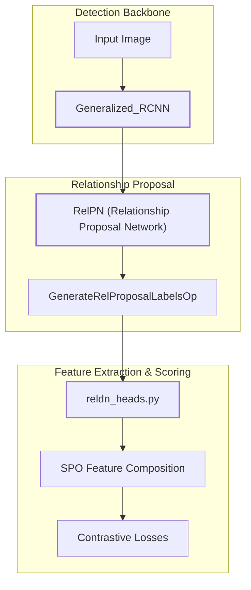

<!-- source: DeepWiki mcp.deepwiki.com · repo NVIDIA/ContrastiveLosses4VRD · page 1 Overview · fetched 2026-10-26 -->

# Overview

<details>
<summary>Relevant source files</summary>

The following files were used as context for generating this wiki page:

- [Examples.PNG](Examples.PNG)
- [Loss_illustration.PNG](Loss_illustration.PNG)
- [README.md](README.md)
- [tools/convert_vrd_anno_to_coco_format.py](tools/convert_vrd_anno_to_coco_format.py)

</details>


The **ContrastiveLosses4VRD** repository provides a PyTorch implementation for **Graphical Contrastive Losses for Scene Graph Parsing** (CVPR 2019). This codebase is an evolution of the system that secured 1st place in the Google AI Open Images Visual Relationship Detection Challenge [README.md:1-9]().

The primary objective of this project is to improve the discriminative power of relationship detection models (RelDN) by applying contrastive losses that resolve ambiguities between visually similar predicates and relationship triplets [README.md:6-7]().

### System Purpose and Key Results
The repository enables training and evaluation of Scene Graph Generation (SGG) models, which detect objects and the semantic relationships between them (e.g., "person-ride-bike"). 

| Dataset | Backbone | SGDET@50 | SGDET@100 |
| :--- | :---: | :---: | :---: |
| Visual Genome | VGG16 | 28.1 | 32.5 |
| Visual Genome (Full) | ResNext-101-FPN | 31.0 | 36.7 |

*Source: [README.md:14-23]()*

---

### RelDN Architecture
The core architecture, referred to as **RelDN**, extends standard object detection frameworks. It processes images through a backbone to propose object regions and then evaluates pairs of these regions to predict relationship predicates.

#### Relationship Detection Pipeline
The following diagram maps the logical flow of relationship detection to the specific code entities responsible for each stage.

**Diagram: Logical Pipeline to Code Entities**

*Sources: [README.md:25](), [tools/convert_vrd_anno_to_coco_format.py:15-20]()*

---

### Supported Datasets
The repository supports three major datasets for Visual Relationship Detection (VRD). Each requires specific preprocessing to align with the COCO-style annotation format used by the dataloader.

1.  **OpenImages**: A large-scale dataset. The repository includes a "mini" version for faster iteration [README.md:99-100]().
2.  **Visual Genome (VG)**: The standard benchmark for scene graph parsing [README.md:102-103]().
3.  **Visual Relation Detection (VRD)**: The original benchmark dataset. It requires conversion scripts to transform [ymin, ymax, xmin, xmax] coordinates into the [x, y, w, h] format [README.md:105-108](), [tools/convert_vrd_anno_to_coco_format.py:15-20]().

For detailed instructions on preparing these datasets, see **[Datasets and Data Preparation](#1.2)**.

---

### Repository Organization
The codebase is structured into core libraries for modeling, data handling, and utility functions.

**Diagram: Repository Structure and Key Files**
```mermaid
graph DIR
    root["ContrastiveLosses4VRD/"]
    root --> lib["lib/ (Core Logic)"]
    root --> tools["tools/ (Scripts)"]
    root --> configs["configs/ (YAML)"]
    
    lib --> core["core/config.py (Global Settings)"]
    lib --> modeling["modeling/reldn_heads.py (Losses & Heads)"]
    lib --> datasets["datasets/dataset_catalog_rel.py"]
    
    tools --> train["train_net_step_rel.py"]
    tools --> test["test_net_rel.py"]
```
*Sources: [README.md:80-87](), [README.md:97-98]()*

---

### Next Steps

To begin using the repository, refer to the following child pages:

*   **[Getting Started: Installation and Setup](#1.1)**: Covers environment setup using Docker or Anaconda, and the compilation of CUDA kernels in `lib/make.sh`.
*   **[Datasets and Data Preparation](#1.2)**: Provides download links and explains how to use scripts like `convert_vrd_anno_to_coco_format.py` to prepare your data.

Sources:
- [README.md:1-144]()
- [tools/convert_vrd_anno_to_coco_format.py:1-82]()

---

