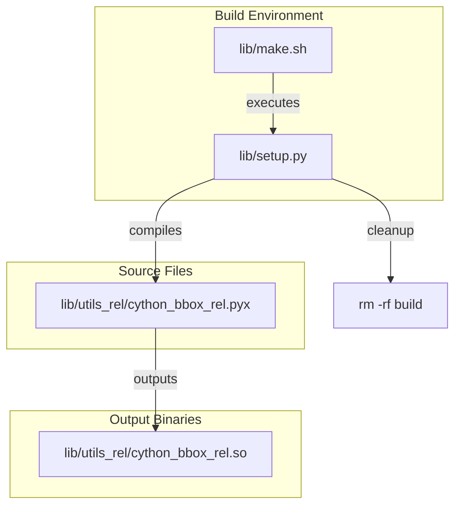
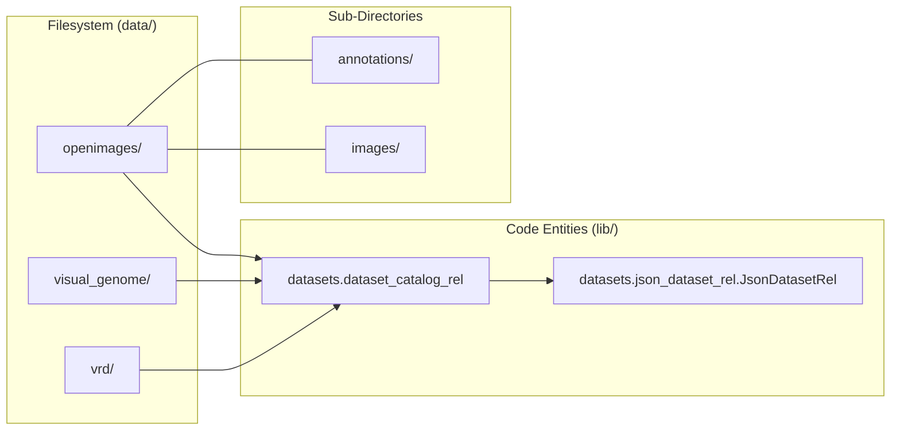

<!-- source: DeepWiki mcp.deepwiki.com · repo NVIDIA/ContrastiveLosses4VRD · page 1.1 Getting Started: Installation and Setup · fetched 2026-10-26 -->

# Getting Started: Installation and Setup

<details>
<summary>Relevant source files</summary>

The following files were used as context for generating this wiki page:

- [.gitmodules](.gitmodules)
- [docker/Dockerfile](docker/Dockerfile)
- [lib/make.sh](lib/make.sh)
- [lib/setup.py](lib/setup.py)
- [tools/_init_paths.py](tools/_init_paths.py)

</details>


This page provides a technical guide for setting up the `ContrastiveLosses4VRD` environment. The project is built upon a modified version of `Detectron.pytorch` and requires specific CUDA-accelerated kernels and directory structures to function correctly.

## Environment Configuration

The project utilizes a Docker-based environment to manage dependencies, specifically targeting older versions of PyTorch and CUDA that are compatible with the underlying Detectron implementation.

### Docker Environment
The system is designed to run within a container based on the `pytorch/pytorch:0.4-cuda9-cudnn7-devel` image [docker/Dockerfile:1-1](). This specific environment ensures compatibility with the required CUDA kernels and Python libraries.

**Key Dependencies installed via Docker:**
*   **System Libraries:** `libsm6`, `libxext6`, `libxrender1` (required for OpenCV) [docker/Dockerfile:4-4]().
*   **Python Packages:** `Cython`, `pyyaml`, `tensorboardX`, `scikit-image`, `gensim`, and `pycocotools` [docker/Dockerfile:6-7]().
*   **Conda Packages:** `opencv` [docker/Dockerfile:8-8]().

### Repository Initialization
The project relies on a specific fork of Detectron as a Git submodule. After cloning the main repository, you must initialize the submodule to populate the `Detectron_pytorch` directory.

```bash
git submodule update --init --recursive
```
The submodule configuration maps the remote repository to the local `Detectron_pytorch` path [ .gitmodules:1-3]().

### Sources:
- [docker/Dockerfile:1-8]()
- [.gitmodules:1-3]()

---

## Compilation and Build Process

The project includes custom Cython and CUDA implementations for performance-critical operations, such as bounding box overlap calculations. These must be compiled before the library can be used.

### CUDA and Cython Compilation
The `lib/make.sh` script automates the build process. It assumes a standard CUDA installation path at `/usr/local/cuda/` [lib/make.sh:4-4]().

The script executes `lib/setup.py`, which performs the following:
1.  **Numpy Integration:** Retrieves the local NumPy include directory to facilitate C-API calls [lib/setup.py:23-26]().
2.  **Cython Extension:** Compiles `utils_rel/cython_bbox_rel.pyx` into a shared object file named `utils_rel.cython_bbox_rel` [lib/setup.py:30-36]().
3.  **In-place Build:** The `--inplace` flag ensures the compiled `.so` files are moved into the source tree, allowing them to be imported directly by Python [lib/make.sh:6-6]().

### Execution Flow: Compilation
The following diagram illustrates how the build script interacts with the project structure to generate the required binaries.

**Figure 1: Compilation Pipeline**


### Sources:
- [lib/make.sh:1-8]()
- [lib/setup.py:12-41]()

---

## Python Path Configuration

To ensure that the main library and the Detectron submodule are discoverable by the Python interpreter, the project uses a path initialization shim.

### `_init_paths.py`
The script `tools/_init_paths.py` must be imported at the beginning of any execution script (e.g., training or testing). It dynamically modifies `sys.path` to include:
1.  **Detectron Library:** Adds `{PROJECT_ROOT}/Detectron_pytorch/lib` [tools/_init_paths.py:24-25]().
2.  **Project Library:** Adds `{PROJECT_ROOT}/lib` [tools/_init_paths.py:28-29]().

This mechanism allows the code to use absolute imports such as `from core.config import cfg` without requiring the packages to be installed in the global site-packages [tools/_init_paths.py:9-11]().

### Sources:
- [tools/_init_paths.py:1-30]()

---

## Dataset Directory Layout

The codebase expects datasets to be organized in a specific structure, typically symlinked into the project root. The `JsonDatasetRel` class and the dataset catalog rely on these paths to locate annotations and image files.

### Recommended Structure
The following diagram maps the expected data flow from the filesystem into the internal `lib` entities.

**Figure 2: Data Flow and Directory Mapping**


### Path Resolution Logic
The system uses `osp.abspath` and `osp.dirname` relative to the script location to resolve the project root [tools/_init_paths.py:21-21](). This allows the codebase to remain portable across different machine environments as long as the internal folder structure is maintained.

### Sources:
- [tools/_init_paths.py:21-29]()
- [lib/setup.py:31-32]()

---

