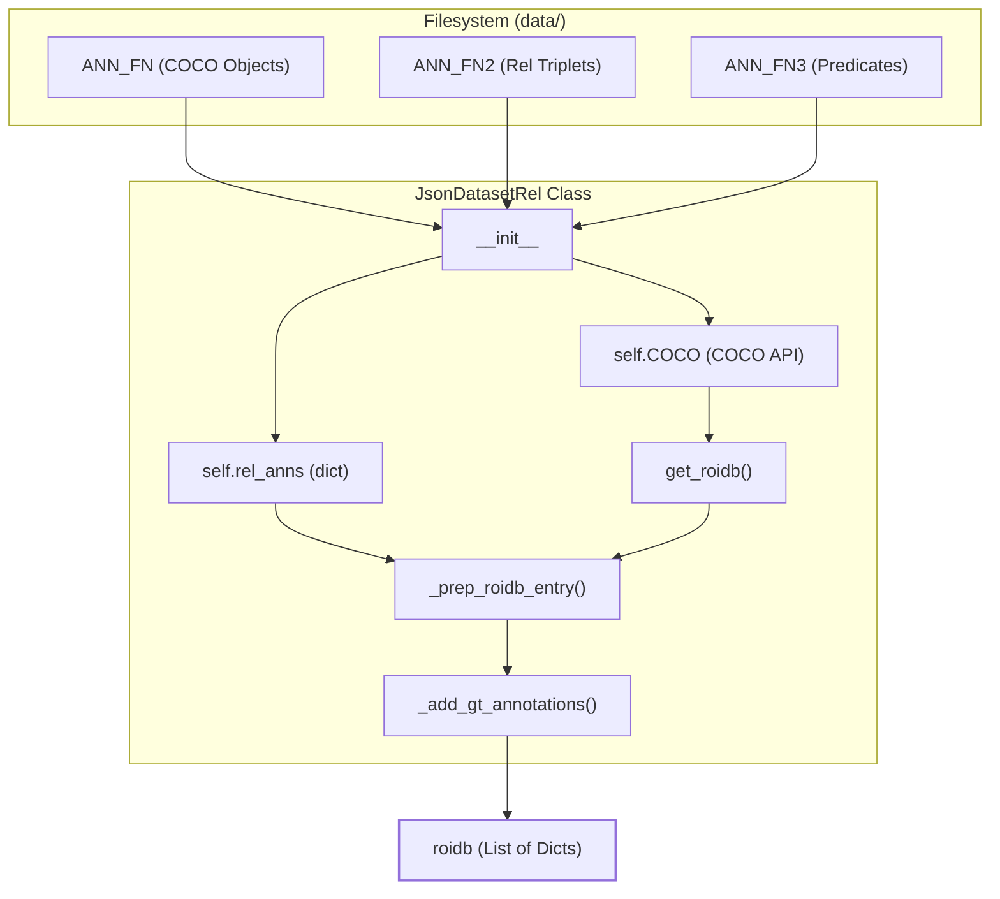
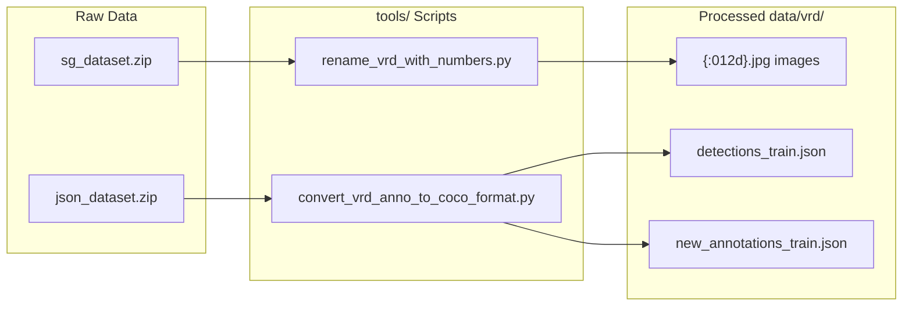

<!-- source: DeepWiki mcp.deepwiki.com · repo NVIDIA/ContrastiveLosses4VRD · page 1.2 Datasets and Data Preparation · fetched 2026-10-26 -->

# Datasets and Data Preparation

<details>
<summary>Relevant source files</summary>

The following files were used as context for generating this wiki page:

- [README.md](README.md)
- [lib/datasets_rel/dataset_catalog_rel.py](lib/datasets_rel/dataset_catalog_rel.py)
- [lib/datasets_rel/json_dataset_rel.py](lib/datasets_rel/json_dataset_rel.py)
- [tools/convert_vrd_anno_to_coco_format.py](tools/convert_vrd_anno_to_coco_format.py)
- [vg_vis_rels.ipynb](vg_vis_rels.ipynb)

</details>


This page provides a technical overview of the three datasets supported by the ContrastiveLosses4VRD framework: **OpenImages**, **Visual Genome (VG)**, and **Visual Relationship Detection (VRD)**. It details the annotation formats, the directory structures required by the configuration system, and the preprocessing scripts used to harmonize these datasets into a COCO-style layout for the relationship detection task.

## Dataset Overview

The repository supports three primary benchmarks for Visual Relationship Detection. Each dataset is managed via a registry in `lib/datasets_rel/dataset_catalog_rel.py` and loaded through the `JsonDatasetRel` class.

| Dataset | Object Classes | Predicate Classes | Purpose |
| :--- | :---: | :---: | :--- |
| **OpenImages v4** | 57 | 9 | Large-scale challenge dataset; includes a "mini" subset for debugging. |
| **Visual Genome** | 150 | 50 | Standard benchmark for scene graph generation with dense annotations. |
| **VRD** | 100 | 70 | Classic relationship dataset; requires specific preprocessing for COCO compatibility. |

**Sources:** [README.md:99-108](), [lib/datasets_rel/dataset_catalog_rel.py:45-140]()

---

## Data Directory Structure

By default, the system expects a `data` folder at the root of the repository. This path is controlled by `cfg.DATA_DIR` in the global configuration.

```text
data/
├── openimages_v4/
│   ├── train/                  # All images (train + val split)
│   └── rel/                    # .json annotations
├── vg/
│   ├── VG_100K/                # 108,249 images
│   ├── detections_train.json   # COCO-format object detections
│   ├── rel_annotations_train.json # Relationship triplets
│   └── predicates.json         # Predicate category list
└── vrd/
    ├── train_images/           # Renamed .jpg images
    ├── val_images/
    ├── detections_train.json   # Generated COCO-format objects
    └── new_annotations_train.json # Relationship triplets
```

**Sources:** [README.md:91-135](), [lib/datasets_rel/dataset_catalog_rel.py:31-140]()

---

## Annotation Formats and Logic Flow

The framework utilizes a "dual-annotation" strategy. For every dataset, the `JsonDatasetRel` class requires three distinct annotation files defined in the `DATASETS` catalog:
1.  `ANN_FN`: Standard COCO-style JSON containing object instances (`images`, `annotations`, `categories`).
2.  `ANN_FN2`: Relationship-specific JSON containing triplets (Subject, Object, Predicate).
3.  `ANN_FN3`: A list of predicate category names.

### Data Flow: From Files to Roidb
The following diagram illustrates how the `JsonDatasetRel` class parses these disparate files into a unified `roidb` (Region of Interest Database) used by the training and inference pipelines.

**Relationship Data Loading Pipeline**

**Sources:** [lib/datasets_rel/json_dataset_rel.py:60-103](), [lib/datasets_rel/json_dataset_rel.py:128-176](), [lib/datasets_rel/dataset_catalog_rel.py:34-37]()

---

## Dataset-Specific Preparation

### 1. OpenImages v4
OpenImages annotations are converted from the original `.csv` format to `.json`. The repository provides a "mini" version (4,500 train / 1,000 test images) to facilitate faster iteration.
*   **Images:** All training images should be placed in `data/openimages_v4/train`.
*   **Annotations:** Downloaded JSONs include `detections_train.json` and `rel_only_annotations_train.json`.

**Sources:** [README.md:99-101](), [lib/datasets_rel/dataset_catalog_rel.py:47-86]()

### 2. Visual Genome (VG)
The implementation uses the standard VG split (150 object classes, 50 predicates). 
*   **Preprocessing:** The annotations provided in the download link are already pre-formatted for the `JsonDatasetRel` loader.
*   **Structure:** Images must be placed in a single directory `VG_100K`.

**Sources:** [README.md:102-103](), [vg_vis_rels.ipynb:77-82]()

### 3. VRD (Visual Relationship Detection)
The VRD dataset requires the most extensive preprocessing to convert it from its native format to the COCO-compatible format expected by the codebase.

**VRD Preprocessing Workflow**


#### Key Preprocessing Functions:
*   `rename_vrd_with_numbers.py`: Standardizes image filenames to 12-digit integers (e.g., `000000000001.jpg`) and converts non-JPG formats (PNG/GIF) to JPG. This ensures compatibility with the integer-based `image_id` indexing in the COCO API. [README.md:139-142]()
*   `box_transform(box)`: In `tools/convert_vrd_anno_to_coco_format.py`, this function converts VRD's `[ymin, ymax, xmin, xmax]` format into the COCO `[x, y, w, h]` format. [tools/convert_vrd_anno_to_coco_format.py:15-20]()
*   `convert_anno(split)`: This function iterates through relationship annotations, extracts unique object bounding boxes to build the `detections_{split}.json` file, and maps them to relationship triplets. [tools/convert_vrd_anno_to_coco_format.py:24-76]()

**Sources:** [README.md:135-144](), [tools/convert_vrd_anno_to_coco_format.py:15-81]()

---

## The `roidb` Structure
The end result of data preparation is the `roidb` list. Each entry in the `roidb` represents one image and contains:

| Key | Description |
| :--- | :--- |
| `boxes` | `(N, 4)` ndarray of all object boxes. |
| `gt_classes` | `(N,)` ndarray of object class IDs. |
| `sbj_gt_boxes` | `(M, 4)` ndarray of subject boxes in M relationships. |
| `obj_gt_boxes` | `(M, 4)` ndarray of object boxes in M relationships. |
| `prd_gt_classes` | `(M,)` ndarray of predicate labels for the triplets. |
| `pair_to_gt_ind_map` | Maps relationship pairs to their ground truth indices. |

**Sources:** [lib/datasets_rel/json_dataset_rel.py:119-126](), [lib/datasets_rel/json_dataset_rel.py:204-235]()

---

