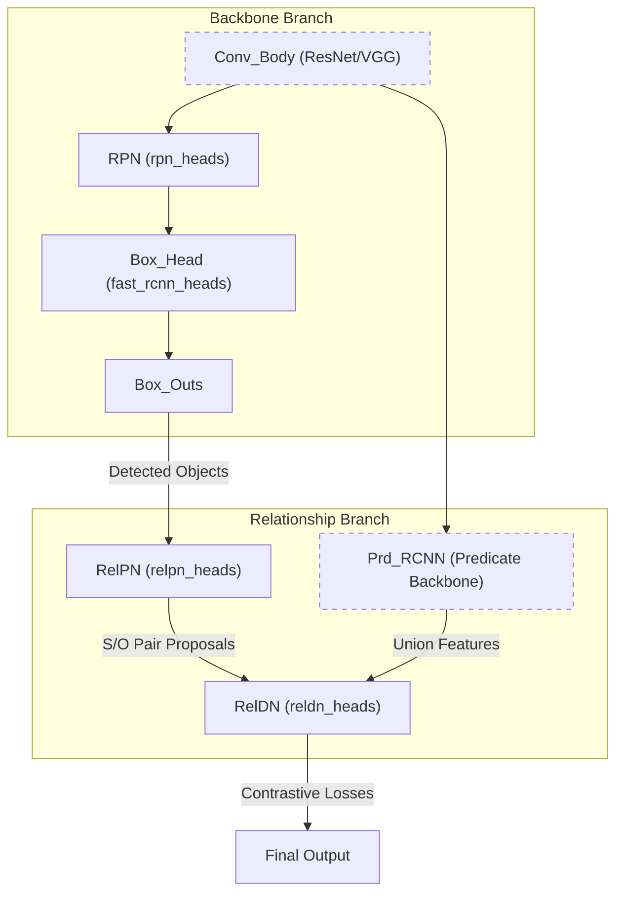
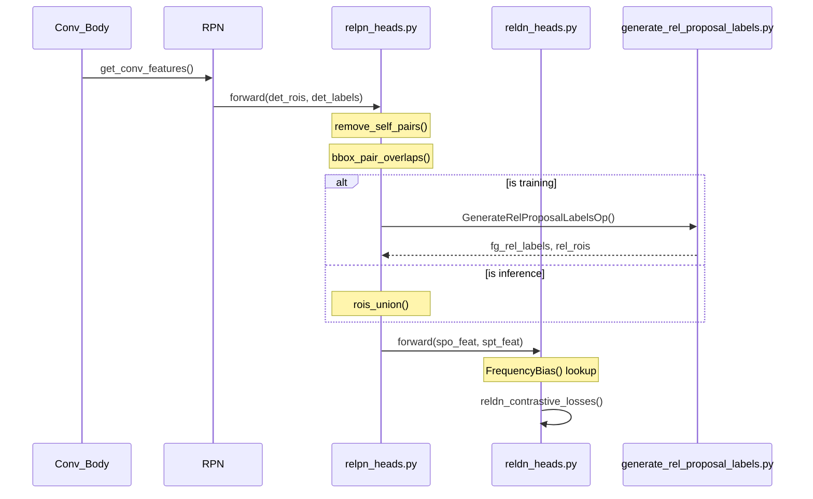

<!-- source: DeepWiki mcp.deepwiki.com · repo NVIDIA/ContrastiveLosses4VRD · page 2 Core Architecture · fetched 2026-10-26 -->

# Core Architecture

Relevant source files

The following files were used as context for generating this wiki page:

- [lib/modeling_rel/model_builder_rel.py](lib/modeling_rel/model_builder_rel.py)
- [lib/modeling_rel/reldn_heads.py](lib/modeling_rel/reldn_heads.py)
- [lib/modeling_rel/relpn_heads.py](lib/modeling_rel/relpn_heads.py)

The RelDN (Relationship Detection Network) architecture is designed for Visual Relationship Detection (VRD) by extending the standard Faster R-CNN framework with relationship-specific components. It treats relationship detection as a dual-branch task: one branch for object detection and another for predicate classification between object pairs.

The architecture is implemented in `Generalized_RCNN` within [lib/modeling_rel/model_builder_rel.py:78-138](), which orchestrates the interaction between the backbone, the Relationship Proposal Network (RelPN), and the RelDN heads.

### System Overview

The following diagram illustrates the high-level data flow and the association between logical components and their implementation classes.

**RelDN High-Level Pipeline**

**Sources:** [lib/modeling_rel/model_builder_rel.py:87-127]()

---

### Major Subsystems

#### 1. Model Builder and Generalized RCNN
The `Generalized_RCNN` class is the central entry point. Unlike standard R-CNNs, it maintains a `Prd_RCNN` attribute [lib/modeling_rel/model_builder_rel.py:114](), which is a deep copy of the backbone used specifically for extracting features from the union regions of subject-object pairs. It also manages complex weight loading for different datasets (OpenImages, VG, VRD) and initializes subject (`S_Head`) and object (`O_Head`) branches if `ADD_SO_SCORES` is enabled [lib/modeling_rel/model_builder_rel.py:131-137]().

For details, see [Model Builder and Generalized RCNN](#2.1).

#### 2. Relationship Proposal Network (RelPN)
The RelPN is responsible for generating candidate subject-object pairs. It takes detected object ROIs and creates a combinatorial set of pairs, which are then filtered.
*   **Self-Pair Removal:** It excludes pairs where the subject and object are the same ROI [lib/modeling_rel/relpn_heads.py:39-46]().
*   **Overlap Filter:** If `USE_OVLP_FILTER` is active, it only retains pairs that have a spatial overlap [lib/modeling_rel/relpn_heads.py:72-82]().
*   **Label Assignment:** During training, `GenerateRelProposalLabelsOp` [lib/modeling_rel/relpn_heads.py:31]() matches these proposals to ground-truth triplets.

For details, see [Relationship Proposal Network (RelPN)](#2.2).

#### 3. RelDN Head and Contrastive Losses
The `reldn_head` [lib/modeling_rel/reldn_heads.py:22]() performs the final predicate classification. It integrates multiple sources of information:
*   **Visual Features:** Extracted from the union box of the subject and object.
*   **Spatial Features:** Encoded geometry (deltas, relative sizes) via `spt_cls_feats` [lib/modeling_rel/reldn_heads.py:53-58]().
*   **Frequency Bias:** A statistical prior of predicate distributions per subject/object category pair [lib/modeling_rel/reldn_heads.py:45-50]().

The architecture is notable for its use of **Contrastive Losses** (SPO-agnostic, SO-aware, and P-aware), which enforce margins between positive and negative relationship samples [lib/modeling_rel/reldn_heads.py:150-180]().

For details, see [RelDN Head and Contrastive Losses](#2.3).

---

### Component Interaction Diagram

This diagram maps specific code entities to the relationship detection flow, showing how `RelPN` and `RelDN` communicate.

**Code Entity Interaction Map**

**Sources:** [lib/modeling_rel/relpn_heads.py:48-132](), [lib/modeling_rel/reldn_heads.py:78-136]()

### Architectural Features Table

| Component | Code Reference | Key Responsibility |
| :--- | :--- | :--- |
| **Backbone** | `self.Conv_Body` [87]() | Shared feature extraction for detection and predicates. |
| **Predicate Branch** | `self.Prd_RCNN` [114]() | Dedicated feature path for predicate classification. |
| **Rel Proposal** | `relpn_heads.py` [22]() | Pairwise ROI generation and overlap filtering. |
| **Feature Fusion** | `reldn_heads.py` [94-110]() | Merging visual, spatial, and frequency bias scores. |
| **Contrastive Loss** | `reldn_heads.py` [150]() | Margin-ranking losses for robust relationship ranking. |

**Sources:** [lib/modeling_rel/model_builder_rel.py](), [lib/modeling_rel/reldn_heads.py]()

---

