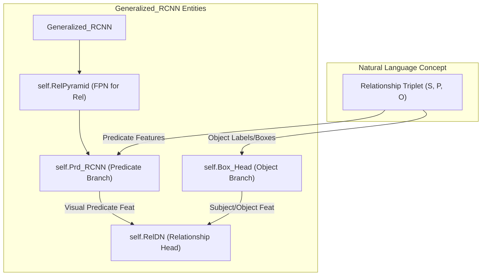
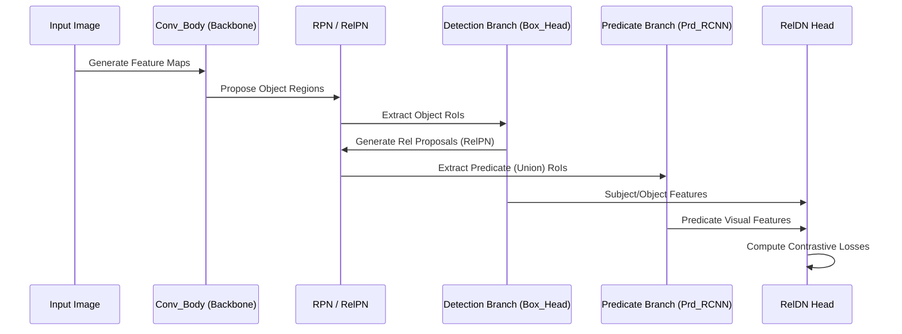

<!-- source: DeepWiki mcp.deepwiki.com · repo NVIDIA/ContrastiveLosses4VRD · page 2.1 Model Builder and Generalized RCNN · fetched 2026-10-26 -->

# Model Builder and Generalized RCNN

Relevant source files

The following files were used as context for generating this wiki page:

- [lib/modeling_rel/VGG16.py](lib/modeling_rel/VGG16.py)
- [lib/modeling_rel/fast_rcnn_heads.py](lib/modeling_rel/fast_rcnn_heads.py)
- [lib/modeling_rel/model_builder_rel.py](lib/modeling_rel/model_builder_rel.py)
- [lib/modeling_rel/rel_pyramid_module.py](lib/modeling_rel/rel_pyramid_module.py)
- [lib/modeling_rel/relpn_heads.py](lib/modeling_rel/relpn_heads.py)

The `Generalized_RCNN` class, defined in `lib/modeling_rel/model_builder_rel.py`, serves as the top-level meta-architecture for the Visual Relationship Detection (VRD) framework. It extends the standard Detectron-style RCNN by incorporating a dual-branch design: one for object detection and a mirrored branch (`Prd_RCNN`) for predicate/relationship extraction.

### 1. Initialization and Dual-Branch Architecture

The model is initialized by dynamically loading a backbone (e.g., ResNet or VGG) and setting up the detection pipeline. A key feature of this implementation is the creation of the `Prd_RCNN` branch via a deep copy of the main detector, which is then specialized for relationship tasks.

*   **Backbone (`Conv_Body`)**: Extracted using `get_func(cfg.MODEL.CONV_BODY)()` [lib/modeling_rel/model_builder_rel.py:87-88]().
*   **Detection Branch**: Consists of a standard RPN [lib/modeling_rel/model_builder_rel.py:90-92](), `Box_Head` [lib/modeling_rel/model_builder_rel.py:109-110](), and `Box_Outs` [lib/modeling_rel/model_builder_rel.py:111-112]().
*   **Predicate Branch (`Prd_RCNN`)**: Created by copying the detector and removing the object-specific RPN and BBox output layers [lib/modeling_rel/model_builder_rel.py:114-116](). This allows the predicate branch to share the same architecture as the object detector while learning different weights for relationship features.
*   **Subject/Object Heads**: If `cfg.MODEL.ADD_SO_SCORES` is enabled, independent `S_Head` and `O_Head` are created to refine features specifically for the subject and object roles within a triplet [lib/modeling_rel/model_builder_rel.py:131-137]().

#### Data Flow: Natural Language Space to Code Entities
The following diagram illustrates how abstract relationship concepts (Subject-Predicate-Object) map to specific class instances and attributes within the `Generalized_RCNN`.

**Relationship Mapping Diagram**

**Sources:** [lib/modeling_rel/model_builder_rel.py:78-128](), [lib/modeling_rel/reldn_heads.py:22-31]()

---

### 2. Relationship Components

Beyond standard detection, the model integrates three specific modules for VRD:

1.  **RelPyramid**: When FPN is enabled, this module creates a lateral connection specifically for relationship features. Unlike the standard FPN which downsamples, the `RelPyramid` processes blobs in the order (P5, P4, P3, P2) and applies max-pooling to propagate features [lib/modeling_rel/rel_pyramid_module.py:23-78]().
2.  **RelPN (Relationship Proposal Network)**: Generates candidate subject-object pairs. It filters self-pairs [lib/modeling_rel/relpn_heads.py:39-46]() and can optionally use an overlap filter (`cfg.MODEL.USE_OVLP_FILTER`) to discard non-overlapping boxes [lib/modeling_rel/relpn_heads.py:72-82]().
3.  **RelDN (Relationship Detection Network)**: The final head that takes concatenated features (Subject + Object + Predicate) and outputs relationship scores [lib/modeling_rel/reldn_heads.py:126]().

---

### 3. Weight Loading and Initialization

The `_init_modules` function handles complex weight loading logic, supporting ImageNet pretraining, detector-only pretraining, and predicate-specific pretraining.

| Weight Type | Config Field | Logic |
| :--- | :--- | :--- |
| **ImageNet** | `RESNETS.IMAGENET_PRETRAINED_WEIGHTS` | Loads standard ResNet weights; freezes `Conv_Body` [lib/modeling_rel/model_builder_rel.py:141-145](). |
| **Detector** | `RESNETS.VRD_PRETRAINED_WEIGHTS` | Loads weights into the main detection branch using `load_detector_weights` [lib/modeling_rel/model_builder_rel.py:147-150](). |
| **Predicate** | `RESNETS.VRD_PRD_PRETRAINED_WEIGHTS` | Loads weights specifically into the `Prd_RCNN` branch [lib/modeling_rel/model_builder_rel.py:165-175](). |

**Sources:** [lib/modeling_rel/model_builder_rel.py:139-204](), [lib/modeling_rel/VGG16.py:23-28]()

---

### 4. Forward Pass Pipeline

The forward pass is divided into detection and relationship phases.

**Forward Pass Logic Flow**

#### Key Execution Steps:
1.  **Feature Extraction**: The image passes through `self.Conv_Body` [lib/modeling_rel/model_builder_rel.py:461]().
2.  **Object Detection**: Standard RPN and Fast R-CNN heads generate object detections [lib/modeling_rel/model_builder_rel.py:464-501]().
3.  **Pair Proposal**: `self.RelPN` takes the detections and identifies candidate pairs, returning a `rel_ret` dictionary containing `sbj_rois`, `obj_rois`, and `rel_rois` (union boxes) [lib/modeling_rel/model_builder_rel.py:532-533]().
4.  **Predicate Feature Extraction**: The union boxes are passed through `self.Prd_RCNN` to extract visual features for the relationship itself [lib/modeling_rel/model_builder_rel.py:553-557]().
5.  **RelDN Scoring**: `self.RelDN` aggregates visual features from the subject, object, and union regions, combines them with spatial features (if enabled), and calculates the final predicate scores [lib/modeling_rel/model_builder_rel.py:586-591]().

**Sources:** [lib/modeling_rel/model_builder_rel.py:452-610](), [lib/modeling_rel/relpn_heads.py:48-132](), [lib/modeling_rel/fast_rcnn_heads.py:106-122]()

---

