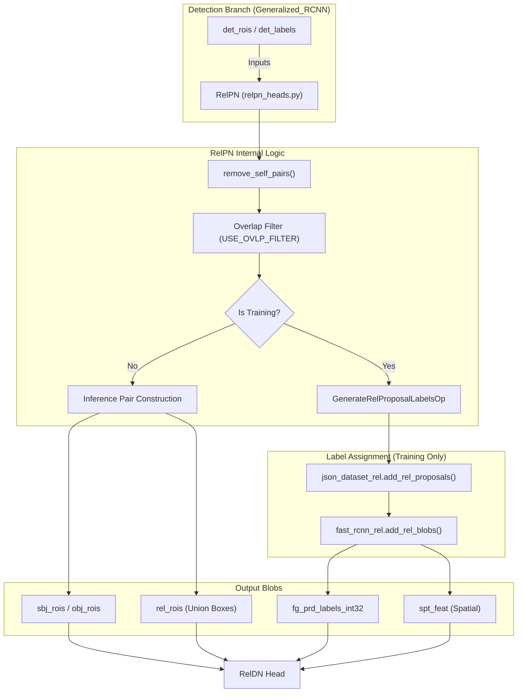
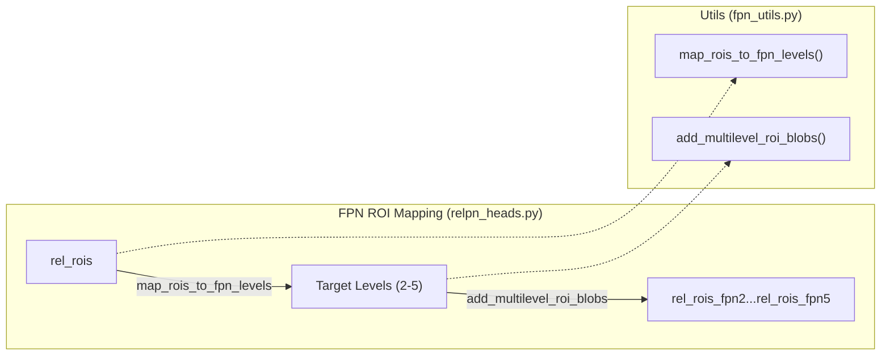

<!-- source: DeepWiki mcp.deepwiki.com · repo NVIDIA/ContrastiveLosses4VRD · page 2.2 Relationship Proposal Network (RelPN) · fetched 2026-10-26 -->

# Relationship Proposal Network (RelPN)

Relevant source files

The following files were used as context for generating this wiki page:

- [lib/modeling_rel/generate_rel_proposal_labels.py](lib/modeling_rel/generate_rel_proposal_labels.py)
- [lib/modeling_rel/model_builder_rel.py](lib/modeling_rel/model_builder_rel.py)
- [lib/modeling_rel/relpn_heads.py](lib/modeling_rel/relpn_heads.py)

The Relationship Proposal Network (RelPN) is a critical component of the RelDN architecture responsible for generating candidate subject-object pairs from detected object instances. Unlike standard RPNs that propose individual object boxes, RelPN operates on the combinatorial space of detected objects to form relationship triplets (subject, predicate, object).

## Overview and Purpose

RelPN takes the output of the object detection branch (ROIs, labels, and scores) and constructs a set of relationship candidates. Its primary responsibilities include:
1.  **Pairwise Candidate Generation**: Exhaustively pairing detected objects to form potential relationships.
2.  **Spatial Filtering**: Reducing the proposal space by removing non-overlapping pairs (if configured).
3.  **Label Assignment**: During training, it maps these proposals to ground-truth relationships to generate training signals.
4.  **Feature Preparation**: Constructing union boxes (Relationship ROIs) and calculating spatial features.

### System Architecture Flow

The following diagram illustrates how RelPN bridges the detection backbone with the relationship heads.

**RelPN Data Flow and Code Entities**

**Sources:** [lib/modeling_rel/relpn_heads.py:48-132](), [lib/modeling_rel/model_builder_rel.py:124-126](), [lib/modeling_rel/generate_rel_proposal_labels.py:15-49]()

---

## Candidate Generation and Filtering

RelPN generates proposals by creating a Cartesian product of all detected ROIs.

### Pairwise Construction
The function `single_scale_relpn_outputs.forward` initializes the indices for subject and object candidates using `np.repeat` and `np.tile` [lib/modeling_rel/relpn_heads.py:60-61](). It then invokes `remove_self_pairs` to ensure an object is not paired with itself [lib/modeling_rel/relpn_heads.py:63-64]().

### Overlap Filter
To manage the quadratic explosion of pairs, RelPN can filter out candidates where the subject and object bounding boxes do not overlap. This is controlled by `cfg.MODEL.USE_OVLP_FILTER` [lib/modeling_rel/relpn_heads.py:72-82]().
*   **Implementation**: It uses `box_utils_rel.bbox_pair_overlaps` to calculate Intersection over Union (IoU) or simple intersection [lib/modeling_rel/relpn_heads.py:73-75]().
*   **Result**: Only pairs with an overlap > 0 are retained for further processing.

**Sources:** [lib/modeling_rel/relpn_heads.py:39-46](), [lib/modeling_rel/relpn_heads.py:60-82]()

---

## Training: GenerateRelProposalLabelsOp

During training, RelPN must determine which generated pairs correspond to actual ground-truth relationships. This is handled by the `GenerateRelProposalLabelsOp` class [lib/modeling_rel/generate_rel_proposal_labels.py:11-13]().

### Step 1: Proposal Matching
The operation calls `json_dataset_rel.add_rel_proposals` [lib/modeling_rel/generate_rel_proposal_labels.py:23](). This function:
1.  Calculates the overlap between detected ROIs and ground-truth ROIs.
2.  Assigns relationship labels to pairs where both the subject and object ROIs sufficiently overlap with a ground-truth triplet's subject and object boxes.

### Step 2: Blob Construction
After matching, `add_rel_blobs` in `roi_data_rel.fast_rcnn_rel` is called to package the data into tensors [lib/modeling_rel/generate_rel_proposal_labels.py:47](). These include:
*   **Relationship ROIs**: The union box covering both subject and object [lib/modeling_rel/relpn_heads.py:94]().
*   **Predicate Labels**: Ground-truth predicate IDs (`fg_prd_labels_int32`) [lib/modeling_rel/generate_rel_proposal_labels.py:24]().
*   **Spatial Features**: Geometric relationship features (`spt_feat`) if `cfg.MODEL.USE_SPATIAL_FEAT` is enabled [lib/modeling_rel/generate_rel_proposal_labels.py:25-26]().

**Sources:** [lib/modeling_rel/generate_rel_proposal_labels.py:11-50](), [lib/modeling_rel/relpn_heads.py:85-88]()

---

## FPN Integration and Multi-level ROIs

When Feature Pyramid Networks (FPN) are enabled, RelPN ensures that ROIs are mapped to the correct pyramid level based on their scale.

### Multi-level Mapping
If `cfg.FPN.FPN_ON` and `cfg.FPN.MULTILEVEL_ROIS` are active, RelPN processes both the individual object ROIs (`det_rois`) and the union relationship ROIs (`rel_rois`) [lib/modeling_rel/relpn_heads.py:116-123]().

**FPN ROI Distribution Process**

1.  **Level Assignment**: `fpn_utils.map_rois_to_fpn_levels` determines which level of the pyramid (e.g., P2 through P5) an ROI belongs to based on its area [lib/modeling_rel/relpn_heads.py:126-127]().
2.  **Blob Splitting**: `fpn_utils.add_multilevel_roi_blobs` splits the ROI tensor into multiple tensors named `<blob_name>_fpn<level>` (e.g., `rel_rois_fpn3`) [lib/modeling_rel/relpn_heads.py:128-130]().

**Sources:** [lib/modeling_rel/relpn_heads.py:116-130](), [lib/modeling_rel/model_builder_rel.py:94-106]()

---

## Key Class Reference

| Class / Function | File Path | Description |
| :--- | :--- | :--- |
| `single_scale_relpn_outputs` | [lib/modeling_rel/relpn_heads.py:26]() | Main RelPN logic for generating and filtering subject-object pairs. |
| `GenerateRelProposalLabelsOp` | [lib/modeling_rel/generate_rel_proposal_labels.py:11]() | Operator for assigning GT labels and sampling relationship proposals during training. |
| `remove_self_pairs` | [lib/modeling_rel/relpn_heads.py:39]() | Utility to prevent the network from predicting relationships between an object and itself. |
| `rois_union` | [lib/utils_rel/boxes_rel.py]() | Computes the minimal bounding box containing both the subject and object ROIs. |

**Sources:** [lib/modeling_rel/relpn_heads.py:26-31](), [lib/modeling_rel/generate_rel_proposal_labels.py:11-13]()

---

