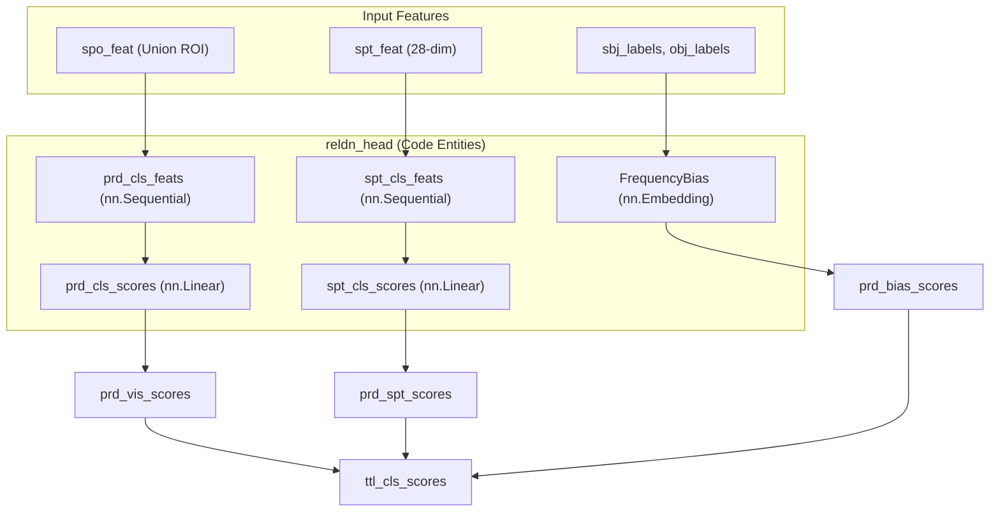
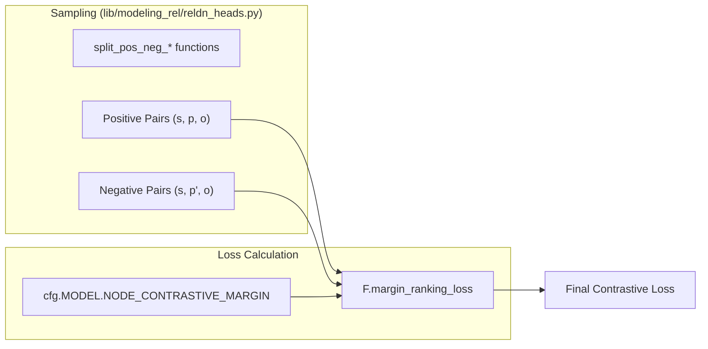

<!-- source: DeepWiki mcp.deepwiki.com · repo NVIDIA/ContrastiveLosses4VRD · page 2.3 RelDN Head and Contrastive Losses · fetched 2026-10-26 -->

# RelDN Head and Contrastive Losses

Relevant source files

The following files were used as context for generating this wiki page:

- [Loss_illustration.PNG](Loss_illustration.PNG)
- [lib/modeling_rel/reldn_heads.py](lib/modeling_rel/reldn_heads.py)
- [lib/modeling_rel/sparse_targets_rel.py](lib/modeling_rel/sparse_targets_rel.py)

This page details the relationship detection head (`reldn_head`) and the contrastive loss mechanisms implemented in `reldn_heads.py`. The RelDN head is responsible for fusing multi-modal features—visual, spatial, and semantic frequency priors—to predict predicate categories between object pairs.

## RelDN Head Architecture

The `reldn_head` class [lib/modeling_rel/reldn_heads.py:22-23]() implements the final stage of the relationship detection pipeline. It processes Subject-Predicate-Object (SPO) feature compositions to generate classification scores.

### Multi-Modal Scoring Pipeline
The head produces scores from four distinct sources which can be combined to form the final prediction:

1.  **Visual Scores (`prd_vis_scores`)**: Derived from the union box features of the subject and object [lib/modeling_rel/reldn_heads.py:94-95]().
2.  **Spatial Scores (`prd_spt_scores`)**: Derived from a 28-dimensional spatial vector [lib/modeling_rel/reldn_heads.py:53-58]() representing relative geometry (box deltas, overlaps).
3.  **Frequency Bias (`prd_bias_scores`)**: A semantic prior $P(predicate | subject, object)$ calculated from training set statistics [lib/modeling_rel/reldn_heads.py:101]().
4.  **S/O Scores (`prd_sbj_scores`, `prd_obj_scores`)**: Optional scores derived specifically from the subject or object features independently [lib/modeling_rel/reldn_heads.py:60-62]().

### Feature Composition and Data Flow
The `forward` pass [lib/modeling_rel/reldn_heads.py:78-136]() aggregates these modalities. If `cfg.MODEL.ADD_SCORES_ALL` is enabled, the scores are summed before the final softmax [lib/modeling_rel/reldn_heads.py:116-125]().

**RelDN Head Internal Data Flow**

**Sources:** [lib/modeling_rel/reldn_heads.py:38-62](), [lib/modeling_rel/reldn_heads.py:78-136]()

---

## Frequency Bias Logic

The `FrequencyBias` class [lib/modeling_rel/sparse_targets_rel.py:23-24]() provides a statistical baseline for predicate prediction.

*   **Initialization**: It loads a frequency matrix `fg_matrix` representing counts of triplets $(s, p, o)$ from the dataset [lib/modeling_rel/sparse_targets_rel.py:45]().
*   **Log-Probability**: It converts counts into log-probabilities: $\log(P(p | s, o) + \epsilon)$ [lib/modeling_rel/sparse_targets_rel.py:49]().
*   **Lookup**: During the forward pass, it uses `nn.Embedding` to perform a fast lookup using the index calculated as $s \times \text{num\_objs} + o$ [lib/modeling_rel/sparse_targets_rel.py:64]().

**Sources:** [lib/modeling_rel/sparse_targets_rel.py:23-65]()

---

## Contrastive Loss Variants

The repository implements three variants of contrastive losses to regularize the relationship features. These losses use `F.margin_ranking_loss` [lib/modeling_rel/reldn_heads.py:155]() to ensure that the probability of a positive predicate is higher than negative ones by a specified margin (`cfg.MODEL.NODE_CONTRASTIVE_MARGIN`).

### 1. SPO-Agnostic Contrastive Loss
Implemented in `reldn_contrastive_losses` [lib/modeling_rel/reldn_heads.py:150](). It treats all predicates for a given subject or object node independently.
*   **Function**: `split_pos_neg_spo_agnostic` [lib/modeling_rel/reldn_heads.py:153]().
*   **Logic**: For a fixed subject (or object), it identifies all predicates that are ground-truth "positive" and compares their scores against all "negative" predicates for that same node.

### 2. SO-Aware Contrastive Loss
Implemented in `reldn_so_contrastive_losses` [lib/modeling_rel/reldn_heads.py:165]().
*   **Function**: `split_pos_neg_so_aware` [lib/modeling_rel/reldn_heads.py:168]().
*   **Logic**: This variant considers the specific pair. It ensures that for a subject-object pair $(s, o)$, the ground truth predicate $p$ has a higher score than other predicates $p'$ that are not valid for that specific pair.

### 3. P-Aware Contrastive Loss
Implemented in `reldn_p_contrastive_losses` (available in full file).
*   **Logic**: Focuses on the predicate class. It ensures that a specific predicate $p$ is more strongly associated with its true subject/object nodes than with other nodes in the same image.

**Contrastive Loss Mechanics Diagram**

**Sources:** [lib/modeling_rel/reldn_heads.py:150-171](), [lib/core/config.py]() (for margin config).

---

## Summary of Loss Functions

| Function Name | Input | Description |
| :--- | :--- | :--- |
| `reldn_losses` | `prd_cls_scores`, `prd_labels` | Standard Cross-Entropy loss for predicate classification [lib/modeling_rel/reldn_heads.py:139-142](). |
| `reldn_contrastive_losses` | `prd_scores_sbj_pos`, `rel_ret` | Computes SPO-agnostic margin loss for subject/object branches [lib/modeling_rel/reldn_heads.py:150-162](). |
| `reldn_so_contrastive_losses`| `prd_scores_sbj_pos`, `rel_ret` | Computes Subject-Object aware margin loss [lib/modeling_rel/reldn_heads.py:165-171](). |

**Sources:** [lib/modeling_rel/reldn_heads.py:139-171]()

---

