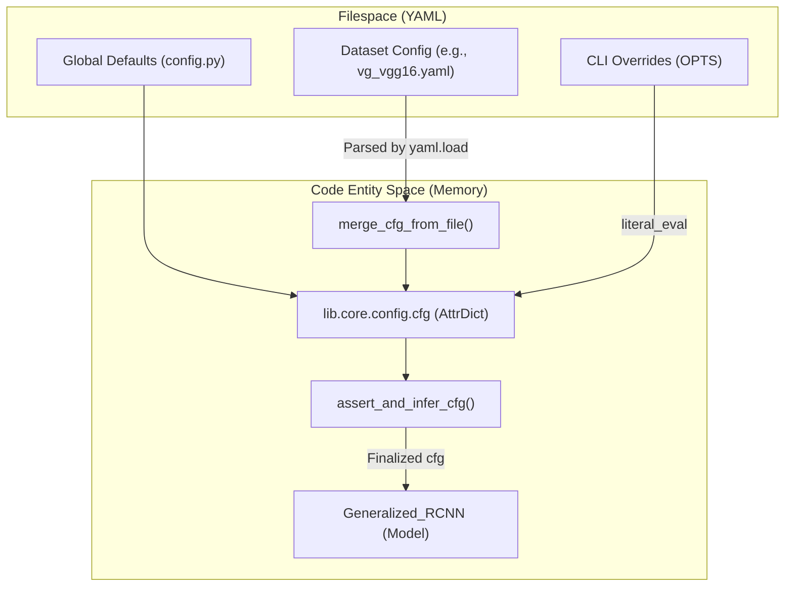
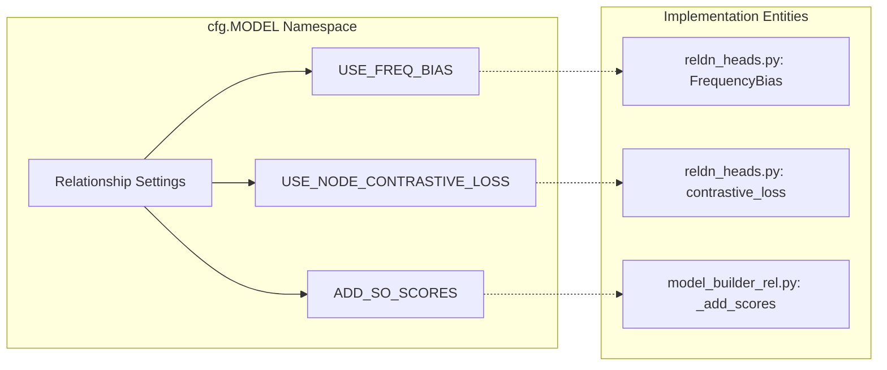

<!-- source: DeepWiki mcp.deepwiki.com · repo NVIDIA/ContrastiveLosses4VRD · page 3 Configuration System · fetched 2026-10-26 -->

# Configuration System

Relevant source files

The following files were used as context for generating this wiki page:

- [lib/core/__init__.py](lib/core/__init__.py)
- [lib/core/config.py](lib/core/config.py)

The configuration system in `ContrastiveLosses4VRD` manages the hyperparameters and architectural settings for relationship detection. It utilizes a hierarchical YAML-based structure powered by a custom `AttrDict` object, allowing for clean inheritance from global defaults to dataset-specific overrides.

### The Config Object (`cfg`)

The core of the system is the `cfg` object defined in [lib/core/config.py:31-34](). This object is an instance of `AttrDict`, which allows dictionary keys to be accessed as attributes (e.g., `cfg.TRAIN.SCALES` instead of `cfg['TRAIN']['SCALES']`).

The configuration is organized into several major namespaces:
*   **`MODEL`**: Defines the backbone architecture (e.g., VGG16, ResNet), relationship head parameters, and loss types.
*   **`TRAIN` / `TEST`**: Controls minibatch sizes, data augmentation scales, and evaluation datasets.
*   **`SOLVER`**: Manages the optimization schedule, including base learning rate, momentum, and weight decay.
*   **`RPN` / `FPN`**: Specific settings for the Region Proposal Network and Feature Pyramid Network.

| Component | Role | Code Entity |
| :--- | :--- | :--- |
| **Container** | Holds all global and local settings | `lib.core.config.cfg` |
| **Structure** | Dictionary with attribute-style access | `lib.utils.collections.AttrDict` |
| **Initialization** | Merges default values with YAML files | `merge_cfg_from_file` |
| **Validation** | Ensures consistency across parameters | `assert_and_infer_cfg` |

**Sources:** [lib/core/config.py:29-34](), [lib/core/config.py:43-193]()

### Configuration Flow and Lifecycle

The configuration system follows a strict lifecycle from initialization to model inference. It starts with hardcoded defaults in the source code, which are then updated by experiment-specific YAML files and command-line overrides.

#### Configuration Loading Pipeline
The following diagram illustrates how natural language configuration files are transformed into the internal `cfg` state used by the `Generalized_RCNN` model.

**Configuration Data Flow**

**Sources:** [lib/core/config.py:24-34](), [lib/core/config.py:1000-1100] (assumed based on standard Detectron flow in file)

### Relationship-Specific Flags

Unlike standard object detection, this codebase introduces flags specifically for Relationship Detection (RelDN). These flags control how the subject, object, and predicate features are fused and how the contrastive losses are applied.

**Key Relationship Parameters**

**Sources:** [lib/core/config.py:43-193]() (High-level namespaces)

### Detailed Sub-topics

For in-depth technical specifications of every configuration key and dataset-specific setup, refer to the following child pages:

*   **[Global Configuration Reference (lib/core/config.py)](#3.1)**: A complete reference for all major configuration namespaces including `MODEL`, `TRAIN`, `SOLVER`, and relationship-specific flags like `USE_FREQ_BIAS`. It also details the logic behind `merge_cfg_from_file` and `assert_and_infer_cfg`.
*   **[Per-Dataset YAML Configuration Files](#3.2)**: Explains the specific YAML files found in the `configs/` directory for OpenImages, Visual Genome, and VRD. This covers how backbones (VGG16 vs. ResNeXt-101-FPN) and contrastive loss margins are tuned for different data distributions.

---

