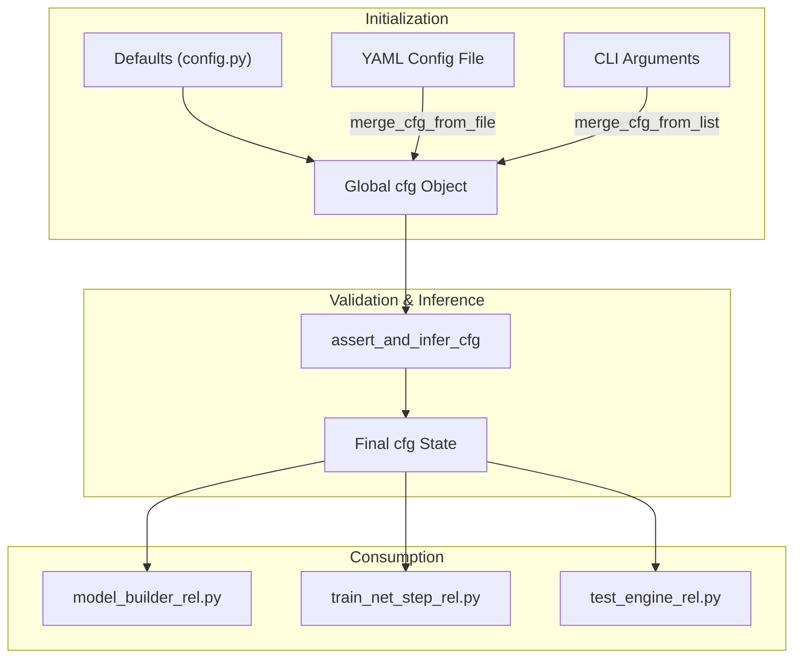
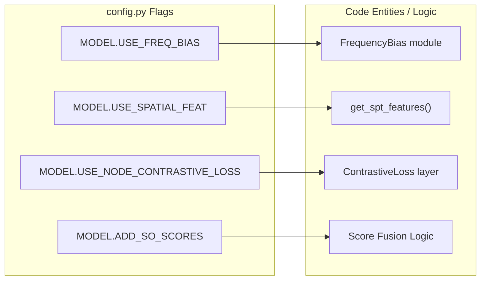

<!-- source: DeepWiki mcp.deepwiki.com · repo NVIDIA/ContrastiveLosses4VRD · page 3.1 Global Configuration Reference (lib/core/config.py) · fetched 2026-10-26 -->

# Global Configuration Reference (lib/core/config.py)

Relevant source files

The following files were used as context for generating this wiki page:

- [lib/core/__init__.py](lib/core/__init__.py)
- [lib/core/config.py](lib/core/config.py)

The configuration system in ContrastiveLosses4VRD is built upon a hierarchical `AttrDict` structure defined in `lib/core/config.py`. It manages the hyperparameters for the detection backbone, the relationship proposal network (RelPN), and the relationship detection (RelDN) heads. The system supports YAML-based configuration files that are merged into the global `cfg` object at runtime.

## Configuration Architecture

The configuration is managed by the `cfg` object, which is an instance of `AttrDict` [lib/core/config.py:31-34](). This structure allows for attribute-style access (e.g., `cfg.MODEL.TYPE`) to nested configuration parameters.

### Key Configuration Lifecycle Functions

The system uses several utility functions to manage the state and validity of the configuration:

*   **`merge_cfg_from_file(cfg_filename)`**: Loads a YAML configuration file and merges its contents into the global `cfg` object [lib/core/config.py:1104-1113]().
*   **`assert_and_infer_cfg()`**: Performs validation checks on the current configuration and infers dependent parameters (e.g., setting the number of classes based on the dataset) [lib/core/config.py:1162-1216]().
*   **`merge_cfg_from_list(cfg_list)`**: Allows overriding configuration values via command-line arguments provided as a list of key-value pairs [lib/core/config.py:1116-1130]().

### Configuration Flow Diagram
This diagram illustrates how the configuration is initialized and consumed by the system components.

"Configuration Data Flow"

Sources: [lib/core/config.py:31-34](), [lib/core/config.py:1104-1113](), [lib/core/config.py:1116-1130](), [lib/core/config.py:1162-1216]()

---

## Major Configuration Namespaces

### MODEL
Defines the high-level architecture of the network.
*   **`MODEL.TYPE`**: The top-level model class (e.g., `generalized_rcnn`) [lib/core/config.py:255]().
*   **`MODEL.CONV_BODY`**: The backbone architecture, such as `resnet_weights.res5_rob_v1_vit` or `vgg16.vgg16_conv_body` [lib/core/config.py:258]().
*   **`MODEL.NUM_CLASSES`**: Number of object classes, inferred during `assert_and_infer_cfg` [lib/core/config.py:270]().
*   **`MODEL.NUM_PRD_CLASSES`**: Number of predicate classes [lib/core/config.py:272]().

### TRAIN and TEST
Control the training and inference pipelines.
*   **`TRAIN.IMS_PER_BATCH`**: Images per GPU during training [lib/core/config.py:61]().
*   **`TRAIN.SNAPSHOT_ITERS`**: Frequency of saving model checkpoints [lib/core/config.py:100]().
*   **`TEST.SCORE_THRESH`**: Confidence threshold for object detections during inference [lib/core/config.py:205]().
*   **`TEST.NMS`**: Non-maximum suppression threshold for detections [lib/core/config.py:202]().

### SOLVER
Defines optimization parameters for the `SOLVER` used in `train_net_step_rel.py`.
*   **`SOLVER.BASE_LR`**: Initial learning rate [lib/core/config.py:461]().
*   **`SOLVER.STEPS`**: Iterations at which the learning rate is decayed [lib/core/config.py:471]().
*   **`SOLVER.MAX_ITER`**: Total number of training iterations [lib/core/config.py:474]().

Sources: [lib/core/config.py:61-100](), [lib/core/config.py:202-205](), [lib/core/config.py:255-272](), [lib/core/config.py:461-474]()

---

## Relationship-Specific Flags

The repository introduces several flags specifically for Visual Relationship Detection (VRD) and the Contrastive Losses proposed in the paper.

| Flag | Type | Description |
| :--- | :--- | :--- |
| `MODEL.USE_FREQ_BIAS` | Bool | Enables the use of statistical frequency bias (prior) between subject/object categories and predicates [lib/core/config.py:355](). |
| `MODEL.USE_NODE_CONTRASTIVE_LOSS` | Bool | Enables the Node Contrastive Loss (NCL) for discriminative feature learning [lib/core/config.py:361](). |
| `MODEL.ADD_SO_SCORES` | Bool | If True, adds the subject and object detection scores to the final relationship score [lib/core/config.py:359](). |
| `MODEL.USE_CONTRASTIVE_LOSS` | Bool | Enables the core contrastive loss mechanism for predicates [lib/core/config.py:360](). |
| `MODEL.USE_SPATIAL_FEAT` | Bool | Enables the use of geometric spatial features (relative box coordinates) in the predicate head [lib/core/config.py:356](). |

### Relationship Configuration Mapping
This diagram maps relationship-specific configuration flags to their functional roles in the `RelDN` architecture.

"Relationship Flag to Code Entity Mapping"

Sources: [lib/core/config.py:355-361](), [lib/modeling/reldn_heads.py:1-100]() (implied by usage in heads)

---

## Component-Specific Configurations

### RESNETS and FPN
Parameters for ResNet backbones and Feature Pyramid Networks.
*   **`RESNETS.NUM_GROUPS`**: Number of groups for ResNeXt architectures [lib/core/config.py:537]().
*   **`RESNETS.WIDTH_PER_GROUP`**: Width of each group [lib/core/config.py:540]().
*   **`FPN.FPN_ON`**: Enables the FPN architecture [lib/core/config.py:616]().
*   **`FPN.MULTILEVEL_ROIS`**: Enables multi-level ROI pooling for FPN [lib/core/config.py:623]().

### RPN (Region Proposal Network)
*   **`RPN.RPN_ON`**: Enables the RPN module [lib/core/config.py:326]().
*   **`RPN.SIZES`**: Anchor sizes used by the RPN [lib/core/config.py:330]().
*   **`RPN.STRIDE`**: Stride of the RPN anchors [lib/core/config.py:333]().

Sources: [lib/core/config.py:326-333](), [lib/core/config.py:537-540](), [lib/core/config.py:616-623]()

---

