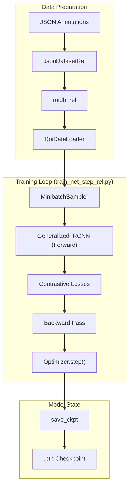
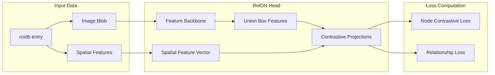

<!-- source: DeepWiki mcp.deepwiki.com · repo NVIDIA/ContrastiveLosses4VRD · page 4 Training Pipeline · fetched 2026-10-26 -->

# Training Pipeline

Relevant source files

The following files were used as context for generating this wiki page:

- [tools/test_net_rel.py](tools/test_net_rel.py)
- [tools/train_net_step_rel.py](tools/train_net_step_rel.py)

The training pipeline in **ContrastiveLosses4VRD** is designed to handle the complex requirements of Visual Relationship Detection (VRD), including dual-branch architectures (detection and relationship), multi-modal feature extraction, and contrastive loss optimization. This page provides a high-level overview of the workflow from configuration and data ingestion to gradient updates and checkpointing.

## Pipeline Overview

The training process is orchestrated by `tools/train_net_step_rel.py` [tools/train_net_step_rel.py:142-143](). It follows a standard deep learning loop but with specific adaptations for relationship triplets (subject-predicate-object).

### 1. Initialization and Configuration
The pipeline begins by parsing command-line arguments and merging them with YAML configuration files [tools/train_net_step_rel.py:145-184](). Crucially, it adaptively adjusts hyperparameters based on the available hardware, such as scaling the learning rate and batch size relative to the number of GPUs [tools/train_net_step_rel.py:187-210]().

### 2. Data Loading and ROI Construction
Data is managed through a specialized `RoiDataLoader` [tools/train_net_step_rel.py:30](). This system does more than just load images; it constructs "roidbs" (Region of Interest Databases) that contain ground-truth relationship triplets. During minibatch construction, the pipeline samples foreground and background object pairs and computes spatial features and union boxes.
*   For details, see [Data Loading and Minibatch Construction](#4.2).

### 3. Model Forward Pass
The model, typically a `Generalized_RCNN` [tools/train_net_step_rel.py:31](), processes the minibatch through two main branches:
*   **Object Branch:** Detects and classifies individual entities.
*   **Relationship Branch (RelDN):** Uses the output of the Relationship Proposal Network (RelPN) to extract features for subject-object pairs and predict predicate categories using contrastive losses.

### 4. Optimization and Gradient Updates
The pipeline supports gradient accumulation via `iter_size` [tools/train_net_step_rel.py:80-82](), allowing for large effective batch sizes on limited hardware. It utilizes a step-decay learning rate scheduler with a warmup period to stabilize early training [tools/train_net_step_rel.py:5-6]().

---

## System Workflow: From Data to Gradients

The following diagram illustrates how the high-level training concepts map to specific code entities and data structures within the repository.

### Training Execution Flow
"Natural Language Space" to "Code Entity Space" Mapping

**Sources:** [tools/train_net_step_rel.py:28-31](), [tools/train_net_step_rel.py:122-140](), [lib/datasets_rel/roidb_rel.py:29]()

---

## Detailed Components

### Training Script (train_net_step_rel.py)
The entry point for training. It handles the mapping of dataset names (e.g., `vrd`, `vg`, `oi_rel`) to specific class counts and dataset catalogs [tools/train_net_step_rel.py:157-180](). It also manages the training state, including the `TrainingStats` logger for monitoring losses and timing [tools/train_net_step_rel.py:35]().
*   For details, see [Training Script (train_net_step_rel.py)](#4.1).

### Data Loading and Minibatch Construction
This subsystem bridges the raw dataset annotations and the neural network. It involves complex sampling logic to ensure the model sees a balanced distribution of relationship predicates and handles the generation of "Union ROIs" that encompass both subjects and objects.
*   For details, see [Data Loading and Minibatch Construction](#4.2).

### Dataset Layer (JsonDatasetRel and Catalog)
This layer abstracts the underlying data format (COCO-style JSON) into a standardized format used by the trainers. It maintains the `DATASETS` registry, which maps logical names to file paths for images and annotations.
*   For details, see [Dataset Layer (JsonDatasetRel and Catalog)](#4.3).

---

## Relationship Data Pipeline

This diagram bridges the relationship concepts to the internal data structures used during the training forward pass.

### Relationship Feature Extraction
"Natural Language Space" to "Code Entity Space" Mapping

**Sources:** [tools/train_net_step_rel.py:30-31](), [tools/test_net_rel.py:171-175]()

---

## Training Lifecycle Summary

| Phase | Responsibility | Key Files |
| :--- | :--- | :--- |
| **Setup** | Parse args, merge YAML, scale LR | `train_net_step_rel.py` [tools/train_net_step_rel.py:145-210]() |
| **Data Ingestion** | Construct roidb, sample pairs, load blobs | `loader_rel.py`, `roidb_rel.py` [tools/train_net_step_rel.py:29-30]() |
| **Model Forward** | Compute object detections and relationship scores | `model_builder_rel.py`, `reldn_heads.py` [tools/train_net_step_rel.py:31]() |
| **Optimization** | Gradient accumulation, step-decay scheduler | `train_net_step_rel.py` [tools/train_net_step_rel.py:80-93]() |
| **Persistence** | Save model and optimizer states | `train_net_step_rel.py` [tools/train_net_step_rel.py:122-140]() |

**Sources:** [tools/train_net_step_rel.py:1-210]()

---

