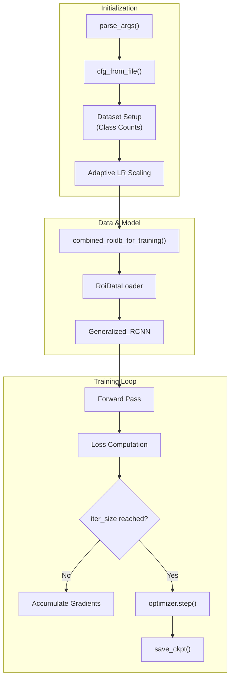
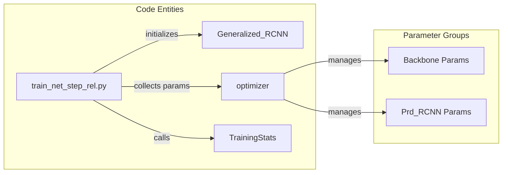

<!-- source: DeepWiki mcp.deepwiki.com · repo NVIDIA/ContrastiveLosses4VRD · page 4.1 Training Script (train_net_step_rel.py) · fetched 2026-10-26 -->

# Training Script (train_net_step_rel.py)

Relevant source files

The following files were used as context for generating this wiki page:

- [lib/utils_rel/logging_rel.py](lib/utils_rel/logging_rel.py)
- [lib/utils_rel/training_stats_rel.py](lib/utils_rel/training_stats_rel.py)
- [tools/test_net_rel.py](tools/test_net_rel.py)
- [tools/train_net_step_rel.py](tools/train_net_step_rel.py)

The `train_net_step_rel.py` script is the primary entry point for training the relationship detection models in this repository. It manages the training loop, dataset initialization, adaptive hyperparameter scaling, and checkpointing for various datasets including Visual Genome, VRD, and OpenImages.

## Overview and Purpose

This script orchestrates the training process using a step-based learning rate decay policy [tools/train_net_step_rel.py:5](). It extends the standard Detectron training pipeline to support relationship-specific requirements, such as dual-branch parameter optimization (backbone vs. predicate branch) and relationship-aware data loading.

### Key Responsibilities
*   **Dataset Mapping**: Maps high-level dataset names to specific configuration flags and class counts [tools/train_net_step_rel.py:157-181]().
*   **Adaptive Scaling**: Automatically adjusts learning rates and batch sizes based on the number of available GPUs [tools/train_net_step_rel.py:187-210]().
*   **Optimization**: Implements gradient accumulation via `iter_size` and manages separate learning rates for the backbone and relationship heads [tools/train_net_step_rel.py:246-277]().
*   **Logging and Checkpointing**: Integrates with `TrainingStats` for metric tracking and saves model states periodically [tools/train_net_step_rel.py:122-140]().

## System Flow: Data to Optimization

The following diagram illustrates the flow from dataset configuration through the training loop to the optimization step.

### Training Pipeline Logic

**Sources:** [tools/train_net_step_rel.py:142-300](), [tools/train_net_step_rel.py:122-140]()

## Dataset-to-Class Mapping

The script contains hardcoded mappings for supported datasets to ensure the model architecture (specifically the final classification layers) matches the dataset schema.

| Dataset Name | `TRAIN.DATASETS` | Object Classes | Predicate Classes |
| :--- | :--- | :--- | :--- |
| `vrd` | `('vrd_train',)` | 101 | 70 |
| `vg` | `('vg_train',)` | 151 | 50 |
| `oi_rel` | `('oi_rel_train',)` | 58 | 9 |

**Sources:** [tools/train_net_step_rel.py:157-181]()

## Adaptive Learning Rate Scaling

To maintain consistent effective learning rates across different hardware configurations, the script performs adaptive adjustments based on the number of GPUs and the `iter_size` parameter.

1.  **Effective Batch Size**: Calculated as `batch_size * iter_size` [tools/train_net_step_rel.py:196-197]().
2.  **LR Adjustment**: The base learning rate is scaled linearly by the ratio of the current effective batch size to the original batch size defined in the configuration [tools/train_net_step_rel.py:202-205]().
3.  **Step Schedule**: Iteration thresholds for LR decay (`STEPSIZE`) are scaled inversely to the batch size increase to keep the number of epochs constant [tools/train_net_step_rel.py:207-210]().

**Sources:** [tools/train_net_step_rel.py:187-210]()

## Optimization and Parameter Groups

The script separates model parameters into two distinct groups to allow for different optimization strategies, particularly when using a pre-trained backbone.

### Parameter Group Separation
*   **Backbone Group**: Contains parameters for the feature extractor (e.g., ResNet/VGG).
*   **Predicate Branch Group**: Contains parameters for the relationship detection heads (`Prd_RCNN`).

The `backbone_lr` is typically lower than the global learning rate if specified in the configuration, allowing the relationship heads to learn faster than the frozen or semi-frozen backbone [lib/utils_rel/logging_rel.py:57-59]().

### Gradient Accumulation (iter_size)
The script implements `iter_size` logic similar to Caffe. Gradients are accumulated over `iter_size` forward passes before `optimizer.step()` is called [tools/train_net_step_rel.py:80-82](). This allows for training with large effective batch sizes on memory-constrained GPUs.

### Code Entity Association: Optimization

**Sources:** [tools/train_net_step_rel.py:246-277](), [lib/utils_rel/training_stats_rel.py:40-64]()

## Logging and Training Statistics

Training progress is monitored via the `TrainingStats` class [lib/utils_rel/training_stats_rel.py:40]().

*   **Smoothed Metrics**: Uses `SmoothedValue` to maintain a windowed average (median filtering) of losses and accuracies [lib/utils_rel/training_stats_rel.py:51-56]().
*   **IterSize Support**: `TrainingStats` includes internal buffers (`inner_total_loss`, `inner_losses`) to aggregate statistics across multiple sub-iterations when `iter_size > 1` [lib/utils_rel/training_stats_rel.py:58-63]().
*   **Log Output**: `log_stats` formats the accumulated metrics, printing the current step, loss, learning rates (including backbone-specific LR), and time/ETA [lib/utils_rel/logging_rel.py:47-64]().

**Sources:** [lib/utils_rel/training_stats_rel.py:109-168](), [lib/utils_rel/logging_rel.py:47-64]()

## Checkpoint Saving

The `save_ckpt` function serializes the model state, optimizer state, and current training progress [tools/train_net_step_rel.py:122-140]().

*   **Directory Structure**: Checkpoints are saved in a `ckpt` subdirectory within the output directory [tools/train_net_step_rel.py:126-128]().
*   **Contents**: The saved `.pth` file includes the iteration `step`, `train_size`, `batch_size`, `model.state_dict()`, and `optimizer.state_dict()` [tools/train_net_step_rel.py:133-138]().
*   **DataParallel Handling**: If `mynn.DataParallel` is used, the script unwraps the module to save only the underlying model parameters [tools/train_net_step_rel.py:130-131]().

**Sources:** [tools/train_net_step_rel.py:122-140]()

---

