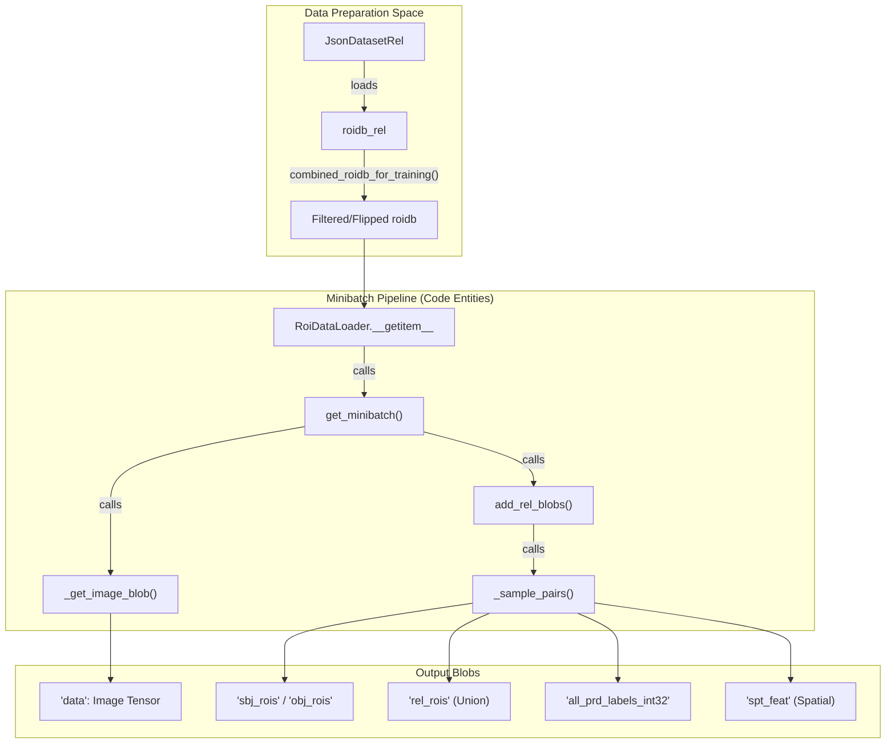
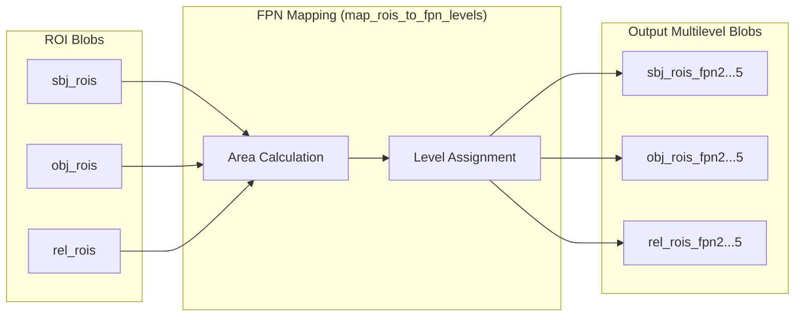

<!-- source: DeepWiki mcp.deepwiki.com · repo NVIDIA/ContrastiveLosses4VRD · page 4.2 Data Loading and Minibatch Construction · fetched 2026-10-26 -->

# Data Loading and Minibatch Construction

Relevant source files

The following files were used as context for generating this wiki page:

- [configs/vg/e2e_faster_rcnn_VGG16_8_epochs_vg_v3_default_node_contrastive_loss_w_so_p_aware_margin_point2_so_weight_point5_no_spt.yaml](configs/vg/e2e_faster_rcnn_VGG16_8_epochs_vg_v3_default_node_contrastive_loss_w_so_p_aware_margin_point2_so_weight_point5_no_spt.yaml)
- [lib/datasets_rel/roidb_rel.py](lib/datasets_rel/roidb_rel.py)
- [lib/roi_data_rel/__init__.py](lib/roi_data_rel/__init__.py)
- [lib/roi_data_rel/fast_rcnn_rel.py](lib/roi_data_rel/fast_rcnn_rel.py)
- [lib/roi_data_rel/loader_rel.py](lib/roi_data_rel/loader_rel.py)
- [lib/roi_data_rel/minibatch_rel.py](lib/roi_data_rel/minibatch_rel.py)

This page details the implementation of the data loading pipeline and the construction of minibatches specifically for Visual Relationship Detection (VRD). The pipeline extends the standard Fast R-CNN data loader to handle subject-object pairs, relationship predicates, and complex sampling strategies for contrastive learning.

## Overview of the Data Pipeline

The data loading process is orchestrated by `RoiDataLoader`, which interfaces with `roidb_rel` to fetch image metadata and `minibatch_rel` to transform that metadata into GPU-ready tensors. Unlike standard object detection, this pipeline must manage quadratic combinations of object proposals to form relationship candidates.

### Data Flow Architecture

The following diagram illustrates the transformation from raw dataset annotations to the structured blobs used by the model.

**Minibatch Construction Flow**

**Sources:** [lib/roi_data_rel/loader_rel.py:20-30](), [lib/roi_data_rel/minibatch_rel.py:31-50](), [lib/roi_data_rel/fast_rcnn_rel.py:44-59]()

---

## Image Preprocessing and Aspect Ratio Handling

The `RoiDataLoader` ensures efficient batching by grouping images with similar aspect ratios. If an image's aspect ratio exceeds `cfg.TRAIN.ASPECT_HI` or falls below `cfg.TRAIN.ASPECT_LO`, the pipeline performs "aspect cropping" [lib/datasets_rel/roidb_rel.py:177-186]().

1.  **Scaling**: Images are resized such that the shorter side matches `cfg.TRAIN.SCALES` while maintaining the aspect ratio, capped by `cfg.TRAIN.MAX_SIZE` [lib/roi_data_rel/minibatch_rel.py:92-95]().
2.  **Flipping**: If `cfg.TRAIN.USE_FLIPPED` is enabled, the `roidb` is augmented with horizontally flipped entries. This requires flipping the coordinates of `boxes`, `sbj_gt_boxes`, and `obj_gt_boxes` [lib/datasets_rel/roidb_rel.py:93-127]().
3.  **Cropping**: In `RoiDataLoader.crop_data`, images are cropped to the target ratio, and all ground truth bounding boxes are shifted and clamped to the new boundaries [lib/roi_data_rel/loader_rel.py:70-130]().

**Sources:** [lib/roi_data_rel/loader_rel.py:70-130](), [lib/datasets_rel/roidb_rel.py:86-127](), [lib/roi_data_rel/minibatch_rel.py:69-101]()

---

## Relationship Pair Sampling

The core of the VRD minibatch construction happens in `_sample_pairs` within `lib/roi_data_rel/fast_rcnn_rel.py`. This function samples a fixed number of subject-object pairs from the potential $N^2$ combinations.

### Foreground/Background Sampling
The sampler divides pairs into categories based on their overlap with ground truth relationship triplets:
*   **GT Pairs**: Pairs that match a ground truth relationship (overlap $> 1 - 1e-4$) [lib/roi_data_rel/fast_rcnn_rel.py:70]().
*   **FG Pairs**: Pairs with overlap $\ge$ `cfg.TRAIN.FG_THRESH` but not exact GT [lib/roi_data_rel/fast_rcnn_rel.py:71-72]().
*   **BG Pairs**: Pairs with overlap < `cfg.TRAIN.BG_THRESH_HI` [lib/roi_data_rel/fast_rcnn_rel.py:86]().

The total number of pairs sampled per image is determined by `cfg.TRAIN.FG_REL_SIZE_PER_IM` and `cfg.TRAIN.FG_REL_FRACTION` [lib/roi_data_rel/fast_rcnn_rel.py:66-67]().

### Feature Generation
For every sampled pair, the following are constructed:
*   **Union ROIs**: `box_utils_rel.rois_union` computes the bounding box encompassing both subject and object [lib/roi_data_rel/fast_rcnn_rel.py:115-116]().
*   **Spatial Features**: If `cfg.MODEL.USE_SPATIAL_FEAT` is active, `box_utils_rel.get_spt_features` generates geometric relationship encodings (relative distance, scale ratios) [lib/roi_data_rel/fast_rcnn_rel.py:117-120]().

**Sources:** [lib/roi_data_rel/fast_rcnn_rel.py:62-126]()

---

## Node Contrastive Sampling

To support the contrastive losses described in the RelDN architecture, the loader implements a specialized sampling logic for "nodes" (subjects and objects).

The sampler identifies four specific types of pairs to facilitate contrastive learning between positive and negative relationship candidates:
1.  **sbj_pos_pair_pos**: Both subject and object are positive (FG) [lib/roi_data_rel/fast_rcnn_rel.py:132]().
2.  **sbj_pos_obj_pos_pair_neg**: Both boxes are FG, but their combination is not a valid relationship [lib/roi_data_rel/fast_rcnn_rel.py:133-135]().
3.  **sbj_pos_obj_neg_pair_neg**: Subject is FG, object is BG, relationship is negative [lib/roi_data_rel/fast_rcnn_rel.py:136-138]().
4.  **sbj_neg_obj_pos_pair_neg**: Subject is BG, object is FG, relationship is negative [lib/roi_data_rel/fast_rcnn_rel.py:155-157]().

These indices are stored in the minibatch as `sbj_node_label_inds` and `obj_node_label_inds`, which the contrastive loss head uses to index into the feature tensors [lib/roi_data_rel/fast_rcnn_rel.py:192-205]().

**Sources:** [lib/roi_data_rel/fast_rcnn_rel.py:126-205]()

---

## FPN-Level ROI Distribution

When Feature Pyramid Networks (FPN) are enabled (`cfg.FPN.FPN_ON`), the sampled ROIs must be distributed across different levels of the feature pyramid ($P_2$ through $P_5$).

The function `_add_rel_multilevel_rois` maps each `sbj_roi`, `obj_roi`, and `rel_roi` to a specific level based on its area. This ensures that large relationships are pooled from high-level features (e.g., $P_5$) while small objects are pooled from fine-grained features (e.g., $P_2$) [lib/roi_data_rel/fast_rcnn_rel.py:214-232]().

**Mapping Logic**

**Sources:** [lib/roi_data_rel/fast_rcnn_rel.py:208-232](), [lib/utils/fpn.py]() (referenced)

---

## Key Functions and Classes

| Entity | Location | Responsibility |
| :--- | :--- | :--- |
| `RoiDataLoader` | `loader_rel.py:20` | PyTorch Dataset wrapper; handles image loading and aspect ratio cropping. |
| `get_minibatch` | `minibatch_rel.py:31` | Entry point for building a minibatch from a `roidb` entry. |
| `add_rel_blobs` | `fast_rcnn_rel.py:44` | High-level coordinator for relationship-specific blob construction. |
| `_sample_pairs` | `fast_rcnn_rel.py:62` | Implements the FG/BG sampling logic for subject-object pairs. |
| `_get_image_blob` | `minibatch_rel.py:69` | Reads images from disk, applies color normalization and scaling. |
| `combined_roidb_for_training` | `roidb_rel.py:39` | Merges multiple datasets and prepares them for training (filtering, flipping). |

**Sources:** [lib/roi_data_rel/loader_rel.py:20](), [lib/roi_data_rel/minibatch_rel.py:31](), [lib/roi_data_rel/fast_rcnn_rel.py:44](), [lib/roi_data_rel/fast_rcnn_rel.py:62](), [lib/roi_data_rel/minibatch_rel.py:69](), [lib/datasets_rel/roidb_rel.py:39]()

---

