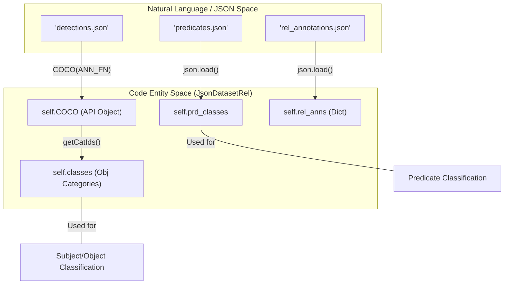
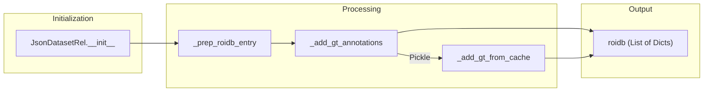

<!-- source: DeepWiki mcp.deepwiki.com · repo NVIDIA/ContrastiveLosses4VRD · page 4.3 Dataset Layer (JsonDatasetRel and Catalog) · fetched 2026-10-26 -->

# Dataset Layer (JsonDatasetRel and Catalog)

Relevant source files

The following files were used as context for generating this wiki page:

- [lib/datasets_rel/dataset_catalog_rel.py](lib/datasets_rel/dataset_catalog_rel.py)
- [lib/datasets_rel/json_dataset_rel.py](lib/datasets_rel/json_dataset_rel.py)
- [lib/datasets_rel/pytorch_misc.py](lib/datasets_rel/pytorch_misc.py)

The dataset layer is responsible for abstracting the physical storage of relationship annotations into a standardized format used by the training and inference pipelines. It extends the standard COCO format to support relationship triplets (subject, predicate, object) and provides a registry for managing different datasets like Visual Genome (VG), VRD, and OpenImages.

## Dataset Catalog and Registry

The `dataset_catalog_rel.py` file serves as the central registry for all relationship datasets. Each entry in the `DATASETS` dictionary defines the paths to image directories and three specific annotation files required for Visual Relationship Detection (VRD) [lib/datasets_rel/dataset_catalog_rel.py:45-140]().

### Required Annotation Files
The system expects three distinct JSON files per dataset split:
1.  **`ANN_FN` (Detection)**: Standard COCO-style object detection annotations [lib/datasets_rel/dataset_catalog_rel.py:35]().
2.  **`ANN_FN2` (Relationships)**: Relationship-specific annotations containing triplets that reference the objects in `ANN_FN` [lib/datasets_rel/dataset_catalog_rel.py:36]().
3.  **`ANN_FN3` (Predicates)**: A list of predicate category names used to map IDs to semantic labels [lib/datasets_rel/dataset_catalog_rel.py:37]().

| Dataset Key | Image Directory | Primary Annotations (Detection) | Relationship Annotations |
| :--- | :--- | :--- | :--- |
| `oi_rel_train` | `openimages_v4/train` | `detections_train.json` | `rel_only_annotations_train.json` |
| `vg_train` | `vg/VG_100K` | `detections_train.json` | `rel_annotations_train.json` |
| `vrd_train` | `vrd/train_images` | `detections_train.json` | `new_annotations_train.json` |

Sources: [lib/datasets_rel/dataset_catalog_rel.py:34-140]()

## JsonDatasetRel Class

The `JsonDatasetRel` class is the primary interface for loading and parsing relationship data. It initializes by loading the standard COCO object categories and then supplements them with predicate categories and relationship triplets [lib/datasets_rel/json_dataset_rel.py:63-103]().

### Data Flow: Natural Language to Code Entities

The following diagram illustrates how semantic concepts from the dataset files are mapped to internal Python objects within `JsonDatasetRel`.

**Diagram: Mapping Dataset Concepts to Code Entities**

Sources: [lib/datasets_rel/json_dataset_rel.py:76-103]()

## Roidb Construction and Fields

The `roidb` (Region of Interest Database) is a list of dictionaries, where each dictionary represents an image and its associated ground-truth (GT) data. `JsonDatasetRel` constructs this by merging detection data with relationship triplets.

### GT Relationship Fields
When `get_roidb(gt=True)` is called, the system populates several relationship-specific fields in each entry [lib/datasets_rel/json_dataset_rel.py:128-176]():

*   **`sbj_gt_boxes`**: Coordinates for the subject of the relationship.
*   **`obj_gt_boxes`**: Coordinates for the object of the relationship.
*   **`prd_gt_classes`**: Integer labels for the predicate categories.
*   **`pair_to_gt_ind_map`**: A mapping that links a specific subject-object pair to its ground-truth index.

### Overlap Matrix Computation
For training, the system computes overlap matrices to determine which proposals match ground-truth objects. This is handled during the `roidb` preparation phase, ensuring that every subject and object in a relationship has a corresponding entry in the `gt_overlaps` sparse matrix [lib/datasets_rel/json_dataset_rel.py:120-123]().

**Diagram: Roidb Entry Lifecycle**

Sources: [lib/datasets_rel/json_dataset_rel.py:145-177](), [lib/datasets_rel/json_dataset_rel.py:119-126]()

## Caching Mechanism

To avoid the high computational cost of parsing large JSON files and computing overlap matrices repeatedly, `JsonDatasetRel` implements a disk-based caching mechanism using Python's `pickle` module.

1.  **Cache Path**: Caches are stored in `DATA_DIR/cache` [lib/datasets_rel/json_dataset_rel.py:106-110]().
2.  **Validation**: The `valid_cached_keys` property defines exactly which fields (e.g., `sbj_gt_boxes`, `prd_gt_classes`) are preserved in the cache [lib/datasets_rel/json_dataset_rel.py:113-126]().
3.  **Loading**: If a file named `<dataset_name>_rel_gt_roidb.pkl` exists, the dataset loader skips the manual annotation parsing and loads the `roidb` directly from disk [lib/datasets_rel/json_dataset_rel.py:161-168]().

## Utility Functions

The dataset layer relies on several specialized utilities for handling 2D array intersections and sorting:

*   **`intersect_2d(x1, x2)`**: Efficiently computes a boolean matrix where each entry `(i, j)` is `True` if row `i` in `x1` matches row `j` in `x2`. This is critical for matching proposed subject-object pairs against ground-truth pairs [lib/datasets_rel/pytorch_misc.py:12-26]().
*   **`argsort_desc(scores)`**: Returns indices that sort a multi-dimensional array in descending order, used for ranking relationship proposals during evaluation [lib/datasets_rel/pytorch_misc.py:28-35]().

Sources: [lib/datasets_rel/pytorch_misc.py:1-35]()

---

