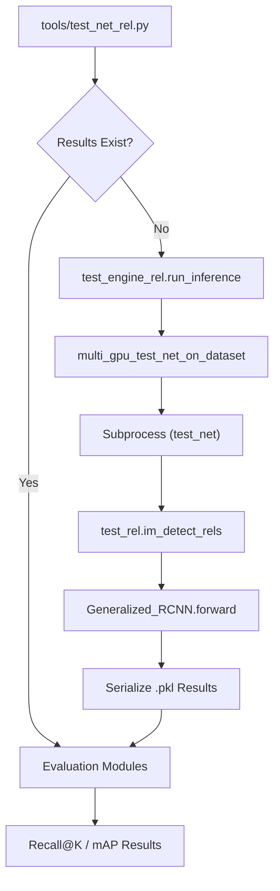
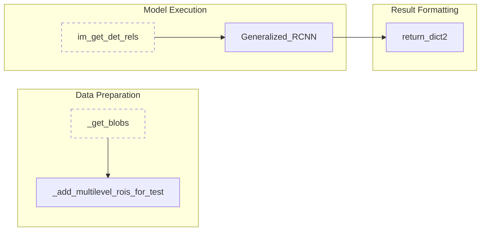

<!-- source: DeepWiki mcp.deepwiki.com · repo NVIDIA/ContrastiveLosses4VRD · page 5 Inference and Evaluation Pipeline · fetched 2026-10-26 -->

# Inference and Evaluation Pipeline

Relevant source files

The following files were used as context for generating this wiki page:

- [lib/core/test_engine_rel.py](lib/core/test_engine_rel.py)
- [lib/core/test_rel.py](lib/core/test_rel.py)
- [tools/test_net_rel.py](tools/test_net_rel.py)
- [tools/train_net_step_rel.py](tools/train_net_step_rel.py)

The inference and evaluation pipeline in **ContrastiveLosses4VRD** manages the transition from trained model weights to structured relationship detections and quantitative metrics. The workflow is designed to handle large-scale datasets like Visual Genome and Open Images by utilizing multi-GPU parallelism and standardized serialization of results.

## Pipeline Overview

The pipeline consists of three primary stages:
1.  **Orchestration**: `tools/test_net_rel.py` parses arguments and determines whether to run fresh inference or evaluate existing results [tools/test_net_rel.py:161-175]().
2.  **Inference Engine**: `lib/core/test_engine_rel.py` manages the data flow, potentially spawning subprocesses for multi-GPU execution [lib/core/test_engine_rel.py:158-188]().
3.  **Evaluation**: Dataset-specific scripts compute metrics like Recall@K and mAP based on the serialized detections [lib/core/test_engine_rel.py:149-153]().

### High-Level Workflow Diagram

The following diagram illustrates the flow from the entry point to the final evaluation metrics.

**Inference and Evaluation Flow**

**Sources:** [tools/test_net_rel.py:161-175](), [lib/core/test_engine_rel.py:79-123](), [lib/core/test_rel.py:55-64]()

## Inference Orchestration

The inference engine is responsible for loading the model, preparing image blobs, and managing the forward pass. It supports different modes such as using ground-truth boxes for **Predicate Classification (PredCls)** or **Scene Graph Classification (SGCls)** [tools/test_net_rel.py:154-160]().

### Inference Components and Code Entities

This diagram maps the logical inference steps to the specific code entities responsible for them.

**Inference Engine Mapping**

**Sources:** [lib/core/test_rel.py:67-100](), [lib/core/test_rel.py:118-156]()

### 5.1 Inference Engine (test_engine_rel.py and test_rel.py)
The engine utilizes `subprocess_utils.process_in_parallel` to distribute images across available GPUs [lib/core/test_engine_rel.py:185-188](). Each subprocess executes `test_net`, which performs the following:
*   **Blob Preparation**: `_get_blobs` scales images and prepares ROIs [lib/core/test_rel.py:70]().
*   **FPN Mapping**: If enabled, `_add_multilevel_rois_for_test` maps ROIs to specific levels of the Feature Pyramid Network [lib/core/test_rel.py:82-83]().
*   **Model Forward**: The model outputs subject/object boxes, labels, and scores, along with multi-modal predicate scores (visual, spatial, and frequency bias) [lib/core/test_rel.py:103-116]().

For details, see [Inference Engine (test_engine_rel.py and test_rel.py)](#5.1).

## Quantitative Evaluation

Once inference is complete, the results are serialized into `.pkl` files (e.g., `rel_detections.pkl`) [tools/test_net_rel.py:160-164](). The evaluation suite then processes these detections to compare them against ground-truth annotations.

### 5.2 Evaluation Metrics (task_evaluation_sg and task_evaluation_vg_and_vrd)
The evaluation logic varies by dataset:
*   **Visual Genome & VRD**: Uses `task_evaluation_vg_and_vrd.eval_rel_results` to compute standard Scene Graph Generation metrics [lib/core/test_engine_rel.py:150-151]().
*   **Open Images**: Uses `task_evaluation_sg.eval_rel_results`, which includes specific logic for the Open Images Challenge, such as weighted scores and phrase detection [lib/core/test_engine_rel.py:152-153]().

Key metrics include:
*   **Recall@K (R@20/50/100)**: The fraction of ground-truth relationships found in the top K predictions.
*   **mAP**: Mean Average Precision for relationship detection.

For details, see [Evaluation Metrics (task_evaluation_sg and task_evaluation_vg_and_vrd)](#5.2).

## Summary Table of Inference Modes

The pipeline behavior is heavily influenced by command-line arguments passed to `tools/test_net_rel.py`.

| Argument | Description | Output Filename |
| :--- | :--- | :--- |
| `--use_gt_boxes` | Use GT boxes for evaluation (SGCls) | `rel_detections_gt_boxes_sgcls.pkl` |
| `--use_gt_labels` | Use GT boxes and labels (PredCls) | `rel_detections_gt_boxes_prdcls.pkl` |
| *None* | Full Relationship Detection (RelDet) | `rel_detections.pkl` |
| `--multi-gpu-testing` | Parallelize inference across GPUs | *As above* |

**Sources:** [tools/test_net_rel.py:154-160](), [lib/core/test_engine_rel.py:195-201]()

---

