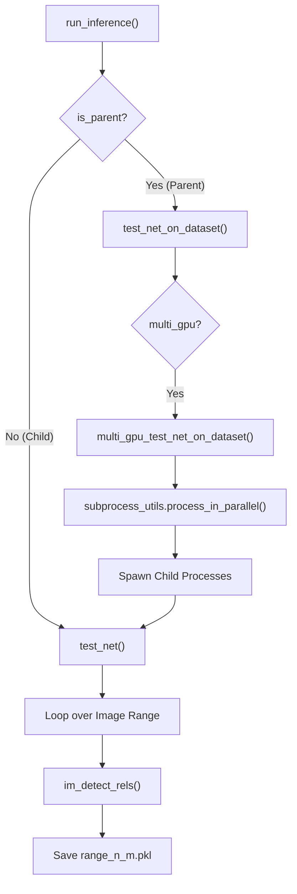
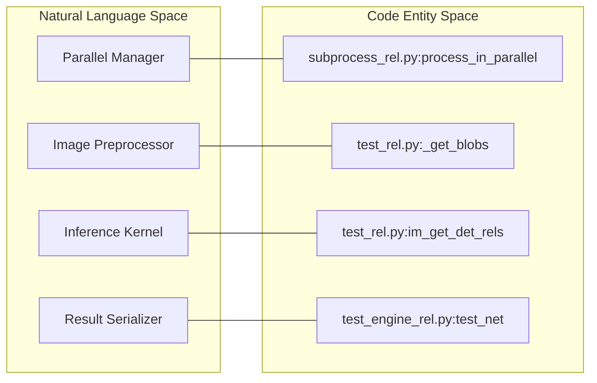
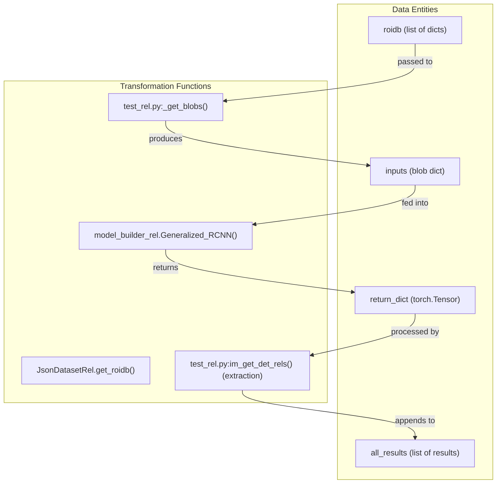

<!-- source: DeepWiki mcp.deepwiki.com · repo NVIDIA/ContrastiveLosses4VRD · page 5.1 Inference Engine (test_engine_rel.py and test_rel.py) · fetched 2026-10-26 -->

# Inference Engine (test_engine_rel.py and test_rel.py)

Relevant source files

The following files were used as context for generating this wiki page:

- [lib/core/test_engine_rel.py](lib/core/test_engine_rel.py)
- [lib/core/test_rel.py](lib/core/test_rel.py)
- [lib/utils_rel/net_rel.py](lib/utils_rel/net_rel.py)
- [lib/utils_rel/subprocess_rel.py](lib/utils_rel/subprocess_rel.py)

The inference engine manages the end-to-end process of generating relationship predictions from a trained model. It handles dataset iteration, image-level preprocessing, model execution, and the collation of results across multiple GPUs using a subprocess-based parallelism strategy to bypass the Python Global Interpreter Lock (GIL).

## Orchestration and Parallelism

The entry point for inference is `run_inference`, which determines if the process is a parent coordinator or a worker child [lib/core/test_engine_rel.py:79-123]().

### Multi-GPU Subprocess Parallelism
To maximize throughput, the engine uses `subprocess_utils.process_in_parallel` to launch multiple instances of the test script [lib/utils_rel/subprocess_rel.py:42-48]().
1.  **Config Snapshot**: The current global `cfg` state is serialized to a temporary YAML file to ensure children use identical hyperparameters [lib/utils_rel/subprocess_rel.py:51-53]().
2.  **Range Splitting**: The dataset is divided into contiguous chunks based on the number of available GPUs [lib/utils_rel/subprocess_rel.py:57-70]().
3.  **Subprocess Execution**: Each child is invoked via `python3` with specific `--range start end` arguments and assigned a unique `CUDA_VISIBLE_DEVICES` ID [lib/utils_rel/subprocess_rel.py:71-103]().
4.  **Result Collation**: As children finish, they save their results to `.pkl` files. The parent process reads these files and concatenates them into a single `all_results` list [lib/utils_rel/subprocess_rel.py:107-116]().

### Inference Flow Control

**Sources:** [lib/core/test_engine_rel.py:79-155](), [lib/utils_rel/subprocess_rel.py:42-116]()

## The Detection Pipeline (`im_detect_rels`)

The core logic for processing a single image resides in `im_detect_rels` and its helper `im_get_det_rels` [lib/core/test_rel.py:55-67]().

### Blob Preparation and FPN Mapping
Before the forward pass, the image and proposals must be formatted into "blobs" (network-ready tensors):
*   **Image Scaling**: Images are resized according to `cfg.TEST.SCALE` and `cfg.TEST.MAX_SIZE` [lib/core/test_rel.py:70]().
*   **ROI Projection**: RoIs from the `roidb` are scaled to the resized image dimensions [lib/core/test_rel.py:170-172]().
*   **FPN Multi-level Mapping**: If using a Feature Pyramid Network (FPN), `_add_multilevel_rois_for_test` assigns each ROI to a specific pyramid level ($P_2$ through $P_5$) based on its area, using the formula $k = \lfloor k_0 + \log_2(\sqrt{wh}/224) \rfloor$ [lib/core/test_rel.py:82-83]().

### Model Forward Pass
The prepared `inputs` dictionary is passed to the `Generalized_RCNN` model [lib/core/test_rel.py:100](). During inference, the model:
1.  Extracts visual features for subject and object ROIs.
2.  Computes relationship scores using the predicate branch.
3.  Optionally incorporates **Frequency Bias** (`prd_scores_bias`) and **Spatial Features** (`prd_scores_spt`) if configured [lib/core/test_rel.py:111-114]().

### Result Extraction
The engine extracts and post-processes the raw tensors from the GPU:
*   **Coordinate Rescaling**: Box coordinates are scaled back to the original image dimensions by dividing by `im_scale` [lib/core/test_rel.py:104-107]().
*   **Label Mapping**: Labels are converted from 1-based (internal) back to 0-based (dataset) indices [lib/core/test_rel.py:105-108]().

| Output Field | Description | Source |
| :--- | :--- | :--- |
| `sbj_boxes` | Rescaled [x1, y1, x2, y2] for subjects | [lib/core/test_rel.py:104]() |
| `sbj_scores` | Softmax scores for subject classification | [lib/core/test_rel.py:106]() |
| `prd_scores` | Relationship predicate scores (visual) | [lib/core/test_rel.py:110]() |
| `prd_scores_ttl` | Combined scores (Visual + Spatial + Bias) | [lib/core/test_rel.py:115-116]() |

**Sources:** [lib/core/test_rel.py:67-156](), [lib/core/test_rel.py:159-172]()

## Code Entity to Natural Language Mapping

This section bridges high-level inference concepts to specific code implementations.

### System Components

**Sources:** [lib/utils_rel/subprocess_rel.py:42](), [lib/core/test_rel.py:67](), [lib/core/test_engine_rel.py:210]()

### Data Flow Entities

**Sources:** [lib/core/test_engine_rel.py:134](), [lib/core/test_rel.py:70-100](), [lib/core/test_rel.py:102-156]()

## Result Serialization

Once `test_net` completes its assigned range, it aggregates all image-level results into a list and saves them to a pickle file [lib/core/test_engine_rel.py:284-290]().

*   **File Naming**: Files are named using the pattern `{tag}_range_{start}_{end}.pkl` to prevent collisions between subprocesses [lib/utils_rel/subprocess_rel.py:111-113]().
*   **Final Output**: After the parent process collates all chunks, it saves a final consolidated file, typically `rel_detections.pkl` (or `rel_detections_gt_boxes_prdcls.pkl` if using ground truth boxes), in the output directory [lib/core/test_engine_rel.py:195-202]().
*   **Evaluation Trigger**: Immediately following collation, the engine calls `eval_rel_results` from either `task_evaluation_sg` or `task_evaluation_vg_and_vrd` depending on the dataset name [lib/core/test_engine_rel.py:150-153]().

**Sources:** [lib/core/test_engine_rel.py:149-202](), [lib/utils_rel/subprocess_rel.py:107-116]()

---

