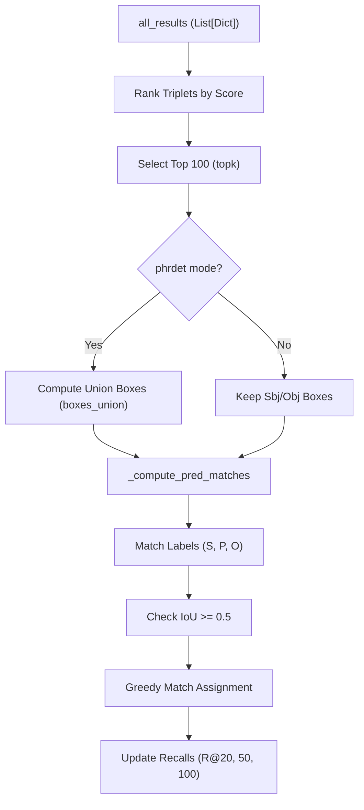
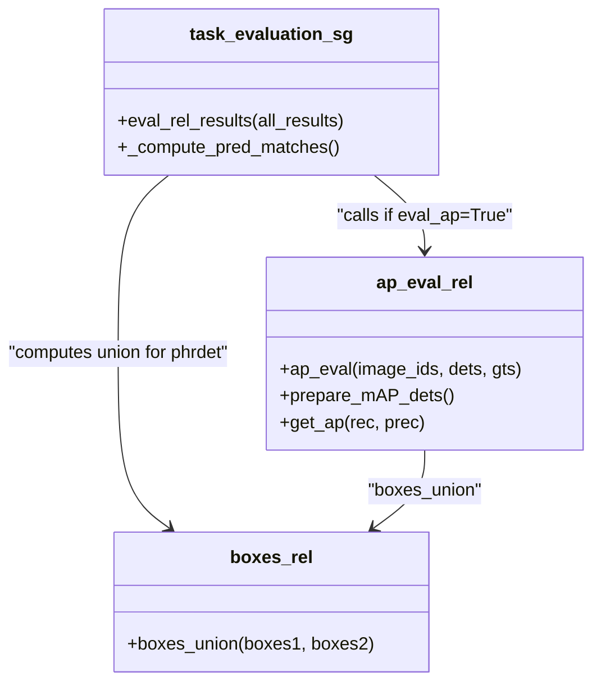

<!-- source: DeepWiki mcp.deepwiki.com · repo NVIDIA/ContrastiveLosses4VRD · page 5.2 Evaluation Metrics (task_evaluation_sg and task_evaluation_vg_and_vrd) · fetched 2026-10-26 -->

# Evaluation Metrics (task_evaluation_sg and task_evaluation_vg_and_vrd)

Relevant source files

The following files were used as context for generating this wiki page:

- [lib/datasets_rel/ap_eval_rel.py](lib/datasets_rel/ap_eval_rel.py)
- [lib/datasets_rel/task_evaluation_sg.py](lib/datasets_rel/task_evaluation_sg.py)
- [lib/datasets_rel/task_evaluation_vg_and_vrd.py](lib/datasets_rel/task_evaluation_vg_and_vrd.py)

This page details the implementation of relationship evaluation metrics in the ContrastiveLosses4VRD repository. The evaluation pipeline processes inference results to compute Recall@K (R@K) and mean Average Precision (mAP) across various datasets, specifically Visual Genome (VG), VRD, and Open Images (OI).

## Overview of Evaluation Logic

The evaluation logic is split between two primary modules based on the dataset characteristics:
*   `task_evaluation_sg.py`: Handles Scene Graph Detection (SGDET) for Open Images and Visual Genome.
*   `task_evaluation_vg_and_vrd.py`: Specialized for Visual Genome and VRD, supporting varying `prd_k` iterations and Phrase Detection (PhrDet) modes.

### Key Data Flow: Results to Metrics

The evaluation starts with `all_results`, a list of dictionaries containing detected bounding boxes, labels, and scores for subjects, objects, and predicates.

| Entity | Code Reference | Description |
| :--- | :--- | :--- |
| **Top-K Selection** | `eval_rel_results` | Filters and ranks the top 100 relationship triplets per image. |
| **Matching Logic** | `_compute_pred_matches` | Determines if a prediction matches a ground truth based on labels and IoU. |
| **AP Calculation** | `ap_eval` | Computes the area under the Precision-Recall curve for Open Images. |

**Sources:** [lib/datasets_rel/task_evaluation_sg.py:27-59](), [lib/datasets_rel/task_evaluation_vg_and_vrd.py:31-57]()

---

## Technical Detail: Predicate Ranking and Top-K Selection

For every detected subject-object pair, the model provides a distribution over predicate classes. The evaluation scripts rank these triplets using a combined score:
$Score_{SPO} = Score_{sbj} \times Score_{obj} \times Score_{prd}$

### prd_k Iteration
The variable `prd_k` determines how many top predicate labels are considered for each subject-object pair:
*   **Visual Genome:** Usually `prd_k = 1` (standard SG Evaluation) [lib/datasets_rel/task_evaluation_sg.py:34]().
*   **VRD/Others:** Can iterate through `prd_k` values (e.g., 1 to 70) to evaluate the model's ability to recover relationships within the top-N predicate predictions [lib/datasets_rel/task_evaluation_vg_and_vrd.py:35-36]().

### Detection Modes
1.  **Relationship Detection (RelDet):** Requires both subject and object boxes to have an IoU $\ge 0.5$ with their respective ground truths [lib/datasets_rel/task_evaluation_vg_and_vrd.py:125-128]().
2.  **Phrase Detection (PhrDet):** Requires the union box of the subject and object to have an IoU $\ge 0.5$ with the ground truth union box [lib/datasets_rel/task_evaluation_vg_and_vrd.py:118-123]().

**Sources:** [lib/datasets_rel/task_evaluation_sg.py:92-104](), [lib/datasets_rel/task_evaluation_vg_and_vrd.py:79-96]()

---

## Matching Implementation (`_compute_pred_matches`)

The core of the evaluation is the `_compute_pred_matches` function. It performs a greedy matching between predicted triplets and ground truth (GT) triplets.

### Algorithm Logic
1.  **Label Filtering:** A prediction only matches a GT if the triplet labels $(L_{sbj}, L_{prd}, L_{obj})$ match exactly [lib/datasets_rel/task_evaluation_vg_and_vrd.py:183-185]().
2.  **IoU Constraint:** 
    *   In `reldet`, both subject and object boxes must exceed `iou_thresh`.
    *   In `phrdet`, the union box must exceed `iou_thresh`.
3.  **Greedy Assignment:** For each prediction, it finds all valid GT matches and assigns the one with the highest IoU that hasn't been "captured" by a higher-scoring prediction [lib/datasets_rel/task_evaluation_vg_and_vrd.py:195-205]().

### Code-to-Logic Mapping: Matching Process
Title: Relationship Matching Pipeline

**Sources:** [lib/datasets_rel/task_evaluation_vg_and_vrd.py:158-205](), [lib/datasets_rel/ap_eval_rel.py:175-185]()

---

## Open Images mAP and Weighted Scoring

For the Open Images dataset, the evaluation computes Average Precision (AP) per relationship category.

### mAP Logic (`ap_eval_rel.py`)
The `ap_eval` function follows the PASCAL VOC style:
1.  **Confidence Sorting:** All detections for a specific predicate class across the entire dataset are sorted by score [lib/datasets_rel/ap_eval_rel.py:145-151]().
2.  **TP/FP Assignment:** For each detection, it is marked as a True Positive (TP) if it matches an unvisited GT image-wise, otherwise it is a False Positive (FP) [lib/datasets_rel/ap_eval_rel.py:158-200]().
3.  **Precision-Recall Curve:** AP is calculated as the area under the PR curve using the `get_ap` function [lib/datasets_rel/ap_eval_rel.py:101-119]().

### Open Images Final Score
The final score for Open Images is a weighted average of three components:
$Score_{final} = 0.2 \times R@50 + 0.4 \times wmAP_{rel} + 0.4 \times wmAP_{phr}$
*(Note: Implementation of weighted formula is typically handled in the calling script or final logging based on outputs from `eval_rel_results`).*

### Code Entity Space: Evaluation Classes
Title: Evaluation Entity Relationships

**Sources:** [lib/datasets_rel/task_evaluation_sg.py:18](), [lib/datasets_rel/ap_eval_rel.py:35](), [lib/datasets_rel/ap_eval_rel.py:54]()

---

## Key Functions Reference

### `eval_rel_results`
The entry point for evaluation. It differentiates between datasets using `cfg.TEST.DATASETS[0]` to set parameters like `prd_k` and `eval_per_img`.
*   **VG:** `eval_per_img = True`, `prd_k = 1`.
*   **VRD:** `eval_per_img = False`, `prd_k` iterates through a set (1, 70).
*   **OI:** `eval_ap = True`.

### `prepare_mAP_dets`
Prepares the data structures required for AP calculation. It aggregates detections and ground truths into class-specific arrays (`cls_dets` and `cls_gts`), including subject/object labels and boxes.
[lib/datasets_rel/ap_eval_rel.py:40-98]()

### `_compute_pred_matches`
The heavy-lifting function for Recall calculation. It returns a list where each element `i` contains the indices of ground truth triplets matched by the $i$-th prediction.
[lib/datasets_rel/task_evaluation_vg_and_vrd.py:158-165]()

**Sources:** [lib/datasets_rel/task_evaluation_sg.py:27-43](), [lib/datasets_rel/ap_eval_rel.py:40-98](), [lib/datasets_rel/task_evaluation_vg_and_vrd.py:158-165]()

---

