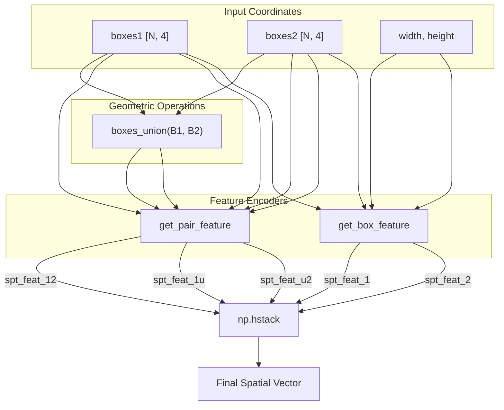
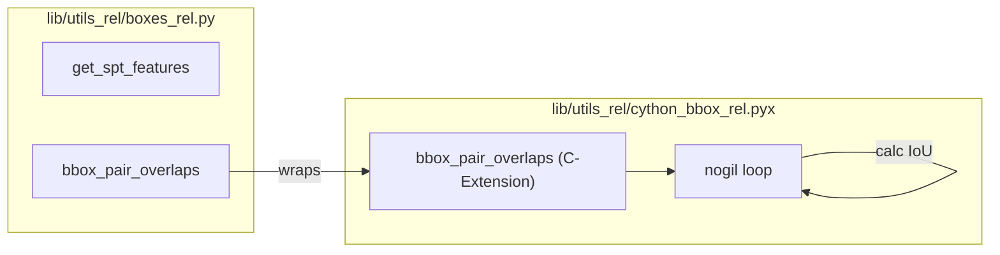

<!-- source: DeepWiki mcp.deepwiki.com · repo NVIDIA/ContrastiveLosses4VRD · page 6.1 Bounding Box and Spatial Feature Utilities · fetched 2026-10-26 -->

# Bounding Box and Spatial Feature Utilities

Relevant source files

The following files were used as context for generating this wiki page:

- [lib/utils_rel/__init__.py](lib/utils_rel/__init__.py)
- [lib/utils_rel/boxes_rel.py](lib/utils_rel/boxes_rel.py)
- [lib/utils_rel/cython_bbox_rel.pyx](lib/utils_rel/cython_bbox_rel.pyx)

This section documents the geometric and spatial utility functions used to process bounding boxes and generate relationship-specific spatial features. These utilities handle coordinate transformations, pairwise box overlaps, and the encoding of relative spatial positions between subjects and objects.

## Overview of Box Manipulation

The repository follows the internal Detectron box format: `[x1, y1, x2, y2]`, where `(x1, y1)` is the top-left corner and `(x2, y2)` is the bottom-right corner [lib/utils_rel/boxes_rel.py:29-32](). A historical convention is maintained where the width of a box is computed as $x2 - x1 + 1$ to account for integer pixel indices [lib/utils_rel/boxes_rel.py:34-41]().

### Coordinate Shims
The function `y1y2x1x2_to_x1y1x2y2` acts as a conversion shim for datasets or external tools that provide coordinates in a different order, remapping them to the standard `[x1, y1, x2, y2]` format [lib/utils_rel/boxes_rel.py:127-132]().

## Spatial Feature Pipeline

The `get_spt_features` function is the primary entry point for generating spatial descriptors used by the relationship heads. It constructs a high-dimensional feature vector by concatenating absolute box encodings and relative pairwise deltas.

### Feature Composition
The pipeline generates a composite feature vector from five distinct sources:
1.  **Pairwise Delta (12):** Relative geometry between box 1 and box 2 [lib/utils_rel/boxes_rel.py:69]().
2.  **Subject-Union Delta (1u):** Relative geometry between box 1 and the union box [lib/utils_rel/boxes_rel.py:70]().
3.  **Union-Object Delta (u2):** Relative geometry between the union box and box 2 [lib/utils_rel/boxes_rel.py:71]().
4.  **Box 1 Absolute:** Normalized coordinates and area of box 1 [lib/utils_rel/boxes_rel.py:67]().
5.  **Box 2 Absolute:** Normalized coordinates and area of box 2 [lib/utils_rel/boxes_rel.py:68]().

### Spatial Feature Flow
The following diagram illustrates how raw bounding boxes are transformed into the spatial feature vector.

**Spatial Feature Generation Flow**

**Sources:** [lib/utils_rel/boxes_rel.py:65-72](), [lib/utils_rel/boxes_rel.py:91-97]()

## Implementation Details

### Relative Encodings
The `get_pair_feature` function utilizes `bbox_transform_inv` to calculate the log-space offsets (deltas) between two boxes. It returns a concatenation of the full delta (dx, dy, dw, dh) of box 2 relative to box 1, and the positional offsets (dx, dy) of box 1 relative to box 2 [lib/utils_rel/boxes_rel.py:75-79]().

### Absolute Encodings
`get_box_feature` normalizes the box coordinates by the image dimensions and calculates the normalized area:
*   **f1, f2, f3, f4:** $x1/W, y1/H, x2/W, y2/H$ [lib/utils_rel/boxes_rel.py:83-86]().
*   **f5:** $(Area_{box}) / (W \times H)$ [lib/utils_rel/boxes_rel.py:87]().

### Geometric Utilities
The library provides standard operations for both standard bounding boxes and ROIs (which include a batch/image index in the first column).

| Function | Input Shape | Logic |
| :--- | :--- | :--- |
| `boxes_union` | `(N, 4)` | Computes the min/max of coordinates to find the smallest enclosing box [lib/utils_rel/boxes_rel.py:91-97](). |
| `rois_union` | `(N, 5)` | Same as union, but preserves the image index in `rois[:, 0]` [lib/utils_rel/boxes_rel.py:100-106](). |
| `boxes_intersect` | `(N, 4)` | Computes the intersection of two boxes [lib/utils_rel/boxes_rel.py:109-115](). |
| `rois_intersect` | `(N, 5)` | Intersection for ROIs, preserving the image index [lib/utils_rel/boxes_rel.py:118-124](). |

**Sources:** [lib/utils_rel/boxes_rel.py:75-124]()

## Cython Acceleration

For performance-critical operations, specifically pairwise overlap (IoU) calculations between large sets of boxes, the repository uses a Cython implementation.

### bbox_pair_overlaps
The `bbox_pair_overlaps` function is defined in `cython_bbox_rel.pyx` and exposed via `boxes_rel.py` [lib/utils_rel/boxes_rel.py:62](). It computes the Intersection over Union (IoU) for $N$ pairs of boxes in a single pass [lib/utils_rel/cython_bbox_rel.pyx:37-48]().

**Key implementation features:**
*   **Memory Efficiency:** Operates on `numpy` ndarrays with `float32` precision [lib/utils_rel/cython_bbox_rel.pyx:32-33]().
*   **Speed:** Uses a `with nogil:` block to allow multi-threaded execution by releasing the Python Global Interpreter Lock during the calculation loop [lib/utils_rel/cython_bbox_rel.pyx:55-76]().
*   **Safety:** Bounds checking is disabled (`@cython.boundscheck(False)`) to maximize iteration speed [lib/utils_rel/cython_bbox_rel.pyx:36]().

**Cython Interaction Map**

**Sources:** [lib/utils_rel/cython_bbox_rel.pyx:37-77](), [lib/utils_rel/boxes_rel.py:62]()

---

