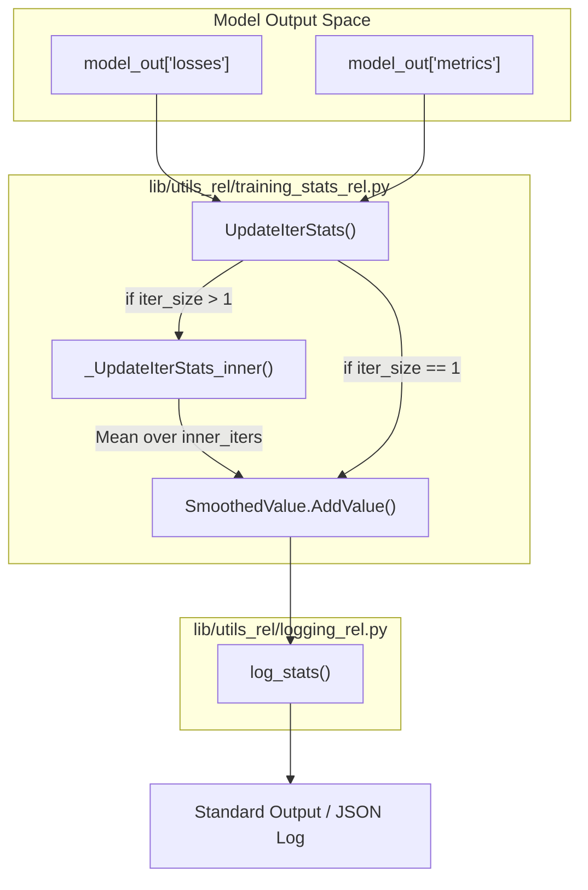
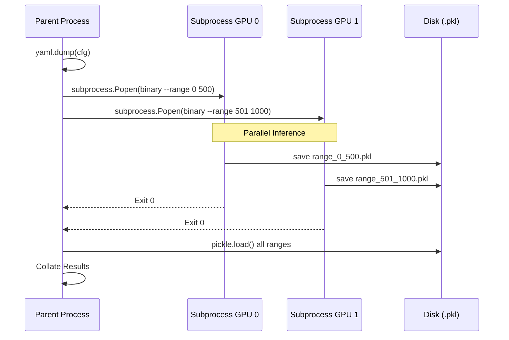

<!-- source: DeepWiki mcp.deepwiki.com · repo NVIDIA/ContrastiveLosses4VRD · page 6.2 Training Statistics, Logging, and Subprocess Utilities · fetched 2026-10-26 -->

# Training Statistics, Logging, and Subprocess Utilities

Relevant source files

The following files were used as context for generating this wiki page:

- [lib/utils_rel/logging_rel.py](lib/utils_rel/logging_rel.py)
- [lib/utils_rel/net_rel.py](lib/utils_rel/net_rel.py)
- [lib/utils_rel/subprocess_rel.py](lib/utils_rel/subprocess_rel.py)
- [lib/utils_rel/training_stats_rel.py](lib/utils_rel/training_stats_rel.py)

This page details the utility modules responsible for tracking training progress, managing structured log output, handling multi-GPU subprocesses for inference, and providing network initialization helpers. These utilities ensure consistent monitoring and efficient execution across different hardware configurations.

## Training Statistics Tracking

The `TrainingStats` class is the primary entity for monitoring model performance during training. It tracks losses and metrics using moving averages to provide stable feedback in logs and TensorBoard.

### Implementation Details
- **Smoothing**: It utilizes the `SmoothedValue` class to maintain a windowed average (default size 20) of scalar values [lib/utils_rel/training_stats_rel.py:51-56]().
- **Gradient Accumulation Support**: The class explicitly handles `iter_size > 1` via `_UpdateIterStats_inner`. It accumulates losses over multiple inner iterations before updating the smoothed moving averages [lib/utils_rel/training_stats_rel.py:109-145]().
- **FPN Integration**: If Feature Pyramid Networks (FPN) are enabled, it aggregates RPN classification and bounding box losses across all levels [lib/utils_rel/training_stats_rel.py:82-85]().
- **TensorBoard**: Integrates with a TensorBoard logger to export training curves, excluding non-scalar keys like `iter` or `eta` [lib/utils_rel/training_stats_rel.py:43-48]().

### Training Stats Data Flow
The following diagram illustrates how raw model outputs are processed into logged statistics.

Title: Training Statistics Update Pipeline

**Sources:** [lib/utils_rel/training_stats_rel.py:74-108](), [lib/utils_rel/training_stats_rel.py:109-168](), [lib/utils_rel/logging_rel.py:47-64]()

---

## Logging and Structured Output

The logging system provides both human-readable terminal output and machine-readable JSON logs for post-processing.

### Key Components
- **`SmoothedValue`**: A utility class that uses a `deque` to store a series of values, providing median, average, and global average calculations [lib/utils_rel/logging_rel.py:67-91]().
- **`log_stats`**: Formats training metrics (LR, loss, time, ETA) into a structured string. It supports both step-based and epoch-based logging formats [lib/utils_rel/logging_rel.py:47-64]().
- **`log_json_stats`**: Serializes statistics into JSON format for automated log analysis [lib/utils_rel/logging_rel.py:43-45]().
- **`setup_logging`**: Configures the standard Python `logging` module with a specific format (`%(levelname)s %(filename)s:%(lineno)4d: %(message)s`) and redirects it to `sys.stdout` [lib/utils_rel/logging_rel.py:102-109]().

**Sources:** [lib/utils_rel/logging_rel.py:40-109]()

---

## Multi-GPU Subprocess Management

Inference in this codebase often involves significant Python-side logic (e.g., relationship triplet construction). To avoid the Python Global Interpreter Lock (GIL) and maximize GPU utilization, the system uses subprocess-based parallelism.

### Parallel Execution Logic
The `process_in_parallel` function manages the distribution of data ranges across available GPUs:
1. **Config Snapshot**: The current `cfg` state is dumped to a temporary YAML file so subprocesses inherit the same hyperparameters [lib/utils_rel/subprocess_rel.py:49-53]().
2. **Data Splitting**: The total dataset range is split into chunks based on the number of GPUs detected or specified in `CUDA_VISIBLE_DEVICES` [lib/utils_rel/subprocess_rel.py:56-66]().
3. **Subprocess Spawning**: For each GPU, a new `python3` process is started running the specified binary with `--range {start} {end}` arguments [lib/utils_rel/subprocess_rel.py:68-87]().
4. **Output Collation**: The parent process waits for all children to finish, then loads the resulting `.pkl` files and aggregates them into a single output list [lib/utils_rel/subprocess_rel.py:105-116]().

Title: Multi-GPU Inference Subprocess Management

**Sources:** [lib/utils_rel/subprocess_rel.py:42-116](), [lib/utils_rel/subprocess_rel.py:119-146]()

---

## Network and Learning Rate Utilities

The `net_rel.py` module contains helpers for model state management and learning rate scheduling adjustments specific to relationship detection.

### Learning Rate Updates
The function `update_learning_rate_rel` handles complex LR logic:
- **Parameter Groups**: It iterates through `optimizer.param_groups`. Typically, indices 0-1 represent the backbone and 2-3 represent the relationship/predicate heads [lib/utils_rel/net_rel.py:49-56]().
- **Backbone Scaling**: Applies `cfg.SOLVER.BACKBONE_LR_SCALAR` (usually 0.1) to the backbone parameters to prevent aggressive updates to pretrained weights [lib/utils_rel/net_rel.py:54-55]().
- **Bias Doubling**: If `cfg.SOLVER.BIAS_DOUBLE_LR` is true, bias parameters (groups 1 and 3) receive twice the base learning rate [lib/utils_rel/net_rel.py:50-51]().
- **Momentum Correction**: If the LR change ratio exceeds a threshold, it calls `_CorrectMomentum` to adjust the optimizer state [lib/utils_rel/net_rel.py:57-59]().

### Model Loading
- **`load_ckpt_rel`**: A wrapper around `model.load_state_dict` with `strict=False`. This allows loading partial checkpoints, such as loading detection-only weights into a full RelDN model [lib/utils_rel/net_rel.py:62-65]().

**Sources:** [lib/utils_rel/net_rel.py:20-65]()

---

