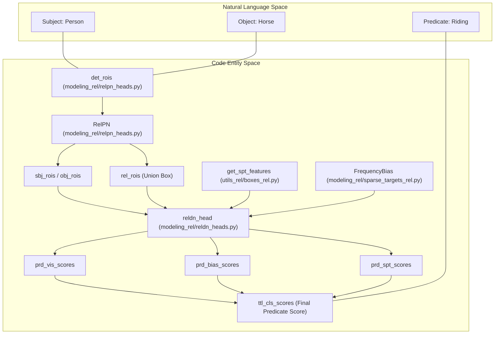
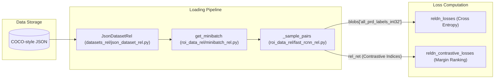

<!-- source: DeepWiki mcp.deepwiki.com · repo NVIDIA/ContrastiveLosses4VRD · page 7 Glossary · fetched 2026-10-26 -->

# Glossary

Relevant source files

The following files were used as context for generating this wiki page:

- [README.md](README.md)
- [lib/core/__init__.py](lib/core/__init__.py)
- [lib/core/config.py](lib/core/config.py)
- [lib/datasets_rel/task_evaluation_sg.py](lib/datasets_rel/task_evaluation_sg.py)
- [lib/datasets_rel/task_evaluation_vg_and_vrd.py](lib/datasets_rel/task_evaluation_vg_and_vrd.py)
- [lib/modeling_rel/model_builder_rel.py](lib/modeling_rel/model_builder_rel.py)
- [lib/modeling_rel/reldn_heads.py](lib/modeling_rel/reldn_heads.py)
- [lib/modeling_rel/relpn_heads.py](lib/modeling_rel/relpn_heads.py)
- [lib/roi_data_rel/fast_rcnn_rel.py](lib/roi_data_rel/fast_rcnn_rel.py)
- [lib/roi_data_rel/minibatch_rel.py](lib/roi_data_rel/minibatch_rel.py)
- [lib/utils_rel/boxes_rel.py](lib/utils_rel/boxes_rel.py)
- [lib/utils_rel/cython_bbox_rel.pyx](lib/utils_rel/cython_bbox_rel.pyx)
- [tools/convert_vrd_anno_to_coco_format.py](tools/convert_vrd_anno_to_coco_format.py)

This glossary defines technical terms, domain-specific concepts, and codebase entities used within the `ContrastiveLosses4VRD` repository. Each term includes pointers to the implementation to assist in navigating the architecture.

## Domain Concepts

### Relationship Detection (RelDet)
The task of identifying pairs of objects and the specific predicate (relationship) that connects them. In this codebase, it is typically evaluated using Recall@K (R@20, R@50, R@100) [lib/datasets_rel/task_evaluation_sg.py:45-47]().

### Phrase Detection (PhrDet)
A variant of relationship evaluation where the subject-predicate-object triplet is treated as a single entity. The bounding box for evaluation is the union of the subject and object boxes [lib/datasets_rel/task_evaluation_vg_and_vrd:118-123]().

### Predicate Frequency Bias
A statistical prior representing the distribution of predicates given a specific subject and object class pair (e.g., "person" and "horse" are likely to have the predicate "ride"). 
*   **Implementation:** `FrequencyBias` class in [lib/modeling_rel/sparse_targets_rel.py]().
*   **Usage:** Integrated into the scoring pipeline via `cfg.MODEL.USE_FREQ_BIAS` [lib/modeling_rel/reldn_heads.py:45-50]().

### Contrastive Losses (Graphical)
Loss functions designed to improve relationship feature learning by contrasting positive subject/object pairs against negative samples.
*   **SPO-Agnostic:** Contrasts general relationship presence [lib/modeling_rel/reldn_heads.py:153-155]().
*   **SO-Aware:** Contrasts specific subject-object class combinations [lib/modeling_rel/reldn_heads.py:168-171]().
*   **P-Aware:** Contrasts specific predicate categories [lib/modeling_rel/reldn_heads.py:183-186]().

---

## Code Entities

### RelDN (Relationship Detection Network)
The primary model architecture that extends a standard R-CNN with a relationship branch. It processes triplets of features (Subject, Predicate/Union, Object) to predict relationship labels.
*   **Class:** `Generalized_RCNN` [lib/modeling_rel/model_builder_rel.py:78]().
*   **Head:** `reldn_head` [lib/modeling_rel/reldn_heads.py:22]().

### RelPN (Relationship Proposal Network)
A module that generates candidate relationship pairs from object detections. It filters pairs based on spatial overlap and proximity.
*   **Implementation:** `single_scale_relpn_outputs` [lib/modeling_rel/relpn_heads.py:26]().
*   **Key Logic:** `forward` pass handles pair generation and overlap filtering [lib/modeling_rel/relpn_heads.py:48-83]().

### Spatial Features (`spt_feat`)
Geometric features derived from the relative positions and sizes of the subject and object bounding boxes.
*   **Function:** `get_spt_features` [lib/utils_rel/boxes_rel.py:65]().
*   **Composition:** Includes box deltas, absolute box coordinates, and union box geometry [lib/utils_rel/boxes_rel.py:66-72]().

### Union ROI
A bounding box that encompasses both the subject and the object. It is used to extract visual features for the predicate branch.
*   **Function:** `rois_union` [lib/utils_rel/boxes_rel.py:100]().

---

## System Architecture Diagrams

### Relationship Feature Flow
The following diagram illustrates how the codebase transforms raw detections into relationship scores, bridging the conceptual "Relationship" to specific code modules.

**Sources:** [lib/modeling_rel/relpn_heads.py:48-132](), [lib/modeling_rel/reldn_heads.py:78-136](), [lib/utils_rel/boxes_rel.py:65-72]()

### Training Data Pipeline
This diagram maps the data loading process from raw annotations to the tensors used in the loss functions.

**Sources:** [lib/roi_data_rel/minibatch_rel.py:31-50](), [lib/roi_data_rel/fast_rcnn_rel.py:62-104](), [lib/modeling_rel/reldn_heads.py:139-162]()

---

## Technical Abbreviations

| Abbreviation | Full Term | Code Pointer |
| :--- | :--- | :--- |
| **SPO** | Subject-Predicate-Object | [lib/modeling_rel/reldn_heads.py:78]() |
| **RelPN** | Relationship Proposal Network | [lib/modeling_rel/relpn_heads.py:22]() |
| **RelDN** | Relationship Detection Network | [lib/modeling_rel/model_builder_rel.py:126]() |
| **FPN** | Feature Pyramid Network | [lib/modeling_rel/model_builder_rel.py:94]() |
| **ROI** | Region of Interest | [lib/roi_data_rel/fast_rcnn_rel.py:46]() |
| **mAP** | Mean Average Precision | [lib/datasets_rel/task_evaluation_sg.py:40]() |
| **IoU** | Intersection over Union | [lib/utils_rel/cython_bbox_rel.pyx:37]() |

**Sources:**
*   `RelDN` and `RelPN` definitions: [lib/modeling_rel/model_builder_rel.py:124-126]()
*   `SPO` usage: [lib/modeling_rel/reldn_heads.py:78]()
*   Evaluation metrics: [lib/datasets_rel/task_evaluation_sg.py:27-43]()
*   BBox utilities: [lib/utils_rel/cython_bbox_rel.pyx:37-77]()