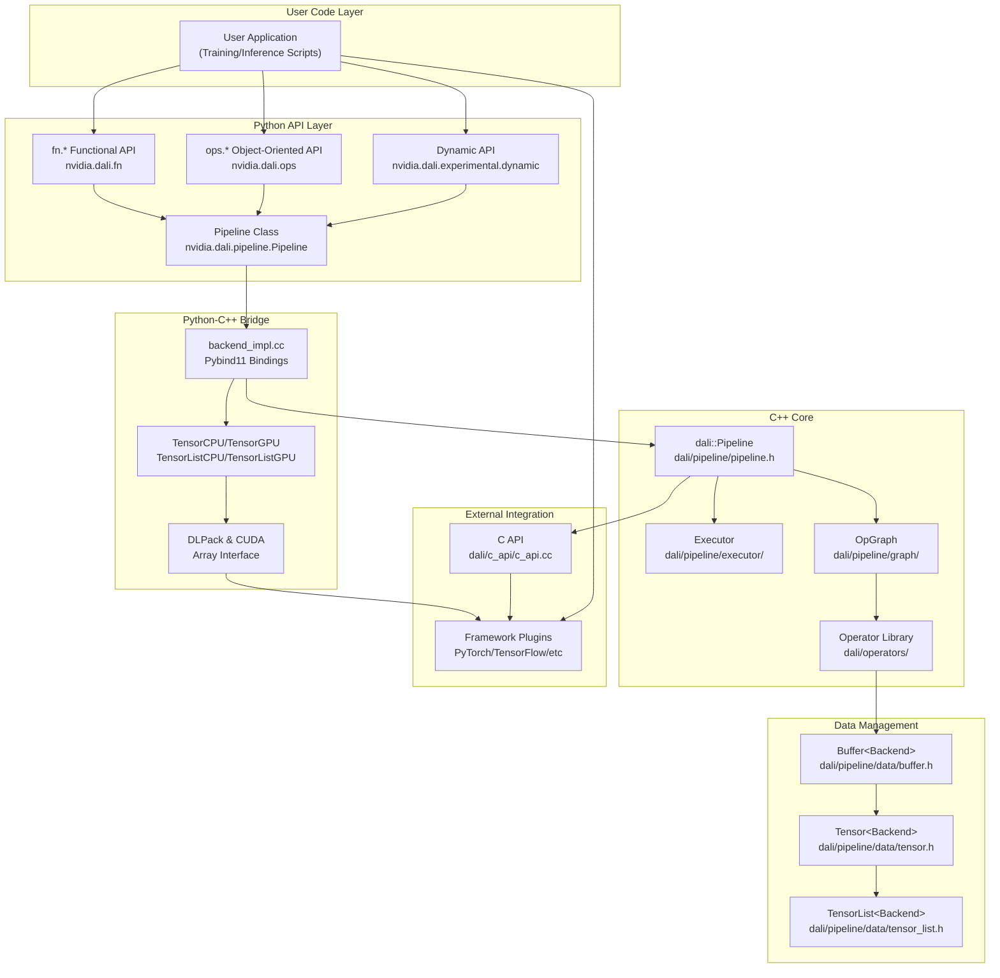
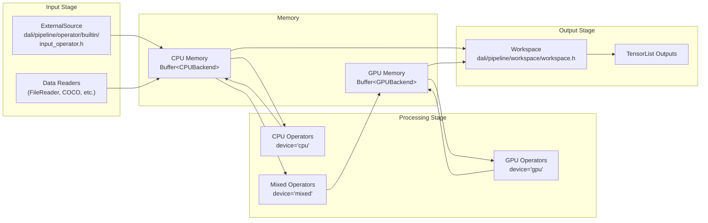
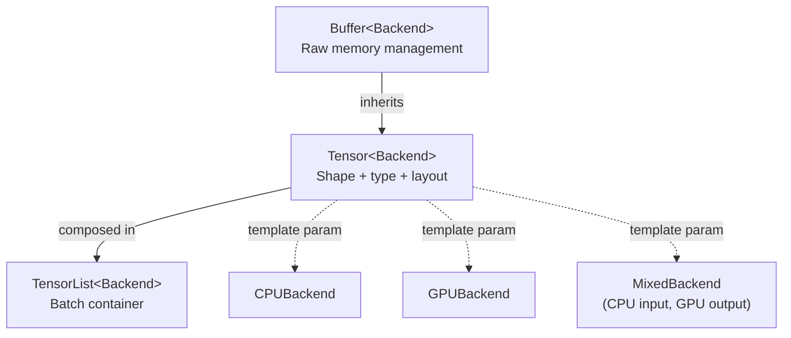
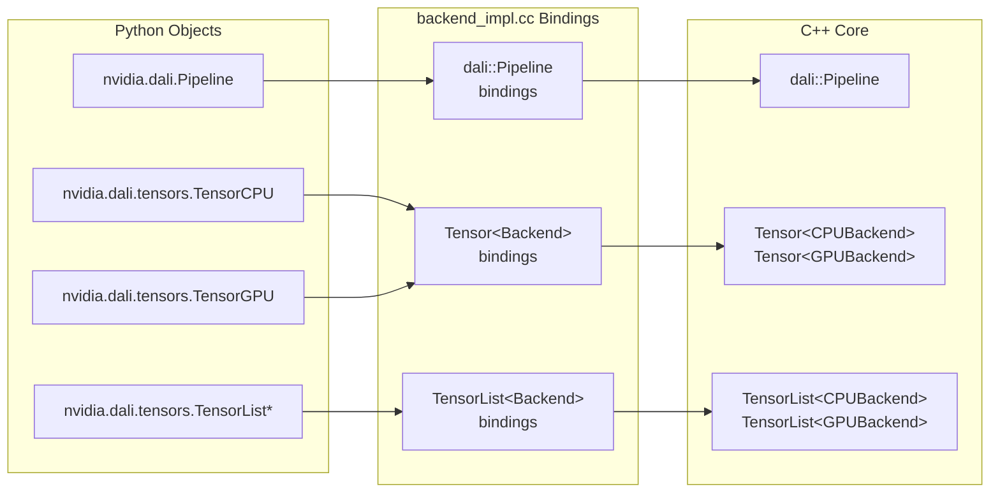
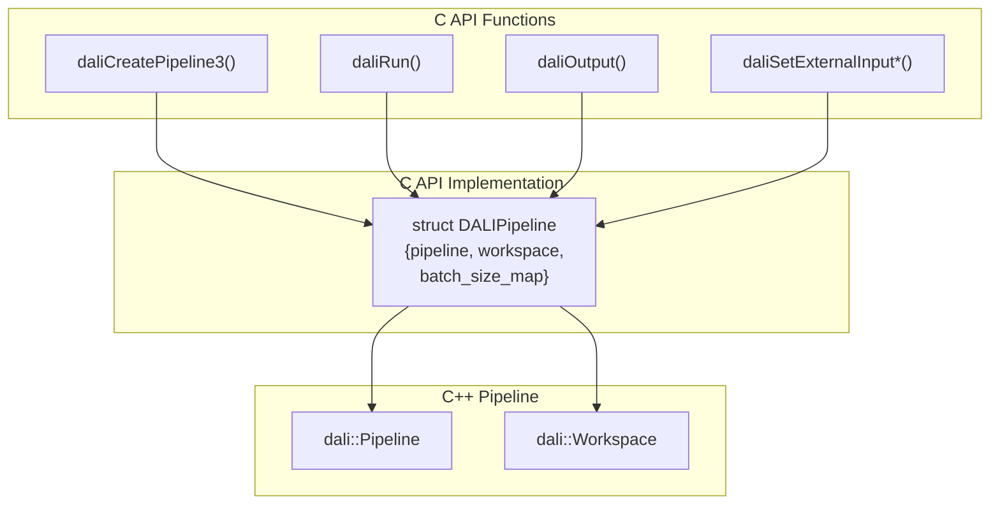
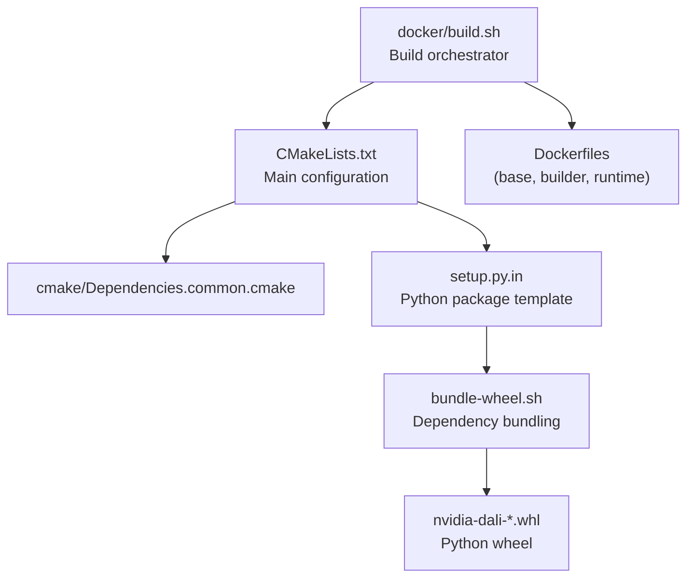

<!-- source: DeepWiki mcp.deepwiki.com · repo NVIDIA/DALI · page 1 Overview · fetched 2026-10-26 -->

# Overview

<details>
<summary>Relevant source files</summary>

The following files were used as context for generating this wiki page:

- [.gitignore](.gitignore)
- [README.rst](README.rst)
- [dali/c_api/c_api.cc](dali/c_api/c_api.cc)
- [dali/c_api/c_api_test.cc](dali/c_api/c_api_test.cc)
- [dali/pipeline/pipeline.cc](dali/pipeline/pipeline.cc)
- [dali/pipeline/pipeline.h](dali/pipeline/pipeline.h)
- [dali/pipeline/pipeline_test.cc](dali/pipeline/pipeline_test.cc)
- [dali/python/backend_impl.cc](dali/python/backend_impl.cc)
- [dali/python/nvidia/dali/_typing.py](dali/python/nvidia/dali/_typing.py)
- [dali/python/nvidia/dali/experimental/dynamic/__init__.py](dali/python/nvidia/dali/experimental/dynamic/__init__.py)
- [dali/python/nvidia/dali/experimental/dynamic/_ops.py](dali/python/nvidia/dali/experimental/dynamic/_ops.py)
- [dali/python/nvidia/dali/experimental/dynamic/random.py](dali/python/nvidia/dali/experimental/dynamic/random.py)
- [dali/python/nvidia/dali/fn/__init__.py](dali/python/nvidia/dali/fn/__init__.py)
- [dali/python/nvidia/dali/ops/__init__.py](dali/python/nvidia/dali/ops/__init__.py)
- [dali/python/nvidia/dali/ops/_docs.py](dali/python/nvidia/dali/ops/_docs.py)
- [dali/python/nvidia/dali/ops/_names.py](dali/python/nvidia/dali/ops/_names.py)
- [dali/python/nvidia/dali/ops/_signatures.py](dali/python/nvidia/dali/ops/_signatures.py)
- [dali/python/nvidia/dali/pipeline.py](dali/python/nvidia/dali/pipeline.py)
- [dali/python/nvidia/dali/types.py](dali/python/nvidia/dali/types.py)
- [dali/test/python/experimental_mode/test_arg_conversion.py](dali/test/python/experimental_mode/test_arg_conversion.py)
- [dali/test/python/experimental_mode/test_docs.py](dali/test/python/experimental_mode/test_docs.py)
- [dali/test/python/experimental_mode/test_public_api.py](dali/test/python/experimental_mode/test_public_api.py)
- [dali/test/python/experimental_mode/test_random.py](dali/test/python/experimental_mode/test_random.py)
- [dali/test/python/operator_1/test_operator_exception.py](dali/test/python/operator_1/test_operator_exception.py)
- [dali/test/python/test_functional_api.py](dali/test/python/test_functional_api.py)
- [dali/test/python/test_pipeline.py](dali/test/python/test_pipeline.py)
- [docs/autodoc_submodules.py](docs/autodoc_submodules.py)
- [docs/conf.py](docs/conf.py)
- [docs/dali_dynamic/api_reference.rst](docs/dali_dynamic/api_reference.rst)
- [docs/dali_dynamic/index.rst](docs/dali_dynamic/index.rst)
- [docs/dali_dynamic/ops_reference.rst](docs/dali_dynamic/ops_reference.rst)
- [docs/index.rst](docs/index.rst)
- [docs/operations_table.py](docs/operations_table.py)
- [docs/supported_ops.rst](docs/supported_ops.rst)
- [include/dali/c_api.h](include/dali/c_api.h)
- [internal_tools/python_stub_generator.py](internal_tools/python_stub_generator.py)

</details>


This document provides a high-level introduction to NVIDIA DALI (Data Loading Library), its architecture, and core components. It is intended as an entry point for understanding the system's design and organization.

For detailed information about specific subsystems:
- Pipeline execution model and graph building: see [Core Architecture](#2)
- Data structures and memory management: see [Data Structures](#2.2)
- Operator implementation: see [Operator System](#2.3)
- Python API usage: see [Python API](#3)
- Framework-specific integration: see [Framework Integration](#4)

## Purpose and Scope

NVIDIA DALI is a GPU-accelerated library for data loading and preprocessing in deep learning workflows. It addresses the CPU bottleneck that occurs when data preprocessing cannot keep pace with GPU computation, limiting overall training and inference performance.

DALI provides:
- A collection of ~300+ optimized operators for image, video, and audio processing
- A pipeline execution engine that overlaps data loading, preprocessing, and computation
- Memory-efficient data structures with CPU/GPU transfer capabilities
- Integration with PyTorch, TensorFlow, PaddlePaddle, and MXNet
- Multiple API styles (functional, object-oriented, imperative)

Sources: [README.rst:1-110](), [dali/pipeline/pipeline.h:46-61]()

## What is DALI?

DALI is implemented as a C++ core library with Python bindings, exposing a pipeline-based processing model. Users define data processing graphs composed of operators, which DALI compiles and executes efficiently using prefetching, parallel execution, and GPU acceleration.

### Key Design Principles

| Principle | Implementation |
|-----------|---------------|
| **GPU Acceleration** | Operators execute on GPU where possible; automatic CPU→GPU transfers |
| **Pipeline Execution** | Overlapped execution across CPU/GPU stages with configurable prefetch depth |
| **Zero-Copy** | Memory sharing via DLPack, CUDA Array Interface, and framework-specific protocols |
| **Portability** | Same pipeline code runs across PyTorch, TensorFlow, PaddlePaddle |
| **Flexibility** | Multiple APIs (fn, ops, dynamic), custom operators via Python |

Sources: [README.rst:6-31](), [dali/pipeline/pipeline.h:46-61]()

## System Architecture

### Layered Architecture



**Figure 1: DALI System Layers**

This architecture separates user-facing Python APIs from the execution engine. The `Pipeline` class orchestrates graph construction and execution, while `Executor` handles the actual operator scheduling and data movement.

Sources: [dali/python/backend_impl.cc:1-50](), [dali/python/nvidia/dali/pipeline.py:97-261](), [dali/pipeline/pipeline.h:15-62]()

### Core Data Flow



**Figure 2: Data Flow Through Pipeline Stages**

Data flows from input operators through CPU, mixed (CPU input→GPU output), and GPU operators. The `Workspace` manages intermediate and output buffers.

Sources: [dali/pipeline/workspace/workspace.h](), [dali/pipeline/operator/builtin/input_operator.h:1-50]()

## Core Components

### Pipeline Class

The `Pipeline` class is the central orchestrator for defining and executing data processing graphs.

**Python Interface**: `nvidia.dali.pipeline.Pipeline` [dali/python/nvidia/dali/pipeline.py:97-261]()

**C++ Implementation**: `dali::Pipeline` [dali/pipeline/pipeline.h:62-110](), [dali/pipeline/pipeline.cc:124-308]()

Key responsibilities:
- Graph construction via `AddOperator()` and `AddExternalInput()`
- Validation and optimization during `Build()`
- Execution control via `Run()`, `Outputs()`, `Prefetch()`
- Serialization for deployment

**Construction Parameters** (subset):

| Parameter | Type | Purpose |
|-----------|------|---------|
| `batch_size` | int | Maximum batch size |
| `num_threads` | int | CPU worker thread count |
| `device_id` | int | GPU device ID |
| `seed` | int | Random number generator seed |
| `exec_pipelined` | bool | Enable pipeline parallelism |
| `exec_async` | bool | Enable async execution |
| `exec_dynamic` | bool | Enable dynamic executor (GPU→CPU transfers) |
| `prefetch_queue_depth` | int/dict | Prefetch queue size(s) |

Sources: [dali/python/nvidia/dali/pipeline.py:101-261](), [dali/pipeline/pipeline.h:87-110]()

### Executor

The `Executor` manages operator execution, memory allocation, and prefetching. DALI supports multiple executor types:

| Executor Type | Description | Use Case |
|---------------|-------------|----------|
| **Simple** | Sequential, synchronous | Debugging |
| **Pipelined** | Overlapped CPU/GPU stages | Standard training |
| **Async** | Asynchronous execution | Background prefetching |
| **Dynamic** | Dynamic memory, GPU→CPU copies | Complex graphs |
| **Separated** | Independent CPU/GPU queues | Fine-grained control |

The executor is selected via `ExecutorType` flags [dali/pipeline/executor/executor.h]().

Sources: [dali/pipeline/pipeline.cc:382-396](), [dali/pipeline/executor/executor_factory.h]()

### Data Structures

DALI's data structures form a hierarchy:



**Figure 3: Data Structure Hierarchy**

- `Buffer<Backend>`: Memory allocation/deallocation, pinned/device memory [dali/pipeline/data/buffer.h]()
- `Tensor<Backend>`: Single sample with shape, type, layout [dali/pipeline/data/tensor.h]()
- `TensorList<Backend>`: Batch of tensors, contiguous or non-contiguous [dali/pipeline/data/tensor_list.h]()

Sources: [dali/pipeline/data/buffer.h](), [dali/pipeline/data/tensor.h](), [dali/pipeline/data/tensor_list.h]()

### Operator System

Operators are the computational building blocks. Each operator:
1. Has an `OpSchema` defining arguments, inputs, outputs [dali/pipeline/operator/op_schema.h]()
2. Implements `Setup()` for shape inference and `Run()` for computation
3. Declares device placement: CPU, GPU, or Mixed
4. Registers via `DALI_REGISTER_OPERATOR` macro

**Registry**: [dali/pipeline/operator/op_schema.cc](), Python wrapper [dali/python/nvidia/dali/ops/_registry.py]()

Sources: [dali/pipeline/operator/operator.h](), [dali/pipeline/operator/op_schema.h]()

## API Styles

DALI provides three complementary APIs:

### Functional API (`fn.*`)

```python
import nvidia.dali.fn as fn

@pipeline_def
def my_pipeline():
    images, labels = fn.readers.file(file_root=image_dir)
    images = fn.decoders.image(images, device="mixed")
    images = fn.resize(images, size=(224, 224))
    return images, labels
```

Operations are functions returning `DataNode` objects representing graph nodes. Used inside `@pipeline_def` decorator or within `Pipeline.define_graph()`.

**Implementation**: [dali/python/nvidia/dali/fn/__init__.py]()

### Object-Oriented API (`ops.*`)

```python
from nvidia.dali import ops, Pipeline

class MyPipeline(Pipeline):
    def __init__(self, **kwargs):
        super().__init__(**kwargs)
        self.reader = ops.readers.File(file_root=image_dir)
        self.decoder = ops.decoders.Image(device="mixed")
        self.resize = ops.Resize(size=(224, 224))
    
    def define_graph(self):
        images, labels = self.reader()
        images = self.decoder(images)
        images = self.resize(images)
        return images, labels
```

Operators are instantiated as objects, then called to produce `DataNode` outputs. Allows operator reuse and stateful operators.

**Implementation**: [dali/python/nvidia/dali/ops/__init__.py:58-500]()

### Dynamic API (`experimental.dynamic.*`)

```python
from nvidia.dali.experimental import dynamic as ndd

def process_batch(batch):
    # Imperative, eager-like execution
    decoded = ndd.imread(batch)
    resized = ndd.resize(decoded, size=(224, 224))
    return resized
```

Imperative API for eager-like execution. Operates on `Tensor` and `Batch` objects with immediate results.

**Implementation**: [dali/python/nvidia/dali/experimental/dynamic/__init__.py]()

Sources: [dali/python/nvidia/dali/fn/__init__.py](), [dali/python/nvidia/dali/ops/__init__.py:1-50](), [dali/python/nvidia/dali/experimental/dynamic/__init__.py]()

## Python-C++ Bridge

The bridge uses Pybind11 to expose C++ classes and functions to Python:



**Figure 4: Python-C++ Bridge via Pybind11**

Key binding entry points:
- `PYBIND11_MODULE(backend_impl, m)` [dali/python/backend_impl.cc:2418-2500]()
- `ExposePipeline()` [dali/python/backend_impl.cc:2100-2200]()
- `ExposeTensor()` [dali/python/backend_impl.cc:624-896]()
- `ExposeTensorList()` [dali/python/backend_impl.cc:998-1200]()

Sources: [dali/python/backend_impl.cc:1-100](), [dali/python/backend_impl.cc:624-896]()

## Framework Integration

DALI integrates with deep learning frameworks through iterators and dataset wrappers:

### Integration Patterns

| Framework | Integration Class | Location |
|-----------|------------------|----------|
| **PyTorch** | `DALIGenericIterator` | `nvidia.dali.plugin.pytorch` |
| **TensorFlow** | `DALIDataset` | `nvidia.dali.plugin.tensorflow` |
| **PaddlePaddle** | `DALIGenericIterator` | `nvidia.dali.plugin.paddle` |
| **MXNet** | `DALIGenericIterator` | `nvidia.dali.plugin.mxnet` |

### Common Iterator Pattern

```python
from nvidia.dali.plugin.pytorch import DALIGenericIterator

train_loader = DALIGenericIterator(
    [pipeline],  # DALI pipeline(s)
    ['data', 'label'],  # Output names
    reader_name='Reader',  # For epoch size
    auto_reset=True  # Auto-restart after epoch
)

for batch in train_loader:
    data = batch[0]['data']  # PyTorch tensor
    labels = batch[0]['label']
    # ... training loop
```

**Base Class**: `_DaliBaseIterator` handles batching, sharding, and epoch management.

**Zero-Copy Transfer**: Uses DLPack (`__dlpack__` protocol) and CUDA Array Interface for efficient data sharing.

Sources: [dali/python/nvidia/dali/plugin/pytorch/__init__.py](), [dali/python/nvidia/dali/plugin/base_iterator.py]()

## C API

DALI provides a C API for language-agnostic integration:



**Figure 5: C API Structure**

Key functions:
- `daliCreatePipeline3()`: Deserialize and build pipeline [dali/c_api/c_api.cc:273-294]()
- `daliSetExternalInput*()`: Feed external data [dali/c_api/c_api.cc:119-210]()
- `daliRun()`, `daliOutput()`: Execute and retrieve results [dali/c_api/c_api.cc:319-350]()

Header: [include/dali/c_api.h]()

Sources: [dali/c_api/c_api.cc:1-100](), [include/dali/c_api.h:1-50]()

## Build System

DALI uses CMake with Docker-based reproducible builds:



**Figure 6: Build System Overview**

Key entry points:
- `CMakeLists.txt`: Main build configuration
- `docker/build.sh`: Orchestrates Docker builds
- `setup.py.in`: Python package template
- `qa/*.sh`: Test orchestration

Sources: [CMakeLists.txt](), [docker/build.sh](), [qa/TL0_python-self-test/test.sh]()

## Getting Started

A minimal DALI pipeline:

```python
from nvidia.dali import pipeline_def
import nvidia.dali.fn as fn
import nvidia.dali.types as types

@pipeline_def(batch_size=16, num_threads=4, device_id=0)
def simple_pipeline():
    images, labels = fn.readers.file(file_root="/data/images")
    images = fn.decoders.image(images, device="mixed", output_type=types.RGB)
    images = fn.resize(images, size=(224, 224))
    images = fn.crop_mirror_normalize(
        images,
        dtype=types.FLOAT,
        mean=[0.485 * 255, 0.456 * 255, 0.406 * 255],
        std=[0.229 * 255, 0.224 * 255, 0.225 * 255]
    )
    return images, labels

# Build and run
pipe = simple_pipeline()
pipe.build()
outputs = pipe.run()
images, labels = outputs
```

Key steps:
1. Define pipeline with `@pipeline_def` or by subclassing `Pipeline`
2. Chain operators using `fn.*` functions or `ops.*` objects
3. Call `build()` to construct the execution graph
4. Call `run()` to execute one iteration
5. Retrieve outputs as `TensorList` objects

Sources: [README.rst:35-92](), [dali/python/nvidia/dali/pipeline.py:713-810]()

## Documentation and Resources

- **Installation**: [docs/installation.rst]()
- **Examples**: [docs/examples/]()
- **API Reference**: Generated from operator schemas and docstrings
- **Release Notes**: https://docs.nvidia.com/deeplearning/dali/release-notes/
- **GitHub**: https://github.com/NVIDIA/DALI

Sources: [README.rst:136-208](), [docs/index.rst:1-81]()

---

