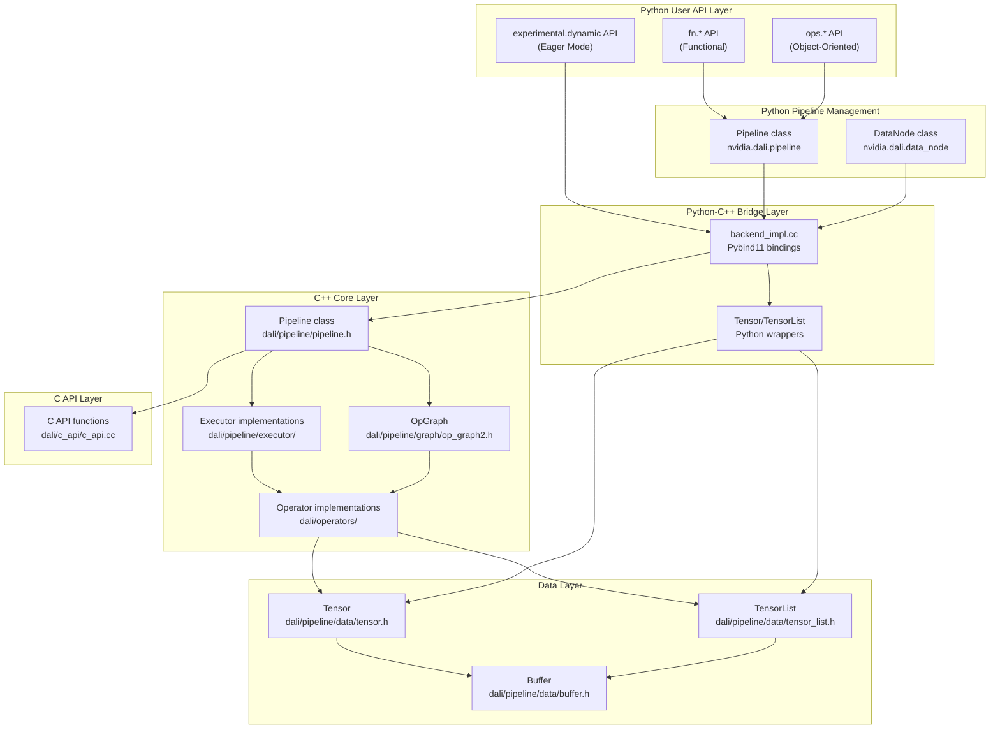
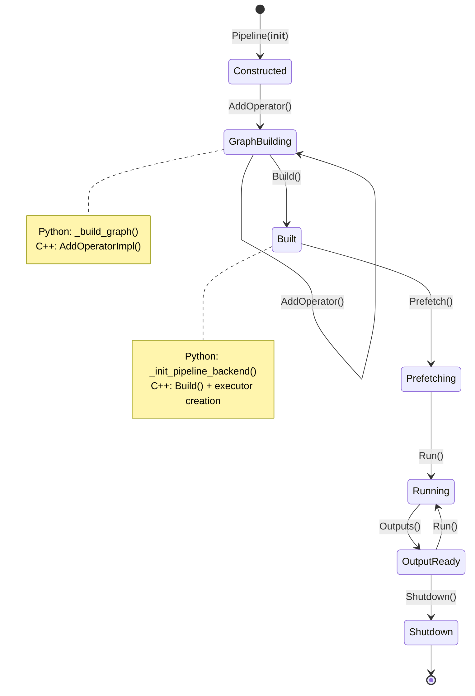
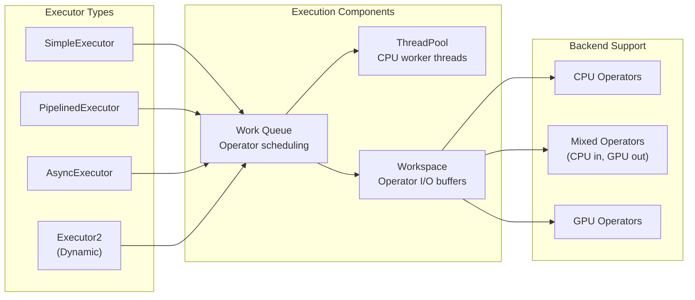
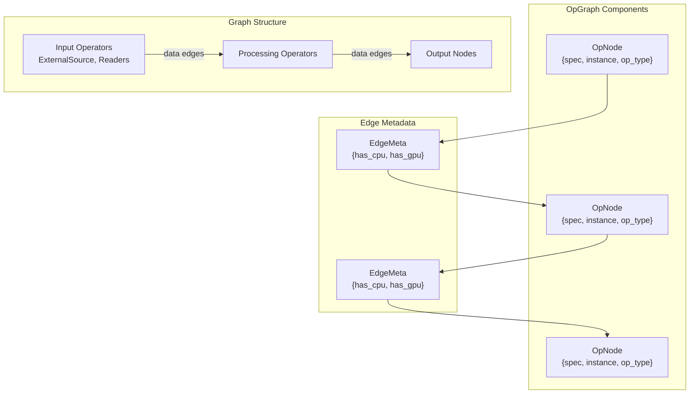
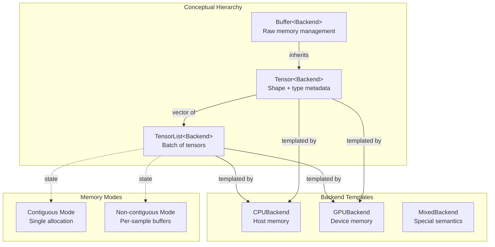
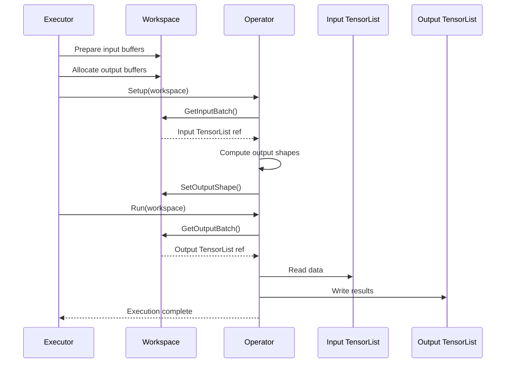
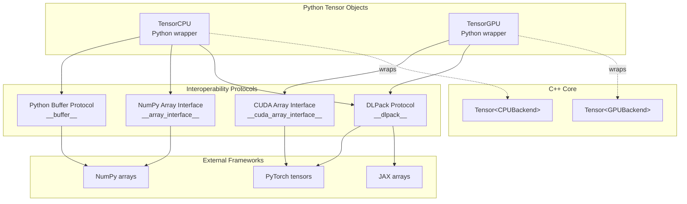
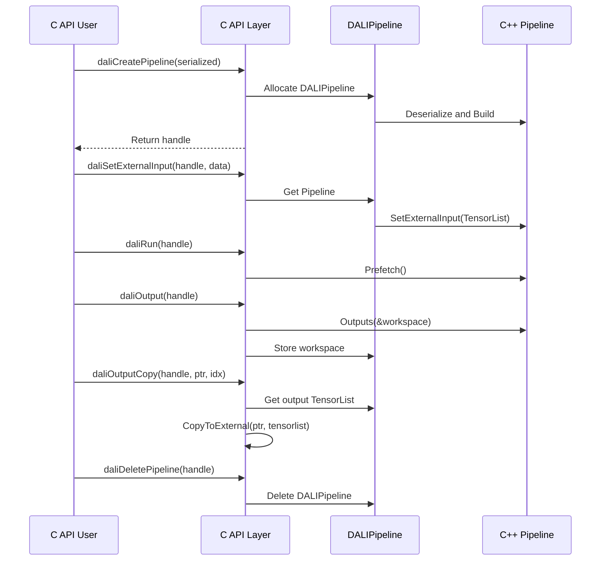

<!-- source: DeepWiki mcp.deepwiki.com · repo NVIDIA/DALI · page 2 Core Architecture · fetched 2026-10-26 -->

# Core Architecture

Relevant source files

The following files were used as context for generating this wiki page:

- [.gitignore](.gitignore)
- [README.rst](README.rst)
- [dali/c_api/c_api.cc](dali/c_api/c_api.cc)
- [dali/c_api/c_api_test.cc](dali/c_api/c_api_test.cc)
- [dali/pipeline/pipeline.cc](dali/pipeline/pipeline.cc)
- [dali/pipeline/pipeline.h](dali/pipeline/pipeline.h)
- [dali/pipeline/pipeline_test.cc](dali/pipeline/pipeline_test.cc)
- [dali/python/backend_impl.cc](dali/python/backend_impl.cc)
- [dali/python/nvidia/dali/_typing.py](dali/python/nvidia/dali/_typing.py)
- [dali/python/nvidia/dali/experimental/dynamic/__init__.py](dali/python/nvidia/dali/experimental/dynamic/__init__.py)
- [dali/python/nvidia/dali/experimental/dynamic/_ops.py](dali/python/nvidia/dali/experimental/dynamic/_ops.py)
- [dali/python/nvidia/dali/experimental/dynamic/random.py](dali/python/nvidia/dali/experimental/dynamic/random.py)
- [dali/python/nvidia/dali/fn/__init__.py](dali/python/nvidia/dali/fn/__init__.py)
- [dali/python/nvidia/dali/ops/__init__.py](dali/python/nvidia/dali/ops/__init__.py)
- [dali/python/nvidia/dali/ops/_docs.py](dali/python/nvidia/dali/ops/_docs.py)
- [dali/python/nvidia/dali/ops/_names.py](dali/python/nvidia/dali/ops/_names.py)
- [dali/python/nvidia/dali/ops/_signatures.py](dali/python/nvidia/dali/ops/_signatures.py)
- [dali/python/nvidia/dali/pipeline.py](dali/python/nvidia/dali/pipeline.py)
- [dali/python/nvidia/dali/types.py](dali/python/nvidia/dali/types.py)
- [dali/test/python/experimental_mode/test_arg_conversion.py](dali/test/python/experimental_mode/test_arg_conversion.py)
- [dali/test/python/experimental_mode/test_docs.py](dali/test/python/experimental_mode/test_docs.py)
- [dali/test/python/experimental_mode/test_public_api.py](dali/test/python/experimental_mode/test_public_api.py)
- [dali/test/python/experimental_mode/test_random.py](dali/test/python/experimental_mode/test_random.py)
- [dali/test/python/operator_1/test_operator_exception.py](dali/test/python/operator_1/test_operator_exception.py)
- [dali/test/python/test_functional_api.py](dali/test/python/test_functional_api.py)
- [dali/test/python/test_pipeline.py](dali/test/python/test_pipeline.py)
- [docs/autodoc_submodules.py](docs/autodoc_submodules.py)
- [docs/conf.py](docs/conf.py)
- [docs/dali_dynamic/api_reference.rst](docs/dali_dynamic/api_reference.rst)
- [docs/dali_dynamic/index.rst](docs/dali_dynamic/index.rst)
- [docs/dali_dynamic/ops_reference.rst](docs/dali_dynamic/ops_reference.rst)
- [docs/index.rst](docs/index.rst)
- [docs/operations_table.py](docs/operations_table.py)
- [docs/supported_ops.rst](docs/supported_ops.rst)
- [include/dali/c_api.h](include/dali/c_api.h)
- [internal_tools/python_stub_generator.py](internal_tools/python_stub_generator.py)

## Purpose and Scope

This document describes the fundamental architecture of NVIDIA DALI, explaining how its core components work together to provide GPU-accelerated data loading and preprocessing. It covers the layered architecture, the pipeline execution model, and the interaction between Python and C++ components.

For detailed information about specific subsystems:
- Pipeline construction and execution patterns: see [Pipeline System](#2.1)
- Memory management and tensor representations: see [Data Structures](#2.2)  
- Operator lifecycle and scheduling: see [Operator System](#2.3)

---

## Architectural Layers

DALI is structured as a multi-layered system that bridges high-level Python APIs down to optimized C++ execution on CPU and GPU backends.

### Layer Diagram

**Sources:** [dali/python/backend_impl.cc:1-100](), [dali/pipeline/pipeline.h:1-70](), [dali/python/nvidia/dali/pipeline.py:1-100]()

---

## Core Components

### Pipeline Management

The `Pipeline` class exists at both Python and C++ levels, serving as the primary interface for constructing and executing data processing graphs.

**Python Pipeline** ([dali/python/nvidia/dali/pipeline.py:97-262]())
- User-facing class for defining data processing pipelines
- Manages operator specifications and graph construction
- Handles Python worker pools for parallel external sources
- Parameters: `batch_size`, `num_threads`, `device_id`, `exec_pipelined`, `exec_async`, `exec_dynamic`

**C++ Pipeline** ([dali/pipeline/pipeline.h:62-110]())
- Core pipeline implementation managing graph building and execution
- Owns the `Executor` and `OpGraph` instances
- Handles operator registration and dependency resolution
- Performs graph optimizations (CSE, implicit copy insertion)

#### Pipeline Lifecycle

**Sources:** [dali/pipeline/pipeline.cc:124-162](), [dali/python/nvidia/dali/pipeline.py:712-880]()

### Execution Engine

DALI supports multiple execution modes through different `Executor` implementations, selected via `ExecutorType` flags.

**Executor Types** ([dali/pipeline/executor/executor_factory.cc]())

| Type | Flags | Description |
|------|-------|-------------|
| Simple | None | Synchronous, single-threaded execution |
| Pipelined | `PIPELINED` | Overlaps CPU/GPU work across iterations |
| Async | `ASYNC \| PIPELINED` | Asynchronous with prefetching |
| Dynamic | `ASYNC \| PIPELINED \| DYNAMIC` | Dynamic memory allocation, GPU→CPU transfers |

**Key Executor Responsibilities:**
- Schedule operator execution based on graph dependencies
- Manage prefetch queues (configurable via `prefetch_queue_depth`)
- Coordinate CPU/GPU work synchronization
- Handle operator workspace allocation

**Sources:** [dali/pipeline/executor/executor.h](), [dali/pipeline/pipeline.cc:382-396]()

### Operator Graph

The `OpGraph` ([dali/pipeline/graph/op_graph2.h]()) represents the data processing graph as a directed acyclic graph (DAG) of operators and data edges.

**Graph Building Process:**

1. **Operator Addition** ([dali/pipeline/pipeline.cc:316-357]())
   - Validate operator specifications
   - Record input/output edge names and devices
   - Track data dependencies

2. **Graph Construction** ([dali/pipeline/pipeline.cc:504-600]())
   - Build DAG from operator specifications
   - Resolve data node storage devices (CPU/GPU)
   - Insert implicit `MakeContiguous` operators for data transfers

3. **Graph Optimization** ([dali/pipeline/pipeline.cc:100-120]())
   - Common Subexpression Elimination (CSE) if enabled
   - Prune unused operators
   - Optimize memory allocation patterns

**Sources:** [dali/pipeline/pipeline.h:400-480](), [dali/pipeline/graph/op_graph2.h]()

---

## Data Flow Architecture

Data flows through DALI as batches of tensors, managed by the `Buffer`-`Tensor`-`TensorList` hierarchy.

### Data Structure Hierarchy

**Key Classes:**
- `Buffer<Backend>`: Manages raw memory allocation and lifetime ([dali/pipeline/data/buffer.h]())
- `Tensor<Backend>`: Adds shape, type, and layout metadata ([dali/pipeline/data/tensor.h]())
- `TensorList<Backend>`: Container for batches with uniform or non-uniform shapes ([dali/pipeline/data/tensor_list.h]())

**Sources:** [dali/pipeline/data/buffer.h](), [dali/pipeline/data/tensor.h](), [dali/pipeline/data/tensor_list.h]()

### Operator Execution Data Flow

**Sources:** [dali/pipeline/executor/executor.cc](), [dali/pipeline/workspace/workspace.h]()

---

## Python-C++ Bridge

The Python-C++ bridge is implemented using pybind11 in `backend_impl.cc`, exposing C++ classes and functions to Python.

### Key Binding Categories

**Pipeline Bindings** ([dali/python/backend_impl.cc:2400-2600]())
- `Pipeline` class constructor and methods
- Graph building: `AddOperator`, `Build`
- Execution: `Run`, `Outputs`, `Prefetch`
- Serialization: `Serialize`, `Deserialize`

**Tensor Bindings** ([dali/python/backend_impl.cc:624-1100]())
- `TensorCPU` and `TensorGPU` classes
- Buffer protocol for NumPy interop
- DLPack export (`__dlpack__`, `__dlpack_device__`)
- CUDA Array Interface (`__cuda_array_interface__`)

**TensorList Bindings** ([dali/python/backend_impl.cc:1100-1600]())
- Batch-level tensor operations
- Shape queries and manipulation
- Data access methods (`at`, `as_array`, `as_cpu`, `as_gpu`)

### Data Exchange Protocols

**Sources:** [dali/python/backend_impl.cc:129-158](), [dali/python/backend_impl.cc:624-700]()

---

## C API Layer

DALI provides a C API for language-agnostic integration, primarily used by the TensorFlow plugin.

**Key Functions** ([include/dali/c_api.h](), [dali/c_api/c_api.cc]())

| Function | Purpose |
|----------|---------|
| `daliCreatePipeline` | Deserialize and build pipeline |
| `daliSetExternalInput` | Feed data to external source operators |
| `daliRun` | Execute one pipeline iteration |
| `daliOutput` | Stage outputs for retrieval |
| `daliOutputCopy` | Copy output data to external buffer |
| `daliGetNumOutput` | Query number of pipeline outputs |

### C API Data Flow

**Sources:** [dali/c_api/c_api.cc:232-300](), [include/dali/c_api.h:120-180]()

---

## Execution Flow Summary

The complete execution flow through DALI's core architecture:

1. **Graph Definition** (Python)
   - User calls `fn.*` or `ops.*` APIs
   - Creates `DataNode` instances representing symbolic tensors
   - Constructs `OpSpec` objects with operator parameters

2. **Pipeline Building** (Python → C++)
   - Python `Pipeline.build()` calls C++ `Pipeline::Build()`
   - Graph optimization (CSE, pruning)
   - Executor instantiation based on configuration
   - Operator instantiation and workspace setup

3. **Execution Loop** (C++)
   - `Pipeline::Run()` → `Executor::Run()`
   - Fill input queues (external sources, readers)
   - Schedule operators based on dependencies
   - Execute in parallel where possible (CPU thread pool, GPU streams)
   - Fill output workspace

4. **Output Retrieval** (C++ → Python)
   - `Pipeline::Outputs()` returns `Workspace`
   - Convert to Python `TensorList` objects via pybind11
   - Zero-copy where possible through DLPack/array interface

**Sources:** [dali/pipeline/pipeline.cc:700-850](), [dali/python/nvidia/dali/pipeline.py:1200-1400]()

---

## Configuration and Tuning

Pipeline behavior is controlled through `PipelineParams` ([dali/pipeline/pipeline_params.h]())

**Key Parameters:**

| Parameter | Type | Default | Description |
|-----------|------|---------|-------------|
| `max_batch_size` | `int` | Required | Maximum batch size |
| `num_threads` | `int` | Required | CPU worker threads |
| `device_id` | `int` | Current GPU | GPU device to use |
| `seed` | `int64_t` | Random | RNG seed |
| `executor_type` | `ExecutorType` | `Dynamic` | Execution model |
| `prefetch_queue_depths` | `QueueSizes` | `{2, 2}` | CPU/GPU queue depths |
| `enable_checkpointing` | `bool` | `false` | Enable state checkpointing |

**Sources:** [dali/pipeline/pipeline_params.h](), [dali/pipeline/pipeline.cc:243-252]()

---

