<!-- source: DeepWiki mcp.deepwiki.com · repo NVIDIA/DALI · page 2.1 Pipeline System · fetched 2026-10-26 -->

# Pipeline System

<details>
<summary>Relevant source files</summary>

The following files were used as context for generating this wiki page:

- [dali/c_api/c_api.cc](dali/c_api/c_api.cc)
- [dali/c_api/c_api_test.cc](dali/c_api/c_api_test.cc)
- [dali/pipeline/pipeline.cc](dali/pipeline/pipeline.cc)
- [dali/pipeline/pipeline.h](dali/pipeline/pipeline.h)
- [dali/pipeline/pipeline_test.cc](dali/pipeline/pipeline_test.cc)
- [dali/python/backend_impl.cc](dali/python/backend_impl.cc)
- [dali/python/nvidia/dali/pipeline.py](dali/python/nvidia/dali/pipeline.py)
- [dali/python/nvidia/dali/types.py](dali/python/nvidia/dali/types.py)
- [dali/test/python/test_functional_api.py](dali/test/python/test_functional_api.py)
- [dali/test/python/test_pipeline.py](dali/test/python/test_pipeline.py)
- [docs/supported_ops.rst](docs/supported_ops.rst)
- [include/dali/c_api.h](include/dali/c_api.h)

</details>


## Purpose and Scope

The Pipeline System is the central orchestration mechanism in DALI that manages the construction, validation, and execution of data processing graphs. It provides both Python and C++ APIs for defining directed acyclic graphs (DAGs) of operators, managing their execution order, and coordinating data flow between CPU and GPU stages.

This document covers the `Pipeline` class architecture, graph building mechanisms, execution models, and lifecycle management. For information about individual operators, see [Operator System](#2.3). For data structures used by pipelines, see [Data Structures](#2.2). For framework-specific integration patterns, see [Framework Integration](#4).

---

## Architecture Overview

The Pipeline System consists of two primary layers connected through pybind11 bindings:

### Python Layer

**Python Pipeline Class** ([dali/python/nvidia/dali/pipeline.py:97-1568]()):
- Main user-facing interface for pipeline construction
- Manages pipeline parameters and configuration
- Handles Python worker pools for parallel external sources
- Provides serialization and deserialization support
- Implements checkpointing functionality

**Key Responsibilities:**
- Operator registration and graph specification
- Python-side validation and error reporting
- External source callback management
- Output specification and validation

### C++ Backend Layer

**C++ Pipeline Class** ([dali/pipeline/pipeline.h:62-582](), [dali/pipeline/pipeline.cc:124-849]()):
- Core pipeline implementation and graph management
- Operator instantiation and lifecycle control
- Graph optimization and validation
- Executor creation and management
- Memory management coordination

**Python-C++ Bridge** ([dali/python/backend_impl.cc:1-1679]()):
- Pybind11 bindings exposing C++ pipeline to Python
- Type conversions between Python and C++ data structures
- Error propagation from C++ exceptions to Python

### Component Architecture

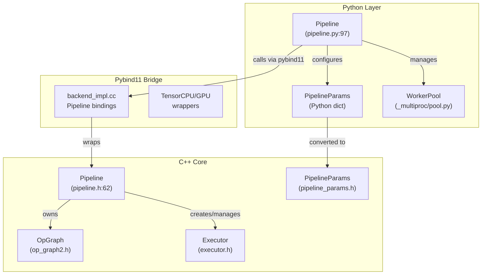

Sources: [dali/python/nvidia/dali/pipeline.py:97-1568](), [dali/pipeline/pipeline.h:62-582](), [dali/python/backend_impl.cc:1-1679]()

---

## Pipeline Lifecycle

The pipeline progresses through distinct phases from construction to execution:

### Lifecycle State Machine

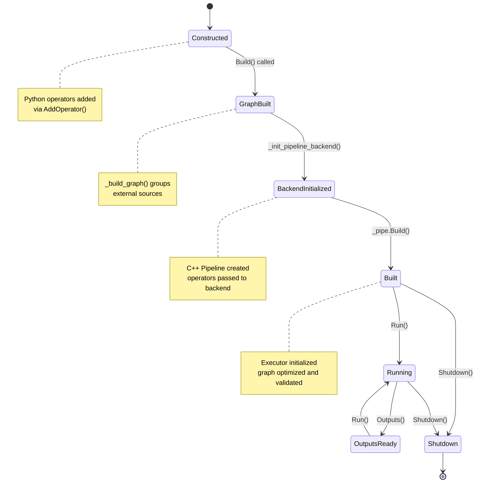

### Lifecycle Phases

**1. Construction Phase** ([dali/python/nvidia/dali/pipeline.py:263-457]()):
- Parameters validated and stored
- Seed generation
- State flags initialized: `_py_graph_built`, `_backend_prepared`, `_built`

**2. Graph Building Phase** ([dali/python/nvidia/dali/pipeline.py:1165-1253]()):
- Method: `_build_graph()`
- Discovers and groups external source operators
- Resolves external source callbacks
- Creates `_ExternalSourceGroup` for parallel execution
- Sets `_py_graph_built = True`

**3. Backend Preparation Phase** ([dali/python/nvidia/dali/pipeline.py:1261-1336]()):
- Method: `_init_pipeline_backend()`
- Creates C++ `Pipeline` object via backend_impl
- Transfers operator specs to C++ layer
- Initializes Python worker pool if needed
- Sets `_backend_prepared = True`

**4. Build Phase** ([dali/pipeline/pipeline.cc:539-687]()):
- C++ `Pipeline::Build()` called
- Graph validation and optimization
- Common subexpression elimination (CSE) if enabled
- MakeContiguous operator insertion
- Executor instantiation
- Sets `_built = True`

**5. Execution Phase** ([dali/python/nvidia/dali/pipeline.py:1433-1508]()):
- `Run()`: Triggers executor to process one iteration
- `Outputs()`: Retrieves results and releases previous buffers
- `ShareOutputs()`: Retrieves results without immediate release

### Build Process Details

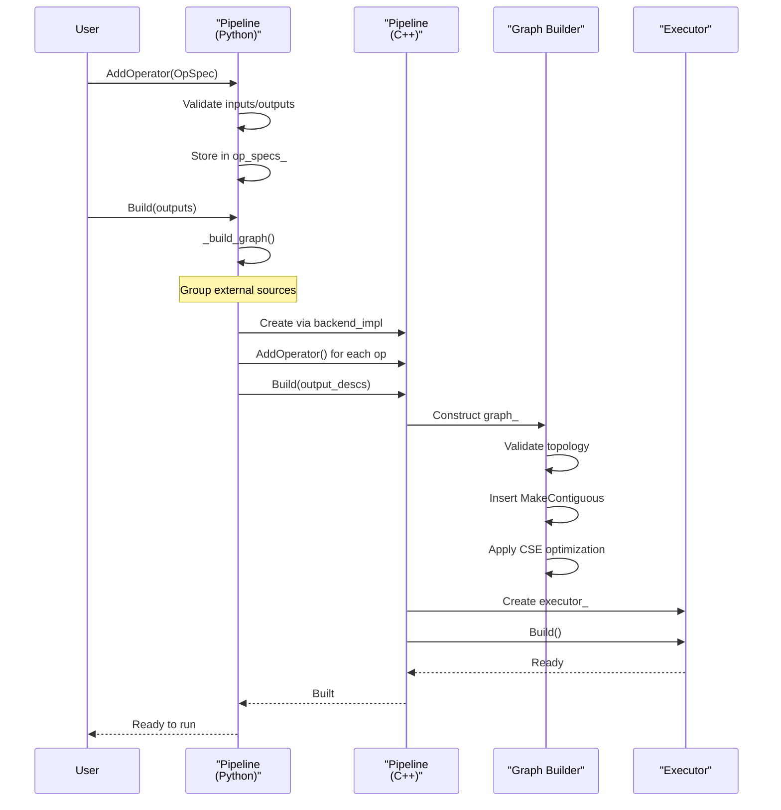

Sources: [dali/python/nvidia/dali/pipeline.py:1165-1336](), [dali/pipeline/pipeline.cc:539-687]()

---

## Execution Models

DALI supports multiple execution models controlled by the `executor_type` parameter:

### Executor Types

| Executor Type | Flags | Description |
|--------------|-------|-------------|
| **Simple** | None | Synchronous, no prefetching |
| **Pipelined** | `PIPELINED` | CPU and GPU stages overlap |
| **Async** | `PIPELINED \| ASYNC` | Asynchronous execution with respect to Python |
| **Separated** | `PIPELINED \| ASYNC \| SEPARATED` | Separate CPU and GPU queue depths |
| **Dynamic** | `PIPELINED \| ASYNC \| DYNAMIC` | Default mode with dynamic memory allocation |

### Execution Model Selection

**Python API** ([dali/python/nvidia/dali/pipeline.py:379-395]()):
```python
# Automatic dynamic executor selection
if exec_dynamic is None and exec_pipelined and exec_async and not self._exec_separated:
    self._exec_dynamic = exec_dynamic = True

self._executor_type = b._MakeExecutorType(
    self._exec_pipelined, self._exec_async, self._exec_separated, self._exec_dynamic
)
```

**C++ API** ([dali/pipeline/pipeline.cc:124-138]()):
```cpp
Pipeline(int max_batch_size, int num_threads, int device_id, int64_t seed,
         bool pipelined_execution, int prefetch_queue_depth,
         bool async_execution, bool dynamic_execution, ...)
: Pipeline(PipelineParams{...})
```

### Stream and Concurrency Policies

**StreamPolicy** ([dali/python/nvidia/dali/pipeline.py:60-76]()):
- `SINGLE`: All operators share one stream
- `PER_BACKEND`: Separate streams for CPU/Mixed/GPU
- `PER_OPERATOR`: Independent operators use distinct streams

**OperatorConcurrency** ([dali/python/nvidia/dali/pipeline.py:79-94]()):
- `NONE`: No concurrent operator execution
- `BACKEND`: Different backends run in parallel
- `FULL`: All independent operators run in parallel

### Queue Depth Configuration

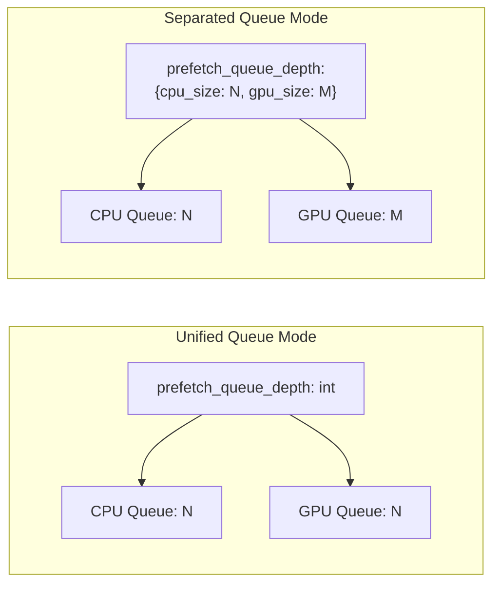

Sources: [dali/python/nvidia/dali/pipeline.py:60-94](), [dali/python/nvidia/dali/pipeline.py:360-384]()

---

## Graph Building and Validation

### Adding Operators

**Operator Addition Flow** ([dali/pipeline/pipeline.cc:337-481]()):

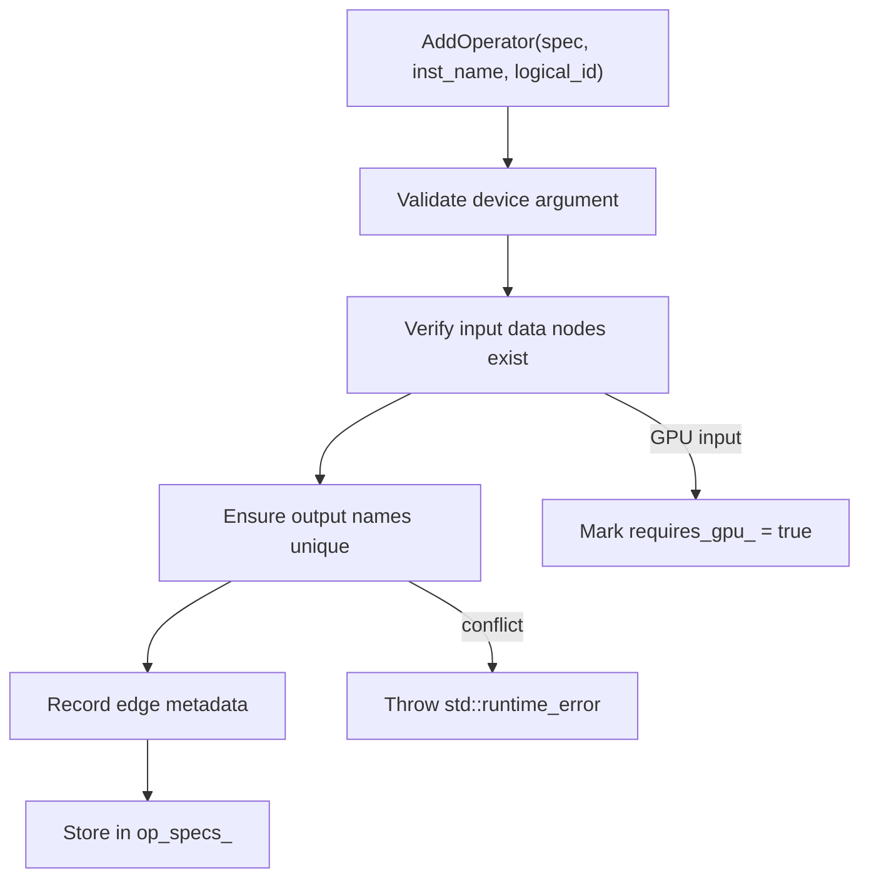

### Edge Management

The pipeline maintains an `edge_names_` map ([dali/pipeline/pipeline.h:501-506]()) tracking data flow:

```cpp
struct EdgeMeta {
  bool has_cpu;    // CPU version of this data exists
  bool has_gpu;    // GPU version exists  
  int cpu_idx;     // Index in CPU outputs (-1 if none)
  int gpu_idx;     // Index in GPU outputs (-1 if none)
};

std::unordered_map<std::string, EdgeMeta> edge_names_;
```

**Edge Creation** ([dali/pipeline/pipeline.cc:453-476]()):
- Each operator output creates an edge
- CPU operators produce CPU edges only
- Mixed/GPU operators produce GPU edges
- Cross-device copies trigger MakeContiguous insertion

### Graph Validation Rules

**Topology Constraints** ([dali/pipeline/pipeline.cc:404-451]()):

| Rule | Enforcement Location | Error Type |
|------|---------------------|------------|
| Input must exist | `AddOperatorImpl:404-416` | `std::runtime_error` |
| Output names unique | `AddOperatorImpl:458-462` | `std::runtime_error` |
| CPU ops produce CPU output only | `AddOperatorImpl:464-467` | `std::runtime_error` |
| Argument inputs must be CPU | `AddOperatorImpl:445-450` | `std::runtime_error` |

### Graph Optimization

**Common Subexpression Elimination (CSE)** ([dali/pipeline/pipeline.cc:110-120]()):
- Enabled by default via `DALI_ENABLE_CSE` environment variable
- Identifies and deduplicates identical operator subgraphs
- Preserves operator names with `preserve_name` argument
- ExternalSource operators never collapsed ([dali/pipeline/pipeline.cc:383]())

**MakeContiguous Insertion** ([dali/pipeline/pipeline.cc:633-669]()):
- Automatically inserted for non-contiguous outputs
- Required when CPU data moves to GPU
- Propagates memory hints from producers to contiguous ops

### Graph Structure Example

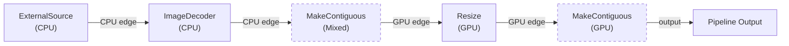

Sources: [dali/pipeline/pipeline.cc:337-481](), [dali/pipeline/pipeline.cc:633-669](), [dali/pipeline/pipeline.h:501-506]()

---

## Pipeline Parameters

### PipelineParams Structure

**Python Parameters** ([dali/python/nvidia/dali/pipeline.py:103-261]()):

| Parameter | Type | Default | Description |
|-----------|------|---------|-------------|
| `batch_size` | int | Required | Maximum batch size |
| `num_threads` | int | Required | CPU thread count |
| `device_id` | int | None | GPU device ID (None for CPU-only) |
| `seed` | int | None | Random seed (auto-generated if None) |
| `exec_pipelined` | bool | True | Enable pipelined execution |
| `exec_async` | bool | True | Enable asynchronous execution |
| `exec_dynamic` | bool | None | Enable dynamic executor (auto-selected) |
| `prefetch_queue_depth` | int or dict | 2 | Queue depth(s) for prefetching |
| `stream_policy` | StreamPolicy | None | Stream allocation policy |
| `concurrency` | OperatorConcurrency | None | Operator concurrency level |
| `enable_checkpointing` | bool | False | Enable checkpoint support |
| `py_num_workers` | int | 1 | Python worker pool size |
| `py_start_method` | str | "fork" | Worker process start method |

**C++ Parameters** ([dali/pipeline/pipeline_params.h](), [dali/pipeline/pipeline.cc:254-288]()):

```cpp
struct PipelineParams {
  std::optional<int> max_batch_size;
  std::optional<int> num_threads;
  std::optional<int> device_id;
  std::optional<int64_t> seed;
  std::optional<ExecutorType> executor_type;
  ExecutorFlags executor_flags = ExecutorFlags::None;
  std::optional<QueueSizes> prefetch_queue_depths;
  bool enable_checkpointing = false;
  bool enable_memory_stats = false;
  size_t bytes_per_sample_hint = 0;
};
```

### Parameter Validation

**Validation Logic** ([dali/pipeline/pipeline.cc:254-288]()):
- Batch size must be positive
- Device ID must be valid CUDA device
- Queue depths must be greater than 0
- Separated queues require different CPU/GPU depths or appropriate executor type

### Device ID Handling

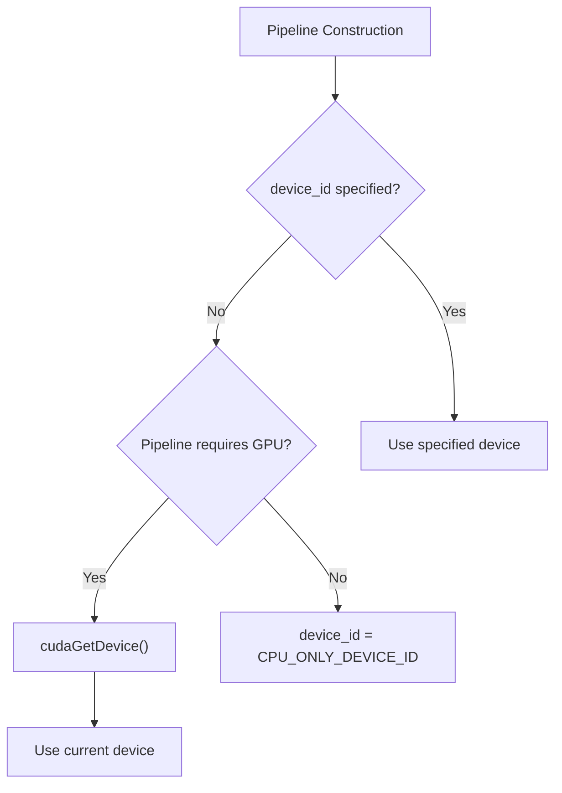

Sources: [dali/python/nvidia/dali/pipeline.py:103-261](), [dali/pipeline/pipeline.cc:254-308]()

---

## External Inputs

External inputs allow feeding data from outside sources into the pipeline.

### ExternalSource Mechanism

**Adding External Inputs** ([dali/pipeline/pipeline.h:118-131]()):

```cpp
int AddExternalInput(const string &name,
                     const string &device = "cpu",
                     DALIDataType dtype = DALI_NO_TYPE,
                     int ndim = -1,
                     const TensorLayout &layout = "")
```

This creates an `ExternalSource` operator internally.

### Setting External Input Data

**Python API** ([dali/pipeline/pipeline.h:202-210]()):

```cpp
template<typename Backend>
void SetExternalInput(const string &name, const TensorList<Backend> &tl,
                     AccessOrder order = {},
                     bool sync = false, bool use_copy_kernel = false,
                     InputOperatorCopyMode copy_mode = InputOperatorCopyMode::DEFAULT,
                     std::optional<std::string> data_id = std::nullopt)
```

**Key Parameters:**
- `sync`: Block until data copied to internal buffers
- `use_copy_kernel`: Use CUDA kernel instead of cudaMemcpyAsync
- `copy_mode`: Override ExternalSource's `no_copy` setting
- `data_id`: Optional identifier for data tracking

### Data Flow for External Inputs

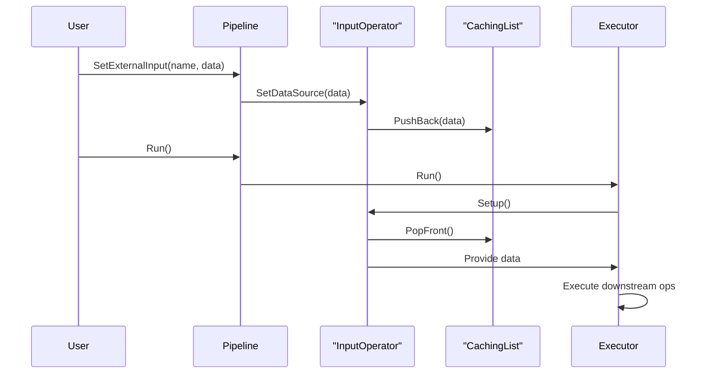

### Feed Input Count

**Input Feed Count Calculation** ([dali/python/nvidia/dali/pipeline.py:1509-1529]()):

The pipeline tracks how many times each input must be fed before execution:

```python
def InputFeedCount(self, input_name: str) -> int:
    """Returns number of times feed_input must be called."""
    self.build()
    return self._pipe.InputFeedCount(input_name)
```

This accounts for prefetch queue depth - inputs must be populated enough times to fill the queues.

### Batch Size Management

**Setting Batch Size** ([dali/c_api/c_api.cc:347-350]()):

```cpp
void daliSetExternalInputBatchSize(daliPipelineHandle *pipe_handle, 
                                   const char *name,
                                   int batch_size)
```

Allows variable batch sizes per iteration, must be ≤ `max_batch_size`.

Sources: [dali/pipeline/pipeline.h:118-210](), [dali/python/nvidia/dali/pipeline.py:1509-1529](), [dali/c_api/c_api.cc:119-210]()

---

## Serialization and Deserialization

### Pipeline Serialization

**Python Serialization** ([dali/python/nvidia/dali/pipeline.py:1536-1616]()):

```python
def serialize(self, **kwargs) -> bytes:
    """Serialize the pipeline to a protobuf string."""
```

**What Gets Serialized:**
- Pipeline parameters (batch_size, num_threads, device_id, etc.)
- All operator specifications (OpSpec objects)
- External input declarations
- Output descriptors (names, devices, dtypes, layouts)
- Logical ID groupings for synchronized operators
- Checkpointing state if enabled

### Deserialization

**C++ Deserialization** ([dali/pipeline/pipeline.cc:164-234]()):

```cpp
Pipeline::Pipeline(const string &serialized_pipe, const PipelineParams &params) {
  dali_proto::PipelineDef def;
  DeserializePipeline(serialized_pipe, def);
  
  // Extract serialized parameters
  params_.max_batch_size = def.batch_size();
  params_.num_threads = def.num_threads();
  // ... more parameters
  
  // Override with provided params
  params_.Update(params);
  
  // Reconstruct operators
  for (auto& op_def : def.op()) {
    OpSpec spec;
    DeserializeOpSpec(op_def, &spec);
    AddOperator(spec, op_def.inst_name(), op_def.logical_id());
  }
}
```

### Serialization Format

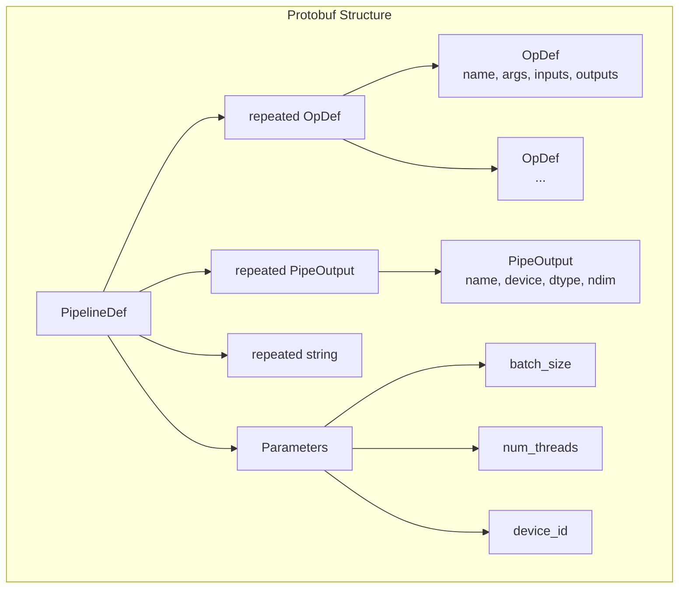

### Use Cases

| Use Case | Description | API |
|----------|-------------|-----|
| **Save/Load** | Persist pipeline definition | `serialize()` / `deserialize_and_build()` |
| **Distribution** | Send to TensorFlow plugin | C API serialization |
| **Reproduction** | Exact pipeline recreation | Includes seed and parameters |

Sources: [dali/python/nvidia/dali/pipeline.py:1536-1616](), [dali/pipeline/pipeline.cc:164-234]()

---

## Checkpointing

Checkpointing allows saving and restoring pipeline execution state.

### Checkpoint Structure

**Components** ([dali/pipeline/operator/checkpointing/checkpoint.h]()):
- Operator states (reader positions, RNG states)
- Executor metadata
- External context data (custom Python state)

### Checkpoint Operations

**Creating Checkpoints** ([dali/python/nvidia/dali/pipeline.py:1753-1771]()):

```python
def checkpoint(self) -> bytes:
    """Returns serialized checkpoint."""
    self.build()
    return self._pipe.GetSerializedCheckpoint(self._external_ctx_cpt)
```

**Restoring from Checkpoint** ([dali/python/nvidia/dali/pipeline.py:1773-1795]()):

```python
def restore_from_checkpoint(self, checkpoint: bytes):
    """Restores pipeline state."""
    self._checkpoint = checkpoint
    # Applied during build phase
```

### Checkpoint Lifecycle

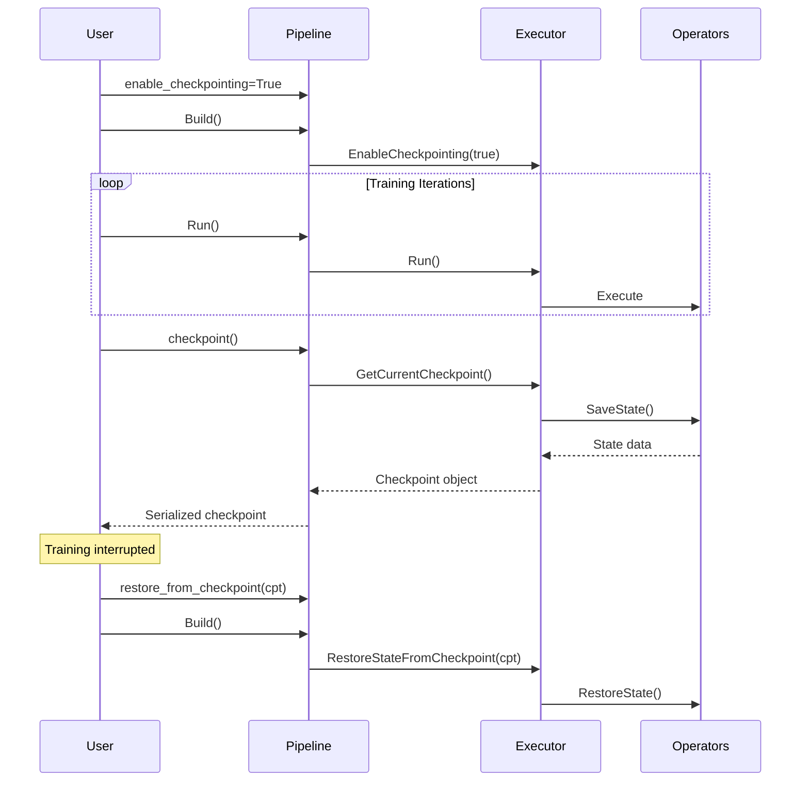

Sources: [dali/python/nvidia/dali/pipeline.py:1753-1795](), [dali/pipeline/pipeline.h:292-369]()

---

## Integration with Executors

The Pipeline creates and manages the Executor but delegates actual execution to it.

### Executor Creation

**Executor Factory** ([dali/pipeline/pipeline.cc:688-745]()):

```cpp
void Pipeline::Build(std::vector<PipelineOutputDesc> output_descs) {
  // ... graph building and validation ...
  
  // Create appropriate executor based on type
  executor_ = GetExecutor(params_.executor_type.value_or(ExecutorType::Dynamic),
                         *params_.max_batch_size,
                         *params_.num_threads,
                         device_id,
                         bytes_per_sample_hint,
                         params_.enable_memory_stats,
                         params_.prefetch_queue_depths->cpu_size,
                         params_.prefetch_queue_depths->gpu_size);
  
  executor_->Init();
  executor_->Build(&graph_, output_descs);
}
```

### Pipeline-Executor Interface

| Operation | Pipeline Method | Executor Method |
|-----------|----------------|-----------------|
| **Execute iteration** | `Run()` | `RunCPU()`, `RunMixed()`, `RunGPU()` |
| **Get outputs** | `Outputs()` | `Outputs()` |
| **Share outputs** | `ShareOutputs()` | `ShareOutputs()` |
| **Release outputs** | `ReleaseOutputs()` | `ReleaseOutputs()` |
| **Get metadata** | `GetExecutorMeta()` | `GetExecutorMeta()` |
| **Shutdown** | `Shutdown()` | `Shutdown()` |

### Run Cycle

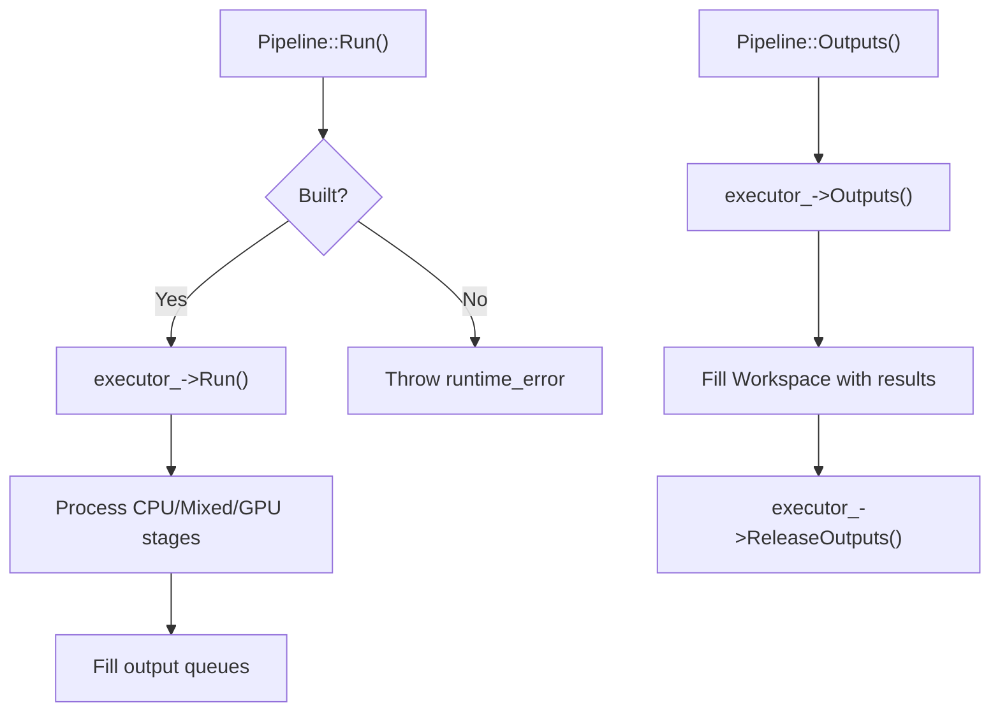

Sources: [dali/pipeline/pipeline.cc:688-745](), [dali/pipeline/pipeline.cc:831-847]()

---

## C API Layer

The C API provides language-agnostic access to pipeline functionality.

### C API Structure

**Handle Type** ([include/dali/c_api.h:34]()):

```cpp
typedef struct DALIPipeline *daliPipelineHandle;
```

**Internal Wrapper** ([dali/c_api/c_api.cc:73-79]()):

```cpp
struct DALIPipeline {
  std::unique_ptr<dali::Pipeline> pipeline;
  dali::Workspace workspace;
  batch_size_map_t batch_size_map;
  data_id_map_t data_id_map;
  dali::CUDAStreamLease copy_stream;
};
```

### Key C API Functions

| Function | Purpose |
|----------|---------|
| `daliCreatePipeline3()` | Create from serialized pipeline |
| `daliSetExternalInput()` | Feed external data |
| `daliRun()` | Execute one iteration |
| `daliOutput()` | Get outputs |
| `daliOutputCopy()` | Copy outputs to external buffer |
| `daliDeletePipeline()` | Cleanup and destroy |

### C API Usage Pattern

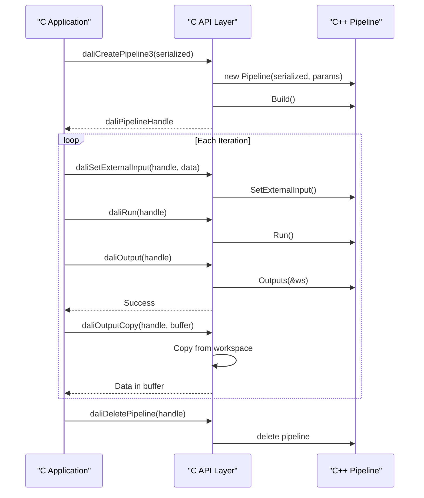

### TensorFlow Integration via C API

The TensorFlow plugin uses C API for pipeline execution:
- Pipeline serialized in Python
- Deserialized in TensorFlow C++ plugin
- Executed via C API calls
- Outputs integrated into TensorFlow dataset

Sources: [include/dali/c_api.h:1-270](), [dali/c_api/c_api.cc:73-362]()

---

## Key Classes and Methods Reference

### Python Pipeline Class

**Location:** [dali/python/nvidia/dali/pipeline.py:97-1568]()

| Method | Purpose |
|--------|---------|
| `__init__()` | Initialize pipeline with parameters |
| `add_operator()` | Register operator in graph |
| `set_outputs()` | Specify pipeline outputs |
| `build()` | Construct and validate graph |
| `run()` | Execute one iteration |
| `outputs()` | Retrieve and release results |
| `share_outputs()` | Retrieve without release |
| `feed_input()` | Provide external source data |
| `serialize()` | Convert to protobuf |
| `deserialize_and_build()` | Reconstruct from protobuf |

### C++ Pipeline Class

**Location:** [dali/pipeline/pipeline.h:62-582](), [dali/pipeline/pipeline.cc:124-849]()

| Method | Purpose |
|--------|---------|
| `Pipeline(params)` | Construct with parameters |
| `Pipeline(serialized, params)` | Deserialize pipeline |
| `AddOperator()` | Add operator to graph |
| `AddExternalInput()` | Create external source |
| `SetExternalInput()` | Feed data to external source |
| `Build()` | Build and optimize graph |
| `Run()` | Execute via executor |
| `Outputs()` | Get results in workspace |
| `SerializeToProtobuf()` | Serialize to string |
| `GetExecutorMeta()` | Get execution statistics |

### Important Helper Functions

**Graph Building** ([dali/pipeline/pipeline.cc:525-537]()):
- `PropagateMemoryHint()`: Pass memory hints through graph
- `SetMemoryHint()`: Configure operator memory allocation
- `NewEdge()`: Create edge metadata for data flow

**Validation** ([dali/pipeline/pipeline.cc:254-288]()):
- `Pipeline::Validate()`: Check parameter consistency
- `AddOperatorImpl()`: Validate operator constraints

**Optimization** ([dali/pipeline/pipeline.cc:100-120]()):
- `IsCSEEnabled()`: Check if CSE optimization active
- `IsGraphOptimizationEnabled()`: Check optimization status

Sources: [dali/python/nvidia/dali/pipeline.py:97-1568](), [dali/pipeline/pipeline.h:62-582](), [dali/pipeline/pipeline.cc:124-849]()

---

